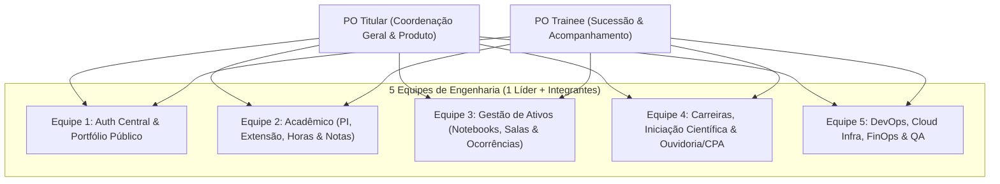

# 🎓 Plataforma Integrada de Extensão, Acadêmico & Gestão Institucional

Plataforma unificada para gestão de Projetos Integradores, Extensão Universitária, Iniciação Científica, Recursos Patrimoniais, Carreira e Canais de Comunicação Institucional (CPA/Ouvidoria).

---

## Visão Geral do Projeto

O objetivo deste projeto é fornecer uma solução integrada, escalável e moderna para a comunidade acadêmica (alunos, professores, coordenação, CPA e comunidade externa), englobando desde a gestão curricular e pedagógica até o controle patrimonial e transparência pública.

---

## Módulos do Sistema

### 1. Autenticação & Autorização Central (SSO)
* Central unificada de autenticação para todos os módulos.
* Gestão de perfis e níveis de acesso (Aluno, Docente, Coordenação, CPA, Administrador).
* Sessões seguras e Single Sign-On (JWT / OAuth2).

### 2. Projetos Integradores & Extensão
* **Captação de Projetos:** Submissão e validação de propostas de projetos integradores e de extensão (incluindo modelos híbridos).
* **Gestão de Equipes/Alunos:** Alocação de estudantes em projetos com acompanhamento de status.
* **Avaliação Docente:** Módulo para avaliação de desempenho e entregas por professores avaliadores.
* **Cálculo de Horas:** Apuração e controle automatizado de horas de extensão para cumprimento curricular.
* **Cálculo de Notas:** Consolidação e lançamento automatizado de notas para Projetos Integradores.

### 3. Portal Público (Vitrine de Ações)
* Website público responsivo com catálogo de projetos de extensão e integradores desenvolvidos.
* Divulgação dos impactos das ações na comunidade e prestação de contas social.

### 4. Carreira & Oportunidades
* Banco de currículos dos alunos.
* Módulo para candidatura a vagas de estágio, trainee e indicações institucionais.

### 5. Iniciação Científica e Tecnológica (IC & IT)
* Gestão de editais, submissões de planos de trabalho e acompanhamento de projetos de IC & IT.

### 6. Gestão de Recursos & Patrimônio
* **Controle de Notebooks:** Sistema de check-in / check-out e rastreamento de empréstimo de computadores portáteis.
* **Uso de Salas Fora do Horário:** Agendamento, autorização e registro de uso de laboratórios e salas fora do expediente normal.
* **Controle de Ocorrências e Avarias:** Registro e acompanhamento de incidentes com patrimônio físico (notebooks, carteiras, ar-condicionado, projetores, etc.).

### 7. Canais de Comunicação & Avaliação
* **Canal CPA (Comissão Própria de Avaliação):** 
  * Formulário de avaliação institucional periódica.
  * Módulo dedicado para avaliação textual da cantina e serviços administrativos/atendimento.
* **Relatos com Docente:** Canal por escrito para alinhamentos, dúvidas ou relatos pontuais diretamente com o professor.
* **Relatos com a Coordenação:** Canal formal e confidencial por escrito com a coordenação de curso.

---

## 👥 Estrutura Organizacional da Equipe

O projeto conta com **25 desenvolvedores** distribuídos estrategicamente em **5 frentes de trabalho** sob a liderança de **2 Product Owners (POs)**.

### 📋 Atribuição das Equipes

| Equipe | Domínio / Módulos | Foco Técnico |
| :--- | :--- | :--- |
| **Equipe 1** | Auth Central (SSO) & Portal Público | Autenticação, IAM, Landing Page, SEO, Catálogo Público |
| **Equipe 2** | Projetos Integradores, Extensão, Horas & Notas | Regras de negócio acadêmicas, cálculos e dashboards |
| **Equipe 3** | Notebooks, Agendamento de Salas & Ocorrências Patrimoniais | Fluxos de empréstimo/reserva, controle de inventário, QR Code |
| **Equipe 4** | Banco de Currículos, Iniciação Científica & CPA/Relatos | Formulários dinâmicos, visualizador de currículos, ouvidoria segura |
| **Equipe 5** | Infraestrutura Cloud, CI/CD, FinOps, Testes & QA | Terraform/IaC, Pipelines, Docker, Monitoramento, Custos de Nuvem e E2E |

---

## ☁️ Arquitetura de Nuvem & Engenharia

* **Provedor Cloud Principal:** AWS *(com arquitetura desacoplada via Docker e IaC para benchmark/migração posterior no Google Cloud Platform - GCP)*.
* **Infraestrutura como Código (IaC):** Terraform para provisionamento reproduzível.
* **FinOps:** Gestão contínua de custos com alertas de orçamento e uso inteligente de tiers gratuitos/educacionais.
* **Qualidade & CI/CD:**
  * Git Flow com branches protegidas e Pull Requests obrigatórios com revisão.
  * Pipelines automatizados com linting, testes unitários, testes de integração e análise estática.

---

## 🚀 Próximos Passos
1. Conclusão do mapeamento de perfis dos alunos via pesquisa de alocação.
2. Definição da stack tecnológica com os POs e líderes de equipe.
3. Configuração do repositório base e esteira de CI/CD inicial.
