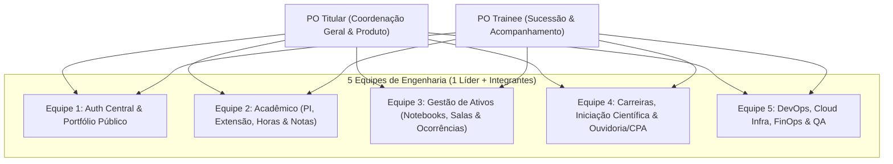
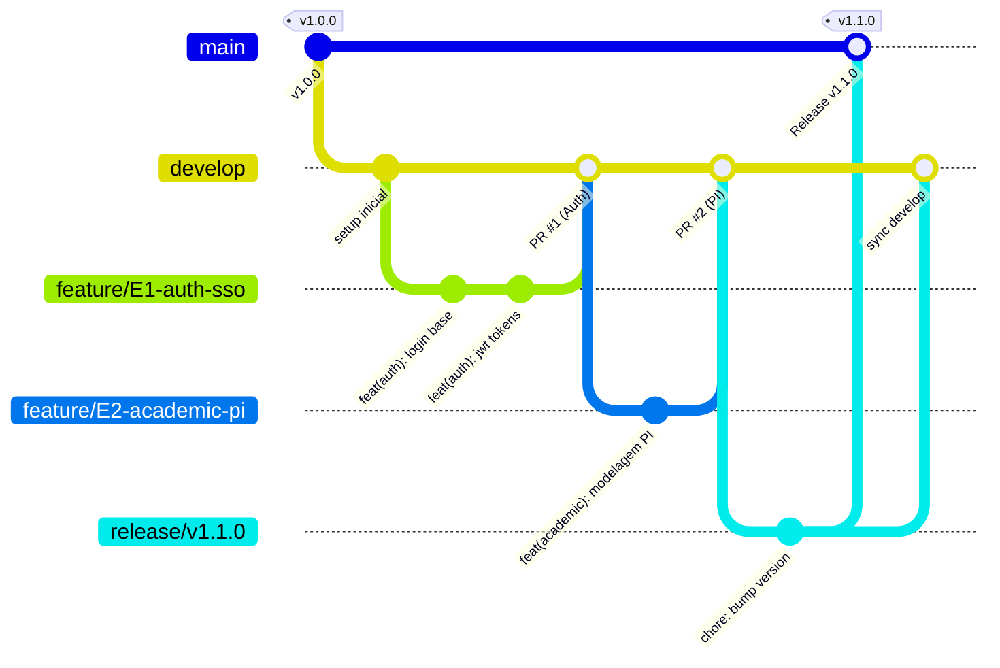
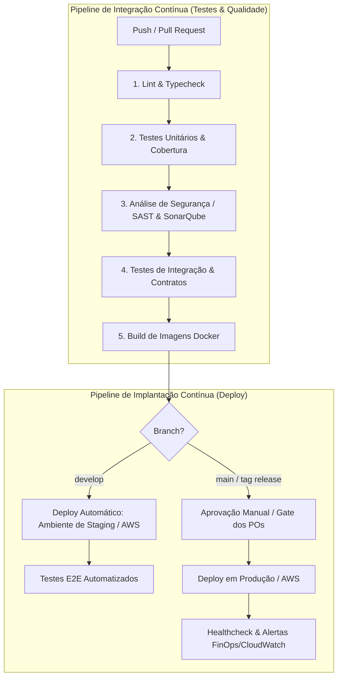

# 🎓 Plataforma Integrada de Extensão, Acadêmico & Gestão Institucional

Plataforma unificada para gestão de Projetos Integradores, Extensão Universitária, Iniciação Científica, Recursos Patrimoniais, Carreira e Canais de Comunicação Institucional (CPA/Ouvidoria).

---

## Visão Geral do Projeto

O objetivo deste projeto é fornecer uma solução integrada, escalável e moderna para a comunidade acadêmica (alunos, professores, coordenação, CPA e comunidade externa), englobando desde a gestão curricular e pedagógica até o controle patrimonial e transparência pública.

---

## Módulos do Sistema

### 1. Autenticação & Autorização Central (SSO)
* Central unificada de autenticação para todos os módulos.
* Gestão de perfis e níveis de acesso (Aluno, Docente, Coordenação, CPA, Administrador).
* Sessões seguras e Single Sign-On (JWT / OAuth2).

### 2. Projetos Integradores & Extensão
* **Captação de Projetos:** Submissão e validação de propostas de projetos integradores e de extensão (incluindo modelos híbridos).
* **Gestão de Equipes/Alunos:** Alocação de estudantes em projetos com acompanhamento de status.
* **Avaliação Docente:** Módulo para avaliação de desempenho e entregas por professores avaliadores.
* **Cálculo de Horas:** Apuração e controle automatizado de horas de extensão para cumprimento curricular.
* **Cálculo de Notas:** Consolidação e lançamento automatizado de notas para Projetos Integradores.

### 3. Portal Público (Vitrine de Ações)
* Website público responsivo com catálogo de projetos de extensão e integradores desenvolvidos.
* Divulgação dos impactos das ações na comunidade e prestação de contas social.

### 4. Carreira & Oportunidades
* Banco de currículos dos alunos.
* Módulo para candidatura a vagas de estágio, trainee e indicações institucionais.

### 5. Iniciação Científica e Tecnológica (IC & IT)
* Gestão de editais, submissões de planos de trabalho e acompanhamento de projetos de IC & IT.

### 6. Gestão de Recursos & Patrimônio
* **Controle de Notebooks:** Sistema de check-in / check-out e rastreamento de empréstimo de computadores portáteis.
* **Uso de Salas Fora do Horário:** Agendamento, autorização e registro de uso de laboratórios e salas fora do expediente normal.
* **Controle de Ocorrências e Avarias:** Registro e acompanhamento de incidentes com patrimônio físico (notebooks, carteiras, ar-condicionado, projetores, etc.).

### 7. Canais de Comunicação & Avaliação
* **Canal CPA (Comissão Própria de Avaliação):** 
  * Formulário de avaliação institucional periódica.
  * Módulo dedicado para avaliação textual da cantina e serviços administrativos/atendimento.
* **Relatos com Docente:** Canal por escrito para alinhamentos, dúvidas ou relatos pontuais diretamente com o professor.
* **Relatos com a Coordenação:** Canal formal e confidencial por escrito com a coordenação de curso.

---

## 👥 Estrutura Organizacional da Equipe

O projeto conta com **25 desenvolvedores** distribuídos estrategicamente em **5 frentes de trabalho** sob a liderança de **2 Product Owners (POs)**.



### 📋 Atribuição das Equipes

| Equipe | Domínio / Módulos | Foco Técnico |
| :--- | :--- | :--- |
| **Equipe 1** | Auth Central (SSO) & Portal Público | Autenticação, IAM, Landing Page, SEO, Catálogo Público |
| **Equipe 2** | Projetos Integradores, Extensão, Horas & Notas | Regras de negócio acadêmicas, cálculos e dashboards |
| **Equipe 3** | Notebooks, Agendamento de Salas & Ocorrências Patrimoniais | Fluxos de empréstimo/reserva, controle de inventário, QR Code |
| **Equipe 4** | Banco de Currículos, Iniciação Científica & CPA/Relatos | Formulários dinâmicos, visualizador de currículos, ouvidoria segura |
| **Equipe 5** | Infraestrutura Cloud, CI/CD, FinOps, Testes & QA | Terraform/IaC, Pipelines, Docker, Monitoramento, Custos de Nuvem e E2E |

---

## ☁️ Arquitetura de Nuvem, Engenharia & Monorepo

### 📦 Estrutura de Monorepositório
O projeto adota uma arquitetura de **Monorepositório**, centralizando todos os serviços, frontends, pacotes compartilhados e scripts de infraestrutura em um único repositório, garantindo consistência, facilidade de versionamento e compartilhamento de contratos/tipos entre equipes:

```text
plataforma/
├── apps/
│   ├── web-portal/         # Portal Público e Vitrine (Equipe 1)
│   ├── web-admin/          # Painel Administrativo e Acadêmico (Equipes 1, 2, 3, 4)
│   ├── api-gateway/        # Gateway / Proxy Central (Equipe 1 / 5)
│   └── services/
│       ├── auth/           # SSO / Autenticação Central (Equipe 1)
│       ├── academic/       # Projetos Integradores & Extensão (Equipe 2)
│       ├── assets/         # Gestão de Notebooks, Salas e Ocorrências (Equipe 3)
│       └── institutional/  # Carreiras, IC & CPA/Relatos (Equipe 4)
├── packages/
│   ├── ui/                 # Componentes visuais compartilhados (Design System)
│   ├── config/             # Configurações globais (ESLint, Prettier, TypeScript)
│   └── shared-types/       # DTOs, interfaces e contratos de dados
└── infra/
    ├── terraform/          # IaC para AWS e GCP (Equipe 5)
    ├── docker/             # Dockerfiles e Docker Compose local (Equipe 5)
    └── k8s/                # Manifestos de orquestração (se aplicável)
```

---

## 🌿 Estratégia de Versionamento: GitFlow

Para organizar o trabalho simultâneo das 5 equipes e dos 25 desenvolvedores, o repositório seguirá rigorosamente o modelo **GitFlow**:



### 📌 Padrão de Branches:
* **`main`**: Código em produção (estável, auditado e tagueado com SemVer: `v1.0.0`).
* **`develop`**: Branch de integração contínua (ambiente de Staging / homologação).
* **`feature/<equipe>-<nome-da-funcionalidade>`**:
  * Exemplo: `feature/E1-auth-sso`, `feature/E3-notebook-checkout`.
  * Aberta a partir da `develop` e mesclada de volta via Pull Request.
* **`release/vX.Y.Z`**: Preparação de versão para deploy com testes finais.
* **`hotfix/<descricao>`**: Correções críticas diretas a partir da `main`.

### 🛡️ Regras de Proteção & Pull Requests:
1. Ninguém realiza `push` direto na `main` ou `develop`.
2. Todo Pull Request requer aprovação de pelo menos **1 Líder Técnico** ou **PO**.
3. O pipeline de CI (lint, build e testes) deve passar com 100% de sucesso antes do merge.
4. Padrão de commits: **Conventional Commits** (`feat:`, `fix:`, `docs:`, `refactor:`, `test:`, `chore:`).

---

## 🔄 Esteiras de CI/CD (Pipelines de Testes & Implantação)

O monorepositório contará com pipelines automatizados via **GitHub Actions** (ou GitLab CI), divididos em estágios de validação contínua (CI) e entrega/implantação contínua (CD):



### 🧪 1. Pipeline de Testes (CI)
* **Linting & Formatação:** Validação de padrões de código (ESLint, Prettier, Black/Flake8, etc.).
* **Testes Unitários:** Execução isolada de regras de negócio com meta de cobertura mínima (> 70%).
* **Análise de Segurança & Qualidade (SAST):** Varredura de vulnerabilidades em dependências (Trivy / Snyk / Dependabot) e qualidade de código (SonarCloud).
* **Testes de Integração:** Validação de rotas de API com banco de dados em container temporário.
* **Testes E2E (Ponta a Ponta):** Automação de fluxos críticos no frontend integrado ao backend (Playwright / Cypress).

### 🚀 2. Pipeline de Implantação (CD)
* **Ambiente de Desenvolvimento/Staging:**
  * Disparado automaticamente a cada merge na branch `develop`.
  * Publicação de containers no **AWS ECR** (Elastic Container Registry) e atualização no **AWS ECS / App Runner**.
* **Ambiente de Produção:**
  * Disparado a partir de tags de versão da branch `main` (`vX.Y.Z`).
  * Requer aprovação manual (gate de governança) dos **POs / Professor**.
  * Estratégia de deploy com zero downtime (Rolling Update / Blue-Green) e rollback automatizado em caso de falha de healthcheck.

---

## ☁️ Arquitetura de Nuvem & FinOps

* **Provedor Cloud Principal:** AWS *(com arquitetura desacoplada via Docker e IaC para benchmark/migração posterior no Google Cloud Platform - GCP)*.
* **Infraestrutura como Código (IaC):** Terraform para provisionamento reproduzível dos ambientes de Staging e Produção.
* **FinOps & Observabilidade:**
  * Alertas de limites de faturamento (AWS Budgets / CloudWatch Alarms).
  * Uso otimizado de recursos com auto-stop de ambientes de homologação fora do horário acadêmico para redução de custos.

---

## 🚀 Próximos Passos
1. Conclusão do mapeamento de perfis dos alunos via pesquisa de alocação.
2. Definição da stack tecnológica com os POs e líderes de equipe.
3. Configuração do monorepositório base e esteiras de CI/CD iniciais.


