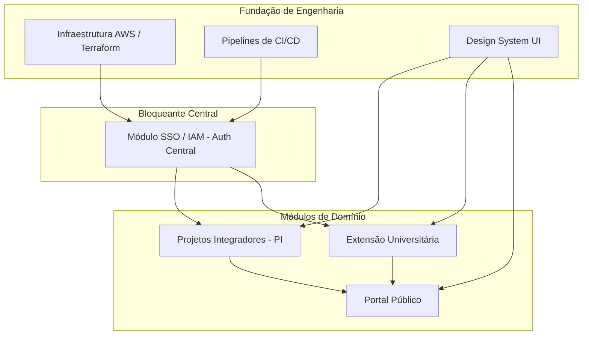

# 🔗 Mapeamento de Dependências & Desacoplamento

Este documento mapeia as dependências críticas entre frentes técnicas, squads e módulos, além de definir os padrões de desacoplamento para evitar bloqueios no fluxo de desenvolvimento.

---

## 1. Grafo de Dependências Críticas

---

## 2. Tabela de Dependências e Impactos

| Dependência | Depende de | Impacto se Atrasar | Estratégia de Desacoplamento |
| :--- | :--- | :--- | :--- |
| **Frontend WebApps** | Contratos de API Backend | Telas não conseguem consumir dados reais. | Publicação antecipada de tipos TypeScript no pacote `packages/shared-types` e uso de Mock Service Worker (MSW) no frontend. |
| **Módulos PI e Extensão** | Módulo SSO / IAM | Usuários não conseguem se autenticar nem obter claims RBAC. | Uso de middleware mock de autenticação local injetando headers estáticos (`x-mock-user-id`, `x-mock-role`) nos testes unitários e de integração. |
| **Deploy em Staging** | Terraform & AWS ECR | Ausência de ambiente centralizado de testes integrados. | Execução de todo o ecossistema localmente via `docker-compose.yml` e testes de API com Testcontainers. |
| **Portal Público Vitrine** | Schemas de PI e Extensão | Catálogo público sem projetos cadastrados. | Criação de seeds de banco de dados (`prisma/seed.ts`) com dados fictícios estruturados desde a Sprint 1. |

---

## 3. Documentos Relacionados
* [Backlog Geral](backlog.md)
* [Estrutura do Monorepo](../04-development/repository-structure.md)
* [Matriz de Riscos](risks.md)
