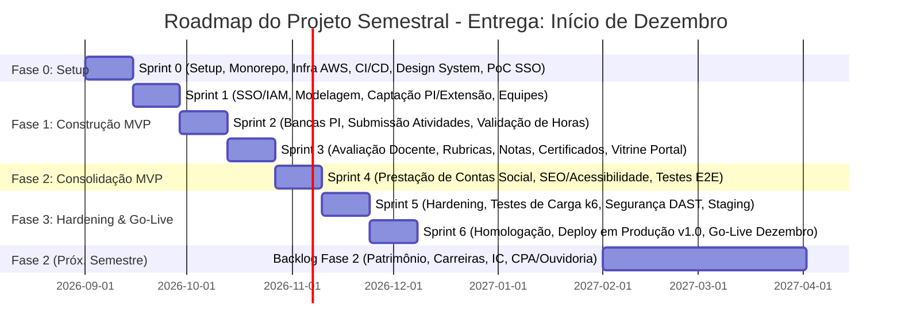

# 📅 Roadmap Semestral (Entrega: Início de Dezembro / 2026.2)

O roadmap semestral foi reestruturado para concentrar **100% da capacidade técnica dos 25 integrantes no Escopo Obrigatório do MVP**, garantindo a entrega da **Release v1.0 estável e em produção no início de dezembro**. Todos os demais módulos institucionais foram formalmente movidos para a **Fase 2 (Próximo Semestre)**.

---

## 1. Detalhamento das Fases do Semestre Atual (Escopo Obrigatório — Dezembro)

### Fase 0: Setup de Engenharia & Fundação (Semanas 1 e 2 — Sprint 0)
* **Objetivo:** Estabelecer a fundação técnica, pipeline de CI/CD operando, monorepo estruturado e PoC de autenticação funcional.
* **Escopo:** Turborepo, pnpm workspaces, Terraform base na AWS (VPC, ECS, RDS), Docker local e Design System base.

### Fase 1: Construção dos Domínios Core do MVP (Semanas 3 a 8 — Sprints 1 a 3)
* **Sprint 1 (Fundação de Identidade & Captação):** Módulo `auth` completo (JWT RS256, sessões, RBAC), captação de propostas de PI e inscrição em editais de extensão.
* **Sprint 2 (Equipes, Bancas & Horas):** Gestão de equipes/alunos, agendamento de bancas examinadoras de PI, submissão de relatórios de atividades e fluxo de validação de horas pelo orientador.
* **Sprint 3 (Avaliação, Notas, Certificação & Vitrine):** Avaliação docente por rubricas, cálculo automatizado de notas e médias de PI, emissão de certificados com hash SHA-256 e catálogo público de projetos.

### Fase 2: Consolidação, Prestação de Contas & Qualidade (Semanas 9 e 10 — Sprint 4)
* **Sprint 4 (Prestação de Contas Social & Integração):** Módulo de divulgação de impacto social comunitário e prestação de contas no portal público, refinamento de SEO/acessibilidade e testes integrados ponta a ponta.

### Fase 3: Hardening, Homologação & Go-Live (Semanas 11 a 14 — Sprints 5 e 6)
* **Sprint 5 (Hardening & Performance):** Testes de carga com k6 (200 RPS), auditoria de segurança estática/dinâmica (Trivy/OWASP ZAP) e estabilização em Staging.
* **Sprint 6 (Go-Live & Encerramento do Semestre):** Homologação formal com coordenação/docentes, **deploy em produção da Release v1.0 (Início de Dezembro)** e documentação de transição.

---

## 2. Fase 2 — Planejamento do Próximo Semestre (Backlog Futuro)
* **Módulos Programados para o Próximo Semestre (2027.1):**
  1. Gestão Patrimonial (Notebooks com QR Code, agendamento de salas e ocorrências de avarias).
  2. Carreira & Oportunidades (Banco de currículos, vagas de estágio/trainee e candidaturas).
  3. Iniciação Científica & Tecnológica (Editais de pesquisa, planos de trabalho e relatórios).
  4. CPA & Ouvidoria (Avaliação institucional periódica, avaliação da cantina e relatos confidenciais).

---

## 3. Documentos Relacionados
* [Delimitação do MVP](../01-product/mvp.md)
* [Plano de Releases](release-plan.md)
* [Planejamento de Sprints](sprint-plan.md)
* [Backlog Geral](backlog.md)
