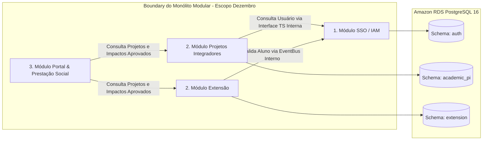

# 💻 Arquitetura de Aplicação & Componentes Internos

Detalhamento da estrutura de componentes da aplicação backend, frontend e bibliotecas compartilhadas para o **Escopo Obrigatório — Dezembro (MVP)**.

---

## 1. Estrutura Interna do Backend Modular Monolith

O backend (`apps/api-server`) concentra exclusivamente os domínios do MVP de Dezembro em módulos fortemente isolados sob princípios de Domain-Driven Design (DDD):

```
apps/api-server/src/
├── modules/
│   ├── auth/                     # 1. SSO, IAM, RBAC, Gestão de Sessões, JWT e Auditoria
│   │   ├── controllers/          # Handlers HTTP REST (/api/v1/auth)
│   │   ├── services/             # Lógica de emissão de tokens, hash e sessões
│   │   ├── dto/                  # Validação de payload via Zod/Class-Validator
│   │   └── entities/             # Mapeamento do Schema PostgreSQL 'auth'
│   │
│   ├── academic-pi/              # 2. Projetos Integradores (Captação, Equipes, Bancas, Rubricas, Notas)
│   │   ├── controllers/          # Endpoints (/api/v1/academic/projects, /evaluations)
│   │   ├── services/             # Consolidação de notas, regras de banca e membros
│   │   └── dto/
│   │
│   ├── extension/                # 2. Extensão Universitária (Editais, Atividades, Horas, Certificados)
│   │   ├── controllers/          # Endpoints (/api/v1/extension/activities, /certificates)
│   │   ├── services/             # Apuração de horas curriculares, emissão de PDF com hash
│   │   └── dto/
│   │
│   └── portal/                   # 3. Portal Público (Vitrine, Impacto Comunitário, Prestação Social)
│       ├── controllers/          # Endpoints públicos (/api/v1/public/projects, /metrics)
│       └── services/             # Agregação de dados de impacto e busca facetada
│
└── shared/                       # Componentes transversais reutilizáveis
    ├── guards/                   # AuthGuard (JWT RS256) e RolesGuard (RBAC 5 roles)
    ├── interceptors/             # LoggingInterceptor (Pino JSON) e TransformInterceptor
    ├── filters/                  # GlobalExceptionFilter (Sanitização de erros)
    └── database/                 # Prisma Service / Pool de conexões PostgreSQL
```

---

## 2. Comunicação Intermodular em Memória

Para manter o desacoplamento e latência zero:
1. Cada módulo expõe uma **Interface de Serviço TypeScript** estritamente tipada.
2. Quando o módulo `academic-pi` precisa validar a existência de um aluno, ele invoca a interface do módulo `auth` via injeção de dependência local.
3. Eventos assíncronos dentro do mesmo processo (ex: recálculo de horas ou geração de logs de auditoria) utilizam um **EventBus em memória** (`EventEmitter2`).



---

## 3. Frontend Architecture (Next.js 14 App Router)
* **`apps/web-admin` (Painel Acadêmico/Admin):** SPA protegida por rotas autenticadas, com gerenciamento de estado global via Zustand e formulários dinâmicos com React Hook Form + Zod.
* **`apps/web-portal` (Vitrine Pública & Prestação Social):** Portal público otimizado com Server-Side Rendering (SSR) e Static Site Generation (SSG) com ISR para garantir pontuação $\ge 90$ no Google Lighthouse.

---

## 4. Documentos Relacionados
* [Arquitetura de Dados](data-architecture.md)
* [Estrutura do Monorepo](../04-development/repository-structure.md)
* [Diretrizes de API](../04-development/api-guidelines.md)
* [Delimitação do MVP](../01-product/mvp.md)
