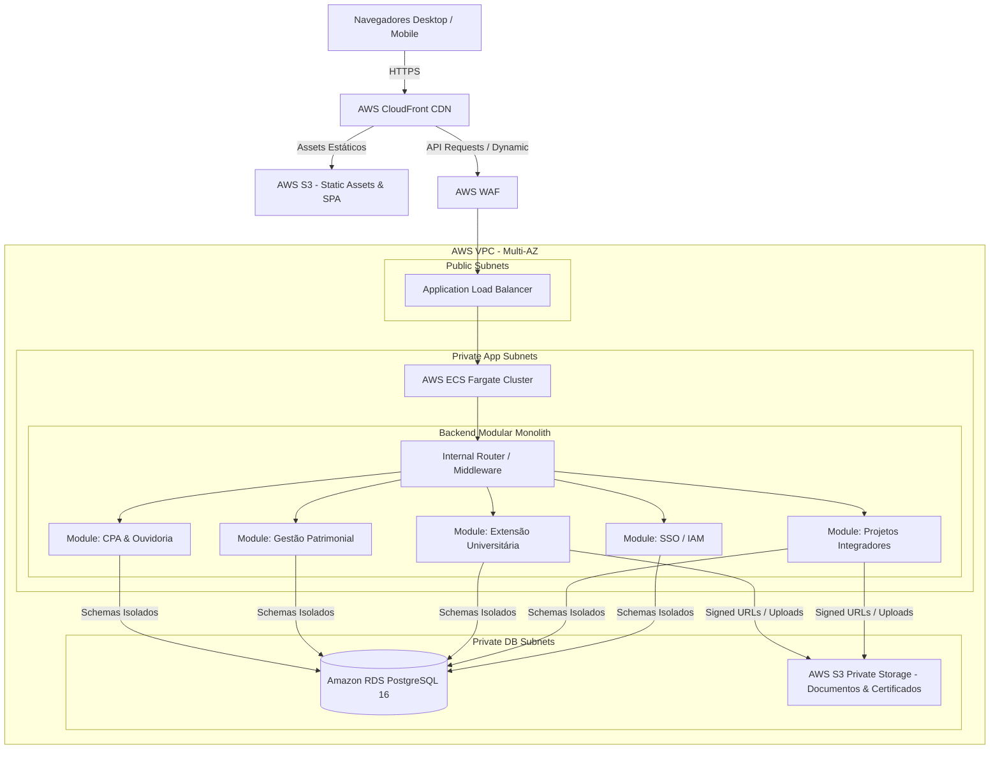
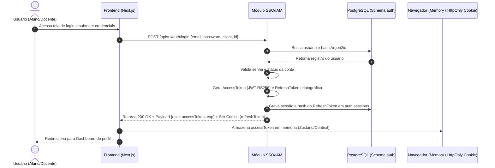
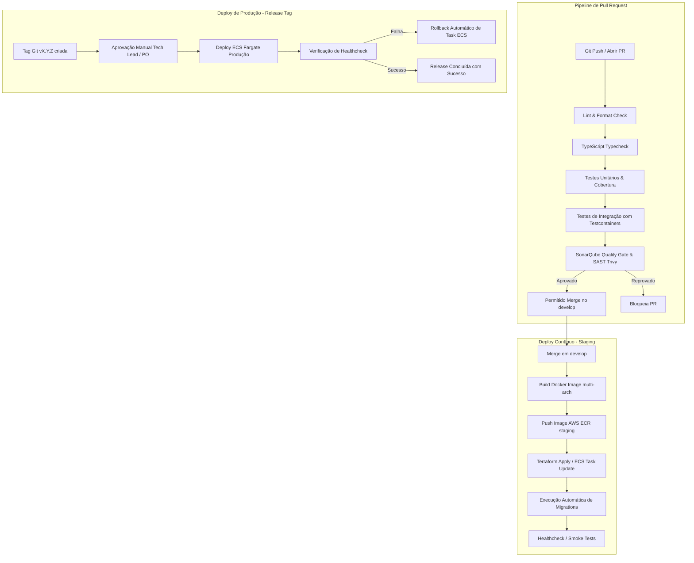
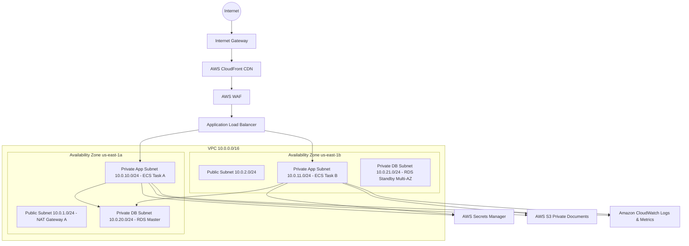
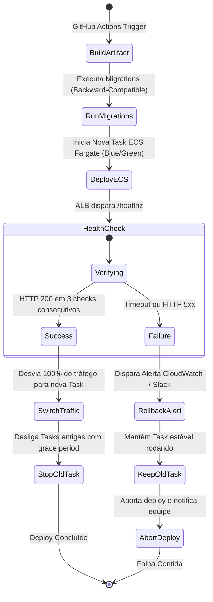

# 📊 Catálogo Geral de Diagramas do Sistema

Este documento centraliza todos os diagramas Mermaid do sistema, organizados por perspectiva arquitetural.

---

## 1. Diagrama Geral da Arquitetura

---

## 2. Diagrama do Fluxo de Autenticação Central (OAuth2 OIDC com PKCE)

---

## 3. Diagrama do Pipeline de CI/CD (GitHub Actions)

---

## 4. Diagrama de Topologia de Infraestrutura AWS

---

## 5. Diagrama de Deploy e Rollback de ECS Tasks

---

## 6. Documentos Relacionados
* [Visão Geral da Arquitetura](overview.md)
* [Infraestrutura AWS](../06-infrastructure/aws.md)
* [CI/CD Pipelines](../07-devops/ci-cd.md)
