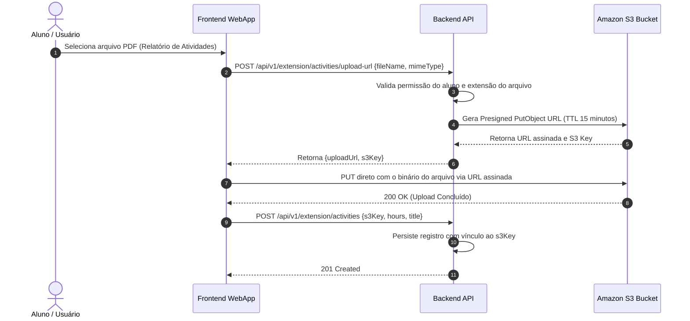

# 🔌 Arquitetura de Integração & APIs

Padrões de integração síncrona e assíncrona entre o frontend, os módulos internos da aplicação e os serviços externos.

---

## 1. Padrões de APIs RESTful
Todas as APIs expostas seguem a especificação **RESTful JSON API v1**:
* **Versionamento de URL:** Obrigatório prefixo `/api/v1/<modulo>/<recurso>`.
* **Envelope de Resposta Padrão:**
  ```json
  {
    "success": true,
    "data": { ... },
    "meta": {
      "timestamp": "2026-08-27T15:00:00Z",
      "requestId": "req-9a8b7c6d-5e4f-3a2b"
    }
  }
  ```
* **Envelope de Erro Padrão:**
  ```json
  {
    "success": false,
    "error": {
      "code": "RESOURCE_NOT_FOUND",
      "message": "Projeto Integrador não encontrado.",
      "details": []
    },
    "meta": {
      "timestamp": "2026-08-27T15:00:00Z",
      "requestId": "req-9a8b7c6d-5e4f-3a2b"
    }
  }
  ```

---

## 2. Integração com Amazon S3 (Upload Seguro via URLs Pré-Assinadas)

Para evitar sobrecarga de memória no contêiner da API e vulnerabilidades de buffer overflow com uploads de arquivos pesados (PDFs de até 10MB):



---

## 3. Documentos Relacionados
* [Diretrizes de API para Desenvolvedores](../04-development/api-guidelines.md)
* [Estrutura do Monorepo](../04-development/repository-structure.md)
