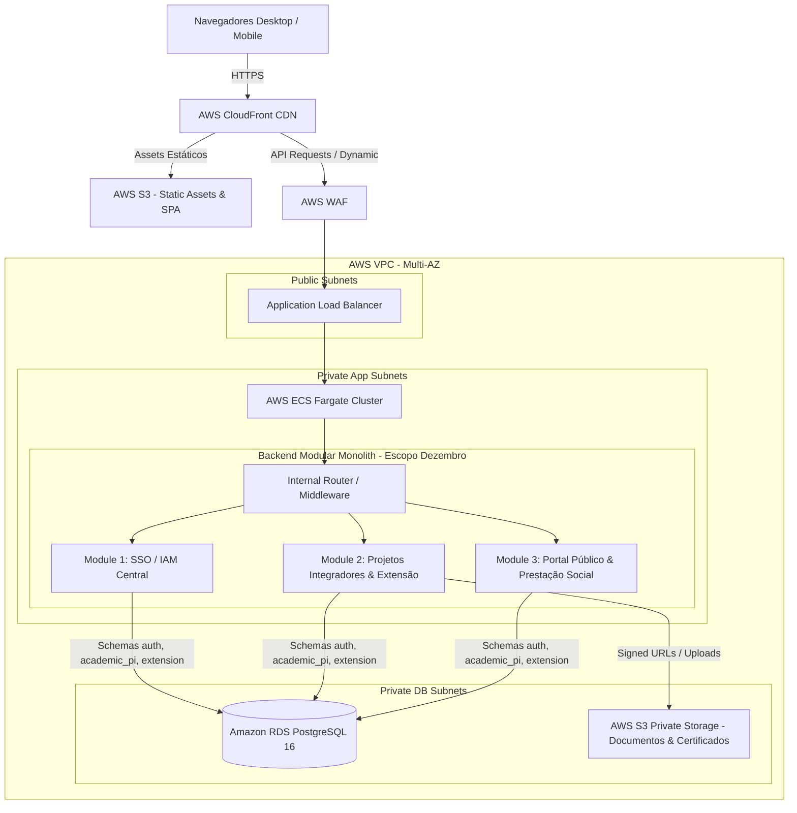

# 🏗️ Visão Geral da Arquitetura do Sistema

## 1. Padrão Arquitetural Escolhido: Monólito Modular (Modular Monolith)

A plataforma adota o padrão **Modular Monolith** orientado a domínios (DDD), com foco absoluto na entrega dos módulos do **Escopo Obrigatório — Dezembro (MVP)**.

```
                                  COMPARAÇÃO ARQUITETURAL
+----------------------------+-----------------------------+-------------------------------+
| CRITÉRIO                   | MONÓLITO MODULAR (ESCOLHIDO)| MICROSSERVIÇOS DISTRIBUÍDOS   |
+----------------------------+-----------------------------+-------------------------------+
| Complexidade de Deploy     | BAIXA (1 contêiner App)     | ALTA (8+ contêineres/repos)   |
| Transações entre Domínios  | ACID nativo no PostgreSQL   | Eventual/Saga (alto risco)    |
| Custo de Infraestrutura    | BAIXO ($60-$100/mês Fargate)| ALTO ($350+/mês instâncias/ALB|
| Curva de Aprendizado Time  | BAIXA (Interfaces TS locais)| ALTA (gRPC, Filas, Network)   |
| Viabilidade até Dezembro   | ALTA (95% confiança)        | CRÍTICA (< 40% confiança)     |
+----------------------------+-----------------------------+-------------------------------+
```

### Justificativa Técnica:
Para um time de 25 desenvolvedores entregando um ecossistema acadêmico integrado no prazo improrrogável de início de dezembro, microsserviços distribuídos puros introduziriam latência de rede, overhead de serialização, transações distribuídas (Saga/2PC) e custos inviáveis de infraestrutura na AWS. O Monólito Modular provê isolamento rigoroso de código com execução em processo único de altíssimo desempenho.

---

## 2. Visão Geral dos Componentes da Plataforma (Escopo Dezembro)



---

## 3. Delimitação de Fases de Arquitetura

1. **Escopo Obrigatório — Dezembro (MVP do Semestre Atual):**
   * `auth`: SSO / IAM Central (OAuth2, JWT RS256, RBAC de 5 perfis, auditoria).
   * `academic_pi_extension`: Captação de projetos (inc. híbridos), equipes, bancas examinadoras, avaliação docente por rubricas, consolidação de notas e apuração automatizada de horas com certificação digital.
   * `public_portal`: Vitrine pública de ações, divulgação do impacto social, módulo de prestação de contas, busca e validação de certificados.
2. **Backlog / Fase 2 (Próximo Semestre):**
   * Expansão dos módulos e schemas de Gestão Patrimonial (`assets`), Carreiras (`careers`), Iniciação Científica (`science`) e CPA/Ouvidoria (`institutional`).

---

## 4. Documentos Relacionados
* [Contexto do Sistema](system-context.md)
* [Arquitetura de Aplicação](application-architecture.md)
* [Arquitetura de Dados](data-architecture.md)
* [Delimitação do MVP](../01-product/mvp.md)
