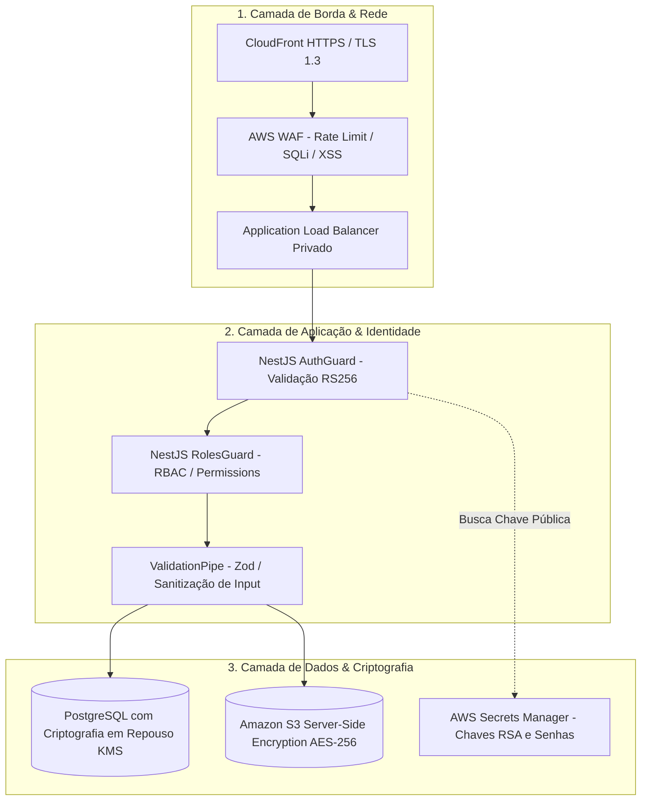
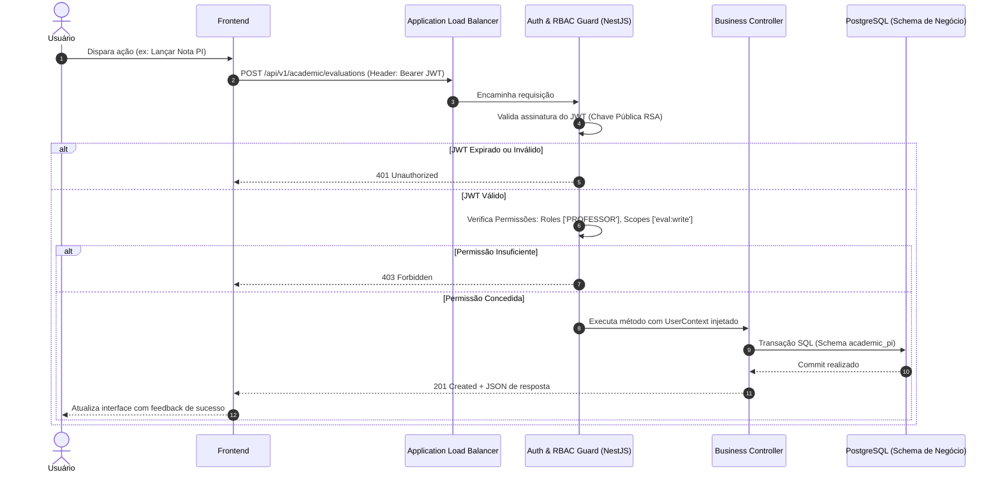

# 🔒 Arquitetura de Segurança da Informação

A segurança da plataforma é projetada sob o princípio de **Defesa em Profundidade** (*Defense-in-Depth*) e **Privilégio Mínimo** (*Least Privilege*).

---

## 1. Camadas de Segurança da Plataforma

---

## 2. Padrão de Autenticação e Emissão de Tokens

* **Algoritmo de Assinatura:** **RS256** (RSA Signature with SHA-256, chave de 2048 bits). O backend assina o token com a chave privada obtida no Secrets Manager; qualquer serviço pode validar a autenticidade usando a chave pública.
* **Access Token:** Validade curta de **15 minutos**, trafegado via cabeçalho `Authorization: Bearer <token>`.
* **Refresh Token:** String criptográfica opaca de 64 bytes (`crypto.randomBytes(64).toString('hex')`), armazenada exclusivamente em cookie com flags:
  `HttpOnly; Secure; SameSite=Strict; Path=/api/v1/auth/refresh`.

---

## 3. Fluxo de Autorização RBAC

---

## 4. Documentos Relacionados
* [ADR-003 — Autenticação Centralizada com JWT RS256](adr/ADR-003-sso-iam-jwt-rs256.md)
* [Visão Geral de Segurança](../05-security/overview.md)
* [Matriz de Permissões RBAC](../05-security/iam-rbac.md)
* [Threat Model](../05-security/threat-model.md)
