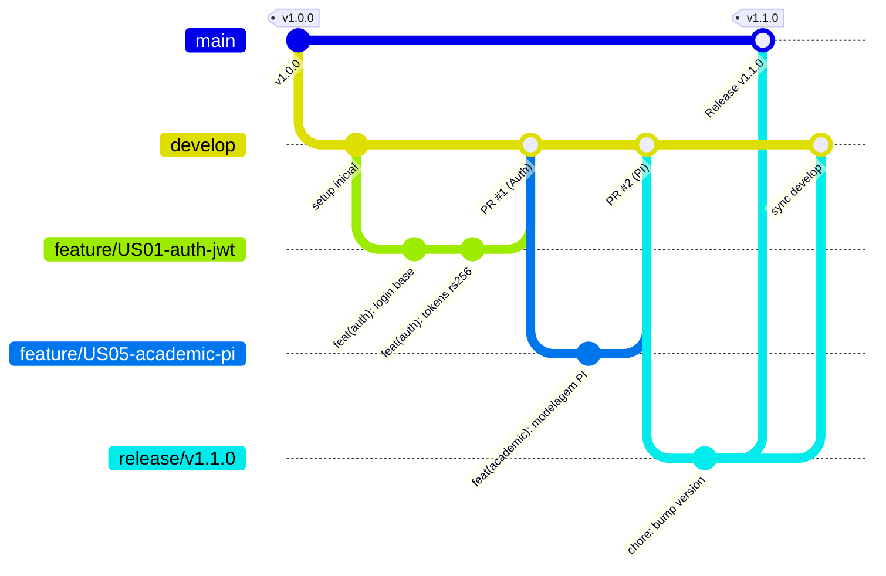

# 🌿 Estratégia de Branching (GitHub Flow Modificado)

O fluxo de branches foi desenhado para maximizar a velocidade de integração contínua de 25 desenvolvedores, mantendo alta rastreabilidade e estabilidade de produção.

---

## 1. Padrão de Nomenclatura de Branches

| Tipo de Branch | Padrão de Nomenclatura | Origem | Destino (Merge) | Exemplo |
| :--- | :--- | :--- | :--- | :--- |
| **Feature** | `feature/US<numero>-<descricao>` | `develop` | `develop` | `feature/US01-auth-login` |
| **Bugfix** | `fix/US<numero>-<descricao>` | `develop` | `develop` | `fix/US07-rubric-rounding` |
| **Infraestrutura**| `infra/<descricao>` | `develop` | `develop` | `infra/ecs-fargate-tuning` |
| **Release** | `release/v<MAJOR>.<MINOR>.<PATCH>` | `develop` | `main` e `develop` | `release/v1.0.0` |
| **Hotfix** | `hotfix/v<versao>-<descricao>` | `main` | `main` e `develop` | `hotfix/v1.0.1-jwt-leak` |

---

## 2. Ciclo de Vida de uma Feature Branch
1. O desenvolvedor cria a branch a partir da `develop` atualizada: `git checkout -b feature/US01-jwt develop`.
2. Desenvolve o código com testes automatizados e commits no padrão Conventional Commits.
3. Abre o Pull Request apontando para `develop`.
4. Após aprovação do CI e de 2 revisores, é realizado o *Squash and Merge*.
5. A branch remota de feature é automaticamente deletada.

---

## 3. Documentos Relacionados
* [Diretrizes de Pull Requests](pull-requests.md)
* [Plano de Releases](../02-planning/release-plan.md)
* [CI/CD Pipelines](../07-devops/ci-cd.md)
