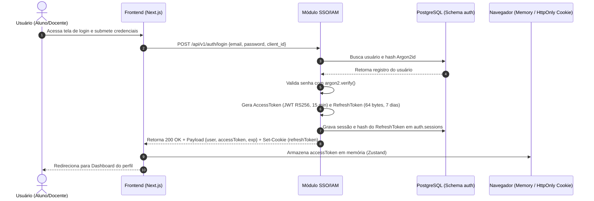

# 🔑 Mecanismo de Autenticação & Gestão de Sessões

Detalhamento técnico da emissão, validação, rotação e revogação de tokens de autenticação.

---

## 1. Fluxo de Tokens (Access Token + Refresh Token)



---

## 2. Estrutura do Payload do Access Token (JWT RS256)

```json
{
  "sub": "b2f6c91a-7b3e-4f11-9a1c-8e9a12345678",
  "email": "aluno@universidade.edu.br",
  "name": "João da Silva",
  "role": "STUDENT",
  "permissions": [
    "pi:read",
    "pi:submit",
    "extension:read",
    "extension:submit",
    "certificate:read"
  ],
  "iss": "https://auth.universidade.edu.br",
  "aud": "plataforma-digital-web",
  "iat": 1756300000,
  "exp": 1756300900
}
```

---

## 3. Rotação e Revogação de Refresh Token
* **Detecção de Reuso:** Se um Refresh Token for utilizado mais de uma vez, o backend invalida **todas** as sessões ativas daquele usuário imediatamente (mitigação contra roubo de tokens).
* **Logout Centralizado:** A rota `POST /api/v1/auth/logout` deleta o registro correspondente em `auth.sessions` e limpa o cookie no navegador do cliente.

---

## 4. Hashing de Senhas com Argon2id
As senhas de usuários são criptografadas antes da persistência utilizando **Argon2id** com os parâmetros recomendados pela OWASP:
* `memoryCost`: 65536 KB (64 MB)
* `timeCost`: 3 iterações
* `parallelism`: 4 threads

---

## 5. Documentos Relacionados
* [ADR-003 — Autenticação Centralizada com JWT RS256](../03-architecture/adr/ADR-003-sso-iam-jwt-rs256.md)
* [Controle de Acesso RBAC](authorization.md)
* [SSO Institucional](sso.md)
