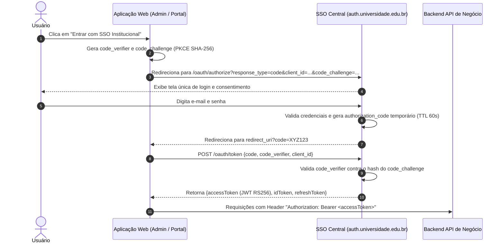

# 🌐 Arquitetura do Single Sign-On (SSO) Centralizado

Especificação do motor de Single Sign-On institucional que unifica a experiência de login entre o Portal Público, o Painel Administrativo e futuras integrações.

---

## 1. Fluxo de SSO Baseado em OAuth2 / OIDC com PKCE

---

## 2. Federação e Expansão Futura (Pós-MVP)
* O SSO está preparado para conectar provedores de identidade externos corporativos (Google Workspace for Education e Microsoft Azure AD / SAML 2.0) a partir da Sprint 5, bastando plugar os adaptadores OIDC no módulo `auth`.

---

## 3. Documentos Relacionados
* [Autenticação e Sessões](authentication.md)
* [Matriz de Permissões RBAC](iam-rbac.md)
* [ADR-003 — Autenticação Centralizada](../03-architecture/adr/ADR-003-sso-iam-jwt-rs256.md)
