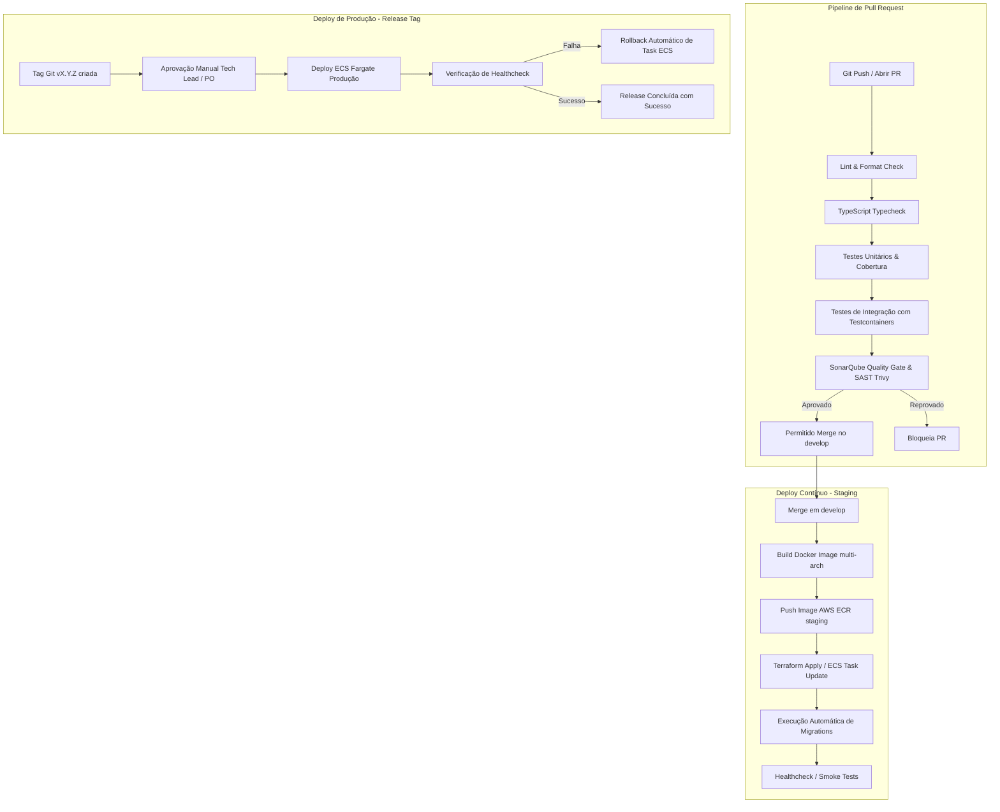

# 🚀 Estratégia Geral de CI/CD

A estratégia de automação garante que todo código seja validado por testes de unidade, integração, segurança estática e qualidade antes de ser implantado de forma automatizada e segura na AWS.

---

## 1. Visão Geral das Esteiras de CI/CD

---

## 2. Responsabilidade Transversal de CI/CD
* **Owner Técnico Geral:** **Luciano Jr** (Definição dos quality gates, bloqueios de pipeline, políticas de build e aprovações de release).
* **Execução Técnica:** **Fazano** e time de Cloud/DevOps (Vinicius Pereira, Felipe Nunes).
* **QA Lead:** **Nicolle** (Integração dos testes automatizados e suítes E2E no pipeline).

---

## 3. Documentos Relacionados
* [Workflows do GitHub Actions](github-actions.md)
* [Estratégia de Deploy](deployment.md)
* [Procedimento de Rollback](rollback.md)
