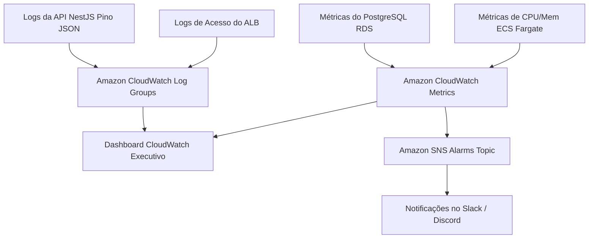

# 📈 Estratégia de Observabilidade, Logs & Alarmes

Arquitetura de telemetria unificada baseada em logs estruturados JSON, métricas do CloudWatch e alarmes proativos.

---

## 1. Padrão de Logs Estruturados em JSON (Pino)

Todas as saídas de log do backend são emitidas em formato JSON estrito, injetando IDs de correlação para rastreabilidade de requisições:

```json
{
  "level": "info",
  "time": 1756301234567,
  "pid": 1,
  "traceId": "req-9a8b7c6d-5e4f-3a2b",
  "userId": "b2f6c91a-7b3e-4f11-9a1c-8e9a12345678",
  "module": "academic-pi",
  "action": "EVALUATION_SUBMITTED",
  "boardId": "e1f2a3b4-c5d6-7e8f-9a0b-1c2d3e4f5a6b",
  "durationMs": 42,
  "msg": "Evaluator submitted rubric grades successfully"
}
```

---

## 2. Métricas Críticas e Alarmes (SLOs da Plataforma)

```
+---------------------------------------------------------------------------------------------------------+
|                                    MATRIZ DE ALARMES CLOUDWATCH                                         |
+---------------------+------------------------------+--------------------+-------------------------------+
| MÉTRICA             | CONDIÇÃO DE DISPARO          | SEVERIDADE         | AÇÃO DISPARADA                |
+---------------------+------------------------------+--------------------+-------------------------------+
| **Taxa de Erro 5xx**| HTTP 5xx > 1.0% por 3 min    | **Crítica**        | Notificação SNS -> Slack/SMS  |
| **Latência p95**    | Resposta API > 800ms por 5 min| **Alta**           | Auto-scaling ECS + Alerta     |
| **Uptime / Health** | /healthz falhar 2x seguidas  | **Crítica**        | Rollback ECS + Notificação    |
| **CPU / Memória**   | Utilização > 75% por 5 min   | **Média**          | Scale-out de Task ECS Fargate |
| **Conexões RDS**    | Conexões ativas > 80% max    | **Alta**           | Alerta para Tech Lead DB      |
| **AWS Budget**      | Custo projetado > $120.00    | **Alta**           | Alerta FinOps para Luciano Jr |
+---------------------+------------------------------+--------------------+-------------------------------+
```

---

## 3. Diagrama de Fluxo de Telemetria



---

## 4. Documentos Relacionados
* [Métricas e Indicadores](../02-planning/metrics.md)
* [FinOps](finops.md)
* [Runbook de Incidentes](../10-runbooks/incident-response.md)
