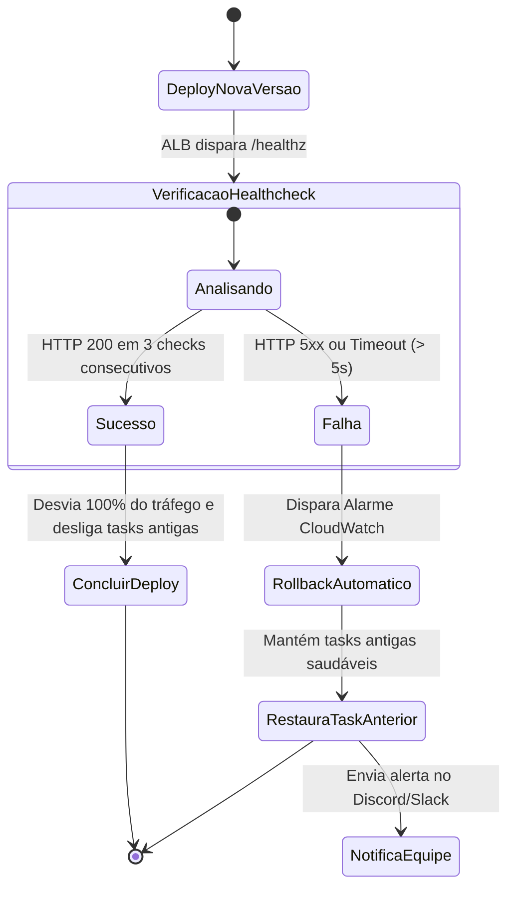

# ⏪ Procedimentos de Rollback Automático & Manual

Mecanismos de reversão imediata de versão em caso de falha de deploy, erros 5xx elevados ou quebra de funcionalidade crítica.

---

## 1. Rollback Automático de Task ECS Fargate

O ECS e o CloudWatch estão configurados para disparar reversão automática se o healthcheck falhar nos primeiros 3 minutos pós-deploy:



---

## 2. Rollback Manual de Versão da API (Via AWS CLI)
Se uma falha funcional for descoberta após a conclusão do deploy:
```bash
# Reverter para a Task Definition anterior estável (ex: revisão 14)
aws ecs update-service \
  --cluster plataforma-cluster-prod \
  --service plataforma-api-prod \
  --task-definition plataforma-api-prod:14 \
  --force-new-deployment
```

---

## 3. Rollback de Migrations do PostgreSQL
* Caso uma migration precise ser revertida:
```bash
# Executa a migration de down versionada
pnpm --filter api-server db:migrate:down
```
* **Atenção:** Em casos de perda ou corrupção de dados, utilize o Point-in-Time Recovery (PITR) do RDS restaurando o banco para o minuto anterior ao deploy.

---

## 4. Documentos Relacionados
* [Runbook de Rollback](../10-runbooks/rollback.md)
* [Disaster Recovery](../06-infrastructure/disaster-recovery.md)
* [Observabilidade](observability.md)
