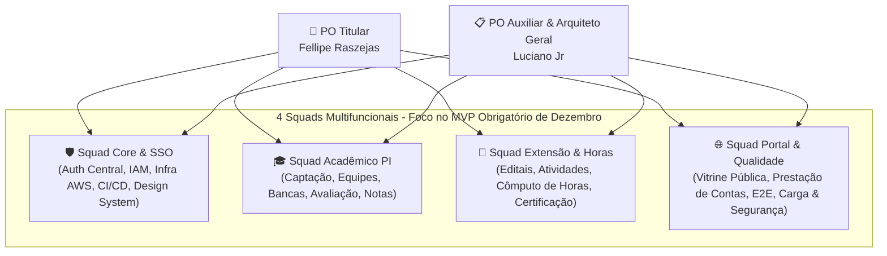

# 👥 Estrutura Organizacional & Alocação dos Squads

A equipe de 25 discentes está organizada em **4 Squads Multifuncionais orientadas a valor**, atuando com 100% de foco no **Escopo Obrigatório do MVP (Entrega: Início de Dezembro)**.

---

## 1. Composição e Atribuições dos Squads no Semestre Atual

### 🛡️ Squad 1: Squad Core & Identidade (SSO/IAM & Plataforma)
* **Foco no MVP:** Autenticação unificada (JWT RS256 / OAuth2 / PKCE), gestão de sessões, autorização RBAC, infraestrutura AWS Terraform, pipelines CI/CD e Design System.
* **Integrantes:** Luciano Jr (Tech Owner / PO Aux.), Fazano (Líder Cloud), Marco (Líder Back), Nicolas Leão (Líder Front), Isabelly (Líder DB), Nicolle (Líder QA).

### 🎓 Squad 2: Squad Acadêmico (Projetos Integradores)
* **Foco no MVP:** Captação de propostas de PI (inc. híbridos), gestão de equipes/alunos, agendamento de bancas examinadoras, avaliação docente por rubricas e cálculo consolidado de notas.
* **Integrantes:** Pedro (Back), Matheus Henrique (Back), Kaique Primissia (Front), Diogo (DB), Vinicius Pereira (Cloud), Ryan (QA).

### 📜 Squad 3: Squad Extensão Universitária & Horas
* **Foco no MVP:** Editais de extensão, inscrição de alunos, submissão de relatórios com evidências no S3, fluxo de validação de horas pelo orientador e emissão de certificados digitais em PDF com hash SHA-256.
* **Integrantes:** Julio (Back), Johann (Back), Luis Felipe (Front), Nicolas Pureza (Front), Henrique (DB), Felipe Nunes (Cloud), Bianca (QA).

### 🌐 Squad 4: Squad Portal Público, Prestação de Contas & Qualidade Core
* **Foco no MVP:** Website público responsivo, vitrine de projetos, divulgação de impactos comunitários, módulo de prestação de contas social, testes de carga (k6), automação E2E (Playwright) e segurança DevSecOps.
* **Integrantes:** Swell (Front), Vinicius Corte (DB), Gustavo Gomes (Cloud), Gabriel Camargo (Cloud/FinOps), Guilherme Aparecido (QA).

---

## 2. Matriz Nominal dos 25 Integrantes do Projeto

| # | Integrante | Squad Principal | Frente Técnica / Especialidade | Papel / Função no MVP |
| :-: | :--- | :--- | :--- | :--- |
| 1 | **Fellipe Raszejas** | Governança | Produto | **Product Owner (PO Titular)** |
| 2 | **Luciano Jr** | Squad Core | Produto / Arquitetura | **PO Auxiliar / Líder Técnico Geral** |
| 3 | **Nicolas Leão** | Squad Core | Frontend | **Líder Técnico Frontend** |
| 4 | **Kaique Primissia** | Squad Acadêmico | Frontend | Desenvolvedor Frontend |
| 5 | **Luis Felipe** | Squad Extensão | Frontend | Desenvolvedor Frontend |
| 6 | **Nicolas Pureza** | Squad Extensão | Frontend | Desenvolvedor Frontend |
| 7 | **Swell** | Squad Portal/QA | Frontend | Desenvolvedor Frontend |
| 8 | **Isabelly** | Squad Core | Banco de Dados | **Líder Técnica Banco de Dados** |
| 9 | **Diogo** | Squad Acadêmico | Banco de Dados | Desenvolvedor Banco de Dados |
| 10 | **Henrique** | Squad Extensão | Banco de Dados | Desenvolvedor Banco de Dados |
| 11 | **Vinicius Corte** | Squad Portal/QA | Banco de Dados | Desenvolvedor Banco de Dados |
| 12 | **Marco** | Squad Core | Backend | **Líder Técnico Backend** |
| 13 | **Pedro** | Squad Acadêmico | Backend | Desenvolvedor Backend |
| 14 | **Matheus Henrique**| Squad Acadêmico | Backend | Desenvolvedor Backend |
| 15 | **Julio** | Squad Extensão | Backend | Desenvolvedor Backend |
| 16 | **Johann** | Squad Extensão | Backend | Desenvolvedor Backend |
| 17 | **Fazano** | Squad Core | Cloud & DevOps | **Líder Técnico Cloud/DevOps** |
| 18 | **Vinicius Pereira**| Squad Acadêmico | Cloud & DevOps | Engenheiro Cloud & DevOps |
| 19 | **Felipe Nunes** | Squad Extensão | Cloud & DevOps | Engenheiro Cloud & DevOps |
| 20 | **Gustavo Gomes** | Squad Portal/QA | Cloud & DevOps | Engenheiro Cloud & DevOps |
| 21 | **Gabriel Camargo** | Squad Portal/QA | Cloud & DevOps | Engenheiro Cloud & FinOps |
| 22 | **Nicolle** | Squad Core | Qualidade & QA | **Líder Técnica Qualidade/QA** |
| 23 | **Ryan** | Squad Acadêmico | Qualidade & QA | Analista de QA & Testes |
| 24 | **Bianca** | Squad Extensão | Qualidade & QA | Analista de QA & Testes |
| 25 | **Guilherme Aparecido**| Squad Portal/QA | Qualidade & QA | Analista de QA & Testes |

---

## 3. Documentos Relacionados
* [Responsabilidades e Liderança de Luciano Jr](responsibilities.md)
* [Matriz RACI](raci.md)
* [Planejamento de Sprints](../02-planning/sprint-plan.md)
