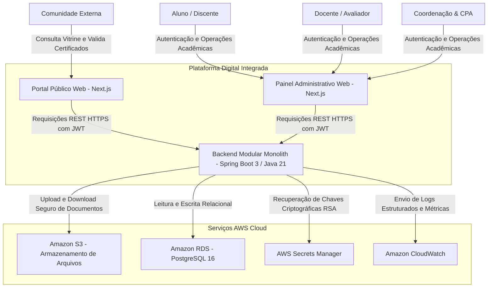

---
title: "Contexto do Sistema e Fronteiras Externas"
domain: "architecture"
status: "accepted"
owner: "Luciano Jr"
last_updated: "2026-08-27"
---

# 🌐 Contexto do Sistema e Fronteiras Externas

Diagrama de contexto (C4 Model Nível 1) ilustrando os limites da Plataforma Digital Integrada, seus usuários humanos e suas integrações com serviços externos de nuvem.

---

## 1. Diagrama de Contexto

---

## 2. Descrição das Fronteiras e Interações
* **Entrada de Tráfego:** Todo o tráfego HTTP é originado por navegadores web seguros via TLS 1.3 mediado pela CDN AWS CloudFront e protegido pelo AWS WAF.
* **Comunicação Segura:** Todas as chamadas para a API REST utilizam tokens JWT RS256 no cabeçalho `Authorization: Bearer <token>`.
* **Armazenamento de Mídia:** Uploads de arquivos (relatórios e evidências em PDF) não trafegam o payload completo pelo backend; o backend emite **URLs pré-assinadas do S3** (TTL 15 min), permitindo upload direto e seguro do navegador para a AWS.

---

## 3. Documentos Relacionados
* [Visão Geral da Arquitetura](containers.md)
* [Arquitetura de Segurança](security.md)
* [Topologia de Rede AWS](../operations/infrastructure.md)
