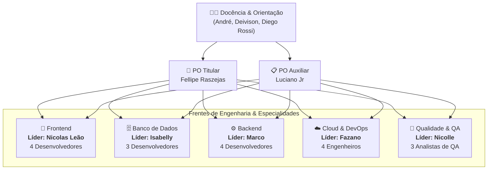

# 👥 Estrutura Organizacional e Divisão de Equipes

Este documento define a distribuição oficial dos alunos, lideranças técnicas e governança de produto do projeto **Plataforma Digital Integrada**, em consonância com a arquitetura e os módulos estabelecidos no [README.md](file:///c:/projetos/plataforma/README.md).

---

## 👨‍🏫 Coordenação Pedagógica & Gestão Geral

| Membro | Papel | Atribuição |
| :--- | :--- | :--- |
| **André** | Docente / Orientador | Direcionamento pedagógico, validação de arquitetura e avaliação de entregas |
| **Deivison** | Docente / Orientador | Acompanhamento técnico, mentoria de engenharia e gestão de escopo |

---

## 🎯 Liderança de Produto (Product Owners)

A liderança de produto é responsável pela ponte entre os docentes, clientes institucionais e o time de desenvolvimento, cuidando do Product Backlog, User Stories e priorização de sprints.

| Função | Integrante | Responsabilidades |
| :--- | :--- | :--- |
| **Product Owner (Titular)** | **Fellipe Raszejas** | • Gestão e priorização do Backlog Geral do Produto • Refinamento de requisitos e critérios de aceite • Alinhamento estratégico semanal com os docentes |
| **Product Owner (Auxiliar / Trainee)** | **Luciano Jr** | • Apoio no detalhamento de User Stories e fluxos • Acompanhamento das sprints e cerimônias ágeis • Suporte na homologação e validação de entregas |

---

## 🏗️ Organograma do Time

---

## 📊 Visão Geral das Frentes Técnicas

| Frente Técnica | Líder Responsável | Total de Integrantes | Foco Principal |
| :--- | :--- | :---: | :--- |
| **Frontend & UI/UX** | **Nicolas Leão** | 5 | Interface com usuário, Design System, telas públicas e painéis internos |
| **Banco de Dados** | **Isabelly** | 4 | Modelagem relacional, migrations, otimização de queries e integridade |
| **Backend & APIs** | **Marco** | 5 | Regras de negócio, microsserviços, autenticação (SSO) e APIs RESTful |
| **Cloud & DevOps** | **Fazano** | 5 | Infraestrutura IaC (Terraform), Docker, pipelines CI/CD e FinOps |
| **Qualidade (QA & Testes)** | **Nicolle** | 4 | Testes automatizados (Unitários, E2E), cobertura, segurança e homologação |

---

## 🧩 Detalhamento das Equipes

### 🎨 1. Frente de Frontend & UI/UX
* **Escopo:** Criação das interfaces web responsivas, implementação do Design System, integração com as APIs do Backend, acessibilidade, catálogo público de projetos e painéis administrativos.

| Papel | Integrante | Atribuição Principal |
| :--- | :--- | :--- |
| **Líder Técnico** | **Nicolas Leão** | Arquitetura frontend, padronização de componentes e code review de telas |
| Desenvolvedor | **Kaique Primissia** | Desenvolvimento de telas e fluxos de navegação |
| Desenvolvedor | **Luis Felipe** | Componentização e responsividade da interface |
| Desenvolvedor | **Nicolas Pureza** | Integração com endpoints de API e gerenciamento de estado |
| Desenvolvedor | **Swell** | Usabilidade, formulários dinâmicos e validação client-side |

---

### 🗄️ 2. Frente de Banco de Dados & Modelagem
* **Escopo:** Modelagem do modelo de dados unificado, diagramas ER, scripts de migração (migrations), garantia de integridade referencial, consultas analíticas e relatórios para CPA e extensão.

| Papel | Integrante | Atribuição Principal |
| :--- | :--- | :--- |
| **Líder Técnica** | **Isabelly** | Arquitetura e modelagem de dados, governança de esquemas e migrations |
| Desenvolvedor DB | **Diogo** | Modelagem de tabelas e queries de persistência de dados |
| Desenvolvedor DB | **Henrique** | Otimização de consultas, índices e rotinas de backup/seed |
| Desenvolvedor DB | **Vinicius Corte** | Estruturação de dados relacionais e auditoria de logs |

---

### ⚙️ 3. Frente de Backend & Regras de Negócio
* **Escopo:** Desenvolvimento dos serviços de backend, autenticação central (JWT/OAuth2), controle de permissões (RBAC), cálculo automatizado de notas e horas de extensão, e APIs de agendamento de recursos.

| Papel | Integrante | Atribuição Principal |
| :--- | :--- | :--- |
| **Líder Técnico** | **Marco** | Arquitetura das APIs, definição de contratos de rotas e segurança de serviços |
| Desenvolvedor Backend | **Pedro** | Lógica de negócio de Projetos Integradores e Extensão |
| Desenvolvedor Backend | **Matheus Henrique** | Serviços de autenticação (SSO), permissões e auditoria |
| Desenvolvedor Backend | **Julio** | APIs de gestão patrimonial (notebooks, salas e ocorrências) |
| Desenvolvedor Backend | **Johann** | Módulos de Carreiras, Editais de IC e formulários de Ouvidoria/CPA |

---

### ☁️ 4. Frente de Cloud, DevOps & FinOps
* **Escopo:** Automação de infraestrutura como código (IaC), configuração de contêineres Docker, esteiras de CI/CD (GitHub Actions), monitoramento de métricas, gestão de custos de nuvem e deploys contínuos.

| Papel | Integrante | Atribuição Principal |
| :--- | :--- | :--- |
| **Líder Técnico** | **Fazano** | Arquitetura de infraestrutura Cloud, orquestração e governança DevOps |
| Engenheiro Cloud/DevOps | **Vinicius Pereira** | Pipelines de CI/CD para build, testes e deploy automatizado |
| Engenheiro Cloud/DevOps | **Felipe Nunes** | Conteinerização (Docker/Docker Compose) e ambientes locais |
| Engenheiro Cloud/DevOps | **Gustavo Gomes** | Monitoramento de servidores, logs centralizados e métricas de saúde |
| Engenheiro Cloud/DevOps | **Gabriel Camargo** | FinOps (otimização de custos de nuvem) e segurança de infraestrutura |

---

### 🧪 5. Frente de Qualidade, Testes & QA
* **Escopo:** Elaboração de planos de teste, automação de testes unitários e de integração, testes end-to-end (E2E), testes de carga/estresse, garantia de cobertura de código e homologação pré-release.

| Papel | Integrante | Atribuição Principal |
| :--- | :--- | :--- |
| **Líder Técnica** | **Nicolle** | Estratégia de qualidade, esteira de testes automatizados e critérios de aceite |
| Analista de QA / Testes | **Ryan** | Criação de suítes de testes funcionais e de integração de APIs |
| Analista de QA / Testes | **Bianca** | Testes de interface (UI/E2E), usabilidade e testes de regressão |
| Analista de QA / Testes | **Guilherme Aparecido** | Testes de segurança, validação de edge cases e automação contínua |

---

## 📋 Matriz Geral de Alocação de Alunos

| # | Aluno(a) | Área / Frente | Papel / Função |
| :-: | :--- | :--- | :--- |
| 1 | **Fellipe Raszejas** | Liderança de Produto | **Product Owner (PO Titular)** |
| 2 | **Luciano Jr** | Liderança de Produto | **Product Owner Auxiliar / Trainee** |
| 3 | **Nicolas Leão** | Frontend | **Líder Técnico Frontend** |
| 4 | **Kaique Primissia** | Frontend | Desenvolvedor Frontend |
| 5 | **Luis Felipe** | Frontend | Desenvolvedor Frontend |
| 6 | **Nicolas Pureza** | Frontend | Desenvolvedor Frontend |
| 7 | **Swell** | Frontend | Desenvolvedor Frontend |
| 8 | **Isabelly** | Banco de Dados | **Líder Técnica Banco de Dados** |
| 9 | **Diogo** | Banco de Dados | Desenvolvedor Banco de Dados |
| 10 | **Henrique** | Banco de Dados | Desenvolvedor Banco de Dados |
| 11 | **Vinicius Corte** | Banco de Dados | Desenvolvedor Banco de Dados |
| 12 | **Marco** | Backend | **Líder Técnico Backend** |
| 13 | **Pedro** | Backend | Desenvolvedor Backend |
| 14 | **Matheus Henrique** | Backend | Desenvolvedor Backend |
| 15 | **Julio** | Backend | Desenvolvedor Backend |
| 16 | **Johann** | Backend | Desenvolvedor Backend |
| 17 | **Fazano** | Cloud & DevOps | **Líder Técnico Cloud/DevOps** |
| 18 | **Vinicius Pereira** | Cloud & DevOps | Engenheiro Cloud & DevOps |
| 19 | **Felipe Nunes** | Cloud & DevOps | Engenheiro Cloud & DevOps |
| 20 | **Gustavo Gomes** | Cloud & DevOps | Engenheiro Cloud & DevOps |
| 21 | **Gabriel Camargo** | Cloud & DevOps | Engenheiro Cloud & FinOps |
| 22 | **Nicolle** | Qualidade & QA | **Líder Técnica Qualidade/QA** |
| 23 | **Ryan** | Qualidade & QA | Analista de QA & Testes |
| 24 | **Bianca** | Qualidade & QA | Analista de QA & Testes |
| 25 | **Guilherme Aparecido** | Qualidade & QA | Analista de QA & Testes |

---

## 🔄 Rituais e Dinâmica Operacional

1. **Alinhamento de Lideranças (PO & Tech Leads):**
   * Reunião semanal de alinhamento com os docentes para planejamento da sprint e desimpedimento de bloqueios.
2. **Integração Inter-Frentes:**
   * **Backend ↔ Frontend:** Alinhamento contínuo de contratos de API via Swagger/OpenAPI.
   * **Backend ↔ Banco de Dados:** Validação prévia de modelos e scripts de migration antes de merges.
   * **Cloud/DevOps ↔ Qualidade:** Inclusão das suítes de testes automatizados diretamente na pipeline de CI/CD do GitHub Actions.
3. **Fluxo de Trabalho Git (GitFlow Simplificado):**
   * Branch `main`: Código em produção, estável e homologado.
   * Branch `develop`: Ambiente de integração contínua.
   * Branches de feature: `feature/nome-da-tarefa` abertas a partir da `develop` com Pull Request e revisão obrigatória do respectivo Líder Técnico.
