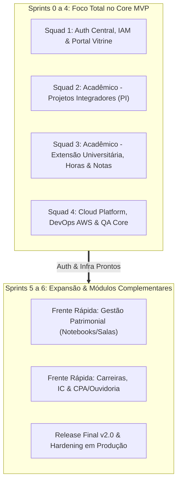

# 🚀 Proposta de Reorganização Ágil (Scrum) & Foco no MVP do Semestre

Este documento apresenta a proposta estratégica de reorganização das equipes e do fluxo de trabalho para o desenvolvimento da **Plataforma Integrada**, adotando o framework **Scrum** com foco absoluto no **MVP (Minimum Viable Product)** do semestre.

---

## 🎯 1. Racional da Reorganização

### ⚠️ O Desafio da Divisão Anterior (5 Silos Fixos):
Na proposta inicial, os 24 alunos estavam divididos igualmente entre os 5 módulos do sistema. No entanto, se os módulos de **Patrimônio (Notebooks/Salas)** e **Carreiras/CPA** ficarem para as últimas sprints, manter equipes dedicadas a eles desde a Sprint 1 geraria:
* Desperdício de capacidade produtiva em módulos secundários.
* Gargalo nas frentes prioritárias (**Auth Central**, **PI & Extensão** e **Infraestrutura AWS**).
* Dificuldade de integração tardia.

### 💡 A Solução Scrum (Foco em Valor & Entregas Incrementais):
Concentrar a capacidade máxima de engenharia nos **módulos críticos do semestre**, estruturando **Squads Multifuncionais** focadas no Core MVP nas Sprints 1 a 4, e realizando um pivô/expansão planejado para os módulos secundários nas Sprints 5 e 6.



---

## 👥 2. Sugestão de Nova Estrutura de Equipes (Scrum Squads)

Com a exclusão dos professores (**André, Deivison e Diego Rossi**), os **24 alunos mapeados** são distribuídos em **4 frentes de alta produtividade** para as Sprints principais:

---

### 👑 Liderança de Produto & Governança Ágil

| Papel | Integrante | Responsabilidades Scrum |
| :--- | :--- | :--- |
| **Product Owner (PO Titular)** | `+55 15 99665-6962` *(Voto para PO / Backend)* | Priorização do Product Backlog, refinamento com docentes/stakeholders e validação de entregas. |
| **Scrum Master / PO Trainee** | `+55 11 97025-0373` *(Designado p/ Facilitação Ágil)* | Facilitação de cerimônias (Dailies, Planning, Retrospectivas), remoção de impedimentos e métricas (Velocity/Burn-down). |

---

### 🛡️ Squad 1: Auth Central (SSO), IAM & Portal Público Vitrine (5 Alunos)
* **Objetivo do Semestre:** Entregar a autenticação unificada (JWT / OAuth2 / RBAC Aluno-Docente-Admin), landing page institucional e catálogo público de projetos.
* **Stack:** Next.js / React, Node/TypeScript, PostgreSQL, Tailwind/CSS.

| Integrante | Papel no Squad | Perfil / Habilidades |
| :--- | :--- | :--- |
| `+55 15 99640-7049` | **Tech Lead do Squad** *(Avançado)* | Frontend & UI/UX / Cloud |
| `+55 15 98828-6563` | Dev Frontend & UI/UX | Frontend, Design de Telas e Usabilidade |
| `+55 14 99872-0467` | Dev Backend & Auth | APIs de Login, Sessões, JWT e Tokens |
| `+55 15 99745-5341` | Dev Banco de Dados & Fullstack | Modelagem de Usuários/Permissões e Telas |
| `~Giovani` (`+55 15 98806-6617`) | Dev Fullstack / QA do Squad | Testes de integração de login e responsividade |

---

### 🎓 Squad 2: Core Acadêmico — Projetos Integradores & Avaliação (6 Alunos)
* **Objetivo do Semestre:** Módulo completo de Projetos Integradores (submissão de propostas, formação de equipes, bancas, avaliação docente e consolidação de notas).
* **Stack:** Node/NestJS ou Express, React, PostgreSQL, Prisma/TypeORM.

| Integrante | Papel no Squad | Perfil / Habilidades |
| :--- | :--- | :--- |
| `~Luciano Jr` (`+55 11 99942-2998`) | **Tech Lead do Squad** *(Avançado)* | Backend, Arquitetura e Modelagem |
| `~Pedro` (`+55 15 99713-5106`) | Dev Frontend | Telas de Gestão de Projetos e Dashboards |
| `+55 11 99964-9489` | Dev Backend | Regras de Negócio e APIs de Avaliação |
| `+55 11 97452-1901` | Dev Banco de Dados | Modelagem Relacional e Queries de Desempenho |
| `+55 15 99853-3015` | Dev Fullstack | Formulários de Submissão e Telas Docentes |
| `+55 11 97278-4527` | Dev Backend / QA do Squad | Testes unitários das regras de notas e bancas |

---

### 📜 Squad 3: Core Acadêmico — Extensão Universitária, Horas & Relatórios (6 Alunos)
* **Objetivo do Semestre:** Módulo completo de Extensão Universitária (editais, inscrição de alunos, acompanhamento de atividades, apuração automatizada de horas curriculares e relatórios institucionais).
* **Stack:** Node/TypeScript, React, PostgreSQL, Integração com APIs do Core.

| Integrante | Papel no Squad | Perfil / Habilidades |
| :--- | :--- | :--- |
| `~Victor` (`+55 15 99647-9455`) | **Tech Lead do Squad** | Backend e Arquitetura de Serviços |
| `+55 15 99704-3871` | Dev Backend Senior | Regras de Cálculo de Horas de Extensão |
| `+55 15 99811-3490` | Dev Backend | APIs de Eventos e Atividades Extensionistas |
| `+55 15 99757-6751` | Dev Backend & Dados | Emissão de Certificados e Relatórios |
| `+55 15 99841-1995` | Dev Banco de Dados & SQL | Modelagem de Histórico e Auditoria de Horas |
| `+55 11 95686-5680` | Dev Fullstack / QA do Squad | Testes de validação de carga horária e telas |

---

### ☁️ Squad 4: Cloud Platform, DevOps AWS & QA Core (5 Alunos)
* **Objetivo do Semestre:** Provisionamento IaC em AWS (Terraform), esteiras de CI/CD (GitHub Actions), Docker/Monorepo, FinOps (gestão de custos de nuvem) e Framework transversal de Testes E2E/Segurança.
* **Stack:** AWS (ECS/App Runner, RDS, S3, CloudWatch), Terraform, Docker, GitHub Actions, Playwright/Cypress.

| Integrante | Papel no Squad | Perfil / Habilidades |
| :--- | :--- | :--- |
| `+55 15 99748-7428` | **Tech Lead Cloud & DevOps** | Infraestrutura como Código (Terraform) & AWS |
| `+55 15 99130-6956` | Engenheiro DevOps & CI/CD | Pipelines de Testes, Build Docker e Staging |
| `+55 15 99612-2297` | Engenheiro FinOps & Observabilidade | CloudWatch, Alarmes de Custos e Métricas |
| `+55 11 91575-3755` | Engenheiro de Dados & Migrações | Scripts de Migrations, Backups e Seed de Dados |
| `+55 11 96631-8300` | Engenheiro de QA & Segurança | Testes E2E automatizados, SAST e Carga |

---

## 📅 3. Cronograma de Sprints (Release Plan do Semestre)

Adotando ciclos de **Sprints de 2 semanas**:

```text
┌──────────────────────────────────────────────────────────────────────────────────┐
│ SPRINT 0 (Semana 1-2): Setup de Engenharia & Arquitetura Base                    │
│ • Setup do Monorepo, Docker Compose local e repositórios GitHub                  │
│ • Provisionamento do ambiente AWS Staging via Terraform                          │
│ • Configuração das pipelines de CI (Lint, Typecheck, Testes)                     │
│ • Modelagem preliminar dos bancos de dados e Design System base                  │
├──────────────────────────────────────────────────────────────────────────────────┤
│ SPRINT 1 (Semana 3-4): Fundação de Auth & Domínio Acadêmico                      │
│ • Auth Central: Estrutura de Login, Tokens JWT e cadastro de perfis              │
│ • PI: Modelagem e CRUD inicial de Projetos e Equipes                             │
│ • Extensão: Modelagem de ações de extensão e fluxo de submissão                  │
│ • DevOps: Deploy automatizado no AWS Staging via branch develop                  │
├──────────────────────────────────────────────────────────────────────────────────┤
│ SPRINT 2 (Semana 5-6): Regras de Negócio & Telas Principais                      │
│ • Auth: Controle de Acesso por Perfil (RBAC) + Landing Page Pública              │
│ • PI: Módulo de bancas examinadoras e submissão de entregáveis                   │
│ • Extensão: Sistema de registro e validação de horas extensionistas              │
│ • QA: Implementação dos primeiros testes de integração e E2E                     │
├──────────────────────────────────────────────────────────────────────────────────┤
│ SPRINT 3 (Semana 7-8): Fechamento do Core MVP & Consolidação                     │
│ • PI: Cálculo automático de notas e relatórios para a coordenação                │
│ • Extensão: Dashboard de cumprimento de horas para o aluno                       │
│ • Portal Público: Vitrine com catálogo de projetos aprovados                     │
│ • Cloud: Alertas FinOps, healthchecks e testes de carga em Staging               │
├──────────────────────────────────────────────────────────────────────────────────┤
│ SPRINT 4 (Semana 9-10): Release v1.0 (Deploy em Produção AWS)                    │
│ • Homologação completa do MVP com os professores (Gate de Aprovação)             │
│ • Deploy estável da v1.0 em Produção na AWS                                      │
│ • Treinamento/apresentação das funcionalidades de PI e Extensão                  │
├──────────────────────────────────────────────────────────────────────────────────┤
│ SPRINTS 5 e 6 (Semana 11-14): Expansão Ágil (Módulos Secundários)                │
│ • Squads 1 e 2 absorvem: Gestão Patrimonial (Notebooks, Salas e Ocorrências)     │
│ • Squads 3 e 4 absorvem: Carreiras, Iniciação Científica & CPA/Ouvidoria         │
│ • Aproveitamento total do Auth Central, Design System e Infra AWS já operacionais│
│ • Release v2.0 completa e encerramento do semestre                               │
└──────────────────────────────────────────────────────────────────────────────────┘
```

---

## 🔄 4. Cerimônias e Ritos Scrum Sugeridos

Para garantir comunicação fluida e alinhamento contínuo:

1. **Sprint Planning (Quinzenal - 1h):**
   * PO apresenta o objetivo da sprint (Sprint Goal) e histórias priorizadas.
   * Squads estimam e puxam as tarefas para o Sprint Backlog.
2. **Daily Scrum Assíncrona / Rápida (10-15 min no WhatsApp/Discord):**
   * *1. O que fiz ontem?*
   * *2. O que farei hoje?*
   * *3. Há algum impedimento que trava meu progresso?*
3. **Sprint Review (Quinzenal com Professores - 30 min):**
   * Demonstração de software funcionando em ambiente AWS Staging.
4. **Sprint Retrospective (Quinzenal interna dos alunos - 20 min):**
   * O que funcionou bem, o que precisamos melhorar e ações de melhoria para o próximo ciclo.

---

## 🌟 5. Principais Vantagens Desta Abordagem

1. **Garantia de Entrega do que Importa:** O coração do projeto (PI, Extensão, Auth e Nuvem AWS) recebe 100% de foco desde o primeiro dia.
2. **Sem Equipes Ociosas ou Deslocadas:** Todos os 24 alunos estarão trabalhando em funcionalidades com valor imediato.
3. **Arquitetura Sólida para o Futuro:** Quando os módulos de Patrimônio e Carreiras entrarem nas Sprints 5 e 6, a autenticação, a nuvem e os componentes já estarão prontos, permitindo entregas extremamente rápidas.
4. **Desenvolvimento Profissional:** Os alunos vivenciam uma esteira real de engenharia com Scrum, monorepo, CI/CD e governança em nuvem.
