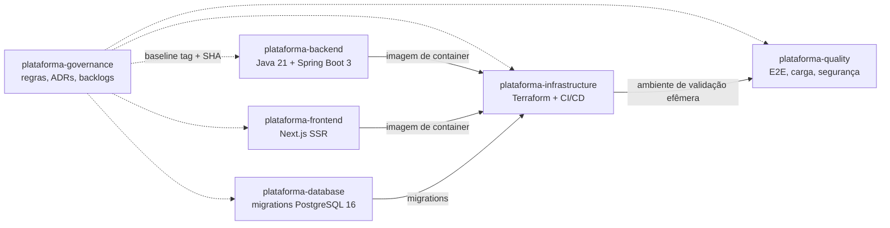
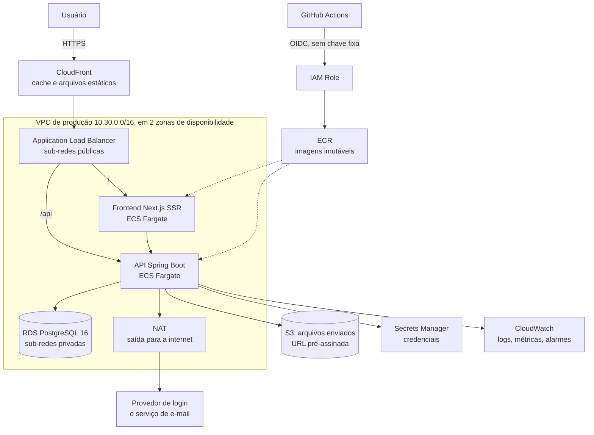
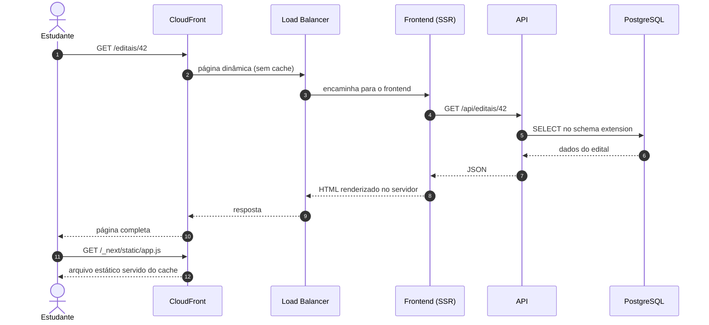
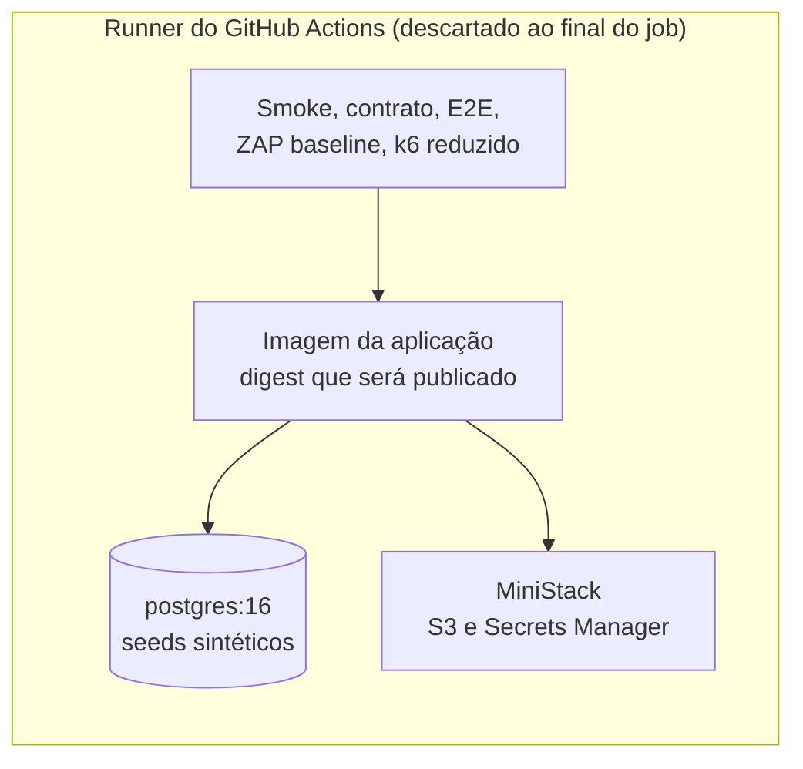
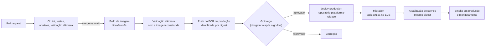

# Visão geral da plataforma

**Objetivo.** Apresentar a Plataforma Digital do ponto de vista da infraestrutura: o que o sistema faz, como o código está organizado em repositórios, qual arquitetura será construída na AWS e quais decisões oficiais definem essa arquitetura. Ao final, o leitor deve conseguir explicar onde cada parte da plataforma executa e por quê.

**Pré-requisitos de leitura:** nenhum. Termos técnicos estão definidos em [02 Conceitos fundamentais de nuvem](02-conceitos-fundamentais-de-nuvem.md) e no [11 Glossário](11-glossario.md).

## Sumário

1. [O que é a Plataforma Digital](#1-o-que-é-a-plataforma-digital)
2. [Os repositórios](#2-os-repositórios)
3. [O papel da infraestrutura](#3-o-papel-da-infraestrutura)
4. [Arquitetura alvo na AWS](#4-arquitetura-alvo-na-aws)
5. [O caminho de uma requisição](#5-o-caminho-de-uma-requisição)
6. [Decisões oficiais que definem a infraestrutura](#6-decisões-oficiais-que-definem-a-infraestrutura)
7. [Ambientes](#7-ambientes)
8. [Do código à produção](#8-do-código-à-produção)
9. [Pontos de arquitetura ainda em detalhamento](#9-pontos-de-arquitetura-ainda-em-detalhamento)
10. [Referências](#referências)

## 1. O que é a Plataforma Digital

A Plataforma Digital é o sistema institucional que integra quatro frentes:

| Frente | O que oferece |
| --- | --- |
| Identidade institucional | Login único (SSO), perfis de acesso e auditoria |
| Projetos Integradores (PI) | Propostas, equipes, quadros de acompanhamento, entregas e notas |
| Extensão universitária | Editais, registro de horas e emissão de certificados |
| Portal público | Catálogo de ações e divulgação do impacto social |

Esse conjunto forma o escopo obrigatório do MVP. Gestão patrimonial, Carreira, Iniciação Científica e CPA/Ouvidoria estão previstos para uma fase posterior (2027.1). O escopo completo está em `_KB/product/scope.md`.

Para a infraestrutura, isso significa hospedar duas aplicações (uma API e um frontend com renderização no servidor), um banco de dados relacional, um repositório de arquivos enviados pelos usuários e todo o processo automatizado que leva o código até esses ambientes.

## 2. Os repositórios

O projeto adota uma arquitetura **multi-repositório** (ADR-006): cada parte do sistema vive em um repositório independente, com seu próprio ciclo de PR e de versão.

| Repositório | Conteúdo | Tecnologia principal |
| --- | --- | --- |
| `plataforma-governance` | Fonte normativa: ADRs, políticas, especificações, backlogs e este material | Markdown |
| `plataforma-backend` | API da plataforma, organizada como monólito modular (ADR-001) | Java 21 e Spring Boot 3 |
| `plataforma-frontend` | Interface web com renderização no servidor (SSR) | Next.js e TypeScript |
| `plataforma-database` | Migrations, seeds e ambiente local do banco | PostgreSQL 16 |
| `plataforma-infrastructure` | Infraestrutura como código, pipelines e observabilidade | Terraform e GitHub Actions |
| `plataforma-quality` | Testes ponta a ponta, carga, segurança e evidências | Playwright, k6 e OWASP ZAP |

Os repositórios de implementação seguem uma versão fixa das regras do repositório de governança. Essa versão é registrada no arquivo `.governance-baseline` de cada repositório, na forma de uma tag (`governance-vMAJOR.MINOR.PATCH`) e do SHA do commit correspondente. O CI confere se a tag aponta para o SHA esperado antes das verificações de conformidade (ADR-008).

## 3. O papel da infraestrutura

A equipe de Cloud & DevOps não escreve as regras de negócio da plataforma. Ela entrega **onde e como** o software executa:

- **O ambiente de produção na AWS**: rede, banco de dados, armazenamento de arquivos, execução de containers e balanceamento de carga.
- **Os ambientes fora da AWS**: o ambiente local de desenvolvimento e o ambiente de validação efêmera criado dentro do pipeline.
- **Pipeline de entrega**: a sequência automatizada que testa, empacota e implanta o código de cada repositório.
- **Segurança da operação**: credenciais temporárias para o pipeline, segredos guardados fora do código, acesso mínimo necessário.
- **Operação contínua**: logs, métricas, alarmes, backup, restauração e procedimentos de rollback.
- **Controle de custos**: orçamento mensal, alertas e escolhas de arquitetura compatíveis com esse orçamento.

Por isso as outras equipes dependem diretamente da infraestrutura: o backend precisa de um ambiente de execução e de segredos, o frontend precisa de um runtime SSR, o banco precisa da instância e do backup, e a equipe de qualidade precisa de um ambiente de validação reproduzível para executar os testes ponta a ponta, de carga e de segurança. O detalhamento dessas integrações está no [06 Backlog de infraestrutura](06-backlog-de-infraestrutura.md#10-integrações-com-as-outras-equipes).

## 4. Arquitetura alvo na AWS

O diagrama a seguir mostra a arquitetura descrita pelos ADRs e políticas. Ela existe em **uma única conta AWS, dedicada ao ambiente de produção**: por decisão do projeto de 2026-10-07, nenhum outro ambiente é criado na AWS (veja a [seção 7](#7-ambientes)). Cada componente é explicado em [02 Conceitos fundamentais de nuvem](02-conceitos-fundamentais-de-nuvem.md).

Leitura do diagrama, de fora para dentro:

1. O usuário acessa a plataforma por HTTPS. O **CloudFront** entrega arquivos estáticos a partir de cache e encaminha o restante.
2. O **Application Load Balancer (ALB)**, nas sub-redes públicas, distribui as requisições: o caminho `/api` vai para a API e o restante vai para o frontend.
3. As duas aplicações executam como containers no **ECS Fargate**, em sub-redes privadas, sem endereço IP público.
4. Somente a API acessa o banco **RDS PostgreSQL 16**, que fica em sub-rede privada e não é acessível pela internet.
5. Arquivos enviados pelos usuários ficam em um bucket **S3** privado. O envio e a leitura usam URLs pré-assinadas geradas pela API, com validade curta.
6. Senhas e chaves ficam no **Secrets Manager** e são entregues às aplicações no momento da execução.
7. Quando a API precisa chamar um serviço externo (o provedor de login institucional ou o envio de e-mail), a saída para a internet passa por um **NAT**.
8. O pipeline do **GitHub Actions** entra na AWS com credenciais temporárias obtidas por **OIDC**, publica imagens no **ECR** e atualiza os serviços no ECS.

## 5. O caminho de uma requisição

Para fixar a arquitetura, acompanhe uma requisição concreta: um estudante abre a página de um edital de extensão.

Observe que o navegador nunca fala diretamente com a API nem com o banco: cada camada só aceita tráfego da camada anterior. Essa regra é implementada pelos Security Groups descritos no [02 Conceitos fundamentais de nuvem](02-conceitos-fundamentais-de-nuvem.md).

## 6. Decisões oficiais que definem a infraestrutura

As decisões abaixo se transformam diretamente em código Terraform. O texto completo de cada uma está na `_KB`.

| Decisão | Documento | Consequência prática para a infraestrutura |
| --- | --- | --- |
| AWS gerenciada por infraestrutura como código | MH-INFRA-002, POL-INFRA-003 | Todo recurso é criado por Terraform e revisado por PR; nada é criado manualmente no console |
| Somente o ambiente de produção existe na AWS | Decisão do projeto de 2026-10-07; registrada no ADR-012 | Uma única conta AWS; desenvolvimento local e validação efêmera no CI (seção 7) |
| API executa no ECS Fargate, atrás de ALB, em sub-redes privadas | ADR-004 | Módulos de rede, ALB, cluster, task definition e service (INF-002, INF-007) |
| Uma instância RDS PostgreSQL 16 com um schema por domínio | ADR-002 | Uma instância em produção; os schemas e as migrations pertencem à equipe de banco (INF-005) |
| Frontend Next.js exige runtime SSR; S3 e CloudFront servem apenas arquivos estáticos e cache | ADR-010 | O frontend também precisa de um serviço de execução, não apenas de um bucket (INF-011) |
| Produção isolada de non-production | ADR-011, MH-INFRA-003 | Atendido por construção: a conta AWS contém apenas produção, e nenhum dado de produção sai dela |
| Segredos de produção não ficam no código nem em state exposto | MH-INFRA-001 | Secrets Manager, state cifrado e com acesso restrito (INF-001, INF-008) |
| Deploy usa OIDC, environments protegidos, artefato imutável e actions fixadas por SHA | POL-INFRA-001 | Nenhuma chave de acesso fixa no GitHub; a imagem validada no CI é a mesma implantada em produção (INF-003, INF-004, INF-009, INF-019) |
| Retenção de logs: development 7 dias, staging 14, production 30, segurança 90, auditoria 180 | POL-INFRA-002 | Na AWS só existem logs de produção (30 dias), de segurança e de auditoria (INF-012) |
| Backup diário com 14 dias de retenção em produção; restore validado antes do go-live | POL-INFRA-003 | Configuração do RDS e ensaio de restauração dentro da conta de produção (INF-015, INF-016) |
| Orçamento de US$ 120 por mês, com alertas em 50%, 80% e 100%, sem desligamento automático | POL-INFRA-004 | O orçamento cobre apenas produção (INF-014, [09 Custos](09-custos-e-finops.md)) |

O ADR-012 (`_KB/architecture/adrs/ADR-012-production-only-aws.md`) registra a decisão, e `_KB/architecture/deployment.md`, o RUNBOOK-INFRA-002 e as políticas de infraestrutura foram atualizados para o modelo sem staging na AWS.

## 7. Ambientes

Um **ambiente** é uma cópia independente da plataforma usada para uma finalidade específica. Para manter o orçamento de US$ 120 por mês, o projeto decidiu em 2026-10-07 que **apenas produção existe na AWS**. O papel tradicional de um ambiente de staging, que é validar a versão em condições próximas às de produção, passa a ser cumprido por um ambiente de validação efêmera criado dentro do pipeline.

| Ambiente | Onde executa | Finalidade | Rede (CIDR) |
| --- | --- | --- | --- |
| `development` | Máquina de cada desenvolvedor, com Docker Compose e o emulador MiniStack | Desenvolvimento e prática | `10.10.0.0/16` (somente no laboratório) |
| Validação efêmera | Dentro do job do GitHub Actions, criado e destruído a cada execução | Smoke, testes de contrato, E2E (Playwright), DAST (ZAP baseline), k6 em escala reduzida e `terraform apply` contra o MiniStack | Não se aplica |
| `production` | Única conta AWS do projeto, região us-east-1 | Uso real pela instituição | `10.30.0.0/16` |

A faixa `10.20.0.0/16` fica reservada, sem uso, caso um ambiente de staging na AWS volte a existir.

**Ambiente de validação efêmera.** O workflow sobe, com Docker Compose, a imagem recém-construída (o mesmo digest que será publicado), um container `postgres:16`, o MiniStack apenas para S3 e Secrets Manager, as migrations e seeds sintéticos. Nunca são usados dados reais. Ao final do job, tudo é destruído. O custo na AWS é zero, mas cada execução consome minutos do GitHub Actions (veja [09 Custos e FinOps](09-custos-e-finops.md)).

**Período pré-go-live.** Até o go-live (INF-019, sprint S6), a conta de produção não tem usuários nem dados reais e funciona como ambiente de integração: deploys frequentes, o teste de carga a 200 RPS (INF-017), o ensaio de rollback (INF-018) e o primeiro ensaio de restore (INF-016) acontecem nela. Depois do go-live, o deploy só ocorre com go/no-go; testes de carga só em janela controlada e comunicada; e o restore é ensaiado em uma instância temporária **dentro da conta de produção**, destruída ao final. Dados pessoais nunca saem da conta (LGPD).

Como só existe um ambiente na AWS, existe também um único state remoto de infraestrutura real (`plataforma-tfstate-production`). O ambiente `development` do laboratório tem seu próprio state, guardado no emulador.

## 8. Do código à produção

Toda mudança percorre o mesmo caminho, e o artefato que chega a produção é exatamente o mesmo que foi validado no CI.

1. **Pull request em um repositório de aplicação:** build, testes unitários, análises e validação efêmera.
2. **Merge na `main`:** a imagem `linux/arm64` é construída, validada novamente no ambiente efêmero e publicada no ECR de produção pela role `gha-<app>-publish`, que só tem permissão de push no próprio repositório ECR.
3. **Deploy em produção:** o workflow `deploy-production`, disparado manualmente (`workflow_dispatch`) no repositório `plataforma-release`, recebe o serviço, o digest e o número da issue de go/no-go. Ele verifica o go/no-go (obrigatório a partir do go-live), executa a migration, atualiza o service, aguarda a estabilização e roda o smoke (INF-020). O circuit breaker do ECS desfaz o deploy se as novas tasks não ficarem saudáveis.
4. **Infraestrutura:** no PR, `terraform plan` contra produção (somente leitura) e `terraform apply` contra o MiniStack no próprio job; após o merge na `main`, `terraform apply` em produção.

O procedimento oficial está no RUNBOOK-INFRA-002 (`_KB/operations/runbooks/deployment.md`), que ainda precisa ser atualizado para este modelo. Os mecanismos de autenticação e aprovação do pipeline são detalhados em [07 OIDC](07-oidc-github-actions-aws.md) e [08 CI/CD no plano Free](08-cicd-no-plano-free-do-github.md).

## 9. Pontos de arquitetura ainda em detalhamento

Em 2026-10-07, alguns pontos ainda não tinham decisão registrada. Eles aparecem neste material como alternativas técnicas, não como decisões. Confira a issue correspondente para a situação atual.

| Ponto | Onde é decidido | Alternativas discutidas neste material |
| --- | --- | --- |
| Serviço AWS que executa o SSR do Next.js | INF-011 e ADR-010 | ECS Fargate (mesmo padrão da API) e outras opções em [06 Backlog](06-backlog-de-infraestrutura.md) |
| Ferramenta de rastreamento distribuído | INF-012 | CloudWatch com X-Ray ou ADOT |
| Metas de RTO e RPO | INF-015 e INF-016 | Definidas a partir do ensaio de restore |
| Saída para a internet das sub-redes privadas e uso de Multi-AZ | INF-002, INF-005 e ADR-002 | Variantes P1 a P4 em [09 Custos e FinOps](09-custos-e-finops.md) |
| Recursos do GitHub disponíveis no plano da organização | Administração da organização | Analisados em [07 OIDC](07-oidc-github-actions-aws.md) e [08 CI/CD no plano Free](08-cicd-no-plano-free-do-github.md) |
| Reforços de segurança da conta, da rede e do pipeline | INF-002, INF-004, INF-005, INF-010 e outros | [13 Segurança da infraestrutura](13-seguranca-da-infraestrutura.md) |

## Referências

- Escopo do produto: `_KB/product/scope.md`
- Mapa de repositórios: `_KB/architecture/repository-map.md` e ADR-006
- Arquitetura de deployment: `_KB/architecture/deployment.md`
- ADRs citados: `_KB/architecture/adrs/`
- [AWS Well-Architected Framework](https://docs.aws.amazon.com/wellarchitected/latest/framework/welcome.html)
- [Amazon ECS: guia do desenvolvedor](https://docs.aws.amazon.com/AmazonECS/latest/developerguide/Welcome.html)
