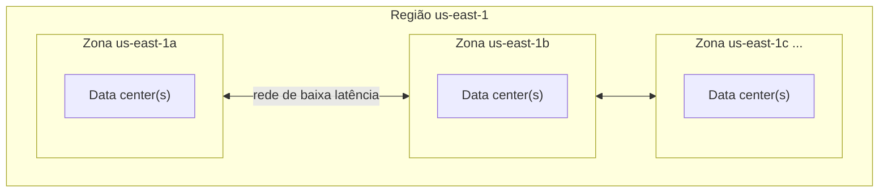
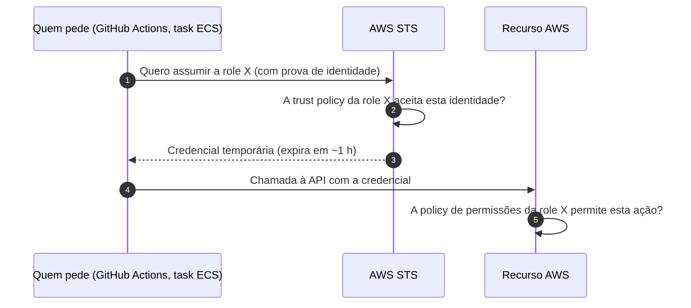
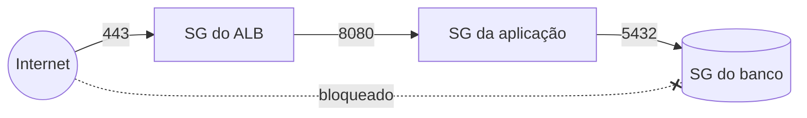
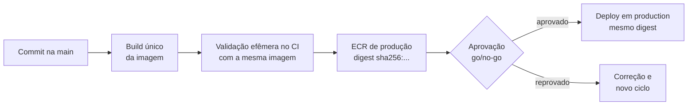
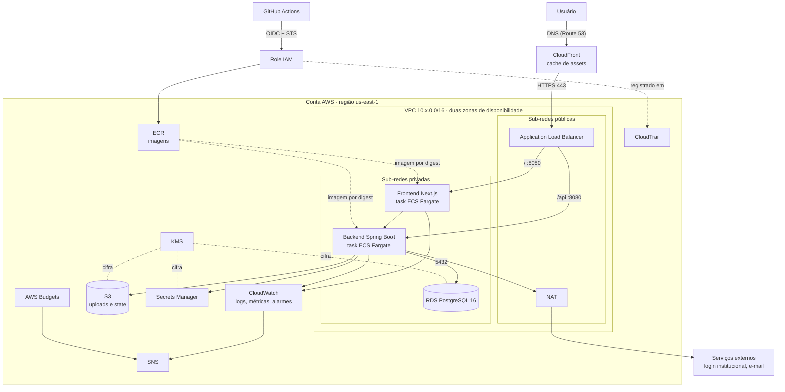

# Conceitos fundamentais de nuvem e AWS

**Objetivo.** Apresentar, a partir do zero, os conceitos de computação em nuvem, redes, identidade e containers necessários para compreender a infraestrutura da Plataforma Digital. Ao final da leitura, deve ser possível olhar o diagrama de arquitetura do projeto e explicar o papel de cada componente.

**Pré-requisitos de leitura:** [01-visao-geral-da-plataforma.md](01-visao-geral-da-plataforma.md). Termos desconhecidos podem ser consultados no [11-glossario.md](11-glossario.md).

> Este documento é material de apoio e não tem caráter normativo. Em caso de divergência, prevalecem os documentos da `_KB` (ADRs, políticas e Must Haves).

## Sumário

1. [Computação em nuvem](#1-computação-em-nuvem)
2. [Conta, região e zona de disponibilidade](#2-conta-região-e-zona-de-disponibilidade)
3. [Identidade e acesso (IAM)](#3-identidade-e-acesso-iam)
4. [Redes](#4-redes)
5. [Containers](#5-containers)
6. [Serviços AWS usados pela plataforma](#6-serviços-aws-usados-pela-plataforma)
7. [Infraestrutura como Código](#7-infraestrutura-como-código)
8. [CI/CD e ambientes](#8-cicd-e-ambientes)
9. [Alta disponibilidade e custo](#9-alta-disponibilidade-e-custo)
10. [Visão integrada](#10-visão-integrada)
11. [Onde aprofundar](#11-onde-aprofundar)
12. [Referências](#referências)

---

## 1. Computação em nuvem

**Computação em nuvem** é o uso de recursos computacionais (servidores, armazenamento, bancos de dados, redes) fornecidos por um provedor pela internet, sob demanda e com cobrança proporcional ao uso. Em vez de comprar e manter servidores físicos, a organização solicita os recursos por meio de uma interface de programação (API) e paga apenas pelo tempo e pela quantidade consumidos.

As características mais relevantes para o projeto são:

| Característica | Significado prático |
| --- | --- |
| Autosserviço sob demanda | Um recurso é criado em minutos, por comando ou por código, sem pedido a terceiros. |
| Elasticidade | A capacidade pode aumentar ou diminuir conforme a carga (por exemplo, mais containers em horário de pico). |
| Cobrança por uso | Recursos ligados custam dinheiro mesmo quando ociosos. Desligar o que não é usado é uma forma direta de economia. |
| Serviços gerenciados | O provedor opera partes da infraestrutura (sistema operacional, backups, atualizações), reduzindo o trabalho da equipe. |

### Modelos de serviço

| Modelo | O provedor gerencia | A equipe gerencia | Exemplo na plataforma |
| --- | --- | --- | --- |
| IaaS (infraestrutura como serviço) | Hardware, rede física, virtualização | Sistema operacional, runtime, aplicação | EC2 (não adotado) |
| CaaS / serverless de containers | Também o sistema operacional e o agendamento dos containers | Imagem do container e configuração | ECS Fargate (ADR-004) |
| PaaS / serviço gerenciado | Também o software do serviço, backups e atualizações | Configuração e dados | RDS PostgreSQL |

### Modelo de responsabilidade compartilhada

A segurança na nuvem é dividida entre o provedor e o cliente. A AWS é responsável pela **segurança da nuvem**: data centers, hardware, rede física e o software que executa os serviços. O cliente é responsável pela **segurança na nuvem**: quem tem acesso, como a rede é configurada, se os dados estão cifrados, se um banco está exposto à internet.

Em outras palavras, a AWS garante que o serviço de banco de dados funciona e está protegido fisicamente, mas é a equipe que decide se esse banco aceita conexões da internet. A maior parte dos incidentes de segurança em nuvem decorre de configurações incorretas do lado do cliente, e não de falhas do provedor. Por esse motivo, o projeto exige revisão de código e varredura automática da configuração de infraestrutura.

## 2. Conta, região e zona de disponibilidade

### Conta AWS

A **conta AWS** é o contêiner administrativo e financeiro de todos os recursos. Cada conta possui um identificador de 12 dígitos, uma fatura própria e um conjunto próprio de identidades e permissões. Recursos de contas diferentes são isolados por padrão.

Organizações costumam usar esse isolamento para separar produção dos demais ambientes (ADR-011, MH-INFRA-003), de modo que um erro cometido em uma conta de não produção não alcance os recursos de produção. Na Plataforma Digital, por decisão do projeto de 2026-10-07 (ADR-012), existe **uma única conta AWS, dedicada à produção**: os demais ambientes executam fora da AWS, e o isolamento fica garantido por construção.

### Região

Uma **região** é uma área geográfica onde a AWS mantém data centers, como `us-east-1` (Norte da Virgínia, Estados Unidos) ou `sa-east-1` (São Paulo). Cada região é independente: um recurso criado em `us-east-1` não aparece em `sa-east-1`. Preços variam entre regiões.

O projeto adota **`us-east-1`** como referência, por ser a região de menor custo e com maior disponibilidade de serviços. A escolha da região afeta latência, custo e eventuais requisitos legais de localização de dados.

### Zona de disponibilidade

Uma **zona de disponibilidade** (Availability Zone, AZ) é um ou mais data centers dentro de uma região, com energia, refrigeração e rede independentes. A região `us-east-1` possui várias zonas, identificadas como `us-east-1a`, `us-east-1b` e assim por diante.

Distribuir recursos em pelo menos duas zonas permite que a aplicação continue funcionando caso uma delas falhe. Esse é o fundamento da **alta disponibilidade**, discutida na seção 9.



## 3. Identidade e acesso (IAM)

O **IAM** (Identity and Access Management) é o serviço que controla **quem** pode fazer **o quê** em **quais recursos** de uma conta AWS. Toda chamada à API da AWS é autenticada (quem está chamando) e autorizada (se essa identidade tem permissão para a ação).

### Identidades

| Identidade | O que é | Tipo de credencial | Uso no projeto |
| --- | --- | --- | --- |
| Usuário raiz (root) | A identidade criada com a conta, com poder total | E-mail e senha | Apenas tarefas administrativas excepcionais; deve ter MFA |
| Usuário IAM | Identidade permanente para uma pessoa ou sistema | Senha e/ou chave de acesso (access key) de longa duração | Evitado para automação |
| Grupo IAM | Conjunto de usuários que compartilham permissões | Não possui credencial própria | Organização de acessos humanos |
| Role (função) IAM | Identidade sem credencial fixa, que é "assumida" temporariamente | Credencial temporária emitida pelo STS | GitHub Actions, tasks do ECS |

A **access key** é um par de identificador e segredo que permite chamar a API como um usuário IAM. Por ser de longa duração, se vazar, permanece válida até ser revogada manualmente. Por isso a política de CI/CD (POL-INFRA-001) determina o uso de roles com credenciais temporárias, e não de access keys.

### Policies

Uma **policy** é um documento JSON que descreve permissões. Cada instrução (statement) combina:

- **Effect**: `Allow` (permitir) ou `Deny` (negar). Um `Deny` explícito sempre prevalece sobre qualquer `Allow`.
- **Action**: as operações da API, no formato `servico:Operacao` (por exemplo, `s3:GetObject`).
- **Resource**: os recursos afetados, identificados pelo **ARN** (Amazon Resource Name), o identificador único de cada recurso na AWS.
- **Condition** (opcional): condições adicionais, como exigir conexão cifrada.

Na ausência de qualquer `Allow`, a ação é negada. Esse comportamento é chamado de **negação implícita**.

Exemplo de policy que permite ler e gravar objetos apenas em um bucket específico e exige conexão cifrada (TLS):

```json
{
  "Version": "2012-10-17",
  "Statement": [
    {
      "Sid": "LerEGravarUploads",
      "Effect": "Allow",
      "Action": ["s3:GetObject", "s3:PutObject"],
      "Resource": "arn:aws:s3:::plataforma-uploads-production/*"
    },
    {
      "Sid": "NegarSemTLS",
      "Effect": "Deny",
      "Action": "s3:*",
      "Resource": [
        "arn:aws:s3:::plataforma-uploads-production",
        "arn:aws:s3:::plataforma-uploads-production/*"
      ],
      "Condition": { "Bool": { "aws:SecureTransport": "false" } }
    }
  ]
}
```

Leitura do exemplo:

- `Version` é a versão da linguagem de policies, sempre `2012-10-17`.
- O primeiro statement permite apenas duas ações (`GetObject` e `PutObject`), apenas nos objetos (`/*`) do bucket `plataforma-uploads-production`. Não permite apagar objetos, listar o bucket nem acessar outros buckets.
- O segundo statement nega qualquer ação no bucket quando a requisição não usa TLS. Como `Deny` prevalece, nem mesmo uma permissão concedida em outro lugar permite acesso sem cifragem.

### Trust policy e STS

Uma role possui dois documentos:

1. **Policy de permissões**: o que a role pode fazer depois de assumida.
2. **Trust policy** (política de confiança): **quem** pode assumir a role.

O **STS** (Security Token Service) é o serviço que, ao validar a trust policy, emite uma **credencial temporária** (válida tipicamente por uma hora). Quando essa credencial expira, ela deixa de funcionar sem nenhuma ação manual.

No projeto, a trust policy das roles usadas pelo GitHub Actions aceita apenas tokens emitidos pelo GitHub para um repositório e contexto específicos. Esse mecanismo, chamado **OIDC** (OpenID Connect), é detalhado em [07-oidc-github-actions-aws.md](07-oidc-github-actions-aws.md).



### Princípio do menor privilégio

O **princípio do menor privilégio** determina que cada identidade receba apenas as permissões estritamente necessárias para sua função, e nada além. Aplicações práticas no projeto:

- A role que executa `terraform plan` em pull requests apenas lê recursos; não cria nem altera nada.
- A role de deploy do backend só publica imagens no repositório de imagens do backend e só atualiza o serviço do backend.
- A aplicação lê apenas o segredo de que precisa, e não todos os segredos da conta.
- Policies com `"Action": "*"` e `"Resource": "*"` são evitadas.

## 4. Redes

### Endereço IP e notação CIDR

Um **endereço IPv4** é composto por 32 bits, escritos como quatro números de 0 a 255 separados por pontos (por exemplo, `10.30.10.15`). Cada número corresponde a 8 bits.

A **notação CIDR** (Classless Inter-Domain Routing) descreve um bloco de endereços na forma `endereço/prefixo`. O prefixo indica quantos bits iniciais são fixos; os bits restantes variam e formam os endereços disponíveis no bloco. A quantidade de endereços é `2^(32 - prefixo)`.

| Bloco | Bits fixos | Bits livres | Endereços | Faixa |
| --- | ---: | ---: | ---: | --- |
| `10.30.0.0/16` | 16 | 16 | 2^16 = 65.536 | `10.30.0.0` a `10.30.255.255` |
| `10.30.10.0/24` | 24 | 8 | 2^8 = 256 | `10.30.10.0` a `10.30.10.255` |
| `10.30.10.0/28` | 28 | 4 | 2^4 = 16 | `10.30.10.0` a `10.30.10.15` |

Exemplo de cálculo para `/16`: os dois primeiros números (`10.30`) ficam fixos, e os dois últimos podem variar de 0 a 255 cada, o que dá 256 × 256 = 65.536 endereços. Para `/24`, os três primeiros números ficam fixos e apenas o último varia: 256 endereços.

Em cada sub-rede, a AWS reserva cinco endereços (o primeiro, os três seguintes e o último). Uma sub-rede `/24` oferece, portanto, 251 endereços utilizáveis.

Os blocos `10.0.0.0/8`, `172.16.0.0/12` e `192.168.0.0/16` são **endereços privados**: não são roteados na internet e são usados dentro de redes internas. O projeto atribui um bloco distinto a cada ambiente:

| Ambiente | CIDR da VPC |
| --- | --- |
| development (somente no laboratório local) | `10.10.0.0/16` |
| reservado (staging, caso volte a existir na AWS) | `10.20.0.0/16` |
| production | `10.30.0.0/16` |

Blocos que não se sobrepõem permitem, no futuro, conectar redes entre si (por exemplo, por peering ou VPN) sem conflito de endereços. Por isso a faixa de staging continua reservada, mesmo sem uso.

### VPC e sub-redes

A **VPC** (Virtual Private Cloud) é uma rede privada e isolada dentro de uma conta AWS, definida por um bloco CIDR. Todos os recursos de rede da aplicação (balanceador, containers, banco de dados) residem dentro de uma VPC.

Uma **sub-rede** (subnet) é uma fatia do bloco da VPC, localizada em uma única zona de disponibilidade. A distinção entre sub-rede pública e privada não é uma propriedade fixa, mas resultado da sua tabela de rotas:

| Tipo | Rota para a internet (`0.0.0.0/0`) | Acessível pela internet | Uso no projeto |
| --- | --- | --- | --- |
| Pública | Para o Internet Gateway | Sim, se o recurso tiver IP público e a regra de firewall permitir | Application Load Balancer, NAT |
| Privada | Para um NAT (ou nenhuma) | Não | Containers da aplicação, banco de dados |

O layout de sub-redes da VPC de produção, `10.30.0.0/16`:

| Sub-rede | CIDR | Zona |
| --- | --- | --- |
| Pública A | `10.30.0.0/24` | us-east-1a |
| Pública B | `10.30.1.0/24` | us-east-1b |
| Privada A | `10.30.10.0/24` | us-east-1a |
| Privada B | `10.30.11.0/24` | us-east-1b |

### Tabela de rotas, Internet Gateway e NAT

- **Tabela de rotas** (route table): conjunto de regras que indica, para cada destino, por onde o tráfego deve sair. A rota `0.0.0.0/0` representa "qualquer endereço", ou seja, a internet.
- **Internet Gateway** (IGW): componente que conecta a VPC à internet nos dois sentidos. Sub-redes cuja tabela de rotas aponta para o IGW são públicas.
- **NAT** (Network Address Translation): componente que permite que recursos em sub-rede privada **iniciem** conexões para a internet (por exemplo, para chamar o provedor de login institucional ou um serviço de e-mail), sem que a internet consiga iniciar conexões para eles. Na AWS, há o **NAT Gateway**, serviço gerenciado, e alternativas como uma instância EC2 configurada como NAT (por exemplo, o projeto de código aberto fck-nat). A escolha entre elas tem impacto relevante de custo; veja [09-custos-e-finops.md](09-custos-e-finops.md).
- **VPC Endpoint**: conexão privada entre a VPC e um serviço AWS (como S3 ou ECR), sem passar pela internet. O endpoint do tipo gateway para S3 é gratuito.

### Security Group e Network ACL

Ambos funcionam como firewall, mas em níveis diferentes:

| Aspecto | Security Group (SG) | Network ACL (NACL) |
| --- | --- | --- |
| Onde atua | Em cada recurso (interface de rede) | Em toda a sub-rede |
| Tipos de regra | Apenas permissões | Permissões e negações |
| Estado | Com estado (stateful): a resposta de uma conexão permitida é liberada automaticamente | Sem estado (stateless): entrada e saída precisam ser liberadas separadamente |
| Pode referenciar outro SG como origem | Sim | Não |
| Uso no projeto | Mecanismo principal de controle de tráfego | Mantida no padrão da AWS |

A possibilidade de referenciar outro Security Group como origem permite o **encadeamento** adotado no projeto: cada camada aceita tráfego apenas da camada anterior, independentemente dos endereços IP.

| Camada | Porta | Aceita tráfego de | Protocolo |
| --- | ---: | --- | --- |
| Balanceador (ALB) | 443 | Internet (`0.0.0.0/0`) | HTTPS |
| Aplicação (containers) | 8080 | Apenas o SG do ALB | HTTP interno |
| Banco de dados | 5432 | Apenas o SG da aplicação | PostgreSQL |



## 5. Containers

Um **container** é um processo isolado que executa uma aplicação junto com todas as suas dependências (bibliotecas, runtime, arquivos de configuração). O mesmo container funciona da mesma forma no computador do desenvolvedor, no pipeline de CI e na nuvem, o que elimina diferenças entre ambientes.

| Conceito | Definição |
| --- | --- |
| Imagem | Pacote imutável, em camadas, com o sistema de arquivos e as instruções para iniciar a aplicação. É o "molde" do container. |
| Container | Uma instância em execução de uma imagem. Várias instâncias podem ser criadas a partir da mesma imagem. |
| Dockerfile | Arquivo de texto com as instruções para construir uma imagem (imagem base, cópia de arquivos, comando de inicialização, usuário). |
| Registry | Repositório onde as imagens são armazenadas e de onde são baixadas. Na AWS, o serviço é o ECR. |

Exemplo simplificado de Dockerfile de uma aplicação Java:

```dockerfile
FROM eclipse-temurin:21-jre          # imagem base com o runtime Java 21
WORKDIR /app
COPY target/app.jar app.jar          # copia o artefato compilado
USER 10001                           # executa sem privilégios de administrador
EXPOSE 8080                          # porta em que a aplicação escuta
ENTRYPOINT ["java", "-jar", "app.jar"]
```

### Tag e digest

Uma imagem pode ser identificada de duas formas:

- **Tag**: um rótulo legível, como `plataforma-backend:1.4.0` ou `plataforma-backend:latest`. Uma tag pode ser movida para outra imagem, a menos que o registry a configure como imutável.
- **Digest**: o resumo criptográfico (hash SHA-256) do conteúdo da imagem, como `plataforma-backend@sha256:3f1a...`. O digest muda se qualquer byte da imagem mudar; portanto, identifica a imagem de forma inequívoca.

O projeto configura tags imutáveis no ECR e realiza deploy referenciando o **digest**. Assim, a imagem validada no CI é comprovadamente a mesma implantada em produção. A tag `latest` não é usada, pois não garante reprodutibilidade.

### Arquitetura de processador

Imagens são construídas para uma arquitetura de processador específica: **x86_64** (também chamada amd64, dos processadores Intel e AMD) ou **arm64** (processadores ARM, como os AWS Graviton e os chips Apple Silicon). Uma imagem x86_64 não executa nativamente em processador arm64, e vice-versa. Imagens **multi-arquitetura** contêm variantes para ambas. Na AWS, processadores Graviton (arm64) custam cerca de 20% menos no Fargate; veja [09-custos-e-finops.md](09-custos-e-finops.md).

## 6. Serviços AWS usados pela plataforma

### Amazon S3

- **O que é:** armazenamento de objetos (arquivos) organizados em **buckets**. Cada objeto é identificado por uma chave (caminho) dentro do bucket.
- **Para que usamos:** armazenar arquivos enviados pelos usuários (entregáveis de projetos, certificados) e o **state** do Terraform. Os buckets do projeto são privados, cifrados, versionados e acessados por **URL pré-assinada**, um link temporário gerado pelo backend que autoriza uma única operação por tempo limitado.
- **No backlog:** INF-001 (bucket do state), INF-010 (bucket de uploads), INF-015 (retenções).

### Amazon ECR

- **O que é:** Elastic Container Registry, o registry de imagens de container da AWS.
- **Para que usamos:** armazenar as imagens do backend e do frontend, com tags imutáveis, varredura de vulnerabilidades no envio (scan on push) e regras de ciclo de vida que removem imagens antigas.
- **No backlog:** INF-006.

### Amazon ECS e AWS Fargate

O **ECS** (Elastic Container Service) é o orquestrador de containers da AWS: decide onde e quantos containers executar e substitui os que falham. O **Fargate** é o modo de execução sem servidores, no qual a AWS fornece a capacidade computacional e a equipe não administra máquinas virtuais (ADR-004).

| Conceito | Definição |
| --- | --- |
| Cluster | Agrupamento lógico de serviços e tasks. |
| Task definition | Especificação versionada de como executar a aplicação: imagem, CPU, memória, portas, variáveis, segredos, configuração de logs e roles. |
| Task | Uma execução de uma task definition (um ou mais containers em execução). |
| Service | Mantém um número desejado de tasks em execução, registra-as no balanceador e realiza deploys graduais. |
| Task role | Role assumida pela aplicação em execução (por exemplo, para gerar URL pré-assinada no S3). |
| Execution role | Role usada pelo ECS para preparar a task (baixar a imagem do ECR, ler segredos, enviar logs). |

- **Para que usamos:** executar a API Spring Boot e, conforme a decisão de runtime do ADR-010, o frontend Next.js com renderização no servidor. Também executar tasks pontuais, como migrations de banco de dados.
- **No backlog:** INF-007 (runtime do backend), INF-011 (runtime do frontend), INF-017 (autoscaling), INF-018 (rollback).

### Application Load Balancer (ALB)

- **O que é:** balanceador de carga da camada de aplicação (HTTP/HTTPS). Recebe as requisições da internet e as distribui entre as tasks saudáveis.
- **Componentes:**
  - **Listener**: escuta uma porta e um protocolo (por exemplo, HTTPS na porta 443) e aplica regras de roteamento por caminho ou nome de host (por exemplo, `/api/*` para o backend e `/` para o frontend).
  - **Target group**: conjunto de destinos (tasks) que recebem o tráfego de uma regra.
  - **Health check**: verificação periódica de um endereço da aplicação (no backend, `/actuator/health/readiness`). Tasks que falham deixam de receber tráfego.
- **Para que usamos:** porta de entrada única da aplicação, compartilhada entre frontend e backend para reduzir custo.
- **No backlog:** INF-002 (rede e SGs), INF-007, INF-011.

### Amazon RDS for PostgreSQL

- **O que é:** serviço gerenciado de banco de dados relacional. A AWS cuida de instalação, atualizações, backups e recuperação.
- **Componentes:**
  - **Instância**: o servidor de banco de dados, com classe (por exemplo, `db.t4g.micro`) e armazenamento definidos.
  - **Subnet group**: conjunto de sub-redes privadas onde a instância pode ser criada.
  - **Parameter group**: parâmetros de configuração do PostgreSQL (por exemplo, `rds.force_ssl = 1`, que obriga conexões cifradas).
  - **Multi-AZ**: mantém uma réplica em outra zona de disponibilidade, com troca automática em caso de falha. Dobra o custo da instância.
  - **Snapshot**: cópia completa do banco em um instante, usada para restauração.
  - **PITR** (Point-in-Time Recovery): restauração para qualquer momento dentro do período de retenção de backups.
- **Para que usamos:** uma única instância PostgreSQL 16, com um schema por domínio de negócio (ADR-002), privada e cifrada.
- **No backlog:** INF-005 (instância), INF-015 (backup), INF-016 (restore).

### AWS Secrets Manager

- **O que é:** serviço para armazenar segredos (senhas, chaves de API) de forma cifrada, com controle de acesso por IAM e possibilidade de rotação.
- **Para que usamos:** guardar a credencial do banco e outros segredos. A task do ECS recebe o segredo em tempo de execução; o valor nunca aparece no código, em variáveis de ambiente do repositório ou em logs (MH-INFRA-001).
- **No backlog:** INF-008.

### AWS KMS

- **O que é:** Key Management Service, serviço de gerenciamento de chaves criptográficas usadas para cifrar dados em outros serviços (S3, RDS, Secrets Manager).
- **Para que usamos:** cifragem com chave gerenciada pelo cliente nos dados mais sensíveis, como o state e os segredos de produção.
- **No backlog:** INF-001, INF-008.

### Amazon CloudWatch

- **O que é:** serviço de observabilidade da AWS.
  - **Logs**: armazenamento e consulta das saídas das aplicações, organizadas em grupos de log com período de retenção.
  - **Métricas**: séries numéricas ao longo do tempo (uso de CPU, latência, número de erros HTTP 5xx, conexões do banco).
  - **Alarmes**: regras que disparam uma notificação quando uma métrica ultrapassa um limite.
- **Para que usamos:** logs estruturados das aplicações com a retenção definida na POL-INFRA-002, painéis e alarmes de latência, erro e banco de dados.
- **No backlog:** INF-007, INF-012 (observabilidade), INF-013 (alarmes).

### Amazon CloudFront

- **O que é:** rede de distribuição de conteúdo (CDN), com servidores espalhados pelo mundo que guardam cópias (cache) de conteúdo próximo aos usuários.
- **Para que usamos:** servir arquivos estáticos do frontend (JavaScript, CSS, imagens) com cache, reduzindo a carga sobre a aplicação. As páginas dinâmicas continuam sendo geradas pelo runtime SSR (ADR-010).
- **No backlog:** INF-011.

### Amazon Route 53

- **O que é:** serviço de DNS, que traduz nomes de domínio (como `plataforma.exemplo.edu.br`) em endereços de rede.
- **Para que usamos:** apontar o domínio da plataforma para o CloudFront ou para o ALB e validar certificados TLS.

### Amazon SNS

- **O que é:** Simple Notification Service, serviço de envio de mensagens para assinantes (e-mail, endpoints HTTP, integrações de chat).
- **Para que usamos:** encaminhar alertas de alarmes do CloudWatch e do AWS Budgets para a equipe.
- **No backlog:** INF-013, INF-014.

### AWS Budgets

- **O que é:** serviço que acompanha o gasto da conta em relação a um orçamento e envia alertas quando limites são atingidos (gasto real ou previsto).
- **Para que usamos:** orçamento mensal de US$ 120 com alertas em 50%, 80% e 100% (POL-INFRA-004). O alerta não desliga recursos automaticamente.
- **No backlog:** INF-014.

### AWS CloudTrail

- **O que é:** registro de auditoria de todas as chamadas à API da AWS: quem fez, o quê, quando e de onde.
- **Para que usamos:** rastrear alterações e acessos, como cada vez que o GitHub Actions assume uma role (`AssumeRoleWithWebIdentity`).
- **No backlog:** INF-004 (evidência de auditoria).

## 7. Infraestrutura como Código

**Infraestrutura como Código** (IaC) é a prática de descrever a infraestrutura em arquivos de texto versionados, em vez de criá-la manualmente pelo console web. A ferramenta lê esses arquivos e cria, altera ou remove os recursos para que correspondam à descrição.

| Criação manual (console) | Infraestrutura como Código |
| --- | --- |
| Difícil de reproduzir em outro ambiente | O mesmo código cria o ambiente do laboratório e o de produção |
| Não há revisão antes da mudança | Toda mudança passa por pull request e revisão |
| Não há histórico confiável | O Git registra quem mudou, o quê e por quê |
| Diferenças entre ambientes passam despercebidas | A ferramenta detecta divergências (drift) |

O projeto adota **Terraform** como ferramenta de IaC (MH-INFRA-002, POL-INFRA-003). Os fundamentos estão em [03-terraform-fundamentos.md](03-terraform-fundamentos.md).

## 8. CI/CD e ambientes

**Integração Contínua** (Continuous Integration, CI) é a prática de validar automaticamente cada alteração de código (compilação, testes, formatação, varreduras de segurança) antes que ela seja incorporada à branch principal. **Entrega Contínua** (Continuous Delivery, CD) estende essa automação até a publicação do software em um ambiente. No projeto, ambas são executadas pelo **GitHub Actions**, o serviço de automação do GitHub, por meio de arquivos chamados **workflows**.

### Ambientes

Um **ambiente** é uma cópia isolada do sistema com uma finalidade específica.

| Ambiente | Finalidade | Dados | Onde executa |
| --- | --- | --- | --- |
| development | Desenvolvimento e experimentação | Fictícios | Máquina do desenvolvedor (containers e emulador) |
| staging (conceito genérico) | Validação em condições próximas às de produção: testes ponta a ponta, carga e segurança | Fictícios ou anonimizados | Em geral, uma conta de nuvem de não produção |
| production | Uso real pelos usuários | Reais | Conta AWS de produção |

Muitos projetos mantêm um **staging** permanente na nuvem. Na Plataforma Digital, para caber no orçamento de US$ 120 por mês, apenas produção existe na AWS (decisão de 2026-10-07). O papel do staging é cumprido por um **ambiente de validação efêmera**: dentro do job do GitHub Actions, o workflow sobe com Docker Compose a imagem recém-construída, um PostgreSQL 16, o MiniStack (S3 e Secrets Manager), as migrations e dados sintéticos; executa smoke, E2E, DAST e carga em escala reduzida; e descarta tudo ao final. Até o go-live, a própria conta de produção, ainda sem usuários nem dados reais, recebe os testes que exigem a AWS real, como a carga a 200 RPS e os ensaios de rollback e de restore. Os detalhes estão em [01-visao-geral-da-plataforma.md](01-visao-geral-da-plataforma.md#7-ambientes) e os custos em [09-custos-e-finops.md](09-custos-e-finops.md).

### Promoção do mesmo artefato

Um princípio central da POL-INFRA-001 é que o **artefato** (a imagem de container, identificada pelo digest) é construído uma única vez e **promovido** entre os ambientes, sem ser reconstruído. Isso garante que o que foi validado é exatamente o que entra em produção.



O fluxo completo, com migrations, smoke tests e rollback, está em [10-diagramas.md](10-diagramas.md) e no runbook RUNBOOK-INFRA-002 (`_KB/operations/runbooks/deployment.md`).

## 9. Alta disponibilidade e custo

**Alta disponibilidade** é a capacidade de um sistema continuar operando diante da falha de um componente. Na AWS, ela é obtida principalmente pela **redundância entre zonas de disponibilidade**: dois containers em zonas diferentes, banco Multi-AZ, NAT em cada zona.

Cada redundância, porém, multiplica o custo do componente. A tabela resume o compromisso para os principais itens do projeto:

| Componente | Opção de maior disponibilidade | Opção de menor custo | Consequência da opção econômica |
| --- | --- | --- | --- |
| Banco de dados | RDS Multi-AZ | RDS em uma zona, com backup e restore testados | Falha de zona exige restauração; indisponibilidade de minutos a horas |
| Saída para a internet | Um NAT Gateway por zona | Uma única instância NAT | Falha da instância interrompe as conexões de saída; o tráfego de entrada continua |
| Containers | Duas ou mais tasks fixas | Uma task com autoscaling | Alguns segundos de indisponibilidade em deploy ou falha de task |

Dois indicadores orientam essa decisão:

- **RTO** (Recovery Time Objective): tempo máximo aceitável para restabelecer o serviço após uma falha.
- **RPO** (Recovery Point Objective): perda máxima aceitável de dados, medida em tempo (por exemplo, até 5 minutos de transações).

A escolha entre disponibilidade e custo é uma decisão de produto e de arquitetura, registrada em ADR. Os números estão em [09-custos-e-finops.md](09-custos-e-finops.md).

## 10. Visão integrada

O diagrama a seguir reúne os conceitos deste documento na arquitetura da plataforma.



## 11. Onde aprofundar

| Conceito | Onde aprofundar no material |
| --- | --- |
| Visão do projeto, repositórios e decisões de arquitetura | [01-visao-geral-da-plataforma.md](01-visao-geral-da-plataforma.md) |
| Terraform: blocos, state, plan e apply, módulos | [03-terraform-fundamentos.md](03-terraform-fundamentos.md) |
| Convenções de nomes, tags, CIDR e fluxo de pull request | [04-padroes-e-fluxo-de-trabalho.md](04-padroes-e-fluxo-de-trabalho.md) |
| Praticar sem conta AWS e sem custo | [05-laboratorio-local-ministack.md](05-laboratorio-local-ministack.md) |
| O que cada item do backlog de infraestrutura entrega | [06-backlog-de-infraestrutura.md](06-backlog-de-infraestrutura.md) |
| IAM, STS, trust policy e OIDC aplicados ao GitHub Actions | [07-oidc-github-actions-aws.md](07-oidc-github-actions-aws.md) |
| Pipeline de deploy no plano gratuito do GitHub | [08-cicd-no-plano-free-do-github.md](08-cicd-no-plano-free-do-github.md) |
| Preços, cenários de custo e alta disponibilidade | [09-custos-e-finops.md](09-custos-e-finops.md) |
| Rede, ambientes, pipeline e state em diagramas | [10-diagramas.md](10-diagramas.md) |
| Definições de termos | [11-glossario.md](11-glossario.md) |
| Dúvidas recorrentes | [12-perguntas-frequentes.md](12-perguntas-frequentes.md) |

## Referências

- AWS: [O que é computação em nuvem](https://aws.amazon.com/what-is-cloud-computing/)
- AWS: [Modelo de responsabilidade compartilhada](https://aws.amazon.com/compliance/shared-responsibility-model/)
- AWS: [Regiões e zonas de disponibilidade](https://docs.aws.amazon.com/whitepapers/latest/get-started-documentdb/aws-regions-and-availability-zones.html)
- AWS: [Guia do usuário do IAM](https://docs.aws.amazon.com/IAM/latest/UserGuide/introduction.html) e [Lógica de avaliação de policies](https://docs.aws.amazon.com/IAM/latest/UserGuide/reference_policies_evaluation-logic.html)
- AWS: [Guia do usuário da Amazon VPC](https://docs.aws.amazon.com/vpc/latest/userguide/what-is-amazon-vpc.html) e [Dimensionamento de sub-redes](https://docs.aws.amazon.com/vpc/latest/userguide/subnet-sizing.html)
- AWS: [Security groups](https://docs.aws.amazon.com/vpc/latest/userguide/vpc-security-groups.html) e [Network ACLs](https://docs.aws.amazon.com/vpc/latest/userguide/vpc-network-acls.html)
- AWS: [Amazon ECS e Fargate](https://docs.aws.amazon.com/AmazonECS/latest/developerguide/AWS_Fargate.html)
- AWS: [Application Load Balancer](https://docs.aws.amazon.com/elasticloadbalancing/latest/application/introduction.html)
- AWS: [Amazon RDS para PostgreSQL](https://docs.aws.amazon.com/AmazonRDS/latest/UserGuide/CHAP_PostgreSQL.html)
- AWS: [Amazon ECR](https://docs.aws.amazon.com/AmazonECR/latest/userguide/what-is-ecr.html), [Amazon S3](https://docs.aws.amazon.com/AmazonS3/latest/userguide/Welcome.html), [Secrets Manager](https://docs.aws.amazon.com/secretsmanager/latest/userguide/intro.html), [CloudWatch](https://docs.aws.amazon.com/AmazonCloudWatch/latest/monitoring/WhatIsCloudWatch.html), [CloudTrail](https://docs.aws.amazon.com/awscloudtrail/latest/userguide/cloudtrail-user-guide.html), [AWS Budgets](https://docs.aws.amazon.com/cost-management/latest/userguide/budgets-managing-costs.html)
- HashiCorp: [O que é Infraestrutura como Código com Terraform](https://developer.hashicorp.com/terraform/tutorials/aws-get-started/infrastructure-as-code)
- GitHub: [Documentação do GitHub Actions](https://docs.github.com/en/actions)
- Governança do projeto: ADR-002, ADR-004, ADR-010 e ADR-011 (`_KB/architecture/adrs/`); POL-INFRA-001 (`_KB/engineering/ci-cd.md`); POL-INFRA-002 (`_KB/engineering/observability.md`); POL-INFRA-003 (`_KB/operations/infrastructure.md`); POL-INFRA-004 (`_KB/operations/finops.md`); MH-INFRA-001 a MH-INFRA-003 (`_KB/must-haves/infrastructure.md`).
