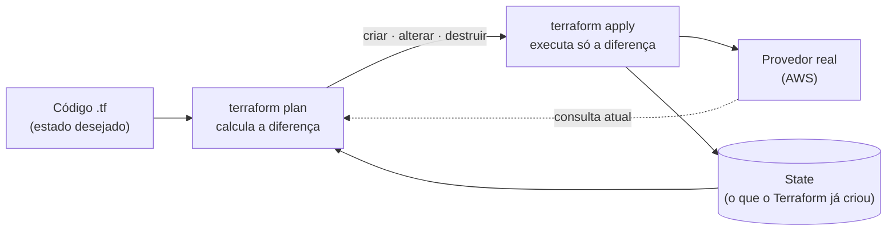
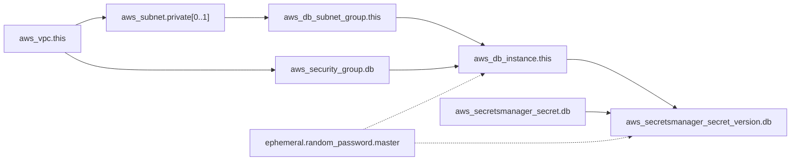
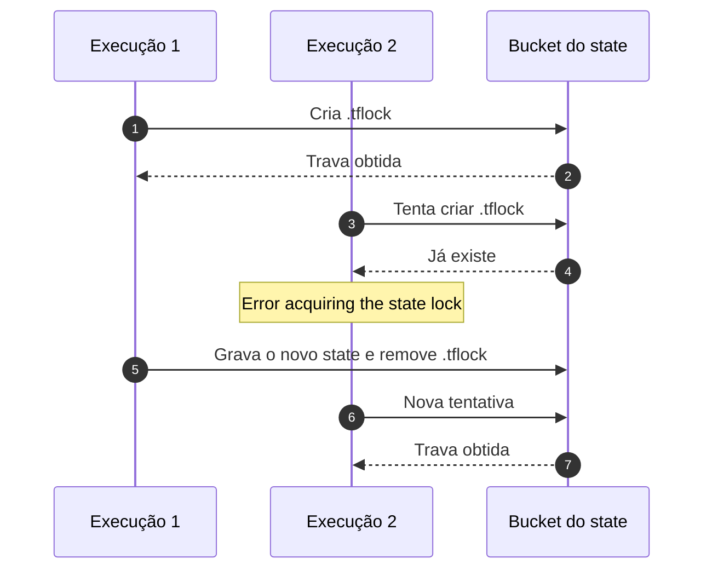
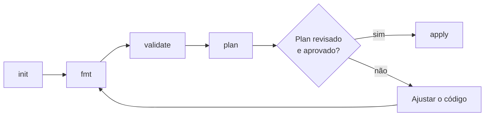

# Terraform: fundamentos

**Objetivo.** Apresentar os conceitos do Terraform necessários para ler, escrever e revisar o código de infraestrutura da Plataforma Digital: o modelo declarativo, a linguagem, o state, o ciclo de comandos, a leitura de um plan, os módulos e as práticas de refatoração e segurança. Todos os exemplos foram retirados do laboratório em [`exemplos/lab-terraform-local/`](exemplos/lab-terraform-local/), que pode ser executado localmente sem conta na AWS.

**Pré-requisitos de leitura:** [02-conceitos-fundamentais-de-nuvem.md](02-conceitos-fundamentais-de-nuvem.md). Para executar os exercícios: [05-laboratorio-local-ministack.md](05-laboratorio-local-ministack.md). Termos desconhecidos: [11-glossario.md](11-glossario.md).

> Este documento é material de apoio e não tem caráter normativo. Em caso de conflito, prevalecem os documentos da `_KB` (ADRs, políticas e Must Haves).

## Sumário

1. [O modelo declarativo](#1-o-modelo-declarativo)
2. [Instalação e controle de versões](#2-instalação-e-controle-de-versões)
3. [Anatomia de um diretório Terraform](#3-anatomia-de-um-diretório-terraform)
4. [Os blocos da linguagem](#4-os-blocos-da-linguagem)
5. [Expressões e meta-argumentos](#5-expressões-e-meta-argumentos)
6. [O grafo de dependências](#6-o-grafo-de-dependências)
7. [State](#7-state)
8. [O ciclo de comandos](#8-o-ciclo-de-comandos)
9. [Como ler um plan](#9-como-ler-um-plan)
10. [Módulos](#10-módulos)
11. [Drift](#11-drift)
12. [Refatoração segura: moved, import e removed](#12-refatoração-segura-moved-import-e-removed)
13. [Segurança no código](#13-segurança-no-código)
14. [Erros comuns](#14-erros-comuns)
15. [Referências](#referências)

---

## 1. O modelo declarativo

Terraform é uma ferramenta de **infraestrutura como código** (IaC, *Infrastructure as Code*): a infraestrutura é descrita em arquivos de texto versionados no Git, revisados por pull request e aplicados por uma ferramenta, em vez de ser criada manualmente pelo console web do provedor.

A linguagem do Terraform (HCL, *HashiCorp Configuration Language*) é **declarativa**. O código não descreve passos ("crie uma VPC, depois crie uma sub-rede"); descreve o **estado desejado** ("existe uma VPC com este CIDR e duas sub-redes nela"). O Terraform compara esse estado desejado com o que já existe e calcula sozinho as ações necessárias.



Consequência importante: **idempotência**. Aplicar o mesmo código duas vezes não cria os recursos em dobro. Na segunda execução, o Terraform encontra tudo como descrito e responde `No changes. Your infrastructure matches the configuration.` Essa propriedade é o que torna a infraestrutura reproduzível: o mesmo código produz o mesmo resultado em qualquer ambiente.

| Abordagem imperativa (scripts, console) | Abordagem declarativa (Terraform) |
| --- | --- |
| Descreve **como** chegar ao resultado | Descreve **qual** é o resultado |
| Rodar duas vezes pode duplicar recursos | Rodar duas vezes não altera nada |
| A ordem dos passos é responsabilidade de quem escreve | A ordem é calculada pelo grafo de dependências |
| Difícil saber o que existe hoje | O state registra o que foi criado |

---

## 2. Instalação e controle de versões

### 2.1 Instalação

| Sistema | Comando |
| --- | --- |
| macOS | `brew install hashicorp/tap/terraform` |
| Windows | `winget install Hashicorp.Terraform` (ou dentro do WSL2, como no Linux) |
| Linux | Pacote oficial do repositório da HashiCorp (ver Referências) |

No laboratório, a instalação é opcional: o `Makefile` executa o Terraform em um container Docker quando o binário não está presente.

### 2.2 Restrições de versão

O bloco `terraform` declara quais versões do próprio Terraform e de cada **provider** são aceitas. Um provider é o plugin que traduz o código para chamadas à API de um serviço; o provider `hashicorp/aws` conversa com a AWS.

```hcl
terraform {
  required_version = ">= 1.10.0, < 2.0.0"

  required_providers {
    aws = {
      source  = "hashicorp/aws"
      version = "~> 6.0"
    }
    random = {
      source  = "hashicorp/random"
      version = "~> 3.6"
    }
  }
}
```

*Trecho de `environments/development/versions.tf` do laboratório.*

| Operador | Significado | Exemplo | Aceita |
| --- | --- | --- | --- |
| `=` | Exatamente esta versão | `= 6.2.0` | Só 6.2.0 |
| `>=`, `<=`, `>`, `<` | Comparação | `>= 1.10.0, < 2.0.0` | De 1.10.0 até antes de 2.0.0 |
| `~>` | Restrição pessimista: só o componente mais à direita pode crescer | `~> 6.0` | 6.0, 6.1, 6.15 (não 7.0) |
| `~>` | Idem, com três componentes | `~> 3.6.1` | 3.6.1, 3.6.9 (não 3.7.0) |

O projeto exige **Terraform 1.10 ou superior** porque é a partir dessa versão que o backend S3 oferece trava (lock) nativa do state, sem tabela DynamoDB (ver seção 7.4).

### 2.3 O arquivo `.terraform.lock.hcl`

O `terraform init` grava em `.terraform.lock.hcl` a versão exata de cada provider escolhida e os hashes do pacote baixado. Nas execuções seguintes, o Terraform usa exatamente essas versões, mesmo que uma versão mais nova compatível exista. Isso garante que todos os integrantes e o pipeline usem o mesmo provider.

- No repositório de infraestrutura real, o arquivo deve ser **versionado** no Git. Para atualizar um provider de forma deliberada, use `terraform init -upgrade` e submeta a mudança do lock em um PR.
- No laboratório, ele está no `.gitignore` para simplificar o uso em máquinas diferentes.

---

## 3. Anatomia de um diretório Terraform

O Terraform trabalha com **um diretório por vez**. Ao executar um comando, ele lê **todos os arquivos `.tf` desse diretório** como se fossem um único arquivo e **ignora subdiretórios e diretórios vizinhos**. A divisão em vários arquivos é apenas organização.

Convenção usada no laboratório e no repositório de infraestrutura:

| Arquivo | Conteúdo |
| --- | --- |
| `versions.tf` | Bloco `terraform`: versões, providers e backend do state |
| `providers.tf` | Configuração dos providers (região, tags padrão) |
| `main.tf` | Recursos e chamadas de módulos |
| `variables.tf` | Variáveis de entrada |
| `outputs.tf` | Valores de saída |

Um diretório em que se executa `terraform init/plan/apply` é chamado de **root module** (módulo raiz). Cada root tem o seu próprio state.

**Erro comum.** Colocar o bloco `terraform { required_providers { ... } }` ou o `backend` em um arquivo na raiz do repositório e executar o Terraform em `environments/production/`. Como o Terraform não lê o diretório pai, o root fica sem as restrições de versão e sem backend remoto, e o state passa a ser gravado localmente sem aviso. Cada root deve declarar o próprio `versions.tf`.

Diretórios gerados que **nunca** devem ser versionados: `.terraform/` (providers e módulos baixados), `*.tfstate`, `*.tfstate.backup` e `*.tfplan`.

---

## 4. Os blocos da linguagem

### 4.1 `terraform`

Configura o próprio Terraform: versões aceitas, providers necessários e o **backend**, isto é, o local onde o state é armazenado. Exemplo na seção 2.2 e na seção 7.3.

### 4.2 `provider`

Configura a conexão com a API do provedor. Na AWS real, o bloco é mínimo: as credenciais vêm do ambiente (no pipeline, por OIDC; ver [07-oidc-github-actions-aws.md](07-oidc-github-actions-aws.md)).

```hcl
provider "aws" {
  region = "us-east-1"

  # Toda resource criada recebe essas tags (rastreabilidade e custos).
  default_tags {
    tags = {
      Project     = "plataforma-digital"
      Environment = "development"
      ManagedBy   = "terraform"
      Squad       = "cloud-devops"
    }
  }
}
```

No laboratório, o mesmo bloco contém também credenciais fictícias e `endpoints` apontando para o emulador local; esses itens são explicados em [05-laboratorio-local-ministack.md](05-laboratorio-local-ministack.md) e **nunca** devem existir no repositório real.

### 4.3 `resource`

Declara um objeto que o Terraform **cria, altera e destrói**. Tem um **tipo** (definido pelo provider) e um **nome local** (usado só dentro do código).

```hcl
resource "aws_s3_bucket" "uploads" {          # tipo = aws_s3_bucket, nome local = uploads
  bucket = "plataforma-uploads-${var.environment}"
}
```

O endereço completo do recurso é `aws_s3_bucket.uploads`. Seus atributos podem ser lidos por outros blocos, por exemplo `aws_s3_bucket.uploads.id` ou `aws_s3_bucket.uploads.arn`.

### 4.4 `data`

Uma **data source** apenas **lê** informações de algo que já existe, sem gerenciá-lo. O Terraform nunca cria nem destrói o objeto lido.

```hcl
# Lê a conta e a identidade usadas pelo provider.
data "aws_caller_identity" "current" {}

# Monta um documento de policy IAM em JSON (não cria nada na AWS).
data "aws_iam_policy_document" "leitura" {
  statement {
    actions   = ["s3:GetObject"]
    resources = ["${aws_s3_bucket.uploads.arn}/*"]
  }
}
```

Uso: `data.aws_caller_identity.current.account_id`.

### 4.5 `variable`

Variáveis são os **parâmetros de entrada** de um módulo. Podem ter tipo, descrição, valor padrão e regras de validação.

```hcl
variable "environment" {
  description = "Nome do ambiente isolado."
  type        = string

  validation {
    condition     = contains(["development", "staging", "production"], var.environment)
    error_message = "environment deve ser development, staging ou production."
  }
}

variable "azs" {
  description = "Zonas de disponibilidade (Multi-AZ = 2 no mínimo)."
  type        = list(string)
  default     = ["us-east-1a", "us-east-1b"]
}
```

*Trecho de `modules/network/variables.tf`.*

| Tipo | Exemplo de valor |
| --- | --- |
| `string` | `"development"` |
| `number` | `14` |
| `bool` | `true` |
| `list(string)` | `["us-east-1a", "us-east-1b"]` (ordenada, permite repetição) |
| `set(string)` | `["plataforma-backend", "plataforma-frontend"]` (sem ordem, sem repetição) |
| `map(string)` | `{ backend = "8080", frontend = "3000" }` |
| `object({...})` | `{ repository = "plataforma-backend", repository_id = 123 }` |

O bloco `validation` transforma regras de negócio em verificação automática. O módulo de banco do laboratório, por exemplo, recusa qualquer versão diferente de PostgreSQL 16, exigida pela baseline do projeto:

```hcl
variable "postgres_major_version" {
  type    = string
  default = "16"

  validation {
    condition     = var.postgres_major_version == "16"
    error_message = "A baseline normativa exige PostgreSQL 16."
  }
}
```

Formas de informar valores, da menor para a maior precedência: `default` na declaração, variáveis de ambiente `TF_VAR_<nome>`, arquivo `terraform.tfvars`, arquivos `*.auto.tfvars`, opção `-var-file=` e opção `-var 'nome=valor'` na linha de comando.

### 4.6 `locals`

Valores internos calculados uma vez e reutilizados, para evitar repetição. Não podem ser informados de fora.

```hcl
locals { environment = "development" }

module "network" {
  source      = "../../modules/network"
  environment = local.environment
}
```

### 4.7 `output`

Valores de **saída**: o que o módulo expõe para quem o chama, ou o que o root exibe ao final do `apply`.

```hcl
output "private_subnet_ids" { value = aws_subnet.private[*].id }

# Só o ARN do segredo sai do módulo; o valor é lido pela aplicação em tempo de execução.
output "secret_arn" { value = aws_secretsmanager_secret.db.arn }
```

Quando um output contém um valor confidencial, ele deve ser marcado com `sensitive = true`. O Terraform passa a ocultá-lo na saída dos comandos (`<sensitive>`). Atenção: `sensitive` **não** remove o valor do state; apenas evita que ele seja impresso. A prática preferida é não expor segredos em outputs.

### 4.8 `module`

Chama um conjunto reutilizável de recursos, passando valores para as suas variáveis. Detalhado na seção 10.

```hcl
module "database" {
  source               = "../../modules/database"
  environment          = local.environment
  private_subnet_ids   = module.network.private_subnet_ids
  db_security_group_id = module.network.db_security_group_id
}
```

---

## 5. Expressões e meta-argumentos

### 5.1 Referências e interpolação

| Forma | Exemplo | Significado |
| --- | --- | --- |
| Atributo de recurso | `aws_vpc.this.id` | O ID da VPC criada |
| Variável | `var.environment` | Valor de entrada |
| Local | `local.environment` | Valor interno |
| Output de módulo | `module.network.vpc_id` | Saída de outro módulo |
| Data source | `data.aws_caller_identity.current.account_id` | Valor lido |
| Interpolação | `"plataforma-${var.environment}-igw"` | Insere um valor em um texto |
| Splat | `aws_subnet.private[*].id` | Lista com o ID de cada instância |

### 5.2 Condicionais

A expressão `condição ? valor_se_verdadeiro : valor_se_falso` permite que o mesmo código se comporte de forma diferente por ambiente:

```hcl
multi_az                = var.environment == "production"
deletion_protection     = var.environment == "production"
skip_final_snapshot     = var.environment != "production"
recovery_window_in_days = var.environment == "production" ? 30 : 0
```

*Trechos de `modules/database/main.tf`.*

### 5.3 Funções

O Terraform oferece funções prontas. Algumas usadas no laboratório: `length()` (tamanho de uma lista), `cidrsubnet()` (divide um bloco CIDR em blocos menores), `jsonencode()` (converte um objeto em JSON), `contains()` (verifica se um item está numa lista) e `can(regex(...))` (testa uma expressão regular). O comando `terraform console` permite testá-las de forma interativa:

```text
> cidrsubnet("10.10.0.0/16", 8, 0)
"10.10.0.0/24"
> cidrsubnet("10.10.0.0/16", 8, 10)
"10.10.10.0/24"
```

### 5.4 `count` e `for_each`

Ambos criam **várias instâncias** de um mesmo bloco. A diferença está em como cada instância é identificada.

**`count`** recebe um número e identifica as instâncias por posição (`[0]`, `[1]`, ...):

```hcl
resource "aws_subnet" "private" {
  count             = length(var.azs)            # uma sub-rede por zona
  vpc_id            = aws_vpc.this.id
  availability_zone = var.azs[count.index]
  cidr_block        = cidrsubnet(var.vpc_cidr, 8, count.index + 10)
}
# Endereços: aws_subnet.private[0], aws_subnet.private[1]
```

**`for_each`** recebe um `set` ou `map` e identifica as instâncias por chave:

```hcl
resource "aws_ecr_repository" "this" {
  for_each             = var.repositories        # set(["plataforma-backend", "plataforma-frontend"])
  name                 = "${each.key}-${var.environment}"
  image_tag_mutability = "IMMUTABLE"
}
# Endereços: aws_ecr_repository.this["plataforma-backend"], aws_ecr_repository.this["plataforma-frontend"]
```

| Critério | `count` | `for_each` |
| --- | --- | --- |
| Identificação | Por índice numérico | Por chave (texto) |
| Remover um item do meio | Desloca os índices seguintes e pode **destruir e recriar** recursos | Afeta apenas o item removido |
| Uso recomendado | Cópias idênticas, ou liga/desliga (`count = var.habilitar ? 1 : 0`) | Itens com identidade própria (repositórios, roles, usuários) |

Regra prática: quando os itens têm nome, use `for_each`.

### 5.5 `depends_on`

O Terraform deduz a ordem de criação pelas referências (seção 6). Quando existe uma dependência que **não aparece** em nenhuma referência, ela é declarada explicitamente:

```hcl
resource "aws_s3_bucket_lifecycle_configuration" "uploads" {
  bucket = aws_s3_bucket.uploads.id
  # ...
  depends_on = [aws_s3_bucket_versioning.uploads]   # a regra de versões antigas exige versionamento ativo
}
```

Use `depends_on` com moderação; referências diretas são mais claras.

### 5.6 `lifecycle`

Altera o comportamento padrão do ciclo de vida de um recurso:

| Argumento | Efeito | Uso típico |
| --- | --- | --- |
| `prevent_destroy = true` | Qualquer plan que destrua o recurso falha | Bancos de dados e buckets de state em produção |
| `create_before_destroy = true` | Na substituição, cria o novo antes de apagar o antigo | Reduzir indisponibilidade |
| `ignore_changes = [atributo]` | Ignora diferenças nesse atributo | Atributos alterados por processos externos |
| `replace_triggered_by = [...]` | Força a substituição quando outro recurso muda | Casos específicos |

No laboratório, `ignore_changes = [max_allocated_storage]` aparece no módulo de banco marcado como *workaround* do emulador: ele não deve ir para o repositório real, porque esconderia mudanças legítimas.

**Exercício de fixação.** No laboratório, adicione um terceiro nome ao `set` `repositories` do módulo `modules/registry` e execute `make plan`. Quantos recursos são adicionados? Em seguida, compare mentalmente com o que aconteceria se o módulo usasse `count` e o nome fosse inserido no início da lista.

---

## 6. O grafo de dependências

Cada referência entre blocos cria uma aresta em um **grafo de dependências**. O Terraform usa esse grafo para decidir a ordem de criação (e a ordem inversa na destruição) e para executar em paralelo tudo o que não depende entre si.

```hcl
resource "aws_subnet" "private" {
  vpc_id = aws_vpc.this.id      # a sub-rede só pode ser criada depois da VPC
}
```

No root `environments/development`, o módulo de banco recebe `module.network.private_subnet_ids`. Por isso o banco só é criado depois da rede. A dependência entre as issues INF-005 (banco) e INF-002 (rede) do backlog corresponde exatamente a essa aresta do grafo.



O comando `terraform graph` gera o grafo completo no formato DOT, que pode ser visualizado com ferramentas como Graphviz.

---

## 7. State

### 7.1 O que é

O **state** é um arquivo JSON (`terraform.tfstate`) em que o Terraform registra a correspondência entre cada endereço do código e o objeto real criado no provedor, por exemplo: "`aws_vpc.this` corresponde à VPC `vpc-0abc123`". Ele guarda também todos os atributos conhecidos de cada recurso.

Sem o state, o Terraform não saberia o que já criou e tentaria criar tudo novamente. Por isso o state é o artefato mais importante e mais sensível de um projeto Terraform.

### 7.2 Por que o state contém segredos

O state armazena os atributos **em texto puro**, inclusive os confidenciais. Uma senha criada com o recurso `random_password`, por exemplo, fica gravada no state mesmo que não apareça em nenhum output. Marcar valores como `sensitive` não muda isso.

O laboratório evita esse problema no banco de dados: a senha é gerada por um recurso efêmero (`ephemeral "random_password"`) e enviada à AWS por atributos write-only (`password_wo` e `secret_string_wo`), que nunca são gravados no state. Esse recurso exige Terraform 1.11 ou superior. Os demais atributos do state continuam sensíveis (endereços, ARNs, configurações), e outros recursos podem gravar segredos; por isso as regras a seguir continuam valendo.

Consequências:

- O state **nunca** é versionado no Git.
- O state fica em armazenamento remoto, **cifrado**, **versionado** e com **acesso mínimo**.
- Sempre que possível, prefira recursos em que o provedor gera e guarda o segredo sem que ele passe pelo Terraform. No RDS, a opção `manage_master_user_password = true` faz a AWS gerar a senha e guardá-la no Secrets Manager.

Esses requisitos correspondem ao Must Have MH-INFRA-001 (`_KB/must-haves/infrastructure.md`) e à issue INF-001.

### 7.3 Backend remoto

O **backend** define onde o state é armazenado. No projeto, o backend é um bucket S3:

```hcl
terraform {
  backend "s3" {
    bucket       = "plataforma-tfstate-development"
    key          = "development/terraform.tfstate"
    region       = "us-east-1"
    encrypt      = true
    use_lockfile = true
  }
}
```

Com o state remoto, todos os integrantes e o pipeline enxergam a mesma versão, e o versionamento do bucket permite recuperar uma versão anterior caso o arquivo seja corrompido.

### 7.4 Lock (trava)

Se duas execuções de `apply` alteram o mesmo state ao mesmo tempo, uma sobrescreve a outra e o state fica inconsistente. O **lock** impede isso: antes de alterar o state, o Terraform cria uma trava; uma segunda execução encontra a trava e falha com `Error acquiring the state lock`.

A partir do Terraform 1.10, a opção `use_lockfile = true` cria a trava como um arquivo `.tflock` **no próprio bucket S3**. A abordagem anterior, com uma tabela DynamoDB, está obsoleta (*deprecated*) e não é necessária.



Se uma execução for interrompida e a trava permanecer, ela pode ser removida com `terraform force-unlock <ID>`, **somente** depois de confirmar que nenhuma outra execução está em andamento.

### 7.5 Bootstrap

O bucket que guarda o state não pode ter o próprio state guardado nele, pois precisa existir antes. Por isso existe o diretório `bootstrap/`: um root pequeno, com state local, executado uma única vez por conta ou ambiente, que cria o bucket do state com versionamento, criptografia e bloqueio de acesso público. Todos os demais roots usam esse bucket como backend.

### 7.6 Um state por ambiente

Cada ambiente tem o próprio root e o próprio state (por exemplo, `key = "production/terraform.tfstate"`). Assim, um erro executado em um ambiente não tem como alterar outro. O ADR-011 (`_KB/architecture/adrs/ADR-011-environment-isolation.md`) exige que produção seja isolada de non-production. Na Plataforma Digital, por decisão de 2026-10-07 (ADR-012), apenas produção existe na AWS: o único state real é o de produção, no bucket `plataforma-tfstate-production` da conta de produção, e o state do ambiente `development` existe somente no laboratório local.

### 7.7 Comandos de inspeção

| Comando | Uso |
| --- | --- |
| `terraform state list` | Lista os endereços registrados |
| `terraform state show <endereço>` | Mostra os atributos de um recurso |
| `terraform show` | Mostra o state completo de forma legível |
| `terraform output` | Mostra os outputs do root |

Edição manual do state (`terraform state rm`, `state mv`) deve ser evitada; prefira os blocos declarativos da seção 12.

**Exercício de fixação.** No laboratório, execute `make exemplo NOME=<seu-nome>` e abra `exemplos/01-primeiro-bucket/terraform.tfstate`. Localize o ID do bucket. Execute `make exemplo-destroy NOME=<seu-nome>` e abra o arquivo novamente. Depois, com o ambiente completo aplicado, rode `make aws CMD="s3 ls s3://plataforma-tfstate-development --recursive"` para ver o state remoto.

---

## 8. O ciclo de comandos

| Comando | O que faz | Quando usar |
| --- | --- | --- |
| `terraform init` | Baixa providers e módulos e conecta ao backend | Na primeira vez e sempre que mudar provider, módulo ou backend |
| `terraform fmt` | Formata o código no padrão oficial (`-check` só verifica) | Antes de todo commit; o CI usa `fmt -check -recursive` |
| `terraform validate` | Verifica sintaxe, tipos e referências, sem acessar o provedor | Antes de todo commit |
| `terraform plan` | Calcula e mostra o que será criado, alterado ou destruído | Sempre; a saída acompanha o PR |
| `terraform plan -out=arquivo.tfplan` | Salva o plano para aplicar exatamente o que foi revisado | No pipeline |
| `terraform apply` | Executa as mudanças | Em ambientes reais, somente pelo pipeline |
| `terraform destroy` | Destrói tudo o que está no state | Laboratório e ambientes temporários |
| `terraform output` | Exibe os outputs | Consultas |
| `terraform console` | Avalia expressões de forma interativa | Testar funções e valores |
| `terraform providers` | Lista os providers exigidos | Diagnóstico |



---

## 9. Como ler um plan

O plan é o documento que mostra o efeito real de uma mudança. **Revisar código Terraform sem ler o plan não é revisão.**

### 9.1 Símbolos

| Símbolo | Significado | Risco |
| --- | --- | --- |
| `+` | Criar | Baixo; verificar custo e exposição |
| `~` | Alterar no lugar (*update in-place*) | Médio; verificar o atributo |
| `-` | Destruir | Alto |
| `-/+` | Destruir e recriar (*replace*) | Alto; em bancos de dados significa perda de dados |
| `+/-` | Criar o novo e depois destruir o antigo (`create_before_destroy`) | Médio |
| `<=` | Ler uma data source | Nenhum |

### 9.2 Exemplo anotado

```text
Terraform will perform the following actions:

  # module.network.aws_security_group.db will be updated in-place     ← (1)
  ~ resource "aws_security_group" "db" {
        id      = "sg-0a1b2c3d"
        name    = "plataforma-development-db"
      ~ ingress = [
          - {                                                         ← (2)
              - cidr_blocks = ["0.0.0.0/0"]
              - from_port   = 5432
              - to_port     = 5432
                # (demais atributos sem mudança)
            },
            # (1 unchanged element hidden)
        ]
    }

  # module.database.aws_db_instance.this must be replaced            ← (3)
-/+ resource "aws_db_instance" "this" {
      ~ address           = "plataforma-development.abc.rds.amazonaws.com" -> (known after apply)  ← (4)
      ~ identifier        = "plataforma-development" -> "plataforma-dev" # forces replacement      ← (5)
      ~ id                = "db-XYZ" -> (known after apply)
        # (32 unchanged attributes hidden)
    }

  # module.storage.aws_s3_bucket.uploads will be created               ← (6)
  + resource "aws_s3_bucket" "uploads" {
      + arn    = (known after apply)
      + bucket = "plataforma-uploads-development"
      + id     = (known after apply)
    }

Plan: 2 to add, 1 to change, 1 to destroy.                           ← (7)
```

1. **Cabeçalho de cada bloco.** Indica o endereço completo do recurso (incluindo o módulo) e a ação.
2. **Atributo removido em uma alteração.** Aqui, uma regra que liberava a porta 5432 para a internet será removida. Esse padrão aparece quando alguém altera o recurso fora do Terraform (drift, seção 11).
3. **`must be replaced` e `-/+`.** O recurso será destruído e criado novamente. Em um banco de dados, isso significa **apagar os dados**, a menos que haja restauração a partir de snapshot.
4. **`(known after apply)`.** O valor só será conhecido depois que o recurso for criado, como IDs e endereços gerados pelo provedor.
5. **`# forces replacement`.** Indica qual atributo provocou a substituição. Alguns atributos não podem ser alterados no lugar; mudar o `identifier` de uma instância RDS é um exemplo.
6. **Criação.** Recurso novo.
7. **Resumo.** Conferir se os números são compatíveis com a intenção da mudança. Um PR que deveria "apenas adicionar uma tag" e mostra `1 to destroy` precisa ser investigado.

### 9.3 Perguntas que o revisor deve fazer

- Os números do resumo correspondem à intenção do PR?
- Existe algum `-` ou `-/+`? Em qual recurso, e qual atributo força a substituição?
- Alguma regra passa a aceitar `0.0.0.0/0`? Alguma policy IAM usa `*` em ações ou recursos?
- Algum valor confidencial aparece em texto claro?
- O que esta mudança custa por mês?

A lista completa de verificação de um PR está em [04-padroes-e-fluxo-de-trabalho.md](04-padroes-e-fluxo-de-trabalho.md).

**Exercício de fixação.** No laboratório, altere no root `environments/development/main.tf` o valor de `vpc_cidr` para `10.11.0.0/16` e execute `make plan`. Identifique quais recursos são substituídos e qual atributo força a substituição. Desfaça a alteração sem aplicar.

---

## 10. Módulos

### 10.1 Conceito

Um **módulo** é um diretório com arquivos `.tf` que recebe valores por `variable` e devolve valores por `output`. Funciona como uma função: encapsula um conjunto de recursos que fazem sentido juntos (a rede, o banco, o registro de imagens) e pode ser chamado várias vezes com parâmetros diferentes.

| Termo | Definição | No projeto |
| --- | --- | --- |
| Root module | Diretório onde se executa o Terraform; tem backend e state próprios | `bootstrap/`, `environments/<ambiente>/`, `global/github-oidc/` |
| Child module | Módulo chamado por um root ou por outro módulo | `modules/network/`, `modules/database/` etc. |
| Entradas | Variáveis do módulo | `environment`, `vpc_cidr`, `private_subnet_ids` |
| Saídas | Outputs do módulo, que formam o seu contrato público | `vpc_id`, `private_subnet_ids`, `secret_arn` |

### 10.2 Estrutura do repositório

```text
plataforma-infrastructure/
├── bootstrap/               # bucket do state (state local, executado uma vez)
├── modules/                 # child modules reutilizáveis
│   ├── network/
│   ├── database/
│   ├── backend/
│   └── frontend/
└── environments/            # roots: um por ambiente, cada um com seu state
    ├── development/         # usado no laboratório local (MiniStack)
    └── production/          # único ambiente na AWS
```

O root de um ambiente apenas compõe os módulos, ligando os outputs de um às entradas de outro (ver `environments/development/main.tf` do laboratório).

### 10.3 Um módulo, vários ambientes

Um módulo **não sabe em qual ambiente está**, além do que recebe por variável. O mesmo `modules/database` cria o banco de desenvolvimento (uma zona, sem proteção contra exclusão, 7 dias de backup) e o de produção (Multi-AZ, proteção contra exclusão, 14 dias de backup). A diferença vem apenas das variáveis e das expressões condicionais:

```hcl
multi_az            = var.environment == "production"
deletion_protection = var.environment == "production"
backup_retention_period = var.backup_retention_days   # o root de produção informa 14
```

Isso garante que o ambiente do laboratório e o de produção sejam construídos pelo **mesmo código**. Como não existe staging na AWS, essa propriedade é o que torna o `plan` e o `apply` contra o MiniStack, executados no CI, uma verificação útil antes do `apply` em produção.

### 10.4 Origem e versão de módulos

O argumento `source` aceita caminhos locais (`../../modules/network`), o Terraform Registry (`terraform-aws-modules/vpc/aws`, com `version = "~> 5.0"`) ou repositórios Git (`git::https://...?ref=v1.2.0`). Módulos externos devem ter a versão fixada, pelo mesmo motivo dos providers.

### 10.5 Boas práticas

- Variáveis com `description` e `type`; validações para regras de negócio.
- Outputs mínimos: exponha IDs e ARNs, nunca valores secretos.
- Nada de bloco `provider` dentro de child modules; o provider é configurado no root.
- Um módulo por responsabilidade; evite módulos que criam "tudo".

---

## 11. Drift

**Drift** é a divergência entre o que o código descreve e o que existe de fato no provedor. Acontece quando alguém altera um recurso por fora do Terraform, por exemplo pelo console web ou pela CLI.

No próximo `plan`, o Terraform detecta a divergência e propõe **desfazer a alteração manual**, devolvendo o recurso ao estado descrito no código. Por isso a regra do projeto é: **nenhum recurso gerenciado por Terraform é criado ou alterado pelo console**. Alterações manuais não passam por revisão, não deixam histórico no Git e são revertidas no próximo `apply`.

Quando uma alteração manual for inevitável (por exemplo, durante um incidente), ela deve ser registrada e incorporada ao código por PR logo em seguida.

O comando `terraform plan -refresh-only` mostra apenas as divergências detectadas, sem propor mudanças de código.

**Exercício de fixação.** Execute o exercício de drift descrito no `README.md` do laboratório: com o ambiente aplicado, uma regra que abre a porta 5432 para `0.0.0.0/0` é adicionada pela CLI, e o `make plan` seguinte mostra a remoção dessa regra.

---

## 12. Refatoração segura: moved, import e removed

Renomear um recurso no código parece inofensivo, mas para o Terraform o endereço antigo deixou de existir e um novo apareceu. O resultado é um plan que **destrói o recurso antigo e cria um novo**. Os blocos abaixo resolvem esse e outros casos sem editar o state manualmente.

### 12.1 `moved`: renomear ou mover

```hcl
moved {
  from = aws_s3_bucket.arquivos
  to   = aws_s3_bucket.uploads
}

# Também serve para mover um recurso para dentro de um módulo:
moved {
  from = aws_vpc.principal
  to   = module.network.aws_vpc.this
}
```

O plan passa a mostrar `has moved to` em vez de destruição e criação.

### 12.2 `import`: trazer para o Terraform algo criado fora dele

```hcl
import {
  to = aws_s3_bucket.legado
  id = "nome-do-bucket-existente"
}

resource "aws_s3_bucket" "legado" {
  bucket = "nome-do-bucket-existente"
}
```

O comando `terraform plan -generate-config-out=gerado.tf` pode gerar um rascunho do bloco `resource` a partir do objeto real, que deve ser revisado antes do uso.

### 12.3 `removed`: deixar de gerenciar sem destruir

```hcl
removed {
  from = aws_s3_bucket.legado

  lifecycle {
    destroy = false     # remove do state, mas mantém o bucket na AWS
  }
}
```

Os três blocos são revisados no PR como qualquer outro código e podem ser removidos depois de aplicados em todos os ambientes.

---

## 13. Segurança no código

As práticas abaixo são verificadas na revisão e pelos analisadores estáticos de IaC.

| Prática | Como aparece no código |
| --- | --- |
| Nenhuma credencial no código | Sem `access_key`/`secret_key` no provider; no pipeline, credenciais temporárias via OIDC ([07-oidc-github-actions-aws.md](07-oidc-github-actions-aws.md)) |
| Banco sem exposição | `publicly_accessible = false`, sub-redes privadas, security group aceitando só o security group da aplicação |
| Buckets privados | `aws_s3_bucket_public_access_block` com os quatro bloqueios, criptografia e versionamento |
| Segredos gerados, não escritos | `random_password` ou `manage_master_user_password`; valor entregue pelo Secrets Manager e lido pela aplicação em tempo de execução |
| Outputs sem segredos | Expor ARN, não o valor; `sensitive = true` quando inevitável |
| Privilégio mínimo | Policies IAM com ações e recursos específicos, sem `"*"` |
| Imagens imutáveis | ECR com `image_tag_mutability = "IMMUTABLE"` e `scan_on_push = true` |
| Proteção de dados em produção | `deletion_protection`, `prevent_destroy`, backups |

Analisadores usados no projeto:

```bash
tflint --recursive                # boas práticas e erros específicos do provider
trivy config .                    # configurações inseguras de IaC
checkov -d .                      # alternativa ao trivy
```

---

## 14. Erros comuns

| Erro | Consequência | Prevenção |
| --- | --- | --- |
| Versionar `terraform.tfstate` no Git | Vazamento de segredos e conflito entre integrantes | `.gitignore` e backend remoto |
| Aplicar sem ler o plan | Destruição não percebida (por exemplo, `-/+` no banco) | Leitura obrigatória do plan no PR |
| Alterar recursos pelo console | Drift; a alteração é revertida no próximo `apply` | Toda mudança por código e PR |
| Renomear um recurso sem `moved` | Destruição e recriação | Bloco `moved` |
| Usar `count` para itens com identidade | Recriações ao remover um item do meio | `for_each` com chaves |
| Versões não fixadas (providers, módulos, imagens `latest`) | Resultados diferentes a cada execução | Restrições de versão e `.terraform.lock.hcl` versionado |
| Mesmo bloco CIDR em dois ambientes | Impede interligação de redes no futuro | CIDR exclusivo por ambiente |
| Declarar `backend` ou `required_providers` fora do diretório do root | State local sem aviso e versões não controladas | `versions.tf` em cada root |
| Excluir um segredo do Secrets Manager e recriar com o mesmo nome | A AWS bloqueia o nome durante a janela de recuperação (até 30 dias) | `recovery_window_in_days` adequado por ambiente |
| Interromper um `apply` | Trava do state permanece | Aguardar; usar `force-unlock` só com certeza |

---

## Referências

- Terraform: documentação da linguagem — https://developer.hashicorp.com/terraform/language
- Terraform: instalação — https://developer.hashicorp.com/terraform/install
- Terraform: tutoriais oficiais para AWS — https://developer.hashicorp.com/terraform/tutorials/aws-get-started
- Terraform: restrições de versão — https://developer.hashicorp.com/terraform/language/expressions/version-constraints
- Terraform: backend S3 e `use_lockfile` — https://developer.hashicorp.com/terraform/language/backend/s3
- Terraform: state — https://developer.hashicorp.com/terraform/language/state
- Terraform: blocos `moved`, `import` e `removed` — https://developer.hashicorp.com/terraform/language/modules/develop/refactoring e https://developer.hashicorp.com/terraform/language/import
- Provider AWS no Terraform Registry — https://registry.terraform.io/providers/hashicorp/aws/latest/docs
- TFLint — https://github.com/terraform-linters/tflint
- Trivy — https://github.com/aquasecurity/trivy
- Governança do projeto: ADR-011 `_KB/architecture/adrs/ADR-011-environment-isolation.md`; MH-INFRA-001 a MH-INFRA-003 `_KB/must-haves/infrastructure.md`; POL-INFRA-003 `_KB/operations/infrastructure.md`
