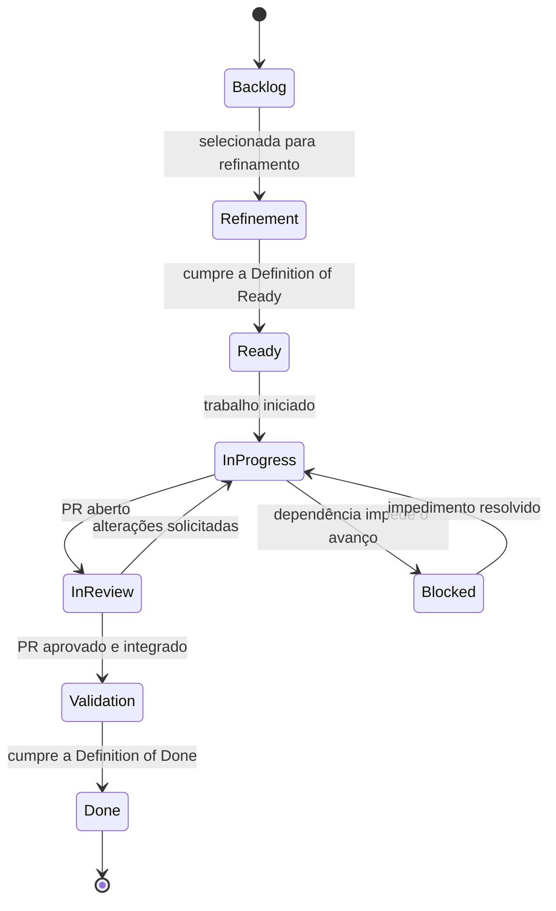
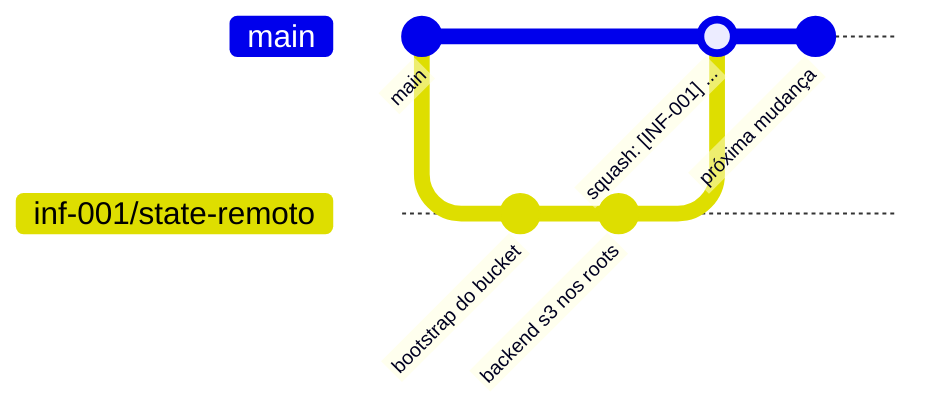

# Padrões e fluxo de trabalho de infraestrutura

**Objetivo.** Descrever como uma mudança de infraestrutura percorre o processo do projeto, desde a issue até o merge, e quais convenções, verificações e critérios de revisão se aplicam ao código Terraform do repositório `plataforma-infrastructure`.

**Pré-requisitos de leitura:** [01-visao-geral-da-plataforma.md](01-visao-geral-da-plataforma.md) e [03-terraform-fundamentos.md](03-terraform-fundamentos.md).

> Este documento é material de apoio e não tem caráter normativo. As regras oficiais estão na `_KB`: POL-GOV-005 Definition of Ready (`_KB/governance/definition-of-ready.md`), POL-GOV-006 Definition of Done (`_KB/governance/definition-of-done.md`), POL-GOV-010 Git e Pull Requests (`_KB/engineering/git-and-pr.md`), POL-INFRA-001 CI/CD (`_KB/engineering/ci-cd.md`) e ADR-008 baseline de governança (`_KB/architecture/adrs/ADR-008-governance-baseline.md`). Em caso de conflito, prevalecem esses documentos.

## Sumário

1. [Onde cada informação fica](#1-onde-cada-informação-fica)
2. [Estados de uma issue](#2-estados-de-uma-issue)
3. [Definition of Ready aplicada a infraestrutura](#3-definition-of-ready-aplicada-a-infraestrutura)
4. [GitHub Flow](#4-github-flow)
5. [Convenções](#5-convenções)
6. [O pull request de infraestrutura](#6-o-pull-request-de-infraestrutura)
7. [Verificações automáticas e como executá-las localmente](#7-verificações-automáticas-e-como-executá-las-localmente)
8. [Checklist de revisão](#8-checklist-de-revisão)
9. [Definition of Done aplicada a infraestrutura](#9-definition-of-done-aplicada-a-infraestrutura)
10. [Regras permanentes](#10-regras-permanentes)
11. [Baseline de governança](#11-baseline-de-governança)
12. [Esboço do workflow de CI](#12-esboço-do-workflow-de-ci)
13. [Referências](#referências)

---

## 1. Onde cada informação fica

| Informação | Local | Observação |
| --- | --- | --- |
| Unidade de trabalho (o que fazer, critérios de aceite) | **Issue** no repositório executor | Ex.: issues INF-001 a INF-021 em `plataforma-infrastructure` |
| Estado, prioridade e sprint | **GitHub Project** | Campos Status e Sprint |
| Regras, decisões e políticas | `_KB` do `plataforma-governance` | ADRs, políticas, Must Haves |
| Código e evidências técnicas | Repositório executor e PR | Plan, logs de CI |

Documentos Markdown não registram o andamento de tarefas. Quem quiser saber em que ponto está uma entrega consulta o Project.

---

## 2. Estados de uma issue



| Estado | Significado |
| --- | --- |
| Backlog | Registrada, ainda não detalhada |
| Refinement | Em detalhamento: critérios de aceite, dependências, riscos |
| Ready | Pronta para ser iniciada |
| In Progress | Em desenvolvimento, com branch aberta |
| In Review | PR aberto aguardando revisão |
| Validation | Integrada; evidências pós-merge sendo verificadas (por exemplo, apply em produção seguido de `plan` sem mudanças) |
| Done | Concluída conforme a Definition of Done |
| Blocked | Impedida por dependência externa ou questão em aberto |

---

## 3. Definition of Ready aplicada a infraestrutura

A Definition of Ready (DoR) é a lista de condições para que uma issue possa ser iniciada. A lista oficial está em `_KB/governance/definition-of-ready.md`. Para infraestrutura, cada item costuma significar o seguinte:

| Item da DoR | Interpretação em infraestrutura |
| --- | --- |
| Objetivo e resultado claros | Quais recursos existirão ao final e em quais ambientes |
| Repositório, prioridade, iteração e dependências definidos | Issues predecessoras concluídas (por exemplo, a rede antes do banco) e conta AWS disponível |
| SPEC e contratos vinculados ou dispensa justificada | ADRs e políticas aplicáveis citados na issue |
| Critérios de aceite numerados e verificáveis | Cada critério pode ser comprovado por plan, comando ou teste. Ex.: "o bucket bloqueia acesso público (evidência: `aws s3api get-public-access-block`)" |
| Must Haves e riscos identificados | MH-INFRA-001 a 003, impacto de custo, risco de destruição de dados |
| Nenhuma questão aberta bloqueante | Decisões de arquitetura ou de custo necessárias já registradas |
| Responsável e revisor aceitaram | Revisor definido antes do início |

Critérios de aceite de referência para cada item do backlog estão em [06-backlog-de-infraestrutura.md](06-backlog-de-infraestrutura.md). Os critérios válidos são os registrados na própria issue.

---

## 4. GitHub Flow

O projeto adota o **GitHub Flow**: a branch `main` contém sempre código aprovado, e toda mudança passa por uma branch de curta duração e um pull request (PR).



Regras (POL-GOV-010):

- Não existem branches `develop` ou `release/*` permanentes.
- Não há push direto na `main` nem *force push* (reescrita forçada do histórico).
- Todo PR referencia a issue, passa nas verificações automáticas, tem as conversas resolvidas e é aprovado pelo revisor e pelos CODEOWNERS (donos de código definidos no arquivo `.github/CODEOWNERS`).
- A integração é feita por **squash merge**: os commits da branch viram um único commit na `main`, com título padronizado.
- Branches devem viver poucos dias. Mudanças grandes são divididas em PRs menores.

> **Limitação do plano atual.** Em organizações no plano GitHub Free com repositórios privados, os recursos de *branch protection* e *rulesets* não estão disponíveis, de modo que as regras acima não podem ser impostas tecnicamente e dependem de disciplina e de auditoria. O assunto e os controles compensatórios estão em [08-cicd-no-plano-free-do-github.md](08-cicd-no-plano-free-do-github.md).

---

## 5. Convenções

### 5.1 Estrutura do repositório

```text
plataforma-infrastructure/
├── bootstrap/                   # bucket do state remoto (state local, executado uma vez)
├── global/                      # recursos de conta (ex.: provedor OIDC e roles do CI)
├── modules/                     # módulos reutilizáveis, sem bloco provider
├── environments/
│   ├── development/             # usado apenas no laboratório local e no CI (MiniStack)
│   └── production/              # único ambiente na AWS, conta dedicada
└── .github/
    ├── CODEOWNERS
    └── workflows/
```

O laboratório em [`exemplos/lab-terraform-local/`](exemplos/lab-terraform-local/) segue o mesmo layout. Não existe `environments/staging/`: por decisão do projeto de 2026-10-07 (ADR-012), apenas produção existe na AWS, e a validação que caberia a um staging é feita em um ambiente efêmero dentro do CI ([01-visao-geral-da-plataforma.md](01-visao-geral-da-plataforma.md#7-ambientes)).

### 5.2 Nomes de recursos

Padrão: `plataforma-<recurso>-<ambiente>`.

| Recurso | Exemplo |
| --- | --- |
| Bucket de state | `plataforma-tfstate-production` |
| Bucket de uploads | `plataforma-uploads-production` |
| Repositório ECR | `plataforma-backend-production` |
| Instância RDS | `plataforma-production` |
| Segredo | `plataforma/production/database` |

No laboratório, o mesmo padrão produz nomes com o sufixo `development` (por exemplo, `plataforma-tfstate-development`).

No código, o nome local de um recurso único em seu módulo é `this` (por exemplo, `aws_vpc.this`).

### 5.3 Tags padrão

Todo recurso recebe as tags abaixo por meio de `default_tags` no provider de cada root:

| Tag | Valor | Finalidade |
| --- | --- | --- |
| `Project` | `plataforma-digital` | Identificar o projeto |
| `Environment` | `production` na AWS; `development` no laboratório | Separar custos e recursos por ambiente |
| `ManagedBy` | `terraform` | Identificar recursos criados fora do Terraform (os que não têm a tag) |
| `Squad` | `cloud-devops` | Responsabilidade |

Essas tags são a base dos relatórios de custo (ver [09-custos-e-finops.md](09-custos-e-finops.md)).

### 5.4 Endereçamento de rede

Cada ambiente usa um bloco CIDR exclusivo, para que as redes possam ser interligadas no futuro sem conflito:

| Ambiente | CIDR da VPC |
| --- | --- |
| development (somente no laboratório) | `10.10.0.0/16` |
| reservado para um staging na AWS, caso volte a existir | `10.20.0.0/16` |
| production | `10.30.0.0/16` |

### 5.5 Branches, commits e PRs

| Item | Padrão | Exemplo |
| --- | --- | --- |
| Branch | `inf-00X/descricao-curta` | `inf-002/vpc-e-subnets` |
| Título do PR e do commit de squash | `[INF-00X] descrição no imperativo` | `[INF-002] Cria VPC, sub-redes e security groups` |
| Vínculo com a issue | `Closes #X` no corpo do PR | `Closes #2` |

A palavra-chave `Closes #X` faz o GitHub fechar a issue automaticamente quando o PR é integrado.

---

## 6. O pull request de infraestrutura

Um PR de infraestrutura precisa permitir que o revisor entenda a intenção, veja o efeito real e saiba como desfazer. Modelo de descrição:

```markdown
## Contexto
Closes #X
Por que esta mudança é necessária. ADRs, políticas e Must Haves relacionados
(ex.: ADR-011, MH-INFRA-001).

## Mudança
- O que foi criado, alterado ou removido, por módulo e por ambiente.
- Decisões tomadas e alternativas descartadas.

## Plan
Resumo: `Plan: N to add, N to change, N to destroy` contra produção e resultado do `apply` contra o MiniStack no CI.
<details><summary>Saída completa do terraform plan</summary>

(colar a saída ou o link para o comentário gerado pelo CI)

</details>

## Riscos
- Algum recurso é destruído ou substituído? Há perda de dados possível?
- Impacto em outras equipes (backend, frontend, banco, qualidade).
- Impacto de custo estimado (US$/mês).

## Rollback
Como desfazer: reverter o PR e aplicar, restaurar snapshot, comandos específicos.

## Evidências
- Verificações do CI aprovadas (fmt, validate, tflint, scanner, plan).
- Comprovação de cada critério de aceite da issue (comandos e saídas).
```

Boas práticas:

- Um PR resolve uma issue. PRs pequenos são revisados com mais qualidade.
- A saída do plan nunca deve conter segredos. Se contiver, o código está errado.
- Mudanças de módulo devem mostrar o plan de **todos** os roots que usam o módulo (produção e, no laboratório, `development`).
- Antes do go-live, um erro em produção afeta apenas a equipe; depois do go-live, afeta usuários reais. A partir do go-live, todo PR que altere recursos com dados (RDS, buckets) deve indicar o snapshot ou a versão a restaurar em caso de falha.

---

## 7. Verificações automáticas e como executá-las localmente

| Verificação | O que detecta | Comando local |
| --- | --- | --- |
| Formatação | Código fora do padrão oficial | `terraform fmt -check -recursive` (corrigir com `terraform fmt -recursive`) |
| Validação | Erros de sintaxe, tipo e referência | `terraform -chdir=environments/production init -backend=false && terraform -chdir=environments/production validate` |
| Lint | Más práticas e valores inválidos do provider (por exemplo, tipo de instância inexistente) | `tflint --init && tflint --recursive` |
| Segurança de IaC | Configurações inseguras: bucket público, banco exposto, falta de criptografia | `trivy config .` ou `checkov -d .` |
| Apply no emulador | Erros que só aparecem ao criar os recursos (dependências, nomes, combinações de atributos) | No laboratório: `make bootstrap && make init && make plan && make apply` |
| Plan | O efeito real da mudança em produção | Executado pelo CI com credenciais temporárias de somente leitura |

No laboratório, `make check` executa `fmt` e `validate` da mesma forma que o CI.

A equipe de Qualidade e Segurança verifica o código de infraestrutura com análise estática e não aceita achados de severidade alta ou crítica. Executar o scanner localmente desde o início evita retrabalho.

**Exercício de fixação.** No laboratório, altere a indentação de um arquivo `.tf` e execute `make check`. Observe a falha do `fmt -check` e corrija com `make fmt`.

---

## 8. Checklist de revisão

O revisor de um PR de Terraform verifica o código **e** o plan. Itens mínimos:

**Plan**

- [ ] O resumo (`to add`, `to change`, `to destroy`) corresponde à intenção descrita.
- [ ] Nenhuma destruição (`-`) ou substituição (`-/+`) inesperada. Substituição de banco de dados, bucket com dados ou bucket de state exige justificativa e plano de backup.
- [ ] O atributo que força cada substituição (`# forces replacement`) foi entendido.
- [ ] Nenhuma alteração em recursos que não fazem parte da mudança (pode indicar drift).

**Segurança**

- [ ] Nenhuma regra de entrada aberta para `0.0.0.0/0`, exceto a porta 443 do load balancer.
- [ ] Banco com `publicly_accessible = false`, em sub-rede privada.
- [ ] Buckets com bloqueio de acesso público, criptografia e versionamento.
- [ ] Policies IAM sem `"*"` em `Action` ou `Resource` sem justificativa explícita.
- [ ] Nenhum segredo em código, variável padrão, output ou saída do plan.
- [ ] Nenhuma credencial (`access_key`, `secret_key`) no provider ou no backend.

**Qualidade**

- [ ] Versões de Terraform, providers e módulos fixadas; `.terraform.lock.hcl` atualizado quando houver mudança de provider.
- [ ] Nomes e tags seguem as convenções da seção 5.
- [ ] Variáveis com `type` e `description`; regras de negócio com `validation`.
- [ ] Renomeações usam `moved`, sem destruição.
- [ ] Nenhum *workaround* do emulador local (`endpoints`, `skip_*`, `ignore_changes` marcados como workaround).

**Custo e operação**

- [ ] Impacto mensal estimado e compatível com o orçamento (POL-INFRA-004, `_KB/operations/finops.md`).
- [ ] Retenção de logs e backups conforme POL-INFRA-002 e POL-INFRA-003.
- [ ] Procedimento de rollback descrito e viável.

---

## 9. Definition of Done aplicada a infraestrutura

A lista oficial está em `_KB/governance/definition-of-done.md`. Em infraestrutura:

| Item da DoD | Interpretação em infraestrutura |
| --- | --- |
| Critérios de aceite atendidos e evidenciados | Saídas de comandos ou capturas anexadas à issue ou ao PR |
| Testes, lint, build e análises estáticas aprovados | `fmt`, `validate`, `tflint` e scanner sem falhas |
| Contratos, ADRs e Must Haves respeitados | Revisão confirmou aderência |
| `spec-compliance` sem FAIL | Verificação de conformidade do CI aprovada |
| Revisão e CODEOWNERS aprovadas | Aprovação registrada no PR |
| Documentação e rollback atualizados | README do módulo, runbooks (`_KB/operations/runbooks/`) quando aplicável |
| PR integrado e validação pós-merge concluída | Apply executado pelo pipeline e `plan` seguinte sem mudanças (`No changes`) |

---

## 10. Regras permanentes

1. **Nunca versionar** `*.tfstate`, `*.tfstate.backup`, `*.tfplan`, `.terraform/`, arquivos `.env` ou chaves de acesso. O `.gitignore` do repositório já cobre esses padrões; não o remova.
2. **Nunca criar ou alterar** recursos gerenciados pelo Terraform pelo console da AWS ou pela CLI. Alterações manuais geram drift e são revertidas no próximo apply.
3. **`apply` em produção somente pelo pipeline**, após o merge na `main`. Execuções locais de `apply` são restritas ao laboratório. Depois do go-live, recomenda-se disparar o apply manualmente (`workflow_dispatch` na `main`) logo após o merge, para que alguém acompanhe a execução.
4. **Sempre ler o plan** antes de aprovar ou aplicar.
5. **Nenhuma credencial de longa duração** no GitHub: o acesso do pipeline à AWS é feito por OIDC ([07-oidc-github-actions-aws.md](07-oidc-github-actions-aws.md)).
6. **Actions de terceiros fixadas por SHA de commit**, nunca por tag (POL-INFRA-001).

---

## 11. Baseline de governança

Cada repositório executor contém um arquivo `.governance-baseline` que fixa a versão da governança seguida, por meio de uma tag no formato `governance-vMAJOR.MINOR.PATCH` e do SHA do commit correspondente. O CI confirma que a tag aponta para o SHA declarado antes de executar as verificações de conformidade (ADR-008).

Motivação: as regras da `_KB` podem evoluir, e cada repositório adota uma nova versão de forma explícita, por PR, em vez de ser afetado por mudanças a qualquer momento. Cópias locais de documentos da governança não têm autoridade.

---

## 12. Esboço do workflow de CI

Esboço de um workflow que executa as verificações em todo PR que altera código Terraform. Como não há staging na AWS, o PR tem duas verificações complementares: um `apply` completo contra o MiniStack, dentro do próprio job (valida a forma do código sem custo), e um `plan` contra produção com uma role de somente leitura (mostra o efeito real). Os valores `<SHA>` representam o commit completo de cada action, que deve ser consultado no repositório da action e fixado.

```yaml
# .github/workflows/terraform-pr.yml
name: terraform-pr
on:
  pull_request:
    paths: ["**/*.tf", ".github/workflows/terraform-*.yml"]

permissions:
  contents: read
  id-token: write        # necessário para obter credenciais AWS por OIDC
  pull-requests: write   # para publicar o plan como comentário

concurrency:
  group: terraform-pr-${{ github.ref }}
  cancel-in-progress: true

jobs:
  checks:
    runs-on: ubuntu-latest
    steps:
      - uses: actions/checkout@<SHA>
      - uses: hashicorp/setup-terraform@<SHA>
      - run: terraform fmt -check -recursive
      - uses: terraform-linters/setup-tflint@<SHA>
      - run: tflint --init && tflint --recursive
      - uses: aquasecurity/trivy-action@<SHA>
        with:
          scan-type: config
          severity: HIGH,CRITICAL
          exit-code: "1"

  apply-emulador:
    needs: checks
    runs-on: ubuntu-latest
    steps:
      - uses: actions/checkout@<SHA>
      - uses: hashicorp/setup-terraform@<SHA>
      - run: docker compose -f exemplos/ministack/compose.yaml up -d --wait   # MiniStack no runner
      - run: terraform -chdir=bootstrap init -input=false && terraform -chdir=bootstrap apply -auto-approve
      - run: terraform -chdir=environments/development init -input=false
      - run: terraform -chdir=environments/development apply -input=false -auto-approve
      - run: terraform -chdir=environments/development plan -input=false -detailed-exitcode   # deve resultar em "No changes"

  plan:
    needs: checks
    runs-on: ubuntu-latest
    steps:
      - uses: actions/checkout@<SHA>
      - uses: hashicorp/setup-terraform@<SHA>
      - uses: aws-actions/configure-aws-credentials@<SHA>
        with:
          role-to-assume: ${{ vars.AWS_ROLE_ARN_PLAN }}   # role de somente leitura
          aws-region: us-east-1
      - run: terraform -chdir=environments/production init -input=false
      - run: terraform -chdir=environments/production validate
      - run: terraform -chdir=environments/production plan -input=false -no-color -lock-timeout=60s
      # Etapa seguinte: publicar a saída do plan como comentário no PR.
```

Pontos de atenção:

- `permissions` declara apenas o necessário; o padrão do repositório deve ser somente leitura.
- O plan em PR usa uma role de **somente leitura**, porque o workflow executado em um PR é a versão contida no próprio PR e pode ter sido modificado por quem o abriu.
- O caminho `exemplos/ministack/compose.yaml` é ilustrativo: no repositório real, o arquivo do emulador fica onde a equipe definir, e o root `development` precisa da configuração de provider para o emulador descrita em [05-laboratorio-local-ministack.md](05-laboratorio-local-ministack.md).
- O `apply` em produção não acontece no PR: ocorre após o merge na `main`, em workflow separado, com a role `gha-infra-apply` e `concurrency` que impede duas execuções simultâneas. Os workflows de apply e de deploy estão descritos em [07-oidc-github-actions-aws.md](07-oidc-github-actions-aws.md) e [08-cicd-no-plano-free-do-github.md](08-cicd-no-plano-free-do-github.md).
- Workflows reutilizáveis (`on: workflow_call`) permitem que vários repositórios compartilhem as mesmas verificações (issue INF-003).

---

## Referências

- GitHub Flow — https://docs.github.com/en/get-started/using-github/github-flow
- Vincular PR a issue (`Closes #X`) — https://docs.github.com/en/issues/tracking-your-work-with-issues/using-issues/linking-a-pull-request-to-an-issue
- CODEOWNERS — https://docs.github.com/en/repositories/managing-your-repositorys-settings-and-features/customizing-your-repository/about-code-owners
- Segurança no GitHub Actions (fixação por SHA, permissões) — https://docs.github.com/en/actions/security-for-github-actions/security-guides/security-hardening-for-github-actions
- Workflows reutilizáveis — https://docs.github.com/en/actions/sharing-automations/reusing-workflows
- Terraform: comandos `fmt`, `validate` e `plan` — https://developer.hashicorp.com/terraform/cli/commands
- TFLint — https://github.com/terraform-linters/tflint
- Trivy — https://github.com/aquasecurity/trivy
- Governança do projeto: POL-GOV-005 `_KB/governance/definition-of-ready.md`; POL-GOV-006 `_KB/governance/definition-of-done.md`; POL-GOV-004 `_KB/governance/workflow.md`; POL-GOV-010 `_KB/engineering/git-and-pr.md`; POL-INFRA-001 `_KB/engineering/ci-cd.md`; POL-INFRA-004 `_KB/operations/finops.md`; ADR-008 `_KB/architecture/adrs/ADR-008-governance-baseline.md`
