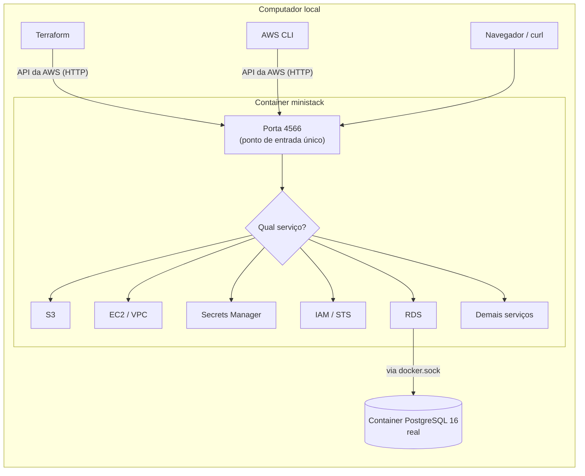

# Laboratório local com MiniStack

**Objetivo.** Explicar como praticar Terraform e AWS no próprio computador, sem conta AWS e sem custo,
usando o emulador MiniStack e o laboratório em [`exemplos/lab-terraform-local/`](exemplos/lab-terraform-local/).
O documento cobre o funcionamento do emulador, a instalação, o uso diário, as diferenças em relação à
AWS real, a solução de problemas e uma sequência de exercícios.

**Pré-requisitos de leitura:** [02-conceitos-fundamentais-de-nuvem.md](02-conceitos-fundamentais-de-nuvem.md)
e [03-terraform-fundamentos.md](03-terraform-fundamentos.md).

> Tudo o que está descrito aqui foi testado em 2026-10-05 com MiniStack **1.5.20**, Terraform **1.13.5**
> e provider AWS `~> 6.0`.

## Sumário

1. [O que é um emulador da AWS](#1-o-que-é-um-emulador-da-aws)
2. [Por que MiniStack](#2-por-que-ministack)
3. [Como o MiniStack funciona](#3-como-o-ministack-funciona)
4. [Requisitos e instalação](#4-requisitos-e-instalação)
5. [Primeiros passos: o exemplo 01](#5-primeiros-passos-o-exemplo-01)
6. [Conteúdo do laboratório](#6-conteúdo-do-laboratório)
7. [Ambiente development completo](#7-ambiente-development-completo)
8. [Comandos do Makefile](#8-comandos-do-makefile)
9. [Configuração do provider para o emulador](#9-configuração-do-provider-para-o-emulador)
10. [Acesso aos serviços](#10-acesso-aos-serviços)
11. [Ciclo de vida e persistência dos dados](#11-ciclo-de-vida-e-persistência-dos-dados)
12. [Limitações do emulador](#12-limitações-do-emulador)
13. [Solução de problemas](#13-solução-de-problemas)
14. [Exercícios](#14-exercícios)
15. [O laboratório no modelo "somente produção na AWS"](#15-o-laboratório-no-modelo-somente-produção-na-aws)
16. [Do laboratório para o repositório real](#16-do-laboratório-para-o-repositório-real)

---

## 1. O que é um emulador da AWS

Um **emulador** é um programa que responde às mesmas chamadas de API que um serviço real, mas executa
localmente. A **API** (interface de programação) da AWS é o conjunto de requisições HTTP que ferramentas
como o Terraform e a AWS CLI enviam para criar, consultar e remover recursos. Como o emulador aceita essas
mesmas requisições, o código Terraform escrito para a AWS funciona contra ele com uma única mudança: o
endereço para onde as requisições são enviadas.

A comparação com um simulador de voo é adequada: os comandos e instrumentos são os mesmos da aeronave,
mas um erro não tem consequência real. Da mesma forma, no emulador:

| Aspecto | AWS real | Emulador (MiniStack) |
| --- | --- | --- |
| Custo | Cobrança por recurso e por tempo de uso | Nenhum |
| Conta e credenciais | Exige conta, cartão e credenciais válidas | Não exige; usa credenciais fictícias |
| Impacto de um erro | Pode afetar recursos compartilhados ou gerar cobrança | Afeta apenas o computador local |
| Tempo para criar um banco RDS | Cerca de 10 minutos | Cerca de 1 minuto |
| Fidelidade | Comportamento oficial | Aproximação; ver a [seção 12](#12-limitações-do-emulador) |

O emulador serve para **aprender e validar a estrutura** do código Terraform: sintaxe, dependências entre
recursos, nomes, tags e o comportamento do ciclo `plan` / `apply`. A validação de comportamento real
(permissões, rede, desempenho e custo) só acontece na AWS. Como o projeto não mantém staging na AWS
(decisão de 2026-10-07), essa validação ocorre na conta de produção, principalmente no período anterior
ao go-live, quando ela ainda não tem usuários nem dados reais (ver a [seção 15](#15-o-laboratório-no-modelo-somente-produção-na-aws)).

## 2. Por que MiniStack

O emulador mais conhecido é o LocalStack. Desde 23/03/2026, o LocalStack exige cadastro e um token de
autenticação (`LOCALSTACK_AUTH_TOKEN`), e o plano gratuito é restrito a uso não comercial. O MiniStack é
software livre (licença MIT) e não exige cadastro.

| Critério | MiniStack | LocalStack (plano gratuito) |
| --- | --- | --- |
| Licença e custo | MIT, gratuito | Gratuito apenas para uso não comercial |
| Conta e token | Não exige | Exige conta e `LOCALSTACK_AUTH_TOKEN` desde 23/03/2026 |
| RDS | Cria um PostgreSQL 16 real em container | Historicamente restrito aos planos pagos |
| Porta | 4566 | 4566 |

Como as duas ferramentas usam a mesma porta e emulam a mesma API, trocar de emulador não exige mudar o
código Terraform, apenas a imagem do container.

## 3. Como o MiniStack funciona



1. **Ponto de entrada único.** Na AWS real, cada serviço tem um endereço próprio
   (`s3.amazonaws.com`, `ec2.us-east-1.amazonaws.com` e assim por diante). No MiniStack, todos respondem
   em `http://localhost:4566`. Cada requisição da AWS informa, em seus cabeçalhos, qual serviço e qual
   operação deseja; o MiniStack usa essa informação para encaminhá-la ao serviço emulado correspondente.
2. **A maior parte dos serviços é simulada em memória.** Ao criar uma VPC, o MiniStack registra que ela
   existe e devolve um identificador (por exemplo, `vpc-db16d4...`), mas nenhuma rede é criada de fato.
3. **Alguns serviços são reais.** Ao criar uma instância RDS, o MiniStack inicia um container PostgreSQL 16
   verdadeiro, ao qual é possível conectar e executar SQL. Para isso, ele precisa de acesso ao
   `/var/run/docker.sock`, o socket pelo qual se controla o Docker do computador. Esse acesso já está
   configurado no `compose.yaml`.
4. **Conta e credenciais fictícias.** O número da conta é sempre `000000000000`, a região é `us-east-1` e
   as credenciais são `test` / `test`.

## 4. Requisitos e instalação

| Requisito | macOS | Windows | Linux |
| --- | --- | --- | --- |
| Docker | Docker Desktop | Docker Desktop com WSL2 | Docker Engine |
| `make` | Já incluído no sistema | No Ubuntu do WSL: `sudo apt install make` | `sudo apt install make` |
| Git | Já incluído no sistema | No WSL: `sudo apt install git` | `sudo apt install git` |
| Terraform | Opcional: `brew install hashicorp/tap/terraform` | Opcional: `winget install Hashicorp.Terraform` | Opcional (pacote oficial da HashiCorp) |

Observações:

- **O Terraform é opcional.** Quando o comando `terraform` não está instalado, o `Makefile` executa a imagem
  oficial `hashicorp/terraform:1.13` em container. Instalar o Terraform localmente deixa os comandos mais
  rápidos e permite usá-lo fora do laboratório.
- **Windows:** use o terminal do Ubuntu no **WSL2** (Windows Subsystem for Linux), não o PowerShell, e
  mantenha o repositório dentro do sistema de arquivos do WSL (por exemplo, `~/projetos/`), não em `C:\`.
  O laboratório não foi testado no Windows.
- **Primeira execução:** o download das imagens (MiniStack, Terraform, AWS CLI e PostgreSQL) soma de 1 a
  2 GB. Recomenda-se fazê-lo com antecedência, em uma conexão estável.

## 5. Primeiros passos: o exemplo 01

```bash
cd exemplos/lab-terraform-local

make up                      # 1. inicia o emulador
make status                  # 2. deve exibir "MiniStack LIGADO em http://localhost:4566"
make exemplo NOME=teste      # 3. o Terraform cria um bucket com um arquivo
```

O passo 3 aplica o código de `exemplos/01-primeiro-bucket/main.tf`, a menor configuração Terraform útil:
um provider, uma variável com validação, dois recursos (um bucket S3 e um objeto dentro dele) e dois
outputs. O valor de `NOME` compõe o nome do bucket (`primeiro-bucket-teste`).

O resultado pode ser conferido de três formas:

```bash
# a) Pela AWS CLI, já configurada para o emulador
make aws CMD="s3 ls"
make aws CMD="s3 cp s3://primeiro-bucket-teste/ola.txt -"

# b) Por HTTP, com curl ou navegador
curl http://localhost:4566/primeiro-bucket-teste/ola.txt

# c) Pelo state do Terraform (arquivo local neste exemplo)
cat exemplos/01-primeiro-bucket/terraform.tfstate
```

Para observar como o Terraform trata mudanças, altere o texto do atributo `content` em `main.tf` e execute
`make exemplo NOME=teste` novamente. O plano mostrará `1 to change`: apenas o objeto é atualizado; o bucket
permanece inalterado. Para remover tudo:

```bash
make exemplo-destroy NOME=teste
```

> **Acesso sem credencial.** O comando `curl` funcionou sem autenticação porque o emulador, por padrão,
> não avalia permissões. Na AWS real, o mesmo bucket responderia `AccessDenied` a uma requisição anônima.
> Essa é uma das diferenças descritas na [seção 12](#12-limitações-do-emulador).

## 6. Conteúdo do laboratório

O laboratório segue a mesma organização do repositório `plataforma-infrastructure`: `bootstrap/` cria a
base do state remoto, `modules/` contém blocos reutilizáveis e `environments/` contém os roots de cada
ambiente. A organização é explicada em [04-padroes-e-fluxo-de-trabalho.md](04-padroes-e-fluxo-de-trabalho.md).

| Caminho | Item do backlog | O que demonstra |
| --- | --- | --- |
| `bootstrap/` | INF-001 | Bucket do state versionado, cifrado e sem acesso público; usa state local |
| `modules/network/` | INF-002 | VPC /16, duas sub-redes públicas e duas privadas, internet gateway e security groups encadeados |
| `modules/storage/` | INF-010 | Bucket de uploads sem acesso público, com criptografia, versionamento e lifecycle |
| `modules/registry/` | INF-006 | Repositórios ECR com tag imutável, scan on push e lifecycle |
| `modules/database/` | INF-005, INF-008 | RDS PostgreSQL 16 privado e cifrado; senha gerada e guardada no Secrets Manager |
| `environments/development/` | INF-001 | Root que compõe os módulos, com backend S3 e lock nativo |
| `modules/github-oidc/` | INF-004 | Provedor OIDC e roles do GitHub Actions com trust policy exata |
| `global/github-oidc/` | INF-004 | Root da conta com a matriz de roles (plan em PR, apply, deploy das aplicações) |
| `exemplos/01-primeiro-bucket/` | - | Exemplo introdutório |

A descrição de cada item do backlog está em [06-backlog-de-infraestrutura.md](06-backlog-de-infraestrutura.md);
o OIDC está detalhado em [07-oidc-github-actions-aws.md](07-oidc-github-actions-aws.md).

## 7. Ambiente development completo

```bash
make up          # 1. inicia o emulador
make bootstrap   # 2. cria o bucket do state remoto (uma única vez)
make check       # 3. fmt + validate, as mesmas verificações exigidas no repositório real
make init        # 4. conecta o ambiente development ao state remoto
make plan        # 5. mostra o que será criado (28 recursos)
make apply       # 6. aplica o plano salvo no passo 5
make plan        # 7. deve resultar em "No changes"
make destroy     # 8. remove os recursos
make down        # 9. desliga o emulador e descarta todos os dados
```

O que cada etapa ensina:

| Etapa | Conceito |
| --- | --- |
| `bootstrap` | O bucket que guarda o state não pode guardar o próprio state. Por isso o bootstrap usa state local e é aplicado uma única vez |
| `check` | `terraform fmt -check` verifica a formatação; `terraform validate` verifica sintaxe e tipos sem acessar a nuvem |
| `init` | Baixa os providers e conecta o root ao backend S3 criado no bootstrap |
| `plan` | Compara o código com o state e lista as ações. Cada linha com `+` é um recurso a criar |
| `apply` | Executa exatamente o plano salvo em `dev.tfplan`. A criação do RDS leva de 1 a 2 minutos |
| `plan` (de novo) | **Idempotência**: aplicar o mesmo código duas vezes não cria nada novo |
| `destroy` | Remove tudo o que está registrado no state |

Comandos úteis para inspecionar o resultado:

```bash
make aws CMD="ec2 describe-vpcs --query Vpcs[].CidrBlock"
make aws CMD="secretsmanager list-secrets --query SecretList[].Name"
make aws CMD="s3 ls s3://plataforma-tfstate-development --recursive"   # o state remoto
docker ps --filter name=ministack-rds                                   # o PostgreSQL criado pelo "RDS"
```

## 8. Comandos do Makefile

O `Makefile` encapsula comandos longos. A coluna da direita mostra o equivalente sem `make`, útil para
entender o que cada alvo executa.

| Comando | Função | Equivalente sem `make` |
| --- | --- | --- |
| `make help` | Lista os comandos documentados | - |
| `make up` | Inicia o emulador e aguarda ficar pronto | `docker compose up -d` |
| `make status` | Informa se o emulador está no ar | `curl http://localhost:4566/_ministack/health` |
| `make down` | Desliga o emulador e **descarta todos os dados** | `docker compose down -v` |
| `make reset` | Desliga, remove states locais desatualizados, inicia e recria o bucket do state | - |
| `make aws CMD="..."` | Executa a AWS CLI apontada para o emulador | `docker compose run --rm aws ...` |
| `make bootstrap` | Cria o bucket do state remoto | `terraform -chdir=bootstrap init && terraform -chdir=bootstrap apply` |
| `make check` | Verifica formatação e valida os roots | `terraform fmt -check -recursive` e `terraform validate` |
| `make fmt` | Formata todo o código | `terraform fmt -recursive` |
| `make init` / `plan` / `apply` / `destroy` | Terraform no ambiente `development` | `terraform -chdir=environments/development <comando>` |
| `make oidc-init` / `oidc-plan` / `oidc-apply` | Terraform no root `global/github-oidc` | `terraform -chdir=global/github-oidc <comando>` |
| `make exemplo NOME=...` | Aplica o exemplo 01 | `terraform -chdir=exemplos/01-primeiro-bucket apply -var seu_nome=...` |
| `make exemplo-destroy NOME=...` | Remove o exemplo 01 | `terraform -chdir=exemplos/01-primeiro-bucket destroy -var seu_nome=...` |

Quando o Terraform não está instalado, `terraform` nos equivalentes acima é substituído por
`docker compose run --rm terraform`.

## 9. Configuração do provider para o emulador

O mesmo código Terraform funciona na AWS e no emulador. A diferença está inteiramente no bloco
`provider` (e, no caso do state remoto, no bloco `backend`):

```hcl
provider "aws" {
  region     = "us-east-1"
  access_key = "test"   # credencial fictícia aceita pelo emulador
  secret_key = "test"

  skip_credentials_validation = true  # não valida a credencial junto ao serviço STS da AWS
  skip_requesting_account_id  = true  # não consulta o número da conta
  skip_metadata_api_check     = true  # não procura credenciais no serviço de metadados de instâncias EC2
  s3_use_path_style           = true  # usa URLs no formato localhost:4566/bucket

  endpoints {                         # redireciona cada serviço para o emulador
    s3             = "http://localhost:4566"
    ec2            = "http://localhost:4566"
    rds            = "http://localhost:4566"
    secretsmanager = "http://localhost:4566"
  }
}
```

| Parâmetro | Por que é necessário no emulador |
| --- | --- |
| `access_key` / `secret_key` | O provider exige alguma credencial; o emulador aceita `test` / `test` |
| `skip_credentials_validation` | Sem ele, o provider tentaria confirmar a credencial na AWS real e falharia |
| `skip_requesting_account_id` | Evita a consulta do número da conta, que também iria para a AWS real |
| `skip_metadata_api_check` | Evita a busca por credenciais no endereço de metadados de uma instância EC2, inexistente localmente |
| `s3_use_path_style` | Por padrão, o S3 usa o nome do bucket como subdomínio (`bucket.s3.amazonaws.com`). Localmente, `bucket.localhost` não resolve; o estilo de caminho (`localhost:4566/bucket`) resolve |
| `endpoints` | Define o endereço de cada serviço. Sem uma entrada, o serviço é chamado na AWS real |

**Regra importante:** todo serviço usado pelo código precisa constar em `endpoints`. Quando falta um, o
Terraform envia a requisição para a AWS real, e o erro típico é de credencial inválida
(`InvalidClientTokenId`) ou de rede. Nomes de serviços usados com frequência: `s3`, `ec2`, `rds`, `ecr`,
`ecs`, `iam`, `sts`, `secretsmanager`, `logs`, `cloudwatch`, `elbv2`, `sqs`, `sns`, `dynamodb`, `lambda`.

**Na AWS real**, o provider fica reduzido a `region = "us-east-1"` (mais `default_tags`). Saem as
credenciais, os parâmetros `skip_*` e os `endpoints`. As credenciais passam a ser fornecidas pelo
GitHub Actions por meio de OIDC, conforme [07-oidc-github-actions-aws.md](07-oidc-github-actions-aws.md).

## 10. Acesso aos serviços

### 10.1 AWS CLI

A forma mais simples é o alvo `make aws`, que executa a AWS CLI em container já configurada:

```bash
make aws CMD="ec2 describe-vpcs --query Vpcs[].CidrBlock"
make aws CMD="secretsmanager list-secrets --query SecretList[].Name"
```

Com a AWS CLI instalada no computador, recomenda-se criar um **perfil** dedicado ao emulador, o que evita
misturar comandos locais com uma conta AWS real. Em `~/.aws/config`:

```ini
[profile ministack]
region = us-east-1
endpoint_url = http://localhost:4566
```

Em `~/.aws/credentials`:

```ini
[ministack]
aws_access_key_id = test
aws_secret_access_key = test
```

Uso: `aws --profile ministack s3 ls`.

### 10.2 HTTP (curl ou navegador)

```bash
curl http://localhost:4566/_ministack/health         # estado do emulador e serviços disponíveis
curl http://localhost:4566/<bucket>/<arquivo>        # leitura de um objeto do S3
curl -X POST http://localhost:4566/_ministack/reset  # apaga todos os recursos do emulador
```

O MiniStack não tem interface web equivalente ao console da AWS; toda interação é feita por linha de
comando ou por API.

### 10.3 Banco PostgreSQL criado pelo RDS

Depois de aplicar o ambiente development ([seção 7](#7-ambiente-development-completo)):

```bash
# 1. Ler as credenciais guardadas no Secrets Manager pelo Terraform
make aws CMD="secretsmanager get-secret-value --secret-id plataforma/development/database --query SecretString --output text"

# 2. Descobrir em qual porta do computador o container do banco foi publicado
docker ps --filter name=ministack-rds --format '{{.Ports}}'   # ex.: 0.0.0.0:15432->5432/tcp

# 3. Conectar com psql, DBeaver ou pgAdmin em localhost, na porta do passo 2
psql -h localhost -p 15432 -U plataforma_admin -d plataforma
```

> **Endereço interno e endereço local.** O segredo e o output `database_endpoint` informam um host como
> `192.168.x.x`. Esse é o endereço do container dentro da rede do Docker, acessível apenas por outros
> containers. A partir do computador, use `localhost` e a porta publicada obtida no passo 2.

## 11. Ciclo de vida e persistência dos dados

Na configuração padrão do laboratório, o MiniStack mantém todos os recursos **em memória**:

| Ação | Os recursos permanecem? |
| --- | --- |
| Executar `plan` e `apply` repetidamente | Sim |
| `docker restart ministack` | Não: tudo é apagado |
| Reiniciar o computador ou encerrar o Docker Desktop | Não |
| `make down` | Não (é o objetivo do comando) |

**Consequência prática:** após reiniciar o computador, o bucket do state deixa de existir, mas os arquivos
locais do Terraform (pastas `.terraform/` e states locais) continuam apontando para ele. O comando
`make reset` resolve essa inconsistência: desliga o emulador, remove os arquivos locais desatualizados,
inicia o emulador e recria o bucket do state.

**Persistência opcional.** O `compose.yaml` contém um bloco comentado com as variáveis `PERSIST_STATE` e
`S3_PERSIST` e dois volumes Docker. Com esse bloco ativo, os recursos sobrevivem a reinicializações e até
a `docker compose down` (sem `-v`). Para fins de estudo, recomenda-se manter a persistência desligada:
recomeçar do zero é simples e evita estados inconsistentes.

## 12. Limitações do emulador

O emulador reproduz a interface da AWS, não todo o seu comportamento. As diferenças abaixo determinam o
que **não** deve ser concluído a partir de um teste local.

| AWS real | MiniStack (configuração padrão) | Consequência |
| --- | --- | --- |
| Permissões IAM sempre avaliadas | Não avaliadas | Uma policy incorreta funciona localmente e falha na AWS |
| Bucket privado recusa acesso anônimo | Responde a qualquer requisição | Testes de segurança de acesso não são válidos localmente |
| A assinatura do token OIDC do GitHub é verificada | Aceita qualquer token, inclusive um texto arbitrário | A segurança do OIDC (INF-004) só pode ser comprovada na AWS |
| VPC e sub-redes são redes reais | São apenas registros | Não é possível testar conectividade entre sub-redes |
| Todo recurso tem custo | Custo zero | Estimativas de custo devem usar a AWS Pricing Calculator; ver [09-custos-e-finops.md](09-custos-e-finops.md) |
| Todos os atributos são persistidos | Alguns não são (por exemplo, `max_allocated_storage` do RDS) | Sem ajuste, o `plan` apontaria uma mudança permanente |

**Ajuste para atributos não persistidos.** Em `modules/database/main.tf` há um bloco
`lifecycle { ignore_changes = [...] }` identificado pelo comentário `WORKAROUND DO EMULADOR`. Ele faz o
Terraform ignorar a diferença causada pelo emulador e **deve ser removido** no repositório real.

**Modo `AUTH=true`.** Ao descomentar `AUTH: "true"` no `compose.yaml`, o MiniStack passa a avaliar as
policies IAM. No teste de 2026-10-05, um usuário com permissão apenas para listar buckets recebeu
`AccessDenied ... not authorized to perform: s3:CreateBucket` ao tentar criar um bucket. Porém, o emulador
identifica o usuário somente pelo identificador da chave de acesso: com uma secret key incorreta, o acesso
foi concedido da mesma forma. O modo é útil para estudar a escrita de policies, não para comprovar
segurança.

## 13. Solução de problemas

| Sintoma | Causa provável | Solução |
| --- | --- | --- |
| `connection refused` em `localhost:4566` | Emulador desligado | `make up` e depois `make status` |
| `Cannot connect to the Docker daemon` | Docker não está em execução | Iniciar o Docker Desktop (ou o serviço Docker) e aguardar |
| `port is already allocated` (4566) | Outro container usa a porta, por exemplo um LocalStack | `docker ps` para identificá-lo e pará-lo |
| `InvalidClientTokenId` ou `The security token included in the request is invalid` | Serviço ausente em `endpoints`; a requisição foi para a AWS real | Incluir o serviço no bloco `endpoints` do provider |
| `NoSuchBucket` no `terraform init` | O bucket do state foi apagado (emulador reiniciado) | `make reset` |
| `BucketAlreadyExists` ou `already exists` | O state não registra um recurso que ainda existe, ou o nome já está em uso | `make reset`; no exemplo 01, usar outro valor de `NOME` |
| `Error acquiring the state lock` | Outro `plan`/`apply` em execução, ou uma execução interrompida deixou o lock | Aguardar; se a execução foi interrompida, `make reset` |
| RDS permanece em `creating` indefinidamente | O emulador não tem acesso ao `docker.sock` | Conferir o volume `/var/run/docker.sock` no `compose.yaml` |
| `make: command not found` no Windows | Terminal PowerShell | Usar o terminal do Ubuntu no WSL2 |

## 14. Exercícios

Os exercícios estão em ordem crescente de dificuldade. Todos partem de `exemplos/lab-terraform-local/`
com o emulador ligado (`make up`).

### Exercício 1: primeiro bucket

- **Objetivo:** executar o ciclo completo do Terraform pela primeira vez.
- **Passos:** `make exemplo NOME=teste`; ler o arquivo com `curl http://localhost:4566/primeiro-bucket-teste/ola.txt`; `make exemplo-destroy NOME=teste`.
- **O que observar:** a ordem de criação (o bucket antes do objeto, por causa da referência
  `aws_s3_bucket.meu_bucket.id`) e o resumo `2 added` / `2 destroyed`.

### Exercício 2: leitura do state

- **Objetivo:** entender o que o state registra.
- **Passos:** aplicar o exemplo 01; abrir `exemplos/01-primeiro-bucket/terraform.tfstate` e localizar o
  identificador do bucket; executar `make exemplo-destroy` e abrir o arquivo novamente.
- **O que observar:** a lista `resources` antes e depois do destroy, e o campo `serial`, que aumenta a
  cada alteração.

### Exercício 3: segundo objeto

- **Objetivo:** adicionar um recurso a uma configuração existente.
- **Passos:** criar no exemplo 01 um novo `aws_s3_object` com `key = "tchau.txt"` e aplicar.
- **O que observar:** o plano deve indicar `1 to add, 0 to change, 0 to destroy`; os recursos existentes
  não são recriados.

### Exercício 4: novo serviço

- **Objetivo:** compreender a função do bloco `endpoints`.
- **Passos:** adicionar um recurso `aws_sqs_queue` ao exemplo 01 e aplicar.
- **O que observar:** o erro de credencial. Identificar o que falta no provider
  ([seção 9](#9-configuração-do-provider-para-o-emulador)), corrigir e aplicar novamente.

### Exercício 5: validação de variáveis

- **Objetivo:** ver uma regra de validação em ação.
- **Passos:** executar `make exemplo NOME="Nome Composto"`.
- **O que observar:** a mensagem de erro e o bloco `validation` da variável `seu_nome` que a produziu.
  Repetir o teste no ambiente development: em `environments/development/main.tf`, acrescentar
  `postgres_major_version = "15"` ao bloco `module "database"` e executar `make check`. A regra está em
  `modules/database/variables.tf`.

### Exercício 6: ambiente completo e banco de dados

- **Objetivo:** aplicar um root com vários módulos e acessar o banco criado.
- **Passos:** `make bootstrap && make init && make plan && make apply`; conectar ao PostgreSQL conforme a
  [seção 10.3](#103-banco-postgresql-criado-pelo-rds).
- **O que observar:** a ordem de criação (rede antes do banco, porque o módulo `database` recebe
  `module.network.private_subnet_ids`) e o segundo `make plan` com `No changes`.

### Exercício 7: drift

- **Objetivo:** ver o Terraform detectar uma alteração feita fora do código. **Drift** é a divergência
  entre o que o código descreve e o que existe de fato na nuvem.
- **Passos:** com o ambiente development aplicado, liberar a porta do banco para a internet diretamente
  pela CLI e executar o plan:

  ```bash
  SG=$(docker compose run --rm -T aws ec2 describe-security-groups \
       --filters Name=group-name,Values=plataforma-development-db \
       --query 'SecurityGroups[0].GroupId' --output text | tr -d '\r')
  docker compose run --rm -T aws ec2 authorize-security-group-ingress \
       --group-id $SG --protocol tcp --port 5432 --cidr 0.0.0.0/0
  make plan
  ```

- **O que observar:** o plano propõe remover a regra `0.0.0.0/0`. Um `apply` desfaz a alteração manual.
  É por isso que alterações pelo console são proibidas: o código é a fonte da verdade.

### Exercício 8: lock do state

- **Objetivo:** ver o lock impedir duas execuções simultâneas.
- **Passos:** em dois terminais, executar `make plan` ao mesmo tempo.
- **O que observar:** um deles termina com `Error acquiring the state lock`, indicando quem detém o lock.

### Exercício 9: novo ambiente (production simulado)

- **Objetivo:** criar um segundo root reaproveitando os mesmos módulos, como o root de produção do
  repositório real.
- **Passos:** copiar `environments/development` para `environments/production`; alterar o CIDR para
  `10.30.0.0/16`, o ambiente para `production` e a `key` do backend; criar o bucket de state correspondente
  (ou reutilizar o existente com outra `key`); executar `init`, `plan` e `apply` com
  `terraform -chdir=environments/production`.
- **O que observar:** os módulos não mudam; apenas as variáveis. Compare o plan com o de `development`:
  o banco passa a ser Multi-AZ, com proteção contra exclusão, e o segredo ganha janela de recuperação de
  30 dias. Refletir: por que os CIDRs de ambientes diferentes não podem se sobrepor, e por que a faixa
  `10.20.0.0/16` continua reservada mesmo sem staging na AWS?

### Exercício 10: exclusão de segredos

- **Objetivo:** conhecer um comportamento da AWS que afeta a recriação de recursos.
- **Passos:** executar `make destroy` e `make apply`; ler o comentário sobre `recovery_window_in_days` em
  `modules/database/main.tf`.
- **O que observar:** fora de produção, o segredo é excluído imediatamente e pode ser recriado com o mesmo
  nome. Em produção, ele fica até 30 dias agendado para exclusão, e o nome não pode ser reutilizado nesse
  período, como ocorre na AWS real.

### Exercício 11: policies com AUTH=true

- **Objetivo:** praticar a escrita de policies IAM.
- **Passos:** descomentar `AUTH: "true"` no `compose.yaml` e executar `make down && make up`; criar pela
  CLI um usuário IAM com uma policy que permita apenas `s3:ListAllMyBuckets`; gerar uma chave de acesso
  para ele e tentar criar um bucket com essa chave.
- **O que observar:** a resposta `AccessDenied`. Em seguida, repetir com a secret key alterada e constatar
  que o emulador não a verifica ([seção 12](#12-limitações-do-emulador)).

## 15. O laboratório no modelo "somente produção na AWS"

Por decisão do projeto de 2026-10-07 (ADR-012), apenas o ambiente de produção
existe na AWS. Não há staging na nuvem. Com isso, o laboratório deixa de ser apenas material de estudo e
passa a ser a base de dois ambientes do projeto:

| Ambiente | Como usa o laboratório |
| --- | --- |
| `development` | Cada desenvolvedor executa a plataforma e a infraestrutura na própria máquina, com Docker Compose e MiniStack, exatamente como nas seções 5 a 10. |
| Validação efêmera (cumpre o papel do antigo staging) | Dentro de cada job do GitHub Actions, o workflow sobe a imagem recém-construída, um container `postgres:16`, o MiniStack apenas para S3 e Secrets Manager, as migrations e seeds sintéticos; executa smoke, contrato, E2E, DAST (ZAP baseline) e k6 em escala reduzida; e descarta tudo ao final. Nos PRs de infraestrutura, o mesmo emulador recebe um `terraform apply` completo antes do `plan` contra produção. |

Dois cuidados decorrem desse papel:

- No ambiente efêmero, o banco é um container `postgres:16` comum, e não o RDS do MiniStack, porque o
  objetivo é testar a aplicação, e não a criação da instância.
- Nunca se usam dados reais no laboratório nem no CI. Dados de produção não saem da conta de produção
  (LGPD). Os testes usam seeds sintéticos.

Os testes que dependem da AWS real (permissões IAM, rede, desempenho, OIDC, restore de snapshot) são
feitos na conta de produção. Até o go-live, ela ainda não tem usuários nem dados reais; depois dele, esses
testes só acontecem em janela controlada. Os detalhes estão em
[01-visao-geral-da-plataforma.md](01-visao-geral-da-plataforma.md#7-ambientes).

## 16. Do laboratório para o repositório real

Ao transpor o código do laboratório para o repositório `plataforma-infrastructure`:

1. Remover `access_key`, `secret_key`, `endpoints` e os parâmetros `skip_*` do provider e do backend.
2. Obter credenciais exclusivamente pelo OIDC do GitHub Actions (INF-004), nunca por chave fixa.
3. Substituir a criptografia `AES256` por KMS com chave gerenciada onde for adequado.
4. Definir a saída para a internet das sub-redes privadas (NAT Gateway, instância NAT ou VPC endpoints),
   conforme [09-custos-e-finops.md](09-custos-e-finops.md).
5. Remover o bloco `WORKAROUND DO EMULADOR`.
6. No banco de dados, preferir `manage_master_user_password = true`, para que a senha seja gerada e
   guardada pela própria AWS e não passe pelo state (ver [07-oidc-github-actions-aws.md](07-oidc-github-actions-aws.md)
   e [13-seguranca-da-infraestrutura.md](13-seguranca-da-infraestrutura.md)).

O procedimento geral de desenvolvimento local da plataforma está descrito no RUNBOOK-INFRA-001
(`_KB/operations/runbooks/local-development.md`).

## Referências

- MiniStack, repositório oficial (serviços emulados, variáveis `AUTH`, `PERSIST_STATE`, `S3_PERSIST` e
  endpoints `/_ministack/*`): https://github.com/ministackorg/ministack
- Terraform, documentação do provider AWS (configuração de endpoints e parâmetros `skip_*`):
  https://registry.terraform.io/providers/hashicorp/aws/latest/docs
- Terraform, backend S3: https://developer.hashicorp.com/terraform/language/backend/s3
- AWS CLI, arquivos de configuração e credenciais:
  https://docs.aws.amazon.com/cli/latest/userguide/cli-configure-files.html
- Docker Compose: https://docs.docker.com/compose/
- Testes próprios no laboratório em 2026-10-05: health check, reinício, reset, persistência com volumes,
  `AUTH=true`, leitura de objetos via HTTP e conexão `psql` ao RDS.
