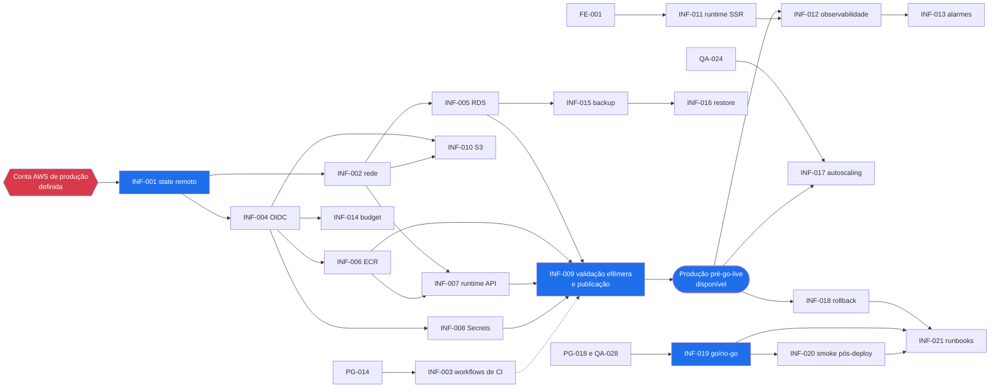

# Backlog de infraestrutura explicado

**Objetivo.** Explicar, item a item, as 21 issues de infraestrutura (prefixo `INF`) da Plataforma Digital: por que cada uma existe, o que ela envolve tecnicamente, como verificar que foi concluída e com quais outras equipes ela se conecta. O documento serve como referência para refinamento, implementação e revisão de pull requests. Ele já considera a decisão de manter **somente o ambiente de produção na AWS** e os reforços de segurança recomendados em [13-seguranca-da-infraestrutura.md](13-seguranca-da-infraestrutura.md).

**Pré-requisitos de leitura:** [01-visao-geral-da-plataforma.md](01-visao-geral-da-plataforma.md), [02-conceitos-fundamentais-de-nuvem.md](02-conceitos-fundamentais-de-nuvem.md) e [03-terraform-fundamentos.md](03-terraform-fundamentos.md).

## Sumário

1. [Como ler este documento](#1-como-ler-este-documento)
2. [Mapa por sprint](#2-mapa-por-sprint)
3. [Sprint 0: fundação](#3-sprint-0-fundação)
4. [Sprint 1: validação efêmera e armazenamento](#4-sprint-1-validação-efêmera-e-armazenamento)
5. [Sprint 2: runtime do frontend](#5-sprint-2-runtime-do-frontend)
6. [Sprint 3: observabilidade e backup](#6-sprint-3-observabilidade-e-backup)
7. [Sprint 5: ensaios](#7-sprint-5-ensaios)
8. [Sprint 6: entrada em produção](#8-sprint-6-entrada-em-produção)
9. [Dependências e caminho crítico](#9-dependências-e-caminho-crítico)
10. [Integrações com as outras equipes](#10-integrações-com-as-outras-equipes)
11. [Itens de segurança sugeridos para o backlog](#11-itens-de-segurança-sugeridos-para-o-backlog)
12. [Referências](#12-referências)

---

## 1. Como ler este documento

A fonte oficial do backlog é o arquivo `backlogs/cloud-devops.md` do repositório de governança, e o estado de cada item (em andamento, bloqueado, concluído) fica no GitHub Project. Este guia não registra estado nem atribuições: ele explica o conteúdo técnico.

Cada issue aparece com a mesma estrutura:

| Campo | Significado |
| --- | --- |
| **Sprint e prioridade** | Em qual sprint o item está planejado (S0 a S6) e sua prioridade (P0 é obrigatória para o MVP; P1 é importante, mas pode ser ajustada). |
| **Dependências** | Itens que precisam estar prontos antes. Podem ser outras issues `INF`, issues de outras equipes (`BE`, `FE`, `DB`, `QA`, `PG`) ou decisões de arquitetura (ADR). |
| **Integrações** | Issues de outras equipes que consomem ou fornecem algo para este item. |
| **Objetivo** | Por que o item existe, em linguagem simples. |
| **O que envolve tecnicamente** | Recursos AWS, blocos Terraform e configurações do GitHub envolvidos. |
| **Critérios de aceite de referência** | Proposta de critérios numerados e verificáveis. |
| **Como evidenciar** | O que anexar ao pull request para comprovar cada critério. |
| **Exemplo no laboratório** | Onde existe código funcional equivalente em `exemplos/lab-terraform-local/`, quando houver. |
| **Pontos de atenção** | Riscos, decisões em aberto e limitações conhecidas. |

> **Importante.** Os critérios de aceite apresentados aqui são **de referência**: ajudam a escrever critérios numerados e verificáveis durante o refinamento, como exige o Definition of Ready. Os critérios oficiais são os que estão registrados no corpo de cada issue. Em caso de conflito, prevalecem os documentos normativos da `_KB` (ADRs, políticas `POL-INFRA-*` e Must Haves `MH-INFRA-*`).

### O contexto: somente produção na AWS

Por decisão do projeto de 2026-10-07, apenas o ambiente de **produção** existe na AWS, para manter o orçamento de US$ 120 por mês (POL-INFRA-004). A decisão está registrada no ADR-012. As consequências para o backlog são:

| Ambiente | Onde existe | Uso no backlog |
| --- | --- | --- |
| `development` | Máquina de cada desenvolvedor: Docker Compose e MiniStack | Desenvolvimento e prática (laboratório) |
| Validação efêmera | Dentro do job do GitHub Actions, criada e destruída a cada execução | Cumpre o papel do antigo staging: smoke, contrato, E2E, DAST, k6 em escala reduzida e `terraform apply` contra o MiniStack |
| `production` | Única conta AWS do projeto, região `us-east-1`, rede `10.30.0.0/16` | Uso real; antes do go-live, também ambiente de integração |

- **Período pré-go-live.** Até o go-live (INF-019, S6), a conta de produção não tem usuários nem dados reais. Nesse período ela funciona como ambiente de integração: deploys frequentes, teste de carga (INF-017), ensaio de rollback (INF-018) e primeiro ensaio de restore (INF-016) acontecem nela.
- **Após o go-live.** Deploy só com go/no-go; teste de carga apenas em janela controlada e comunicada; restore ensaiado em instância temporária **dentro da conta de produção**, destruída ao final. Dados pessoais nunca saem da conta (LGPD).
- **Títulos.** As issues INF-009, INF-016 e INF-019 foram renomeadas para refletir o modelo sem staging na AWS. Os itens QA-019, QA-026 e DB-018, de outras equipes, ainda citam staging no título; a seção 10 mostra onde eles passam a executar.

**Termos usados com frequência neste documento** (ver também [11-glossario.md](11-glossario.md)):

- **Critério de aceite (AC):** condição objetiva que precisa ser verdadeira para o item ser considerado pronto.
- **Evidência:** registro que comprova um critério, como a saída de um comando, um log de pipeline ou uma captura de tela.
- **Root (módulo raiz):** diretório onde o Terraform é executado, por exemplo `environments/production/`.
- **Digest:** identificador imutável de uma imagem de container (`sha256:...`). Diferente de uma tag, não pode ser movido para outra imagem.
- **Validação efêmera:** ambiente temporário montado com Docker Compose dentro do job de CI, com a imagem recém-construída, PostgreSQL 16, MiniStack (S3 e Secrets Manager) e dados sintéticos. É destruído ao fim do job.

## 2. Mapa por sprint

As sprints têm duração de duas semanas. A sprint S4 não tem itens de infraestrutura.

| Sprint | Tema | Issues |
| --- | --- | --- |
| S0 | Fundação: state, rede, CI, identidade, banco, registro de imagens, runtime da API, segredos, orçamento | INF-001 a INF-008, INF-014 |
| S1 | Validação efêmera no CI, publicação de imagens imutáveis e armazenamento de arquivos | INF-009, INF-010 |
| S2 | Runtime do frontend com renderização no servidor | INF-011 |
| S3 | Observabilidade, alarmes e backup | INF-012, INF-013, INF-015 |
| S5 | Ensaios em produção pré-go-live: restore, carga e rollback | INF-016, INF-017, INF-018 |
| S6 | Entrada em produção e operação | INF-019, INF-020, INF-021 |

---

## 3. Sprint 0: fundação

### INF-001 · Terraform remoto com lock, criptografia e acesso mínimo

[Issue #1](https://github.com/UniSENAI-Sorocaba/plataforma-infrastructure/issues/1) · **S0 · P0** · **Dependências:** ADR-011

**Objetivo.** O Terraform guarda num arquivo chamado *state* a relação entre o código e os recursos que existem na AWS. Esse arquivo precisa ficar num local compartilhado (para que todos trabalhem sobre a mesma informação), protegido (porque pode conter dados sensíveis) e travado durante alterações (para que duas execuções simultâneas não o corrompam). Esta issue cria essa base, da qual todas as demais dependem.

**O que envolve tecnicamente.**
- Diretório `bootstrap/`, aplicado uma única vez, por uma pessoa com acesso de administrador, com state local, que cria **um único bucket de state**: `plataforma-tfstate-production`. Não há bucket de state de non-production na AWS.
- Bucket com versionamento, criptografia em repouso com chave KMS gerenciada pelo cliente (SSE-KMS), bloqueio total de acesso público e `BucketOwnerEnforced`.
- Bucket policy que nega qualquer requisição sem TLS (`aws:SecureTransport = false`) e restringe o acesso às roles `gha-infra-plan`, `gha-infra-apply` e de administração.
- Bloco `backend "s3"` no root `environments/production/` e no root `global/github-oidc/`, com `encrypt = true` e `use_lockfile = true`. A partir do Terraform 1.10, o lock é feito no próprio S3, sem tabela DynamoDB.

**Critérios de aceite de referência.**
1. Existe o bucket `plataforma-tfstate-production` com versionamento ativo, SSE-KMS com chave gerenciada pelo cliente e bloqueio total de acesso público.
2. Cada root declara `backend "s3"` com `use_lockfile = true`. Duas execuções simultâneas de `plan` no mesmo root resultam em erro de lock na segunda.
3. A bucket policy nega requisições sem TLS e restringe o acesso às roles de CI e de administração; uma tentativa com outra identidade resulta em `AccessDenied`.
4. O state do bootstrap fica guardado de forma documentada (fora do Git) ou é migrado para o próprio bucket após a criação.
5. O README do `bootstrap/` documenta como executar o bootstrap e como recuperar uma versão anterior do state.

**Como evidenciar.** Saída de `terraform plan` e `apply` do bootstrap; saída de `aws s3api get-bucket-versioning`, `get-bucket-encryption`, `get-public-access-block` e `get-bucket-policy`; log do segundo `plan` exibindo `Error acquiring the state lock`.

**Exemplo no laboratório.** `exemplos/lab-terraform-local/bootstrap/main.tf` e o bloco `backend` em `environments/development/versions.tf`. Ver [05-laboratorio-local-ministack.md](05-laboratorio-local-ministack.md).

**Pontos de atenção.**
- O bucket do state não pode guardar o próprio state (problema conhecido como "ovo e galinha"). Por isso o bootstrap usa state local.
- O Terraform só lê os arquivos `.tf` do diretório em que é executado. Blocos `terraform { required_providers ... }` precisam estar em cada root, não apenas na raiz do repositório.
- Recomenda-se `required_version = ">= 1.11"`: além do lock nativo no S3 (1.10), habilita atributos *write-only*, que mantêm senhas fora do state (ver INF-005).

### INF-002 · VPC, subnets, rotas e security groups passam validate e scan

[Issue #2](https://github.com/UniSENAI-Sorocaba/plataforma-infrastructure/issues/2) · **S0 · P0** · **Dependências:** INF-001

**Objetivo.** Criar a rede privada onde a plataforma vai rodar em produção. A rede define quem consegue falar com quem: a internet só alcança a CDN, a CDN só alcança o balanceador de carga, o balanceador só alcança a aplicação e só a aplicação alcança o banco de dados.

**O que envolve tecnicamente.**
- `aws_vpc` de produção com CIDR `10.30.0.0/16`. A faixa `10.10.0.0/16` é usada apenas no laboratório local, e `10.20.0.0/16` fica reservada caso um staging na AWS volte a existir.
- Duas zonas de disponibilidade (AZs), cada uma com uma subnet pública (ALB e instância NAT) e uma privada (ECS e RDS).
- Saída das subnets privadas por instância NAT (`fck-nat`) em um Auto Scaling Group de tamanho 1, que recria a instância automaticamente em caso de falha. A instância exige IMDSv2, não tem chave SSH nem portas de entrada (acesso administrativo por SSM). Gateway Endpoint do S3 (gratuito).
- Security groups encadeados por referência: o do ALB aceita 443 apenas da *prefix list* gerenciada do CloudFront (`com.amazonaws.global.cloudfront.origin-facing`); o da aplicação aceita 8080 apenas do ALB; o do banco aceita 5432 apenas da aplicação.
- VPC Flow Logs apenas de tráfego rejeitado (`REJECT`), com retenção curta, para controlar custo.

**Critérios de aceite de referência.**
1. A VPC de produção usa `10.30.0.0/16`.
2. Existem subnets públicas e privadas em duas AZs; nenhum recurso de subnet privada recebe IP público.
3. Security groups encadeados como descrito; nenhuma regra de entrada `0.0.0.0/0` além do que for estritamente justificado e documentado.
4. A instância NAT está em Auto Scaling Group, com IMDSv2 obrigatório, sem key pair e sem regra de entrada da internet; a recuperação automática foi testada encerrando a instância.
5. `terraform fmt -check`, `terraform validate`, `tflint` e `trivy config` (ou `checkov`) executam sem achados de severidade High ou Critical não justificados.
6. VPC Flow Logs de tráfego rejeitado habilitado, com retenção documentada.

**Como evidenciar.** Plan comentado no PR; saída dos verificadores estáticos; saída de `aws ec2 describe-security-groups`; registro do teste de recuperação da instância NAT (horário de encerramento e de retorno da saída para a internet).

**Exemplo no laboratório.** `exemplos/lab-terraform-local/modules/network/`. O exercício de *drift* do laboratório abre a porta 5432 manualmente e mostra o Terraform detectando a alteração.

**Pontos de atenção.**
- A instância NAT é um ponto único de falha para a **saída** (login institucional, envio de e-mail); o tráfego de entrada continua funcionando. O Auto Scaling Group reduz o tempo de indisponibilidade para alguns minutos. A alternativa NAT Gateway custa cerca de US$ 30 a mais por mês. Ver [09-custos-e-finops.md](09-custos-e-finops.md).
- VPC Endpoints de interface não substituem a saída para a internet e aumentariam o custo.

### INF-003 · Workflows reutilizáveis executam gates em PR

[Issue #3](https://github.com/UniSENAI-Sorocaba/plataforma-infrastructure/issues/3) · **S0 · P0** · **Dependências:** PG-014 · **Integrações:** QA-003, QA-005, QA-007 e todos os repositórios

**Objetivo.** Garantir que todo pull request passe automaticamente pelas mesmas verificações (*gates*) antes de poder ser integrado, sem que cada repositório tenha de reescrever o próprio pipeline.

**O que envolve tecnicamente.**
- Workflows do GitHub Actions com gatilho `on: workflow_call`, mantidos num local central e chamados pelos seis repositórios.
- Para infraestrutura: `terraform fmt -check`, `validate`, `tflint`, scanner de IaC (`trivy config` ou `checkov`), `plan` contra produção publicado como comentário no PR (role `gha-infra-plan`, somente leitura) e `apply` contra o MiniStack dentro do job, para validar a forma do código.
- Varredura de segredos com `gitleaks` em todos os repositórios: no plano Free com repositórios privados, o *secret scanning* e o *code scanning* (CodeQL) do GitHub não estão disponíveis. Ver [13-seguranca-da-infraestrutura.md](13-seguranca-da-infraestrutura.md).
- Actions de terceiros fixadas por SHA de commit (POL-INFRA-001), bloco `permissions` mínimo e Dependabot configurado para atualizar essas referências.
- Verificação do arquivo `.governance-baseline` (tag e SHA da governança), conforme ADR-008.
- Controle de consumo de minutos: filtros de `paths`, `concurrency` com `cancel-in-progress` e cache.

**Critérios de aceite de referência.**
1. Existe ao menos um workflow reutilizável versionado, chamado pelos repositórios consumidores.
2. Todas as actions externas estão referenciadas por SHA de commit completo, e o Dependabot propõe atualizações delas.
3. O bloco `permissions` concede apenas leitura por padrão; permissões adicionais são declaradas por job. Nenhum workflow usa `pull_request_target` com checkout do código do PR, nem interpola `${{ github.event.* }}` diretamente em `run:`.
4. Um PR de teste com falha proposital (código não formatado e um segredo falso) é reprovado pelos checks.
5. Um check confirma que a tag declarada em `.governance-baseline` aponta para o SHA declarado.
6. O tempo médio de execução e a estimativa de consumo mensal de minutos estão documentados.

**Como evidenciar.** Links para a execução reprovada no PR de teste e para a execução aprovada após a correção; trecho do workflow mostrando as actions fixadas por SHA; estimativa de minutos.

**Pontos de atenção.**
- Sem *branch protection* ou *rulesets*, os checks não podem ser tornados obrigatórios. Ver [08-cicd-no-plano-free-do-github.md](08-cicd-no-plano-free-do-github.md).
- O plano Free com repositórios privados oferece 2.000 minutos de Actions por mês **para a organização inteira**. A validação efêmera é a maior consumidora.
- O compartilhamento de workflows entre repositórios privados depende da configuração de acesso de Actions da organização.

### INF-004 · OIDC assume roles sem access key persistente

[Issue #4](https://github.com/UniSENAI-Sorocaba/plataforma-infrastructure/issues/4) · **S0 · P0** · **Dependências:** INF-001

**Objetivo.** Permitir que os pipelines do GitHub Actions acessem a conta AWS de produção sem guardar nenhuma chave de acesso permanente. Cada execução recebe uma credencial temporária, válida por cerca de uma hora e restrita ao que aquele pipeline precisa fazer.

**O que envolve tecnicamente.**
- `aws_iam_openid_connect_provider` para `token.actions.githubusercontent.com` na conta de produção.
- Root `global/github-oidc/`, aplicado por um administrador, com a matriz de roles abaixo. As trust policies comparam o claim `sub` por igualdade exata (`StringEquals`), no formato imutável dos repositórios da organização.

| Role | Repositório | `sub` aceito | Pode |
| --- | --- | --- | --- |
| `gha-infra-plan` | plataforma-infrastructure | `pull_request` | Somente leitura, ler o state, criar e apagar o `.tflock`. Sem `GetSecretValue` |
| `gha-infra-apply` | plataforma-infrastructure | `ref:refs/heads/main` (ou `environment:production`) | Gerenciar os serviços da plataforma em us-east-1; criar roles só em `/plataforma/` com o permissions boundary `plataforma-workload-boundary`; negado editar roles de CI, o provider OIDC e o próprio boundary |
| `gha-backend-publish` | plataforma-backend | `ref:refs/heads/main` | Push apenas no ECR `plataforma-backend-production` |
| `gha-frontend-publish` | plataforma-frontend | `ref:refs/heads/main` | Push apenas no ECR `plataforma-frontend-production` |
| `gha-release-deploy` | plataforma-release | `ref:refs/heads/main` (ou `environment:production`) | Ler imagens dos ECR, registrar task definitions, atualizar os dois services, executar a task de migration, `iam:PassRole` apenas das roles de task |

**Critérios de aceite de referência.**
1. Nenhum usuário IAM possui access key usada por CI.
2. As cinco roles existem com as trust policies da matriz; a role `gha-release-deploy` é criada assim que o repositório `plataforma-release` existir (o ID do repositório entra por variável).
3. Nenhuma policy concede `*:*`; a role `gha-infra-apply` só cria roles com o permissions boundary obrigatório.
4. Um job de teste assume cada role e executa `aws sts get-caller-identity` com sucesso.
5. Testes negativos resultam em `AccessDenied`: outro repositório tentando a role, outra branch tentando uma role de `main`, a role de plan tentando escrever, a role de publish do backend tentando enviar ao ECR do frontend, e a role de apply tentando criar uma role sem boundary.

**Como evidenciar.** Log do job com a saída de `sts get-caller-identity` para cada role; logs dos testes negativos; eventos `AssumeRoleWithWebIdentity` no CloudTrail.

**Exemplo no laboratório.** `exemplos/lab-terraform-local/modules/github-oidc/` e `global/github-oidc/`. Explicação completa em [07-oidc-github-actions-aws.md](07-oidc-github-actions-aws.md).

**Pontos de atenção.**
- **Este item só pode ser comprovado na AWS real.** O emulador local aceita qualquer token, sem verificar assinatura nem `sub`; ele valida apenas a forma dos recursos.
- Os repositórios da organização usam o formato imutável do `sub` (`repo:<org>@<org_id>/<repo>@<repo_id>:...`). Uma trust policy escrita no formato antigo não funciona.
- Sem o permissions boundary, a role de apply poderia criar uma role com privilégios de administrador e assumi-la (escalada de privilégio).
- A disponibilidade de *environments* depende do plano do GitHub. Ver [08-cicd-no-plano-free-do-github.md](08-cicd-no-plano-free-do-github.md).

### INF-005 · PostgreSQL 16 isolado, cifrado e não público

[Issue #5](https://github.com/UniSENAI-Sorocaba/plataforma-infrastructure/issues/5) · **S0 · P0** · **Dependências:** INF-002 · **Integrações:** DB-002, DB-019

**Objetivo.** Provisionar o banco de dados de produção: uma única instância PostgreSQL 16 gerenciada (Amazon RDS), inacessível pela internet, com dados cifrados e conexões obrigatoriamente cifradas (ADR-002).

**O que envolve tecnicamente.**
- `aws_db_instance` com engine `postgres` versão 16, `db.t4g.micro`, 20 GB gp3 com autoscaling de armazenamento até 50 GB, `storage_encrypted = true` com chave KMS e `publicly_accessible = false`.
- **Multi-AZ habilitado**: é a variante recomendada (P3) para o orçamento de produção. Ver [09-custos-e-finops.md](09-custos-e-finops.md).
- `aws_db_subnet_group` com as subnets privadas e security group que aceita apenas a aplicação.
- `aws_db_parameter_group` com `rds.force_ssl = 1`.
- `deletion_protection = true`, `copy_tags_to_snapshot = true` e snapshot final obrigatório.
- Senha do administrador fora do state: `manage_master_user_password = true` (a própria AWS gera e guarda a senha no Secrets Manager). Alternativa: Terraform 1.11 ou superior com `ephemeral "random_password"` e o atributo *write-only* `password_wo`.
- Usuário da aplicação separado do usuário administrador, com privilégios apenas nos schemas necessários (criado pelas migrations da equipe de Banco de Dados).

**Critérios de aceite de referência.**
1. A versão do engine é 16, garantida por uma regra `validation` na variável correspondente.
2. `storage_encrypted = true` com chave KMS.
3. `publicly_accessible = false`, com subnet group composto apenas por subnets privadas.
4. O security group do banco aceita conexões na porta 5432 apenas do security group da aplicação.
5. `multi_az = true` e `deletion_protection = true`.
6. O parameter group força conexões TLS; uma tentativa de conexão sem TLS é recusada.
7. A senha do administrador não aparece no código nem no state (`terraform state pull` não contém o valor).
8. A aplicação conecta com um usuário próprio, sem privilégios de administrador.

**Como evidenciar.** Plan; saída de `aws rds describe-db-instances` com os atributos de criptografia, Multi-AZ e acesso público; tentativa de conexão sem TLS recusada; busca pela senha no state sem ocorrências.

**Exemplo no laboratório.** `exemplos/lab-terraform-local/modules/database/`. No emulador, o RDS sobe um container PostgreSQL 16 real, ao qual é possível se conectar.

**Pontos de atenção.**
- A infraestrutura entrega a **instância**. Os schemas (`auth`, `academic_pi`, `extension` e outros) e as migrations são responsabilidade da equipe de Banco de Dados.
- As migrations em produção rodam por uma task ECS avulsa, disparada pelo pipeline de deploy (ADR-004).
- `db.t4g.micro` comporta cerca de 100 conexões. O pool de conexões precisa caber nesse limite (INF-017).

### INF-006 · ECR aplica scan, lifecycle e tag imutável

[Issue #6](https://github.com/UniSENAI-Sorocaba/plataforma-infrastructure/issues/6) · **S0 · P0** · **Dependências:** INF-004

**Objetivo.** Criar os repositórios de imagens de container (Amazon ECR) de produção, onde ficam as versões do backend e do frontend, garantindo que uma versão publicada nunca seja substituída silenciosamente e que imagens antigas sejam removidas.

**O que envolve tecnicamente.**
- `aws_ecr_repository` `plataforma-backend-production` e `plataforma-frontend-production`, com `image_tag_mutability = "IMMUTABLE"`, `scan_on_push = true` e criptografia.
- `aws_ecr_lifecycle_policy` que mantém apenas as N imagens mais recentes.
- Repository policy que permite *push* apenas à role de publicação correspondente (`gha-backend-publish` ou `gha-frontend-publish`) e leitura à role de deploy e à execution role do ECS.
- Imagens `linux/arm64` (Fargate Graviton). Nos Dockerfiles, o estágio de compilação usa `FROM --platform=$BUILDPLATFORM`, para que o build do Java e do Node não rode sob emulação, que é muito lenta.

**Critérios de aceite de referência.**
1. Repositórios de backend e frontend criados com tags imutáveis.
2. `scan_on_push` habilitado; o resultado do scan é consultável após o push.
3. Política de ciclo de vida mantém um número definido de imagens.
4. Apenas a role de publicação do repositório correspondente consegue enviar imagens; a outra role de publicação recebe `AccessDenied`.
5. O deploy referencia a imagem por digest (`@sha256:...`), não por tag.
6. A imagem publicada é `linux/arm64` e o tempo de build está documentado.

**Como evidenciar.** Plan; tentativa de enviar duas vezes a mesma tag, recusada; resultado de `aws ecr describe-image-scan-findings`; `docker manifest inspect` mostrando a arquitetura.

**Exemplo no laboratório.** `exemplos/lab-terraform-local/modules/registry/`.

**Pontos de atenção.** Imagens base devem ser fixadas por digest no Dockerfile (por exemplo, `eclipse-temurin:21-jre@sha256:...`) para que o build seja reproduzível.

### INF-007 · Runtime do backend com healthcheck, logs e rollback

[Issue #7](https://github.com/UniSENAI-Sorocaba/plataforma-infrastructure/issues/7) · **S0 · P0** · **Dependências:** INF-002, INF-006 · **Integrações:** BE-001

**Objetivo.** Colocar a API Spring Boot para rodar em containers gerenciados (ECS Fargate, ADR-004) em produção, atrás de um balanceador de carga, com verificação de saúde, registro de logs, retorno automático à versão anterior quando um deploy falha e o container endurecido contra abusos.

**O que envolve tecnicamente.**
- `aws_ecs_cluster`, `aws_ecs_task_definition` (Fargate, `runtime_platform { cpu_architecture = "ARM64" }`) e `aws_ecs_service`.
- `aws_lb` (Application Load Balancer) compartilhado com o frontend, `aws_lb_target_group` e `aws_lb_listener` HTTPS com certificado ACM, política TLS `ELBSecurityPolicy-TLS13-1-2-2021-06`, redirecionamento 80 para 443 e `drop_invalid_header_fields = true`.
- `aws_cloudwatch_log_group` com retenção de 30 dias (POL-INFRA-002).
- `deployment_circuit_breaker { enable = true, rollback = true }` no serviço ECS.
- Duas roles distintas e mínimas: *execution role* (baixa a imagem e lê os segredos declarados) e *task role* (permissões da aplicação em execução), ambas com o permissions boundary.
- Endurecimento do container: usuário não root, `readonlyRootFilesystem = true` (com volume temporário para `/tmp`), sem modo privilegiado, capabilities Linux removidas, ECS Exec desligado.

**Critérios de aceite de referência.**
1. As tasks rodam em subnets privadas, sem IP público.
2. O health check do target group usa `/actuator/health/readiness`.
3. O listener aceita apenas HTTPS com a política TLS definida; HTTP é redirecionado.
4. Os logs vão para o CloudWatch com retenção de 30 dias.
5. O *deployment circuit breaker* com rollback está habilitado.
6. A task role é separada da execution role, cada uma com permissões mínimas.
7. Segredos são injetados pelo campo `secrets` da task definition, nunca por `environment`.
8. O container roda com usuário não root, sistema de arquivos raiz somente leitura, sem capabilities adicionais e com ECS Exec desligado.

**Como evidenciar.** Plan; chamada ao endpoint de saúde pelo ALB; resultado de um teste TLS (por exemplo, `curl -v` ou `testssl.sh`); captura do log group; `aws ecs describe-task-definition` mostrando as opções de endurecimento; deploy de uma imagem com defeito revertido automaticamente.

**Pontos de atenção.** O `application.yaml` do backend já habilita as *probes* de saúde, e o Dockerfile já usa um usuário não root; a infraestrutura deve apenas apontar para eles. O sistema de arquivos somente leitura pode exigir ajustes na aplicação (diretórios temporários), a combinar com a equipe de Backend.

### INF-008 · Secrets Manager sem vazamento em logs ou outputs

[Issue #8](https://github.com/UniSENAI-Sorocaba/plataforma-infrastructure/issues/8) · **S0 · P0** · **Dependências:** INF-004

**Objetivo.** Guardar senhas e chaves num cofre gerenciado (AWS Secrets Manager) e garantir que elas nunca apareçam no código, no state, nos logs dos pipelines ou nas saídas do Terraform (MH-INFRA-001).

**O que envolve tecnicamente.**
- `aws_secretsmanager_secret` com chave KMS; valores gerados fora do Terraform ou gravados por atributos *write-only* (`secret_string_wo`), para que não fiquem no state.
- Outputs que expõem apenas o ARN do segredo.
- Policy da execution role e da task role que permite `secretsmanager:GetSecretValue` apenas nos segredos da própria aplicação.
- `recovery_window_in_days = 30`.

**Critérios de aceite de referência.**
1. Nenhum segredo tem valor escrito no código.
2. Nenhum valor de segredo está gravado no state; os outputs expõem apenas ARNs.
3. Apenas as roles da aplicação conseguem ler o valor do segredo; a role `gha-infra-plan` não consegue.
4. A janela de recuperação é de 30 dias.
5. Uma busca pelo valor do segredo nos logs do CI e da aplicação não encontra ocorrências.

**Como evidenciar.** Plan sem valores; busca no state e nos logs sem ocorrências; tentativa de leitura com outra role resultando em `AccessDenied`.

**Exemplo no laboratório.** Parcial, em `exemplos/lab-terraform-local/modules/database/` (senha gerada e guardada no Secrets Manager).

**Pontos de atenção.**
- Um segredo apagado fica reservado durante a janela de recuperação; recriar um segredo com o mesmo nome nesse período falha.
- No ambiente de validação efêmera, os segredos são valores de teste guardados no MiniStack; nenhum segredo real de produção é usado no CI.

### INF-014 · Budget de US$ 120 e alertas de 50/80/100% testados

[Issue #14](https://github.com/UniSENAI-Sorocaba/plataforma-infrastructure/issues/14) · **S0 · P1** · **Dependências:** INF-004

**Objetivo.** Acompanhar o gasto mensal da conta de produção, que é a única conta AWS do projeto, e avisar a equipe antes que o orçamento definido na POL-INFRA-004 seja ultrapassado.

**O que envolve tecnicamente.**
- `aws_budgets_budget` mensal de US$ 120 com blocos `notification` para 50%, 80% e 100% do gasto real e 100% do gasto previsto (*forecast*).
- Tópico SNS ou e-mail como destino das notificações.
- AWS Cost Anomaly Detection (gratuito) e tags de alocação de custo (`Project`, `Environment`, `Squad`) ativadas no Billing.
- A estimativa de referência (variante P3, cerca de US$ 91 por mês, mais os reforços de segurança como GuardDuty e, opcionalmente, WAF) está em [09-custos-e-finops.md](09-custos-e-finops.md).

**Critérios de aceite de referência.**
1. Existe um budget mensal de US$ 120 cobrindo a conta de produção.
2. Há alertas em 50%, 80% e 100% do gasto real e em 100% do gasto previsto.
3. Os destinatários dos alertas estão definidos e documentados.
4. Um alerta foi efetivamente recebido em teste (usando temporariamente um limite baixo).
5. Nenhum alerta dispara ação destrutiva automática (POL-INFRA-004).
6. Cost Anomaly Detection está ativo e as tags de custo aparecem no Cost Explorer.

**Como evidenciar.** Plan; e-mail ou mensagem de alerta recebida no teste; configuração restaurada após o teste; captura do Cost Explorer agrupado por tag.

**Pontos de atenção.** É um item pequeno e isolado, adequado para um primeiro contato com o fluxo completo de issue, PR e revisão. O consumo de minutos do GitHub Actions não aparece na fatura da AWS e deve ser acompanhado separadamente.

---

## 4. Sprint 1: validação efêmera e armazenamento

### INF-009 · Validação efêmera no CI e publicação de imagem imutável

[Issue #9](https://github.com/UniSENAI-Sorocaba/plataforma-infrastructure/issues/9) · **S1 · P0** · **Dependências:** INF-005, INF-006, INF-007, INF-008 · **Integrações:** Backend, Frontend, Qualidade

> O título original era "Staging faz deploy contínuo de artefato imutável". Com a decisão de manter somente produção na AWS (ADR-012), o papel do staging passa a ser cumprido pela validação efêmera no CI, e o título foi atualizado.

**Objetivo.** Fazer com que toda alteração integrada à branch `main` do backend e do frontend seja construída uma única vez, testada num ambiente temporário criado dentro do próprio pipeline e, se aprovada, publicada no ECR de produção como imagem imutável. Esse é o marco que permite à equipe de Qualidade executar seus testes automatizados sem custo na AWS.

**O que envolve tecnicamente.**
- Workflow (reutilizável, INF-003) que constrói a imagem `linux/arm64` e registra o digest.
- Validação efêmera com Docker Compose dentro do job: a imagem recém-construída, `postgres:16`, MiniStack apenas para S3 e Secrets Manager, migrations e seeds sintéticos. Executa smoke, testes de contrato, E2E (Playwright), DAST (ZAP baseline) e k6 em escala reduzida; ao fim, o ambiente é destruído.
- Push da **mesma** imagem para o ECR de produção pela role `gha-<app>-publish`, somente se a validação passar.
- Status de check no commit indicando que aquele digest foi validado (usado pelo deploy de produção, INF-019).
- Bloco `concurrency` e filtros de `paths` para controlar consumo de minutos.
- No período pré-go-live, deploy frequente em produção pelo workflow do repositório `plataforma-release` (ver INF-019).

**Critérios de aceite de referência.**
1. Um merge na `main` do backend (e do frontend) dispara build, validação efêmera e push para o ECR sem intervenção manual.
2. A imagem testada na validação efêmera e a publicada têm o mesmo digest, registrado no log.
3. Uma falha em qualquer teste da validação impede o push.
4. A validação usa apenas dados sintéticos; nenhum dado ou segredo de produção é acessado pelo job.
5. As migrations rodam na validação antes dos testes e são compatíveis com a versão anterior da aplicação (padrão *expand/contract*).
6. O ambiente efêmero é destruído ao fim do job, inclusive em caso de falha.
7. O tempo de execução e o consumo mensal estimado de minutos estão documentados.

**Como evidenciar.** Link da execução do pipeline completo; digest registrado no log e no ECR; relatórios dos testes anexados como artefatos; execução de teste em que uma falha proposital impede o push.

**Pontos de atenção.**
- O runner do GitHub Actions não reproduz o desempenho do Fargate. Testes de carga com valores reais (200 RPS) acontecem em produção no período pré-go-live (INF-017).
- O MiniStack valida a forma das chamadas a S3 e Secrets Manager, mas não as permissões IAM.

### INF-010 · S3 bloqueia acesso público, cifra e aplica lifecycle

[Issue #10](https://github.com/UniSENAI-Sorocaba/plataforma-infrastructure/issues/10) · **S1 · P0** · **Dependências:** INF-002, INF-004 · **Integrações:** BE-012, BE-013, FE-011

**Objetivo.** Criar o armazenamento de arquivos enviados pelos usuários (entregáveis, certificados), sem exposição pública. O envio e o download acontecem por URLs pré-assinadas: links temporários gerados pelo backend que autorizam uma única operação por tempo limitado.

**O que envolve tecnicamente.**
- `aws_s3_bucket` `plataforma-uploads-production` com `aws_s3_bucket_public_access_block` completo, criptografia em repouso, versionamento e `aws_s3_bucket_ownership_controls` com `BucketOwnerEnforced` (ACLs desabilitadas).
- `aws_s3_bucket_lifecycle_configuration` para expirar versões antigas e uploads incompletos.
- Bucket policy que nega requisições sem TLS.
- Regras CORS que permitem apenas o domínio do frontend.
- Diretriz para o backend: URLs pré-assinadas com validade curta (por exemplo, 5 minutos), limite de tamanho e tipo de conteúdo.

**Critérios de aceite de referência.**
1. Bloqueio total de acesso público habilitado no bucket (e, no nível da conta, pelo item de baseline de segurança).
2. Criptografia em repouso e `BucketOwnerEnforced` habilitados.
3. Versionamento e regra de ciclo de vida configurados.
4. A bucket policy nega requisições sem TLS.
5. CORS permite apenas a origem do frontend.
6. Apenas a task role do backend consegue gerar URLs pré-assinadas válidas; a validade e os limites estão documentados.

**Como evidenciar.** Plan; acesso anônimo a um objeto resultando em `AccessDenied`; requisição HTTP sem TLS recusada; upload bem-sucedido por URL pré-assinada e o mesmo link recusado após expirar.

**Exemplo no laboratório.** `exemplos/lab-terraform-local/modules/storage/`.

**Pontos de atenção.** O emulador local não aplica bloqueio de acesso anônimo por padrão. Os testes de segurança do bucket são feitos na conta de produção, antes do go-live. Os arquivos podem conter dados pessoais (LGPD).

---

## 5. Sprint 2: runtime do frontend

### INF-011 · Runtime Next.js SSR/CDN passa smoke de SSR e cache

[Issue #11](https://github.com/UniSENAI-Sorocaba/plataforma-infrastructure/issues/11) · **S2 · P0** · **Dependências:** FE-001 · **Integrações:** Frontend

**Objetivo.** Executar o frontend Next.js com renderização no servidor (SSR, *server-side rendering*), em que o HTML é montado pelo servidor a cada requisição, e distribuir arquivos estáticos por uma CDN (CloudFront) para reduzir latência e custo.

**O que envolve tecnicamente.**
- Um serviço de execução para o Next.js. O ADR-010 exige runtime SSR, mas não define o serviço AWS.
- CloudFront na frente do ALB: cache longo para `/_next/static/*` e sem cache para páginas dinâmicas. O CloudFront envia um cabeçalho secreto à origem, e o listener do ALB rejeita requisições sem ele; junto com a *prefix list* do CloudFront no security group do ALB (INF-002), isso impede o acesso direto ao ALB.
- Regras do ALB para rotear as requisições entre frontend e API.
- Opcional: AWS WAF no CloudFront com regras gerenciadas básicas e limite de taxa (ver [13-seguranca-da-infraestrutura.md](13-seguranca-da-infraestrutura.md)).

**Critérios de aceite de referência.**
1. A escolha do serviço de execução está registrada em ADR ou na própria issue.
2. Uma rota SSR responde com HTML renderizado no servidor.
3. Arquivos estáticos são servidos pela CDN com cache longo; páginas dinâmicas não são armazenadas em cache.
4. Uma requisição direta ao ALB, sem passar pelo CloudFront, é recusada.
5. Um smoke test automatizado verifica a rota SSR e os cabeçalhos de cache.

**Como evidenciar.** Resposta HTTP de uma rota SSR; cabeçalhos `Cache-Control` e `X-Cache` dos assets e das páginas; requisição direta ao ALB recusada; log do smoke test.

**Pontos de atenção.**
- **A escolha do serviço é uma decisão pendente.** Uma alternativa técnica é usar ECS Fargate, o mesmo serviço do backend. Ela reaproveita a estrutura do INF-007 (cluster, ALB, pipeline e endurecimento do container) e é compatível com o modo `output: "standalone"` já configurado no `next.config.ts`, que gera um servidor Node.js autossuficiente. Outras alternativas devem ser comparadas quanto a custo, suporte a SSR e operação antes do registro da decisão.
- Imagens de frontend também são `linux/arm64`.

---

## 6. Sprint 3: observabilidade e backup

### INF-012 · Logs, métricas e traces correlacionam requisições

[Issue #12](https://github.com/UniSENAI-Sorocaba/plataforma-infrastructure/issues/12) · **S3 · P1** · **Dependências:** INF-009, INF-011 · **Integrações:** BE-002, BE-016

**Objetivo.** Permitir acompanhar uma requisição do início ao fim (CDN, balanceador, frontend, API e banco) usando um identificador comum, e enxergar a saúde do sistema por métricas e painéis (POL-INFRA-002).

**O que envolve tecnicamente.**
- Propagação de um identificador de requisição (`X-Request-Id` ou *trace id*) entre os componentes.
- Logs estruturados em JSON, sem segredos nem dados pessoais desnecessários.
- Retenção: logs de aplicação de produção por 30 dias; logs de segurança por 90 dias; trilha de auditoria (CloudTrail) por 180 dias. As retenções de development e staging da POL-INFRA-002 não se aplicam à AWS, pois esses ambientes não existem lá.
- Painel (*dashboard*) com latência, erros e uso de recursos.

**Critérios de aceite de referência.**
1. O identificador de requisição é propagado do ALB ao frontend, à API e aos logs.
2. Os logs são JSON estruturado e não contêm segredos nem dados pessoais desnecessários.
3. As retenções de 30, 90 e 180 dias estão configuradas nos grupos de logs e no bucket da trilha de auditoria.
4. Existe um painel com latência p95, taxa de respostas 5xx, CPU e memória das tasks e conexões do banco.

**Como evidenciar.** Busca por um identificador de requisição retornando entradas dos vários componentes; captura do painel; `aws logs describe-log-groups` com as retenções.

**Pontos de atenção.** A ferramenta de *tracing* (por exemplo CloudWatch com X-Ray ou AWS Distro for OpenTelemetry) está em aberto e deve ser escolhida em conjunto com a equipe de Backend. O volume de logs ingeridos é cobrado por GB; logs enxutos controlam custo.

### INF-013 · Alarmes de p95, erro, disponibilidade e banco notificam

[Issue #13](https://github.com/UniSENAI-Sorocaba/plataforma-infrastructure/issues/13) · **S3 · P1** · **Dependências:** INF-012

**Objetivo.** Avisar a equipe automaticamente quando o sistema ficar lento, apresentar erros, o banco se aproximar dos limites ou ocorrer um evento de segurança relevante, antes que os usuários percebam.

**O que envolve tecnicamente.**
- `aws_cloudwatch_metric_alarm` para latência p95, taxa de 5xx, *unhealthy hosts* no target group, métricas do RDS (CPU, créditos de CPU, armazenamento livre, conexões) e falha da instância NAT.
- Notificações de achados do GuardDuty de severidade alta (via EventBridge) e, opcionalmente, de login do usuário root.
- Tópico SNS com destino de e-mail ou canal de mensagens.

**Critérios de aceite de referência.**
1. Alarmes configurados para p95 acima de 500 ms (meta do QA-024), taxa de 5xx, hosts não saudáveis, CPU, créditos de CPU, armazenamento e conexões do RDS.
2. Achados de alta severidade do GuardDuty geram notificação.
3. As notificações chegam ao destino definido.
4. Cada alarme foi disparado em teste ao menos uma vez (o GuardDuty oferece achados de exemplo para teste).
5. Cada alarme contém, na descrição, o link para o runbook correspondente.

**Como evidenciar.** Registro de cada alarme disparado em teste e da notificação recebida.

### INF-015 · Backup diário com retenção de 14 dias e retenções aplicadas

[Issue #15](https://github.com/UniSENAI-Sorocaba/plataforma-infrastructure/issues/15) · **S3 · P0** · **Dependências:** INF-005 · **Integrações:** DB-018

**Objetivo.** Garantir que os dados de produção possam ser recuperados em caso de falha ou erro humano, conforme POL-INFRA-003 (backup diário com retenção inicial de 14 dias).

**O que envolve tecnicamente.**
- `backup_retention_period = 14` e `backup_window` no `aws_db_instance`.
- Recuperação para um ponto no tempo (PITR, *point-in-time recovery*), habilitada automaticamente quando há retenção de backup.
- Snapshots cifrados com a chave KMS da instância; `copy_tags_to_snapshot = true`.
- Retenções de logs e de objetos S3 conforme as políticas.

**Critérios de aceite de referência.**
1. `backup_retention_period = 14`.
2. A janela de backup está fora do horário de pico.
3. PITR está disponível e os snapshots estão cifrados.
4. Retenções de logs e objetos seguem POL-INFRA-002 e POL-INFRA-003.
5. Metas de RTO e RPO propostas e registradas, para validação no INF-016.

**Como evidenciar.** Saída de `aws rds describe-db-instances` com retenção e janela; lista de snapshots automáticos com o atributo de criptografia.

**Pontos de atenção.** O RTO (*Recovery Time Objective*, tempo máximo aceitável para restaurar o serviço) e o RPO (*Recovery Point Objective*, quantidade máxima aceitável de dados perdidos) ainda precisam ser definidos com a equipe de Banco de Dados e com o Produto.

---

## 7. Sprint 5: ensaios

Os três ensaios desta sprint acontecem na conta de produção, no período pré-go-live, quando ainda não há usuários nem dados reais.

### INF-016 · Restore registra tempo e integridade

[Issue #16](https://github.com/UniSENAI-Sorocaba/plataforma-infrastructure/issues/16) · **S5 · P0** · **Dependências:** INF-015 · **Integrações:** DB-018

> O título original era "Restore em staging registra tempo e integridade". O ensaio passa a ser feito em instância temporária na conta de produção.

**Objetivo.** Provar que o backup realmente funciona, restaurando-o e medindo quanto tempo leva. Um backup que nunca foi restaurado não oferece garantia.

**O que envolve tecnicamente.**
- Restauração de snapshot ou PITR para uma **instância temporária** na conta de produção (identificador próprio, por exemplo `plataforma-restore-<data>`), na mesma subnet privada e sem acesso público.
- Medição do tempo total até a instância aceitar conexões e responder às verificações.
- Verificações de integridade definidas com a equipe de Banco de Dados.
- Destruição da instância temporária ao final do ensaio, sem snapshot final.

**Critérios de aceite de referência.**
1. Um snapshot ou ponto no tempo é restaurado numa instância temporária na conta de produção.
2. O tempo total de restauração é medido e registrado (RTO observado) e comparado à meta do INF-015.
3. A integridade é verificada por contagens de linhas ou somas de verificação definidas com a equipe de Banco de Dados.
4. Nenhum dado sai da conta de produção durante o ensaio (sem dump para máquinas locais ou para o CI).
5. A instância temporária é destruída ao final, e o custo do ensaio é registrado.
6. O runbook de restauração é atualizado com os comandos usados.

**Como evidenciar.** Registro de horários de início e fim; resultado das verificações de integridade; evidência da destruição da instância; link do PR do runbook.

**Pontos de atenção.** O primeiro ensaio ocorre antes do go-live; após o go-live, o ensaio deve ser repetido periodicamente com o mesmo procedimento, pois passará a envolver dados pessoais reais (LGPD).

### INF-017 · Autoscaling e pool ajustados com evidência de k6

[Issue #17](https://github.com/UniSENAI-Sorocaba/plataforma-infrastructure/issues/17) · **S5 · P0** · **Dependências:** QA-024 · **Integrações:** QA-024, DB-019

**Objetivo.** Fazer com que a aplicação aumente e reduza o número de containers conforme a demanda, sem esgotar as conexões disponíveis no banco.

**O que envolve tecnicamente.**
- `aws_appautoscaling_target` e `aws_appautoscaling_policy` do tipo *target tracking* (por CPU ou por requisições), com `max_capacity = 2` por serviço como teto de custo.
- Cálculo do pool de conexões: tamanho do pool Hikari multiplicado pelo número máximo de tasks deve ser menor que o `max_connections` do RDS.
- Teste de carga com k6 a 200 requisições por segundo, conduzido pela equipe de Qualidade **em produção, no período pré-go-live**. A validação efêmera do CI executa apenas uma versão reduzida do teste.

**Critérios de aceite de referência.**
1. O serviço ECS tem autoscaling por *target tracking* com limites mínimo e máximo definidos.
2. Pool por task multiplicado pelo número máximo de tasks é inferior ao `max_connections` do RDS, com margem documentada.
3. O teste k6 a 200 requisições por segundo mantém p95 de até 500 ms, com relatório anexado.
4. O custo adicional do teste (LCU do ALB, créditos de CPU do RDS) é medido e registrado.

**Como evidenciar.** Relatório do k6; gráfico de número de tasks durante o teste; métricas de conexões e de créditos de CPU do RDS.

**Pontos de atenção.** Após o go-live, testes de carga em produção só em janela controlada e comunicada. Instâncias *burstable* (como `db.t4g.micro`) podem gerar cobrança extra de CPU durante testes prolongados.

### INF-018 · Rollback ensaiado recupera a versão anterior

[Issue #18](https://github.com/UniSENAI-Sorocaba/plataforma-infrastructure/issues/18) · **S5 · P0** · **Dependências:** INF-009

**Objetivo.** Comprovar que, se uma versão com defeito for implantada, o sistema volta à versão anterior de forma automática ou por um procedimento manual conhecido e testado.

**O que envolve tecnicamente.**
- Ensaio em produção, no período pré-go-live, usando o workflow de deploy do repositório `plataforma-release`.
- *Deployment circuit breaker* do ECS (INF-007) e procedimento manual de novo deploy do digest anterior.

**Critérios de aceite de referência.**
1. Um deploy proposital de uma versão defeituosa aciona o *circuit breaker*, que retorna ao digest anterior.
2. O tempo de recuperação é medido e registrado.
3. O procedimento manual (novo deploy do digest anterior pelo workflow de release) está documentado e foi executado com sucesso ao menos uma vez.
4. O efeito de uma migration já aplicada no rollback está analisado (migrations *expand/contract* não exigem reversão do banco).

**Como evidenciar.** Eventos do serviço ECS mostrando o rollback; registro de tempo; log da execução manual.

---

## 8. Sprint 6: entrada em produção

### INF-019 · Produção só após go/no-go e aprovação registrada

[Issue #19](https://github.com/UniSENAI-Sorocaba/plataforma-infrastructure/issues/19) · **S6 · P0** · **Dependências:** PG-018, QA-028

**Objetivo.** Garantir que, a partir do go-live, nenhuma versão chegue à produção sem uma decisão formal de liberação (*go/no-go*) e sem uma aprovação humana registrada, e que a versão liberada seja exatamente a que passou pela validação efêmera.

**O que envolve tecnicamente.**
- Repositório `plataforma-release`, com escrita restrita a quem libera versões e triagem para Produto e Qualidade, e o workflow `deploy-production` (`workflow_dispatch` com serviço, digest e número da issue de go/no-go). Se a organização obtiver o plano Team, um environment `production` com revisores obrigatórios substitui o repositório de release. Ver [08-cicd-no-plano-free-do-github.md](08-cicd-no-plano-free-do-github.md).
- O workflow verifica, antes de assumir a role `gha-release-deploy`: o label `go` na issue (obrigatório a partir do go-live), a existência do digest no ECR e o status de validação do commit correspondente.
- Passos do deploy: migration (task avulsa no ECS), atualização do service, `wait-for-service-stability`, smoke (INF-020) e rollback automático pelo *circuit breaker*.

**Critérios de aceite de referência.**
1. Apenas o workflow do repositório de release (ou o environment protegido) obtém credenciais de deploy em produção; tentativas de outros repositórios resultam em `AccessDenied`.
2. O deploy é abortado se a issue não tiver o label `go`, se o digest não existir no ECR ou se não tiver passado na validação.
3. O artefato implantado é o mesmo digest validado no CI, sem novo build.
4. O registro de go/no-go está vinculado ao deploy (link para a execução do workflow na issue).
5. A organização exige autenticação de dois fatores para quem tem escrita no repositório de release.

**Como evidenciar.** Execução bloqueada por falta do label `go`; execução bem-sucedida com o digest; link da issue de go/no-go; eventos de `AssumeRoleWithWebIdentity` no CloudTrail.

### INF-020 · Smoke pós-deploy e decisão de rollback registrados

[Issue #20](https://github.com/UniSENAI-Sorocaba/plataforma-infrastructure/issues/20) · **S6 · P0** · **Dependências:** INF-019 · **Integrações:** QA-029

**Objetivo.** Verificar, logo após cada deploy em produção, se as funções essenciais estão respondendo e registrar de forma explícita a decisão de manter a versão ou reverter.

**O que envolve tecnicamente.**
- Etapa de smoke test no workflow de deploy, executada após o serviço estabilizar (`wait-for-service-stability`).
- Conjunto mínimo de verificações: endpoint de saúde da API, página SSR principal, login e uma consulta que acessa o banco, todas somente leitura e sem criar dados.
- Registro do resultado e da decisão (manter ou reverter) na issue de go/no-go.

**Critérios de aceite de referência.**
1. O workflow executa o smoke test automaticamente após o serviço atingir estado estável.
2. O smoke cobre ao menos: saúde da API, renderização de uma página SSR, fluxo de autenticação e uma leitura no banco.
3. Uma falha no smoke interrompe o workflow e notifica a equipe.
4. Os critérios para decidir pelo rollback (por exemplo, falha do smoke, taxa de 5xx acima de um limite em um intervalo definido) estão documentados.
5. Para cada deploy em produção, a decisão (manter ou reverter), o horário e o digest ficam registrados.
6. O smoke usa uma conta de teste dedicada, sem privilégios administrativos, cujas credenciais ficam no Secrets Manager ou como segredo do repositório de release.

**Como evidenciar.** Log do smoke de um deploy real; registro de decisão vinculado; execução de teste em que uma falha provocada interrompe o workflow.

### INF-021 · Runbooks de deploy, rollback e incidente testados

[Issue #21](https://github.com/UniSENAI-Sorocaba/plataforma-infrastructure/issues/21) · **S6 · P1** · **Dependências:** INF-018, INF-019, INF-020

**Objetivo.** Transformar os procedimentos de operação em guias passo a passo (*runbooks*) que qualquer integrante da equipe consiga executar sob pressão, e comprovar que eles funcionam.

**O que envolve tecnicamente.**
- Atualização dos runbooks existentes na `_KB` (`_KB/operations/runbooks/`): RUNBOOK-INFRA-001 (desenvolvimento local), RUNBOOK-INFRA-002 (deployment), rollback, restore e resposta a incidentes.
- O runbook de incidente inclui incidentes de segurança: revogação de credenciais, preservação de evidências (CloudTrail), comunicação interna e avaliação de comunicação à ANPD e aos titulares quando houver dados pessoais envolvidos (LGPD).
- Procedimento de acesso de emergência à conta AWS (*break glass*).
- Alteração por pull request no repositório de governança.

**Critérios de aceite de referência.**
1. Os runbooks de deploy, rollback, restore e incidente contêm comandos concretos, pré-condições, passos de verificação e critérios de saída.
2. Cada runbook informa quais acessos são necessários e como escalar o problema.
3. Cada runbook foi executado ao menos uma vez (em produção pré-go-live ou no laboratório, conforme o caso) por uma pessoa que não o escreveu, e as correções resultantes foram incorporadas.
4. Os alarmes do INF-013 apontam para o runbook correspondente.
5. As alterações foram aprovadas por pull request no repositório de governança.

**Como evidenciar.** Link do PR na governança; registro de cada ensaio (data, ambiente, resultado, ajustes feitos).

---

## 9. Dependências e caminho crítico

O diagrama mostra a ordem em que os itens podem ser executados. Uma seta de A para B significa que B depende de A. Itens externos ao backlog de infraestrutura aparecem com o prefixo da equipe de origem.



A linha tracejada entre INF-003 e INF-009 indica uma dependência recomendada, não formal: a validação efêmera é construída sobre os workflows reutilizáveis.

**Caminho crítico.** O caminho crítico é a sequência de itens em que qualquer atraso atrasa o projeto inteiro:

```text
Conta AWS de produção → INF-001 → INF-002 e INF-004 → INF-005, INF-006, INF-007, INF-008 → INF-009 → produção pré-go-live disponível
```

- Sem a conta AWS de produção definida não há onde aplicar o INF-001.
- Sem o INF-001 não há state compartilhado, e nenhum outro item pode ser aplicado com segurança.
- O INF-009 libera os testes automatizados da equipe de Qualidade na validação efêmera, sem depender da AWS.
- A **produção pré-go-live disponível** é o marco que libera os ensaios da S5 (carga, rollback e restore) e os testes da equipe de Qualidade que precisam do ambiente real. Atrasos antes dele se propagam para outras equipes.

As dependências do backlog correspondem a referências no código Terraform: o módulo do banco recebe `module.network.private_subnet_ids`, e por isso o INF-005 depende do INF-002. Ver [03-terraform-fundamentos.md](03-terraform-fundamentos.md).

## 10. Integrações com as outras equipes

A infraestrutura fornece onde e como os sistemas das outras equipes rodam e, ao mesmo tempo, depende de entregas delas.

| Equipe | Espera da infraestrutura | Issues da infraestrutura | A infraestrutura espera da equipe | Issues da equipe |
| --- | --- | --- | --- | --- |
| Backend | Runtime ECS endurecido, segredos, bucket S3 com URL pré-assinada, logs e correlação de requisições, validação efêmera | INF-007, INF-008, INF-009, INF-010, INF-012 | Imagem `linux/arm64` com healthcheck, porta 8080, usuário não root, compatível com sistema de arquivos somente leitura, logs estruturados | BE-001, BE-002, BE-012, BE-013, BE-016, BE-022 |
| Frontend | Runtime SSR, CDN, validação efêmera e pipeline de deploy | INF-011, INF-009 | Aplicação Next.js em modo `standalone`, imagem `linux/arm64`, upload direto via URL pré-assinada | FE-001, FE-011, FE-019, FE-022 |
| Banco de Dados | Instância RDS, execução de migrations, backup e restore, limites de conexão | INF-005, INF-015, INF-016, INF-017 | Schemas, usuário da aplicação com privilégio mínimo, migrations compatíveis (*expand/contract*), seeds sintéticos, verificações de integridade, configuração de pool | DB-002, DB-018, DB-019 |
| Qualidade e Segurança | Validação efêmera no CI e produção pré-go-live para ensaios; IaC sem achados críticos | INF-009, INF-017, INF-020 | Scanner de IaC, testes E2E, k6, ZAP, smoke de produção, evidências de go/no-go | QA-003, QA-005, QA-007, QA-019, QA-024, QA-025, QA-026, QA-028, QA-029 |
| Produto e Governança | Produção liberada apenas com go/no-go, custos dentro do orçamento | INF-019, INF-014 | GitHub Project configurado, escopo da release, decisão de go/no-go, manutenção do ADR-012 | PG-014, PG-018 |

**Onde passam a executar os itens de outras equipes que citavam staging:**

| Item | Título oficial atual | Onde executa com a decisão |
| --- | --- | --- |
| QA-019 | Playwright cobre jornadas P0 no staging | Validação efêmera no CI, a cada merge na `main`; opcionalmente, uma rodada em produção pré-go-live |
| QA-024 | Teste de carga k6 | Versão reduzida na validação efêmera; carga real de 200 RPS em produção pré-go-live (INF-017) |
| QA-026 | ZAP staging sem High/Critical pendente | ZAP baseline na validação efêmera; varredura completa em produção pré-go-live, antes do go/no-go |
| DB-018 | Backup restaurado em staging com RPO/RTO medidos | Instância temporária na conta de produção (INF-016) |

O QA-025 verifica o código de infraestrutura e exige ausência de achados High ou Critical. Executar `trivy config` ou `checkov` desde os primeiros PRs evita retrabalho.

## 11. Itens de segurança sugeridos para o backlog

A análise de segurança em [13-seguranca-da-infraestrutura.md](13-seguranca-da-infraestrutura.md) identificou controles que não pertencem claramente a nenhuma das 21 issues. As propostas abaixo usam códigos provisórios e precisam ser refinadas e incluídas no backlog oficial por PR de governança.

### INF-022 (proposta) · Baseline de segurança da conta AWS

**Dependências:** conta AWS definida; antes do INF-001. **Sprint sugerida:** S0.

**Escopo.** MFA no usuário root e remoção de chaves do root; contatos alternativos (cobrança, operações, segurança); acesso humano mínimo, com poucos administradores e MFA, preferencialmente via IAM Identity Center; procedimento de acesso de emergência; bloqueio de acesso público ao S3 no nível da conta; criptografia padrão de EBS; IAM Access Analyzer de acesso externo; CloudTrail multi-região com validação de integridade em bucket dedicado (retenção de 180 dias); GuardDuty habilitado.

**Critérios de referência.**
1. O usuário root tem MFA e nenhuma chave de acesso.
2. Bloqueio público do S3 e criptografia padrão de EBS ativos no nível da conta.
3. Access Analyzer ativo, sem achados de acesso externo não justificados.
4. CloudTrail multi-região com validação de arquivos de log, em bucket com bloqueio público, TLS obrigatório e retenção de 180 dias.
5. GuardDuty habilitado, com o custo do período de teste registrado.
6. Procedimento de acesso de emergência documentado e testado.

### INF-023 (proposta) · Endurecimento da organização GitHub

**Dependências:** nenhuma. **Sprint sugerida:** S0. **Integrações:** PG-014, administração da organização.

**Escopo.** Autenticação de dois fatores obrigatória (não foi possível verificar o estado atual pela API sem permissão de administrador); permissão base mínima; restringir a criação de repositórios a administradores (hoje membros podem criar); Actions restritas a uma lista permitida (`actions/*`, `aws-actions/*`, `hashicorp/*`, `docker/*`); `GITHUB_TOKEN` somente leitura por padrão; Dependabot (alertas e atualizações de versão para actions, Terraform, Maven, npm e Docker) nos seis repositórios.

**Critérios de referência.**
1. 2FA obrigatório na organização.
2. Membros não criam repositórios; a permissão base é a mínima.
3. Apenas actions da lista permitida executam.
4. `GITHUB_TOKEN` é somente leitura por padrão em todos os repositórios.
5. `dependabot.yml` presente nos seis repositórios.

### INF-024 (proposta) · Varredura de segredos e análise estática sem recursos pagos

**Dependências:** INF-003. **Sprint sugerida:** S0 ou S1. **Integrações:** QA-003, QA-005, QA-007.

**Escopo.** No plano Free com repositórios privados, *secret scanning* e *code scanning* (CodeQL) não estão disponíveis. Compensar com `gitleaks` em *pre-commit* e no CI, varredura do histórico dos seis repositórios, Semgrep CE (ou equivalente) para análise estática e Trivy para dependências e imagens, com SBOM anexado ao release. A POL-INFRA-001 admite ferramenta equivalente quando o CodeQL não estiver disponível.

**Critérios de referência.**
1. O histórico dos seis repositórios foi varrido com `gitleaks`, sem segredos válidos encontrados (ou com os encontrados revogados).
2. Um PR com segredo falso é reprovado.
3. Análise estática e de dependências executam em todo PR, com achados High ou Critical bloqueando o merge por acordo.
4. Cada imagem publicada tem SBOM associado.

### INF-025 (proposta) · Certificado TLS, domínio e proteção da borda

**Dependências:** INF-002, INF-007, INF-011. **Sprint sugerida:** S2.

**Escopo.** Certificados ACM (gratuitos) para o domínio da plataforma no ALB e no CloudFront (o do CloudFront precisa ser emitido em us-east-1); política TLS moderna; HSTS; cabeçalho secreto entre CloudFront e ALB com rotação documentada; WAF opcional no CloudFront com regras gerenciadas básicas e limite de taxa por IP (custo estimado de US$ 8 a 10 por mês, ver [09-custos-e-finops.md](09-custos-e-finops.md)).

**Critérios de referência.**
1. Todo acesso público usa HTTPS com certificado ACM válido e renovação automática.
2. Um teste de configuração TLS não aponta protocolos ou cifras obsoletos.
3. Acesso direto ao ALB é recusado.
4. Se o WAF for adotado, a regra de limite de taxa foi testada e o custo registrado; se não for, a decisão está registrada com a justificativa.

## 12. Referências

- Backlog oficial: `backlogs/cloud-devops.md` (repositório de governança).
- Issues: https://github.com/UniSENAI-Sorocaba/plataforma-infrastructure/issues
- ADR-002 `_KB/architecture/adrs/ADR-002-postgresql-schema-isolation.md`
- ADR-004 `_KB/architecture/adrs/ADR-004-aws-ecs-fargate-platform.md`
- ADR-008 `_KB/architecture/adrs/ADR-008-governance-baseline.md`
- ADR-010 `_KB/architecture/adrs/ADR-010-nextjs-ssr.md`
- ADR-011 `_KB/architecture/adrs/ADR-011-environment-isolation.md`
- ADR-012: somente produção na AWS (`_KB/architecture/adrs/ADR-012-production-only-aws.md`)
- POL-INFRA-001 `_KB/engineering/ci-cd.md`, POL-INFRA-002 `_KB/engineering/observability.md`, POL-INFRA-003 `_KB/operations/infrastructure.md`, POL-INFRA-004 `_KB/operations/finops.md`
- MH-INFRA-001 a MH-INFRA-003 `_KB/must-haves/infrastructure.md`
- Definition of Ready e Definition of Done: `_KB/governance/definition-of-ready.md` e `_KB/governance/definition-of-done.md`
- Documentos relacionados deste material: [04-padroes-e-fluxo-de-trabalho.md](04-padroes-e-fluxo-de-trabalho.md), [07-oidc-github-actions-aws.md](07-oidc-github-actions-aws.md), [08-cicd-no-plano-free-do-github.md](08-cicd-no-plano-free-do-github.md), [09-custos-e-finops.md](09-custos-e-finops.md), [10-diagramas.md](10-diagramas.md), [13-seguranca-da-infraestrutura.md](13-seguranca-da-infraestrutura.md).
