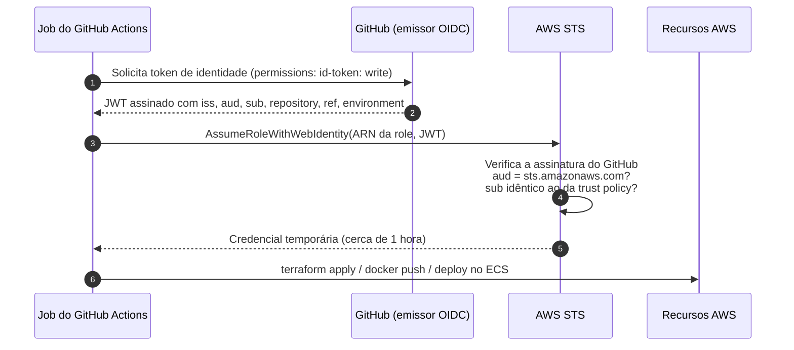
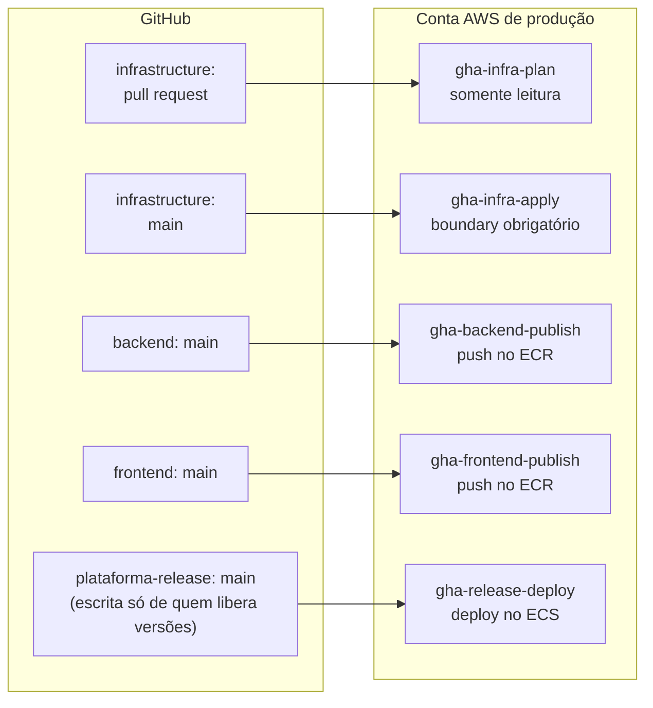
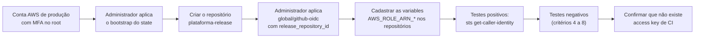

# OIDC: autenticação do GitHub Actions na AWS sem chaves fixas

**Objetivo.** Explicar como os pipelines do GitHub Actions obtêm acesso à AWS por meio de OpenID Connect (OIDC), sem guardar nenhuma chave de acesso no GitHub. O documento cobre o funcionamento do protocolo, a configuração na AWS e no GitHub, o módulo Terraform de referência, os testes que comprovam a segurança e os erros mais comuns.

**Pré-requisitos de leitura:** [02-conceitos-fundamentais-de-nuvem.md](02-conceitos-fundamentais-de-nuvem.md) (IAM, roles e policies) e [03-terraform-fundamentos.md](03-terraform-fundamentos.md). Termos técnicos estão definidos também em [11-glossario.md](11-glossario.md).

> Este material é de apoio e não é normativo. Em caso de divergência, prevalecem os documentos da `_KB`, em especial a POL-INFRA-001 (`_KB/engineering/ci-cd.md`), que exige OIDC e actions fixadas por SHA, e o ADR-011 (`_KB/architecture/adrs/ADR-011-environment-isolation.md`), que isola produção. Este documento já reflete a decisão do projeto de 2026-10-07 de manter **somente o ambiente de produção na AWS**, cuja decisão está registrada no ADR-012.

## Sumário

1. [O problema das chaves de longa duração](#1-o-problema-das-chaves-de-longa-duração)
2. [Como o OIDC funciona](#2-como-o-oidc-funciona)
3. [As duas peças na AWS](#3-as-duas-peças-na-aws)
4. [O claim `sub`: onde está a segurança](#4-o-claim-sub-onde-está-a-segurança)
5. [Matriz de roles](#5-matriz-de-roles)
6. [O módulo `modules/github-oidc`](#6-o-módulo-modulesgithub-oidc)
7. [Workflows de exemplo](#7-workflows-de-exemplo)
8. [Configuração no GitHub](#8-configuração-no-github)
9. [Recursos disponíveis conforme o plano do GitHub](#9-recursos-disponíveis-conforme-o-plano-do-github)
10. [Critérios de aceite e testes](#10-critérios-de-aceite-e-testes)
11. [Riscos de segurança comuns](#11-riscos-de-segurança-comuns)
12. [Erros comuns e correção](#12-erros-comuns-e-correção)
13. [Ordem de implantação na AWS real](#13-ordem-de-implantação-na-aws-real)

---

## 1. O problema das chaves de longa duração

A forma mais simples de dar acesso à AWS a um pipeline é criar um usuário IAM, gerar uma *access key* (par `AWS_ACCESS_KEY_ID` e `AWS_SECRET_ACCESS_KEY`) e guardá-la nos *secrets* do repositório. Essa abordagem tem problemas sérios:

- **A chave não expira.** Se vazar (num log, numa cópia local, num repositório clonado), continua válida até alguém revogá-la manualmente.
- **A chave não sabe quem a usa.** Qualquer workflow do repositório, em qualquer branch, recebe a mesma credencial.
- **A rotação é manual.** Na prática, chaves ficam meses ou anos sem troca.
- **Auditoria fraca.** O CloudTrail registra o usuário IAM, mas não diz qual repositório, branch ou execução fez a chamada.

Com OIDC, **nenhuma credencial permanente existe**. Cada execução do pipeline recebe uma credencial temporária, válida por cerca de uma hora, emitida apenas se o contexto do job (repositório, branch, environment) corresponder exatamente ao que foi autorizado.

## 2. Como o OIDC funciona

**OpenID Connect (OIDC)** é um protocolo padrão de identidade construído sobre o OAuth 2.0. Nele, um **emissor** (*issuer*) confiável gera um documento assinado que atesta a identidade de alguém. Esse documento é um **JWT** (*JSON Web Token*): um JSON codificado e assinado digitalmente, que qualquer pessoa pode ler, mas ninguém pode alterar sem invalidar a assinatura.

No nosso caso:

- O **emissor** é o GitHub (`https://token.actions.githubusercontent.com`).
- O **portador** do token é um job do GitHub Actions.
- O **consumidor** é o AWS STS (*Security Token Service*), serviço que emite credenciais temporárias.

Os campos de um JWT são chamados de **claims**. Os três mais importantes para nós:

| Claim | Significado | Exemplo |
| --- | --- | --- |
| `iss` (*issuer*) | Quem emitiu o token | `https://token.actions.githubusercontent.com` |
| `aud` (*audience*) | Para quem o token foi emitido | `sts.amazonaws.com` |
| `sub` (*subject*) | Quem é o portador, no contexto do job | `repo:UniSENAI-Sorocaba@321832374/plataforma-backend@1364613500:ref:refs/heads/main` |

O token traz ainda outros claims (`repository`, `ref`, `environment`, `actor`, `workflow` e outros), mas a AWS usa principalmente `aud` e `sub` nas condições da trust policy.



A operação do passo 3, **`AssumeRoleWithWebIdentity`**, é a chamada do STS que troca um token de identidade externo por credenciais temporárias de uma role IAM. A action `aws-actions/configure-aws-credentials` faz os passos 1 a 5 automaticamente.

**Uma analogia.** O GitHub funciona como a portaria de um prédio que emite crachás de visitante assinados, com o nome e o destino do visitante. A AWS é o andar de destino: confia na assinatura da portaria, lê o crachá e só abre a sala (a role) se o nome no crachá constar na lista afixada na porta (a trust policy). Se um crachá for perdido, ele perde a validade em pouco tempo.

## 3. As duas peças na AWS

| Peça | O que declara | Quantidade |
| --- | --- | --- |
| **OIDC identity provider** (`aws_iam_openid_connect_provider`) | "Esta conta aceita tokens emitidos por `token.actions.githubusercontent.com` com audiência `sts.amazonaws.com`." | **Uma por conta AWS** |
| **Role IAM** com **trust policy** e **permission policy** | A trust policy diz *quem* pode assumir a role (qual `sub`). A permission policy diz *o que* a role pode fazer. | Uma por combinação de repositório e finalidade (planejar, aplicar, publicar, implantar) |

Separar as duas políticas é essencial: a trust policy controla a entrada, e a permission policy limita o estrago caso a entrada seja indevida.

## 4. O claim `sub`: onde está a segurança

### 4.1 Como o GitHub monta o `sub`

O valor do `sub` depende do contexto em que o job roda ([documentação](https://docs.github.com/en/actions/reference/security/oidc)):

| Contexto do job | Formato do `sub` (após o prefixo do repositório) | Exemplo completo |
| --- | --- | --- |
| Push numa branch, sem environment | `:ref:refs/heads/<branch>` | `repo:UniSENAI-Sorocaba@321832374/plataforma-backend@1364613500:ref:refs/heads/main` |
| Pull request, sem environment | `:pull_request` | `repo:UniSENAI-Sorocaba@321832374/plataforma-infrastructure@1364613694:pull_request` |
| Job com `environment: production` | `:environment:production` | `repo:UniSENAI-Sorocaba@321832374/plataforma-infrastructure@1364613694:environment:production` |
| Push de tag, sem environment | `:ref:refs/tags/<tag>` | `repo:UniSENAI-Sorocaba@321832374/plataforma-backend@1364613500:ref:refs/tags/v1.0.0` |

**Regra importante:** se o job declara um `environment`, o `sub` passa a ser o do environment, mesmo que o gatilho tenha sido um push na `main`. Um `workflow_dispatch` executado na `main`, sem environment, gera o mesmo `sub` de um push na `main` (`:ref:refs/heads/main`).

### 4.2 O formato imutável

Repositórios criados a partir de 2026-07-15 usam o **formato imutável** do `sub`, que inclui os IDs numéricos da organização e do repositório ([changelog do GitHub](https://github.blog/changelog/2026-04-23-immutable-subject-claims-for-github-actions-oidc-tokens/)):

```text
repo:<org>@<org_id>/<repo>@<repo_id>:<contexto>
```

O objetivo é impedir que alguém apague um repositório e crie outro com o mesmo nome para herdar as permissões na AWS. Como os IDs não se repetem, a trust policy continua apontando apenas para o repositório original.

Todos os repositórios da organização UniSENAI-Sorocaba usam esse formato (verificado em 2026-10-05). Uma trust policy escrita no formato antigo, como `repo:UniSENAI-Sorocaba/plataforma-backend:...`, **não corresponde** ao token e a AWS responde `AccessDenied`.

| Repositório | Prefixo do `sub` |
| --- | --- |
| plataforma-infrastructure | `repo:UniSENAI-Sorocaba@321832374/plataforma-infrastructure@1364613694` |
| plataforma-backend | `repo:UniSENAI-Sorocaba@321832374/plataforma-backend@1364613500` |
| plataforma-frontend | `repo:UniSENAI-Sorocaba@321832374/plataforma-frontend@1364613558` |
| plataforma-database | `repo:UniSENAI-Sorocaba@321832374/plataforma-database@1364613644` |
| plataforma-quality | `repo:UniSENAI-Sorocaba@321832374/plataforma-quality@1364613747` |
| plataforma-release | Ainda não criado. O ID será obtido com `gh api repos/UniSENAI-Sorocaba/plataforma-release --jq .id` |

Para conferir o prefixo de qualquer repositório:

```bash
gh api repos/UniSENAI-Sorocaba/<repositorio>/actions/oidc/customization/sub --jq .sub_claim_prefix
```

### 4.3 A trust policy

Trust policy gerada pelo módulo do laboratório para a role de publicação de imagens do backend:

```json
{
  "Effect": "Allow",
  "Principal": {
    "Federated": "arn:aws:iam::<conta>:oidc-provider/token.actions.githubusercontent.com"
  },
  "Action": "sts:AssumeRoleWithWebIdentity",
  "Condition": {
    "StringEquals": {
      "token.actions.githubusercontent.com:aud": "sts.amazonaws.com",
      "token.actions.githubusercontent.com:sub": "repo:UniSENAI-Sorocaba@321832374/plataforma-backend@1364613500:ref:refs/heads/main"
    }
  }
}
```

Leitura de cada parte:

- `Principal.Federated`: só tokens validados por este OIDC provider são considerados.
- `Action`: a única forma de entrar é `AssumeRoleWithWebIdentity`.
- `aud`: o token precisa ter sido emitido para a AWS, e não para outro serviço.
- `sub` com **`StringEquals`**: comparação exata. Nenhum outro repositório, branch ou environment corresponde.

## 5. Matriz de roles

Pela decisão do projeto de 2026-10-07 (ADR-012), **somente o ambiente de produção existe na AWS**. Development roda na máquina de cada pessoa e a validação que antes ocorreria em staging acontece num ambiente efêmero dentro do job de CI (ver [08-cicd-no-plano-free-do-github.md](08-cicd-no-plano-free-do-github.md)). Há, portanto, **uma única conta AWS** e um único conjunto de roles.

O root `global/github-oidc/` cria as roles abaixo, no path IAM `/github-actions/`, com nomes no padrão `gha-<chave>`.

| Role | Repositório | `sub` aceito | Pode | Não pode |
| --- | --- | --- | --- | --- |
| `gha-infra-plan` | plataforma-infrastructure | `pull_request` | Ler a infraestrutura (`Describe*`, `Get*`, `List*`), ler o state, criar e remover o arquivo de lock `.tflock` | Escrever qualquer recurso; ler o **valor** de segredos (negação explícita de `GetSecretValue` e `kms:Decrypt`) |
| `gha-infra-apply` | plataforma-infrastructure | `ref:refs/heads/main` (ou `environment:production`) | Gerenciar os serviços da plataforma em `us-east-1`; criar roles em `/plataforma/` **somente com o permissions boundary** `plataforma-workload-boundary` | Alterar roles de CI, o boundary ou o OIDC provider; criar usuários IAM ou chaves de acesso; desligar o versionamento ou trocar a policy do bucket de state; desligar CloudTrail ou GuardDuty |
| `gha-backend-publish` | plataforma-backend | `ref:refs/heads/main` | Enviar imagens apenas ao repositório ECR `plataforma-backend-production` | Fazer deploy, tocar no frontend, no banco ou no Terraform |
| `gha-frontend-publish` | plataforma-frontend | `ref:refs/heads/main` | Enviar imagens apenas ao repositório ECR `plataforma-frontend-production` | O equivalente |
| `gha-release-deploy` | plataforma-release | `ref:refs/heads/main` (ou `environment:production`) | Ler imagens dos dois repositórios ECR, registrar task definitions, executar a task de migration no cluster de produção, atualizar os dois serviços, `iam:PassRole` apenas das roles de task | Enviar imagens, executar Terraform, alterar IAM |

A separação entre **publicar** e **implantar** é intencional. Um merge na `main` de uma aplicação só consegue colocar uma imagem no ECR; colocá-la em execução em produção exige o repositório de release, no qual apenas quem libera versões tem escrita. A coluna "`sub` aceito" de `gha-infra-apply` e `gha-release-deploy` depende do plano do GitHub (seção 9): com environments disponíveis, usa-se `environment:production` com aprovação obrigatória; sem eles, `ref:refs/heads/main`.



### 5.1 Permissions boundary: por que existe

Um **permissions boundary** é uma policy IAM anexada a uma role como **teto**: a role só pode executar uma ação se ela estiver permitida ao mesmo tempo na própria policy e no boundary.

O Terraform precisa criar roles para as aplicações (task role e execution role do ECS, role da instância NAT). Se o pipeline pudesse criar qualquer role com qualquer policy, haveria um caminho de **escalada de privilégio**: um PR aprovado criaria uma role em `/plataforma/`, anexaria `AdministratorAccess`, escreveria na trust policy dessa role o ARN da própria `gha-infra-apply` e passaria a assumi-la. Dentro da mesma conta, uma trust policy que cita o principal explicitamente é suficiente para permitir a troca de role.

O laboratório fecha esse caminho com três regras:

1. `iam:CreateRole` e `iam:PutRolePermissionsBoundary` em `role/plataforma/*` só são permitidos com a condição `iam:PermissionsBoundary` igual ao ARN de `plataforma-workload-boundary`.
2. `iam:DeleteRolePermissionsBoundary` é negado.
3. O boundary fica em `policy/github-actions/`, path no qual qualquer ação IAM do pipeline é negada; assim ele não pode ser afrouxado.

O boundary permite apenas o que uma aplicação precisa: objetos S3 `plataforma-*`, leitura de segredos `plataforma/*`, escrita de logs, download de imagens do ECR, `kms:Decrypt`/`GenerateDataKey`, métricas e traces, e o canal do Session Manager. Mesmo que uma role da aplicação receba `AdministratorAccess`, o resultado efetivo fica limitado a essa lista.

Um cuidado permanece: uma role criada **manualmente** em `/plataforma/` sem boundary seria uma brecha, porque o pipeline pode alterar roles desse path. Toda role desse path deve nascer pelo Terraform.

## 6. O módulo `modules/github-oidc`

O código de referência está em [`exemplos/lab-terraform-local/modules/github-oidc/`](exemplos/lab-terraform-local/modules/github-oidc/) e é usado pelo root [`exemplos/lab-terraform-local/global/github-oidc/`](exemplos/lab-terraform-local/global/github-oidc/).

### 6.1 Interface

| Variável | Tipo | Padrão | Função |
| --- | --- | --- | --- |
| `github_org` | string | `"UniSENAI-Sorocaba"` | Organização dona dos repositórios |
| `github_org_id` | number | `null` | ID da organização. Quando informado, ativa o formato imutável do `sub` |
| `create_provider` | bool | `true` | Cria o OIDC provider. Use `false` se ele já existir na conta |
| `existing_provider_arn` | string | `null` | ARN do provider existente, quando `create_provider = false` |
| `role_path` | string | `"/github-actions/"` | Path IAM das roles de CI |
| `roles` | map(object) | obrigatório | Uma entrada por role; a chave vira o nome `gha-<chave>` |

Cada item de `roles` contém `repository`, `repository_id` (obrigatório no formato imutável), `subjects` (lista de contextos aceitos), `policy_json` (permissões) e, opcionalmente, `max_session_duration` (padrão 3600 segundos). As saídas são `provider_arn` e `role_arns` (mapa de chave para ARN).

```hcl
module "github_oidc" {
  source        = "../../modules/github-oidc"
  github_org_id = 321832374 # ativa o formato imutável do sub

  roles = {
    "backend-publish" = {
      repository    = "plataforma-backend"
      repository_id = 1364613500
      subjects      = ["ref:refs/heads/main"]
      policy_json   = data.aws_iam_policy_document.app_publish["backend"].json
    }
  }
}
```

### 6.2 Proteções embutidas

O módulo usa blocos `validation` para impedir configurações inseguras ainda no `plan`:

- **Curinga proibido:** `subjects = ["environment:*"]` ou `repository = "*"` falham com a mensagem *"Curinga (\*) não é permitido em repository nem em subjects."*
- **Formato validado:** `subjects` aceita apenas `environment:<nome>`, `pull_request` ou `ref:refs/heads/<nome>` / `ref:refs/tags/<nome>`.
- **ID obrigatório:** com `github_org_id` informado, toda role precisa de `repository_id`.
- **Comparação exata:** a trust policy usa sempre `StringEquals`, nunca `StringLike`.
- **Audiência conferida:** a condição `aud = sts.amazonaws.com` é sempre incluída.

### 6.3 O root `global/github-oidc`

O root define o boundary e quatro famílias de permissões:

| Documento de policy | Usado por | Resumo |
| --- | --- | --- |
| `workload_boundary` | roles da aplicação (via boundary) | Teto de permissões das roles criadas em `/plataforma/` |
| `infra_plan` | `gha-infra-plan` | Leitura, state e lock; negação explícita de leitura de segredos |
| `infra_apply` | `gha-infra-apply` | Serviços da plataforma restritos a `us-east-1`; IAM com boundary obrigatório; negações de autoedição, de usuários e chaves, de alteração do bucket de state e de desligamento da auditoria |
| `app_publish` | `gha-backend-publish`, `gha-frontend-publish` | Push apenas no próprio repositório ECR |
| `release_deploy` | `gha-release-deploy` | Leitura de imagens, task definitions, `RunTask` só da migration e só no cluster de produção, atualização dos dois serviços, `PassRole` das roles de task |

Variáveis do root:

| Variável | Padrão | Função |
| --- | --- | --- |
| `environment` | `"production"` | Ambiente da conta; compõe nomes como `plataforma-backend-production` |
| `state_bucket` | `"plataforma-tfstate-development"` | No laboratório, o único bucket existente; na AWS real, `plataforma-tfstate-production` |
| `use_github_environments` | `false` | `false`: trust por `ref:refs/heads/main`. `true`: trust por `environment:production`. Afeta `infra-apply` e `release-deploy` |
| `release_repository_id` | `null` | ID do repositório `plataforma-release`. Enquanto for `null`, a role `gha-release-deploy` não é criada |

### 6.4 Execução no laboratório

```bash
cd exemplos/lab-terraform-local
make up && make bootstrap
make oidc-init && make oidc-plan && make oidc-apply
make aws CMD="iam list-roles --path-prefix /github-actions/ --query Roles[].RoleName"
make aws CMD="iam get-role --role-name gha-backend-publish --query Role.AssumeRolePolicyDocument"
```

Para simular a role de release, informe um ID qualquer: `terraform -chdir=global/github-oidc plan -var release_repository_id=1`.

> **Limite do emulador.** O MiniStack aceita `AssumeRoleWithWebIdentity` até com um token inválido, como a string `"token-falso"`: ele não verifica a assinatura nem o `sub`. Também não avalia permissions boundaries na configuração padrão. O laboratório comprova a **forma** (recursos criados, conteúdo das policies, idempotência). A **segurança** só pode ser comprovada na AWS real, com os testes da seção 10. Detalhes em [05-laboratorio-local-ministack.md](05-laboratorio-local-ministack.md).

## 7. Workflows de exemplo

A POL-INFRA-001 exige que actions de terceiros sejam fixadas por **SHA de commit**, porque uma tag como `@v4` pode ser movida para outro código. Nos exemplos, `<SHA>` é um marcador a ser substituído pelo SHA completo da versão escolhida.

Blocos que aparecem em todos os exemplos:

- **`permissions: id-token: write`**: sem essa permissão, o GitHub não emite o token OIDC para o job. As demais permissões devem ser as mínimas necessárias (`contents: read` por padrão). Jobs que não acessam a AWS não recebem `id-token: write`.
- **`concurrency`**: agrupa execuções; com `cancel-in-progress: false`, uma segunda execução espera a primeira terminar, o que evita dois `apply` ou dois deploys simultâneos em produção.
- **`vars.AWS_ROLE_ARN_*`**: o ARN de uma role não é segredo; fica numa *variable* do repositório.
- **Nada de `${{ github.event.* }}` dentro de `run:`**: valores controlados por quem abre o PR (título, nome da branch) podem conter comandos. Quando necessário, passe-os por `env:` e use a variável entre aspas.

### 7.1 Plan em pull request (repositório infrastructure)

O plan é feito contra a conta de produção, com a role somente leitura. No mesmo workflow, um segundo job aplica o código no MiniStack, dentro do runner, para comprovar que ele é aplicável sem tocar na AWS.

```yaml
name: terraform-pr
on:
  pull_request:
    paths: ["**/*.tf", ".github/workflows/terraform-*.yml"]

permissions:
  contents: read

concurrency:
  group: tf-pr-${{ github.ref }}
  cancel-in-progress: true   # um novo commit no PR cancela a execução anterior

jobs:
  plan-producao:
    runs-on: ubuntu-latest
    permissions:
      id-token: write        # necessário para o token OIDC
      contents: read
      pull-requests: write   # para comentar o plan no PR
    steps:
      - uses: actions/checkout@<SHA>
      - uses: hashicorp/setup-terraform@<SHA>
      - uses: aws-actions/configure-aws-credentials@<SHA>
        with:
          role-to-assume: ${{ vars.AWS_ROLE_ARN_PLAN }}   # gha-infra-plan
          aws-region: us-east-1
      - run: terraform fmt -check -recursive
      - run: terraform -chdir=environments/production init -input=false
      - run: terraform -chdir=environments/production plan -input=false -no-color -lock-timeout=60s

  apply-no-emulador:
    runs-on: ubuntu-latest     # sem id-token: este job não fala com a AWS
    steps:
      - uses: actions/checkout@<SHA>
      - uses: hashicorp/setup-terraform@<SHA>
      - run: docker compose -f tests/ministack/compose.yaml up -d --wait
      - run: terraform -chdir=tests/ministack init -input=false
      - run: terraform -chdir=tests/ministack apply -input=false -auto-approve
      - run: terraform -chdir=tests/ministack plan -detailed-exitcode   # 0 = sem mudanças (idempotente)
      - if: always()
        run: docker compose -f tests/ministack/compose.yaml down -v
```

Como o job de plan não declara environment, o `sub` é `...:pull_request`, aceito apenas pela role somente leitura `gha-infra-plan`. O diretório `tests/ministack` é um root de teste que chama os mesmos módulos com o provider apontado para o emulador, como em `exemplos/lab-terraform-local/environments/development`.

### 7.2 Apply em produção (repositório infrastructure)

```yaml
name: terraform-apply-production
on:
  push:
    branches: [main]
    paths: ["**/*.tf"]
  workflow_dispatch: {}       # após o go-live, preferir o disparo manual depois do merge

permissions:
  id-token: write
  contents: read

concurrency:
  group: tf-production
  cancel-in-progress: false   # nunca interromper um apply em andamento

jobs:
  apply:
    runs-on: ubuntu-latest
    # environment: production  # somente se o plano do GitHub oferecer environments
    steps:
      - uses: actions/checkout@<SHA>
      - uses: hashicorp/setup-terraform@<SHA>
      - uses: aws-actions/configure-aws-credentials@<SHA>
        with:
          role-to-assume: ${{ vars.AWS_ROLE_ARN_APPLY }}   # gha-infra-apply
          aws-region: us-east-1
      - run: terraform -chdir=environments/production init -input=false
      - run: terraform -chdir=environments/production plan -input=false -out=tfplan
      - run: terraform -chdir=environments/production apply -input=false tfplan
```

Sem environments, o `sub` é `...:ref:refs/heads/main`: o apply acontece no merge (ou no disparo manual na `main`). Somente o time de Cloud & DevOps tem permissão de escrita no repositório de infraestrutura, o que limita quem consegue chegar a esse ponto.

### 7.3 Publicação de imagem (repositório backend; o frontend é análogo)

```yaml
name: publish-image
on:
  push:
    branches: [main]

permissions:
  contents: read

concurrency:
  group: publish-backend
  cancel-in-progress: false

jobs:
  validar-e-publicar:
    runs-on: ubuntu-latest
    permissions:
      id-token: write
      contents: read
    steps:
      - uses: actions/checkout@<SHA>
      - uses: docker/setup-qemu-action@<SHA>
      - uses: docker/setup-buildx-action@<SHA>

      # 1. Build para a arquitetura do runner e validação efêmera (sem credencial AWS ainda).
      - run: docker buildx build --platform linux/amd64 --load -t plataforma-backend:ci .
      - run: ./ci/validacao-efemera.sh plataforma-backend:ci   # ver 08-cicd-no-plano-free-do-github.md

      # 2. Só depois da validação o job assume a role e publica.
      - uses: aws-actions/configure-aws-credentials@<SHA>
        with:
          role-to-assume: ${{ vars.AWS_ROLE_ARN_PUBLISH }}   # gha-backend-publish
          aws-region: us-east-1
      - run: aws sts get-caller-identity   # evidência: mostra a role assumida
      - uses: aws-actions/amazon-ecr-login@<SHA>
        id: ecr
      - name: Build multiarquitetura e push
        env:
          IMAGE: ${{ steps.ecr.outputs.registry }}/plataforma-backend-production:${{ github.sha }}
        run: |
          docker buildx build --platform linux/amd64,linux/arm64 -t "$IMAGE" --push \
            --metadata-file metadata.json .
          jq -r '."containerimage.digest"' metadata.json   # digest que será informado no deploy
```

Esse workflow **não faz deploy**: ele termina com a imagem no ECR, identificada pela tag imutável (SHA do commit) e pelo digest. Três detalhes sustentam a ideia de "testar o que será publicado":

- O Dockerfile compila a aplicação num estágio `FROM --platform=$BUILDPLATFORM`. O artefato da aplicação (o `.jar` ou a pasta `.next`) é gerado uma única vez, sem emulação, e copiado para as duas imagens finais; o segundo build reaproveita o cache do primeiro.
- A validação usa a variante `amd64`, que roda nativamente no runner; produção usa a variante `arm64` (Graviton). O código testado é o mesmo; muda apenas a imagem base.
- Se a organização tiver acesso a runners `arm64` hospedados para repositórios privados (verificar a documentação do plano), a validação pode rodar diretamente na variante `arm64`.

### 7.4 Deploy em produção (repositório plataforma-release)

O workflow `deploy-production`, com as verificações que antecedem a troca de versão, está descrito na seção 5 de [08-cicd-no-plano-free-do-github.md](08-cicd-no-plano-free-do-github.md). Do ponto de vista do OIDC, o que importa é:

- ele roda na `main` do `plataforma-release`, por `workflow_dispatch`, e gera o `sub` `...plataforma-release@<id>:ref:refs/heads/main`;
- só a role `gha-release-deploy` aceita esse `sub`;
- só quem tem escrita no `plataforma-release` consegue disparar o workflow.

## 8. Configuração no GitHub

Variables por repositório (o ARN de uma role não é segredo):

| Repositório | Variable | Role |
| --- | --- | --- |
| plataforma-infrastructure | `AWS_ROLE_ARN_PLAN` | `gha-infra-plan` |
| plataforma-infrastructure | `AWS_ROLE_ARN_APPLY` | `gha-infra-apply` |
| plataforma-backend | `AWS_ROLE_ARN_PUBLISH` | `gha-backend-publish` |
| plataforma-frontend | `AWS_ROLE_ARN_PUBLISH` | `gha-frontend-publish` |
| plataforma-release | `AWS_ROLE_ARN_DEPLOY` | `gha-release-deploy` |

Configurações gerais, por repositório e na organização:

| Local | Configuração |
| --- | --- |
| Settings → Actions → General | Permissões padrão do `GITHUB_TOKEN` somente leitura; não permitir que o GitHub Actions aprove pull requests |
| Organização → Actions → Policies | Permitir apenas actions de uma lista (`actions/*`, `aws-actions/*`, `hashicorp/*`, `docker/*` e as demais aprovadas), sempre fixadas por SHA |
| Settings → Collaborators and teams | Escrita no infrastructure apenas para Cloud & DevOps; escrita no `plataforma-release` apenas para quem libera versões |
| Settings → Environments → `production` (somente se o plano permitir) | **Required reviewers**, deployment branches apenas `main`; nesse caso, `use_github_environments = true` |
| Branch `main` (somente se o plano permitir) | Protegida: PR obrigatório, checks obrigatórios, aprovação de CODEOWNERS, sem force push |

**Por que, com environments, a regra de deployment branches é indispensável.** O environment determina o `sub`, e o `sub` determina a role. Sem restrição de branch, qualquer pessoa com permissão de escrita poderia criar uma branch, escrever `environment: production` num workflow e receber as credenciais de produção sem passar por revisão. O environment funciona como a fechadura; a regra de branch controla quem tem a chave.

## 9. Recursos disponíveis conforme o plano do GitHub

Situação verificada em 2026-10-05 na organização UniSENAI-Sorocaba: plano **Free**, repositórios **privados**. Nas chamadas à API de branch protection e de rulesets, o GitHub responde `403 "Upgrade to GitHub Pro or make this repository public"`.

| Recurso | Free com repositório privado | Team, ou repositório público |
| --- | --- | --- |
| Environments | Não | Sim |
| Deployment branches por environment | Não | Sim |
| Required reviewers (aprovação de deploy) | Não | Sim (em repositório público, em qualquer plano; em privado, depende do plano: [documentação](https://docs.github.com/en/actions/how-tos/deploy/configure-and-manage-deployments/manage-environments)) |
| Branch protection e rulesets | Não (API retorna 403) | Sim |
| OIDC no GitHub Actions | Sim | Sim |
| Minutos de Actions por mês (repositórios privados, para a organização inteira) | 2.000 | 3.000 |

**Consequência.** Sem esses recursos, regras como "sem push direto na `main`", "aprovação obrigatória de CODEOWNERS" e "aprovação humana antes de produção" não podem ser impostas pelo GitHub; valem apenas como acordo de trabalho. Por isso o desenho deste material desloca a trava para a trust policy na AWS e para as permissões de repositório.

**Alternativas:**

| Alternativa | Vantagens | Desvantagens |
| --- | --- | --- |
| **GitHub Team gratuito via GitHub Education.** Docentes verificados podem solicitar a atualização de organizações acadêmicas para o plano Team sem custo ([Teacher Toolbox](https://education.github.com/toolbox), [discussão na comunidade](https://github.com/orgs/community/discussions/205783)) | Libera os recursos da tabela mantendo os repositórios privados; permite trocar o repositório de release por um environment com aprovação | Depende de verificação docente, que pode levar alguns dias |
| **Tornar os repositórios públicos** | Libera os recursos imediatamente e sem custo | Exige revisão de dados sensíveis no histórico e concordância da instituição |
| **Permanecer no Free com controles compensatórios** (trust por branch, separação entre publicar e implantar, repositório de release, auditoria), descritos em [08-cicd-no-plano-free-do-github.md](08-cicd-no-plano-free-do-github.md) | Funciona hoje, sem depender de terceiros | Mais peças para manter; parte das regras vira detecção em vez de prevenção |

Note que, com somente produção na AWS, **não existe mais a opção de aceitar trust por branch como "suficiente para staging"**: toda role com poder de escrita atua em produção. Por isso a role que a `main` de uma aplicação assume só publica imagens, e a que implanta fica atrás do repositório de release.

## 10. Critérios de aceite e testes

Critérios de referência para o item de backlog de OIDC (INF-004). Os critérios oficiais são os registrados na issue. Os testes são executados na conta de produção antes do go-live, quando ela ainda não tem usuários nem dados reais.

1. Existe **um único** OIDC provider na conta, criado por Terraform (`global/github-oidc`).
2. Nenhum usuário IAM possui access key ativa usada por CI (`aws iam list-access-keys` não retorna chaves de pipeline).
3. **Teste positivo:** o workflow de publicação do backend executa `aws sts get-caller-identity` e o resultado mostra `assumed-role/gha-backend-publish/...`. O log é anexado como evidência. O mesmo para `gha-infra-plan` (num PR) e `gha-infra-apply` (na `main`).
4. **Teste negativo de repositório:** um job do repositório frontend tenta assumir `gha-backend-publish` e recebe `AccessDenied`.
5. **Teste negativo de branch:** um job numa branch diferente de `main` tenta assumir `gha-infra-apply` e recebe `AccessDenied`.
6. **Teste negativo de permissão de leitura:** com `gha-infra-plan`, `aws s3 cp arquivo s3://<bucket-de-uploads>/` e `aws secretsmanager get-secret-value` retornam `AccessDenied`.
7. **Teste negativo de separação de funções:** com `gha-backend-publish`, `aws ecs update-service` retorna `AccessDenied`; com `gha-release-deploy`, `aws ecr put-image` retorna `AccessDenied`.
8. **Teste negativo de escalada:** com `gha-infra-apply`, `aws iam create-role --path /plataforma/ --role-name teste-sem-boundary ...` **sem** `--permissions-boundary` retorna `AccessDenied`; com o boundary, funciona. `aws iam create-user` também retorna `AccessDenied`.
9. A role `gha-release-deploy` só é assumível a partir da `main` do `plataforma-release` (ou do environment `production`, se o plano permitir).
10. O CloudTrail registra os eventos `AssumeRoleWithWebIdentity` com o `sub` correspondente, permitindo auditoria.

Os testes negativos são tão importantes quanto o positivo: eles provam que a trust policy e as permissões rejeitam o que devem rejeitar.

## 11. Riscos de segurança comuns

| Risco | Por que é perigoso | Proteção |
| --- | --- | --- |
| Curinga no `sub` (`repo:UniSENAI-Sorocaba/*`) | Qualquer repositório da organização, inclusive um criado no futuro, assume a role | Validação do módulo e `StringEquals` |
| Workflow de PR com permissão de escrita | O workflow executado num PR é a versão do próprio PR: quem abre o PR pode alterá-lo | `gha-infra-plan` somente leitura, com negação explícita de leitura de segredos |
| Pipeline capaz de editar a própria trust policy | Uma mudança aprovada poderia ampliar o acesso de forma permanente | `Deny` em `role/github-actions/*`, `policy/github-actions/*` e no OIDC provider |
| Escalada pela criação de roles | O pipeline cria uma role com `AdministratorAccess` que confia nele mesmo e passa a assumi-la | Permissions boundary obrigatório em `iam:CreateRole`, negação de remoção do boundary (seção 5.1) |
| Merge numa aplicação vira deploy em produção | Com somente produção na AWS, qualquer role de deploy assumível pela `main` de um app levaria código direto a usuários | Separação entre `publish` (só ECR) e `release-deploy` (só pelo repositório de release) |
| Deploy a partir de branch arbitrária | Environment sem regra de branch entrega credenciais a qualquer branch | Deployment branches restritas à `main` (seção 8) |
| Segredo no state lido pelo plan | O `plan` atualiza `aws_secretsmanager_secret_version` e precisaria de `GetSecretValue` | No RDS, usar `manage_master_user_password = true`, ou atributos write-only do Terraform 1.11+ (ver [13-seguranca-da-infraestrutura.md](13-seguranca-da-infraestrutura.md)) |
| Injeção de comando no workflow | `${{ github.event.pull_request.title }}` dentro de `run:` executa o que estiver no título | Passar valores por `env:` e nunca usar `pull_request_target` com checkout do código do PR |
| Action de terceiros comprometida | Uma tag pode ser movida para código malicioso | Fixar actions por SHA (POL-INFRA-001) e restringir as actions permitidas na organização |
| Pipeline apagando a própria trilha | Um apply malicioso desliga o CloudTrail ou o versionamento do state antes de agir | Negações explícitas em `infra_apply` (`ProtectStateBucket`, `ProtectAuditAndDetection`) |

> **Observação sobre o laboratório.** O módulo `modules/database` do laboratório pode usar geração de senha pelo Terraform por finalidade didática. Com a role de plan sem `GetSecretValue`, um plan em PR falharia ao ler um segredo guardado no state. No repositório real, prefira `manage_master_user_password` ou atributos write-only.

## 12. Erros comuns e correção

| Mensagem | Causa provável | Correção |
| --- | --- | --- |
| `Credentials could not be loaded` | Falta `permissions: id-token: write` no job | Adicionar a permissão no job que acessa a AWS |
| `Not authorized to perform sts:AssumeRoleWithWebIdentity` | O `sub` não corresponde: branch diferente de `main`, environment declarado quando a role espera branch (ou o contrário), formato antigo em vez do imutável, ID de repositório errado | Conferir o prefixo com `gh api` (seção 4.2) e comparar com a trust policy |
| `No OpenIDConnect provider found` | Provider não criado nesta conta | Aplicar `global/github-oidc` na conta de produção |
| `AccessDenied` em `iam:CreateRole` durante o apply | A role está sendo criada sem `permissions_boundary`, ou fora de `/plataforma/` | No recurso `aws_iam_role`, definir `path = "/plataforma/"` e `permissions_boundary` com o ARN do boundary |
| `AccessDenied` depois de assumir a role | A role foi assumida, mas a permission policy não permite a ação (por exemplo, `publish` tentando `ecs:UpdateService`) | Verificar se a ação pertence a esta role; se pertencer, ajustar `policy_json` ação por ação |
| Role `gha-release-deploy` inexistente | `release_repository_id` não foi informado | Criar o repositório `plataforma-release`, obter o ID e reaplicar `global/github-oidc` |

## 13. Ordem de implantação na AWS real



Os passos B e D são executados por uma pessoa com credencial administrativa, **uma única vez**. Antes deles, o pipeline não tem como entrar na AWS; depois deles, nenhuma chave permanente é necessária. Alterações posteriores em `global/github-oidc` também são aplicadas por um administrador, porque o pipeline não pode alterar as próprias roles.

## Referências

- [GitHub Docs: OpenID Connect reference](https://docs.github.com/en/actions/reference/security/oidc): formatos do `sub` e personalização por organização
- [GitHub Docs: Managing environments](https://docs.github.com/en/actions/how-tos/deploy/configure-and-manage-deployments/manage-environments): disponibilidade de environments em repositórios privados
- [GitHub Docs: Deployments and environments](https://docs.github.com/en/actions/reference/workflows-and-actions/deployments-and-environments): deployment branches e secrets por plano
- [GitHub Docs: Security hardening for GitHub Actions](https://docs.github.com/en/actions/security-for-github-actions/security-guides/security-hardening-for-github-actions): injeção de scripts e uso de actions de terceiros
- [GitHub Changelog: immutable subject claims para tokens OIDC](https://github.blog/changelog/2026-04-23-immutable-subject-claims-for-github-actions-oidc-tokens/)
- [GitHub Community: atualização de organização com licença de educador](https://github.com/orgs/community/discussions/205783)
- [GitHub Education: Teacher Toolbox](https://education.github.com/toolbox)
- [AWS IAM: permissions boundaries](https://docs.aws.amazon.com/IAM/latest/UserGuide/access_policies_boundaries.html)
- Governança: POL-INFRA-001 (`_KB/engineering/ci-cd.md`), ADR-011 (`_KB/architecture/adrs/ADR-011-environment-isolation.md`), MH-INFRA-001 (`_KB/must-haves/infrastructure.md`); proposta ADR-012 (somente produção na AWS)
- Material relacionado: [08-cicd-no-plano-free-do-github.md](08-cicd-no-plano-free-do-github.md), [05-laboratorio-local-ministack.md](05-laboratorio-local-ministack.md), [10-diagramas.md](10-diagramas.md), [13-seguranca-da-infraestrutura.md](13-seguranca-da-infraestrutura.md)
