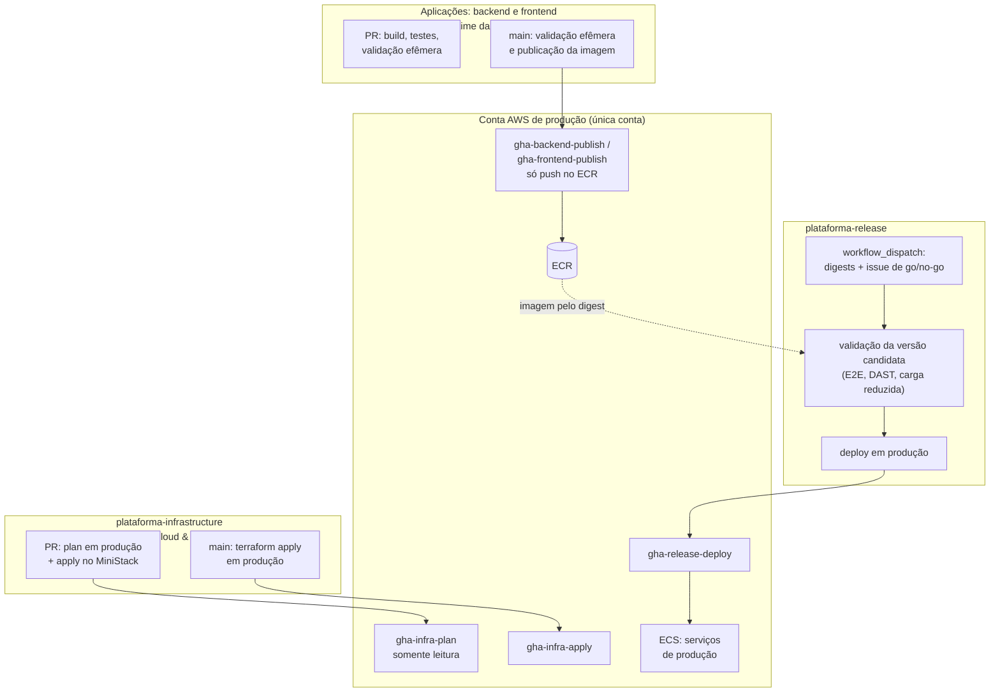

# CI/CD seguro no plano Free do GitHub com repositórios privados

**Objetivo.** Descrever o desenho de integração e entrega contínuas (CI/CD) da plataforma considerando duas condições do projeto: a organização do GitHub está no plano Free com repositórios privados, em que environments, aprovações de deploy e proteção de branch não estão disponíveis, e **somente o ambiente de produção existe na AWS**. O documento apresenta o que funciona nesse plano, a validação em ambiente efêmero que substitui o staging, o fluxo de produção por repositório de release, as boas práticas de pipeline para o ECS e os riscos que permanecem.

**Pré-requisitos de leitura:** [07-oidc-github-actions-aws.md](07-oidc-github-actions-aws.md) (OIDC, claim `sub`, trust policy e matriz de roles) e [04-padroes-e-fluxo-de-trabalho.md](04-padroes-e-fluxo-de-trabalho.md). Termos técnicos estão em [11-glossario.md](11-glossario.md).

> Este material é de apoio e não é normativo. Ele descreve uma alternativa de desenho para cumprir a POL-INFRA-001 (`_KB/engineering/ci-cd.md`) e o RUNBOOK-INFRA-002 (`_KB/operations/runbooks/deployment.md`) dentro das limitações do plano. A decisão de manter somente produção na AWS é do projeto, de 2026-10-07, e está registrada no ADR-012 (`_KB/architecture/adrs/ADR-012-production-only-aws.md`). Em caso de divergência, prevalecem os documentos normativos da `_KB`.

## Sumário

1. [O que funciona e o que não funciona no plano Free](#1-o-que-funciona-e-o-que-não-funciona-no-plano-free)
2. [Princípio do desenho](#2-princípio-do-desenho)
3. [Visão geral da arquitetura](#3-visão-geral-da-arquitetura)
4. [Validação em ambiente efêmero](#4-validação-em-ambiente-efêmero)
5. [Produção: repositório de release](#5-produção-repositório-de-release)
6. [Antes e depois do go-live](#6-antes-e-depois-do-go-live)
7. [Terraform no pipeline](#7-terraform-no-pipeline)
8. [Detecção no lugar da prevenção](#8-detecção-no-lugar-da-prevenção)
9. [Acordos de trabalho](#9-acordos-de-trabalho)
10. [Boas práticas de pipeline de deploy no ECS](#10-boas-práticas-de-pipeline-de-deploy-no-ecs)
11. [Consumo de minutos do GitHub Actions](#11-consumo-de-minutos-do-github-actions)
12. [Riscos residuais](#12-riscos-residuais)
13. [Se a organização passar para o plano Team](#13-se-a-organização-passar-para-o-plano-team)
14. [Pendências que exigem administração](#14-pendências-que-exigem-administração)

---

## 1. O que funciona e o que não funciona no plano Free

Verificações feitas em 2026-10-05 e 2026-10-07 na organização UniSENAI-Sorocaba, apenas com consultas de leitura à API do GitHub, complementadas pela documentação oficial.

| Recurso | Disponível no Free com repositório privado | Como foi verificado |
| --- | --- | --- |
| GitHub Actions, secrets e variables do repositório | Sim | Documentação do GitHub |
| **OIDC para a AWS** | Sim | É um recurso do GitHub Actions, sem restrição de plano ([documentação](https://docs.github.com/en/actions/reference/security/oidc)) |
| Personalização do claim `sub` | Sim | O endpoint `GET /repos/{repo}/actions/oidc/customization/sub` responde normalmente |
| Permissões por time (read, triage, write, maintain, admin) | Sim | Consulta às permissões dos times nos repositórios da organização |
| Compartilhamento de workflows de repositório privado com a organização | O endpoint responde; a alteração não foi testada | `GET /repos/{repo}/actions/permissions/access` |
| Environments, required reviewers, deployment branches | Não | [Documentação](https://docs.github.com/en/actions/how-tos/deploy/configure-and-manage-deployments/manage-environments) |
| Branch protection e rulesets | Não | A API retorna `403 Upgrade to GitHub Pro or make this repository public` |
| Code scanning (CodeQL) e secret scanning em repositório privado | Não (recursos pagos de segurança avançada) | Documentação do GitHub; ver [13-seguranca-da-infraestrutura.md](13-seguranca-da-infraestrutura.md) para os substitutos |
| Fork de repositórios privados | Não (desabilitado na organização) | Configuração `members_can_fork_private_repositories: false` |
| Criação de repositórios por membros | Sim (permitida hoje) | `members_can_create_repositories: true` |
| Minutos de Actions | 2.000 por mês para a organização inteira | Documentação de cobrança do GitHub |

A ausência de environments e de proteção de branch é discutida em detalhe na seção 9 de [07-oidc-github-actions-aws.md](07-oidc-github-actions-aws.md), junto com as alternativas de mudança de plano.

## 2. Princípio do desenho

No plano Free, o GitHub não impõe regras de branch nem de aprovação. Duas coisas, porém, continuam sendo respeitadas integralmente:

1. **A trust policy na AWS.** A AWS só entrega credenciais a um token cujo `sub` corresponda exatamente ao autorizado. O GitHub não pode contornar essa verificação.
2. **As permissões de repositório.** Só quem tem permissão de escrita num repositório consegue fazer push nele ou disparar seus workflows manualmente.

O desenho, portanto, **move a trava** das regras do GitHub para esses dois pontos. Como só existe produção na AWS, toda role com poder de escrita atua sobre produção; por isso o desenho separa **publicar** uma imagem de **implantar** uma imagem.

| Recurso pago ausente | Substituto que funciona no Free |
| --- | --- |
| Environment de staging | **Validação em ambiente efêmero** dentro do job do GitHub Actions (seção 4) |
| Required reviewers (aprovação de produção) | **Repositório de release separado**, no qual apenas quem libera versões tem escrita; somente ele assume a role de deploy (seção 5) |
| Deployment branches | Trust da role na AWS aceitando apenas a **branch `main`** do repositório correto (`ref:refs/heads/main`) |
| Branch protection na `main` | **Permissões por time**, **separação entre publicar e implantar** e **auditoria** que detecta push direto (seção 8) |
| Aprovação obrigatória de CODEOWNERS | Acordo de revisão e auditoria (sem imposição técnica) |

## 3. Visão geral da arquitetura



Um merge na `main` de uma aplicação **nunca** coloca código em execução para os usuários: ele apenas publica uma imagem no ECR. A troca de versão em produção acontece somente pelo repositório de release, depois de validar a versão candidata.

## 4. Validação em ambiente efêmero

### 4.1 O que é

Um **ambiente efêmero** é uma cópia da plataforma criada no início de um job de CI e destruída ao final. Ele cumpre o papel que o staging teria: integrar as peças e testar a versão antes de produção, mas sem custo na AWS e sem criar nada na nuvem (no nível 2, descrito abaixo, a credencial AWS serve apenas para baixar as imagens do ECR). Tudo roda dentro do runner do GitHub Actions com Docker Compose:

| Serviço no Compose | Imagem | Papel |
| --- | --- | --- |
| `db` | `postgres:16` | Banco da validação, criado vazio a cada execução |
| `aws` | MiniStack (versão fixada, por exemplo `1.5.20`) | Emula apenas S3 e Secrets Manager para a aplicação |
| `migrate` | Imagem de migration | Aplica as migrations versionadas e os seeds sintéticos |
| `backend` | A imagem candidata, pelo digest | API em teste |
| `frontend` | A imagem candidata, pelo digest | Frontend SSR em teste |

**Seeds sintéticos** são dados inventados para teste. Dados reais de produção, que incluem dados pessoais de estudantes, nunca são copiados para o CI nem para máquinas locais (LGPD).

### 4.2 Os dois níveis de validação

| Nível | Onde roda | Quando | O que valida |
| --- | --- | --- | --- |
| 1. Validação da aplicação | Repositório da aplicação | Em cada PR e em cada merge na `main` | Build, testes unitários, testes de contrato, smoke da imagem com banco e MiniStack, análise de dependências e da imagem |
| 2. Validação da versão candidata | Repositório `plataforma-release` | Antes de cada deploy em produção | Backend e frontend juntos, pelos digests que serão implantados: migrations, smoke, E2E com Playwright (QA-019), DAST com ZAP baseline (QA-026) e k6 em escala reduzida |

O nível 2 garante que a combinação exata que vai para produção foi testada. As suítes de teste vêm do repositório `plataforma-quality`, lido pelo workflow por meio de um token de GitHub App (seção 7).

### 4.3 Exemplo de Compose da validação

```yaml
# ci/compose.validacao.yaml (no repositório plataforma-release)
services:
  db:
    image: postgres:16
    environment:
      POSTGRES_DB: plataforma
      POSTGRES_USER: plataforma
      POSTGRES_PASSWORD: validacao   # senha descartável, válida só dentro do runner
    healthcheck:
      test: ["CMD", "pg_isready", "-U", "plataforma"]
      interval: 2s
      retries: 30

  aws:
    image: ministackorg/ministack:1.5.20
    healthcheck:
      test: ["CMD", "curl", "-sf", "http://localhost:4566/_ministack/health"]
      interval: 2s
      retries: 30

  migrate:
    image: ${BACKEND_IMAGE}            # a definir com a equipe de Banco (DB-002)
    command: ["migrate"]
    depends_on: { db: { condition: service_healthy } }

  backend:
    image: ${BACKEND_IMAGE}            # repositorio@sha256:...
    environment:
      SPRING_PROFILES_ACTIVE: validacao
      AWS_ENDPOINT_URL: http://aws:4566
    depends_on:
      migrate: { condition: service_completed_successfully }
      aws: { condition: service_healthy }
    ports: ["8080:8080"]

  frontend:
    image: ${FRONTEND_IMAGE}
    environment:
      API_URL: http://backend:8080
    depends_on: [backend]
    ports: ["3000:3000"]
```

Os nomes de variáveis da aplicação (`SPRING_PROFILES_ACTIVE`, `API_URL`) são ilustrativos e devem seguir o que os repositórios de backend e frontend definirem.

### 4.4 Exemplo do job de validação

```yaml
  validar-candidata:
    runs-on: ubuntu-latest
    timeout-minutes: 30
    permissions:
      id-token: write          # somente para baixar as imagens do ECR
      contents: read
    env:
      BACKEND_IMAGE: ${{ needs.verificar.outputs.backend_image }}
      FRONTEND_IMAGE: ${{ needs.verificar.outputs.frontend_image }}
    steps:
      - uses: actions/checkout@<SHA>
      - uses: actions/create-github-app-token@<SHA>
        id: app
        with:
          app-id: ${{ vars.LEITURA_APP_ID }}
          private-key: ${{ secrets.LEITURA_APP_KEY }}
          repositories: plataforma-quality
      - uses: actions/checkout@<SHA>
        with:
          repository: UniSENAI-Sorocaba/plataforma-quality
          token: ${{ steps.app.outputs.token }}
          path: quality
      - uses: aws-actions/configure-aws-credentials@<SHA>
        with:
          role-to-assume: ${{ vars.AWS_ROLE_ARN_DEPLOY }}
          aws-region: us-east-1
      - uses: aws-actions/amazon-ecr-login@<SHA>

      - name: Subir o ambiente efêmero
        run: docker compose -f ci/compose.validacao.yaml up -d --wait

      # As imagens já foram baixadas: a credencial AWS não é mais necessária e não deve
      # ficar disponível para as ferramentas de teste executadas a seguir.
      - name: Descartar a credencial AWS
        run: |
          for v in AWS_ACCESS_KEY_ID AWS_SECRET_ACCESS_KEY AWS_SESSION_TOKEN; do
            echo "$v=" >> "$GITHUB_ENV"
          done

      - name: Smoke
        run: |
          curl -fsS http://localhost:8080/actuator/health/readiness
          curl -fsS http://localhost:3000/ | grep -q '<html'

      - name: E2E (Playwright)
        working-directory: quality/tests/e2e
        run: npm ci && npx playwright install --with-deps chromium && npx playwright test
        env:
          BASE_URL: http://localhost:3000

      - name: DAST (ZAP baseline)
        run: |
          docker run --rm --network host -v "$PWD:/zap/wrk" ghcr.io/zaproxy/zaproxy:stable \
            zap-baseline.py -t http://localhost:3000 -r zap.html -I

      - name: Carga reduzida (k6)
        run: docker run --rm --network host -v "$PWD/quality/tests/performance:/scripts" grafana/k6 run /scripts/smoke.js

      - name: Guardar evidências
        if: always()
        uses: actions/upload-artifact@<SHA>
        with:
          name: evidencias-validacao
          path: |
            zap.html
            quality/tests/e2e/playwright-report

      - name: Destruir o ambiente
        if: always()
        run: docker compose -f ci/compose.validacao.yaml down -v
```

Em produção as tarefas executam a variante `arm64` das imagens. No runner `amd64`, o Docker baixa automaticamente a variante `amd64` do mesmo índice multiarquitetura: o digest informado é o mesmo, e o artefato da aplicação dentro das duas variantes também (ver a seção 7.3 de [07-oidc-github-actions-aws.md](07-oidc-github-actions-aws.md)). Imagens de ferramentas (ZAP, k6) também devem ser fixadas por digest no repositório real.

### 4.5 Limites da validação efêmera

- **Não testa a infraestrutura AWS real**: rede, security groups, IAM, ALB e CloudFront não existem no runner. Esses itens são validados pelo `terraform plan`, pela análise de IaC e, antes do go-live, diretamente na conta de produção (seção 6).
- **Carga reduzida**: um runner tem 2 a 4 vCPUs; o k6 nele verifica regressões grosseiras, não a capacidade de produção. O teste de 200 RPS (INF-017, QA-024) é feito na conta de produção antes do go-live.
- **O MiniStack não aplica IAM** na configuração padrão; permissões são comprovadas apenas na AWS.

## 5. Produção: repositório de release

### 5.1 O repositório e seus papéis

Em vez de um environment com aprovadores, cria-se um repositório privado dedicado, **`plataforma-release`**, cujo único propósito é validar e disparar deploys de produção.

| Papel | Permissão no `plataforma-release` |
| --- | --- |
| Responsáveis por liberação de versões (*release managers*) | **write**: apenas eles disparam o workflow |
| Produto e Qualidade | **triage**: abrem e rotulam as issues de go/no-go |
| Demais integrantes | Sem acesso ou somente leitura |

O repositório guarda também as **task definitions de produção** (por exemplo, `deploy/backend.json`, `deploy/frontend.json`, `deploy/migration.json`), de modo que toda mudança de configuração de container passa por PR e revisão nesse repositório.

### 5.2 Fluxo de um deploy em produção

1. Os merges nas aplicações publicam imagens no ECR. O workflow de publicação registra o digest no resumo da execução.
2. Qualidade abre no `plataforma-release` uma issue **"Go/No-Go vX.Y.Z"** com os digests candidatos e as evidências. Produto aplica o rótulo **`go`**, registrando a decisão (INF-019, PG-018).
3. Um responsável por liberação executa o workflow `deploy-production` (`workflow_dispatch`), informando os digests do backend e do frontend e o número da issue.
4. O job **verificar** interrompe a execução se qualquer condição falhar:
   - quem disparou pertence ao time de responsáveis por liberação;
   - a issue informada possui o rótulo `go` (obrigatório a partir do go-live; ver seção 6);
   - cada digest existe no ECR de produção;
   - o commit que gerou cada imagem (a tag imutável é o SHA do commit) tem a validação de nível 1 concluída com sucesso no repositório da aplicação.
5. O job **validar-candidata** executa a validação de nível 2 (seção 4.4) com esses digests.
6. O job **implantar** executa a migration como task avulsa no ECS, atualiza os serviços aguardando a estabilização, executa o smoke em produção (INF-020) e, se o smoke falhar, volta para a revisão anterior da task definition.
7. O resultado (sucesso ou rollback), os digests e o link da execução são registrados na issue de go/no-go e notificados ao canal da equipe.

### 5.3 Por que isso substitui o required reviewer

A AWS só entrega a credencial de deploy (`gha-release-deploy`) a um job originado da `main` desse repositório, e **somente quem tem escrita nele consegue executar o workflow**. Isso é uma permissão de repositório, que o plano Free respeita. As verificações do passo 4 acrescentam a garantia de que só se implanta uma versão aprovada e já validada, em linha com a exigência de artefato imutável da POL-INFRA-001.

### 5.4 Exemplo do workflow `deploy-production`

```yaml
name: deploy-production
on:
  workflow_dispatch:
    inputs:
      backend_digest:  { description: "sha256:... do backend",  required: true }
      frontend_digest: { description: "sha256:... do frontend", required: true }
      issue:           { description: "Número da issue de go/no-go", required: true }

permissions:
  contents: read

concurrency:
  group: deploy-production
  cancel-in-progress: false

env:
  REGISTRY: ${{ vars.ECR_REGISTRY }}           # <conta>.dkr.ecr.us-east-1.amazonaws.com
  CLUSTER: plataforma-production

jobs:
  verificar:
    runs-on: ubuntu-latest
    permissions:
      id-token: write
      contents: read
      issues: read
    outputs:
      backend_image:  ${{ steps.imgs.outputs.backend_image }}
      frontend_image: ${{ steps.imgs.outputs.frontend_image }}
    steps:
      - uses: actions/create-github-app-token@<SHA>
        id: app
        with:
          app-id: ${{ vars.LEITURA_APP_ID }}
          private-key: ${{ secrets.LEITURA_APP_KEY }}
          owner: UniSENAI-Sorocaba

      - name: Quem disparou é responsável por liberação?
        env:
          GH_TOKEN: ${{ steps.app.outputs.token }}
          ACTOR: ${{ github.actor }}
        run: gh api "orgs/UniSENAI-Sorocaba/teams/release-managers/memberships/$ACTOR" --jq .state | grep -qx active

      - name: Issue com rótulo go?
        if: vars.GO_LIVE_REALIZADO == 'true'
        env:
          GH_TOKEN: ${{ github.token }}
          ISSUE: ${{ inputs.issue }}
        run: gh issue view "$ISSUE" -R "$GITHUB_REPOSITORY" --json labels --jq '.labels[].name' | grep -qx go

      - uses: aws-actions/configure-aws-credentials@<SHA>
        with:
          role-to-assume: ${{ vars.AWS_ROLE_ARN_DEPLOY }}   # gha-release-deploy
          aws-region: us-east-1

      - name: Digests existem e passaram na validação de nível 1?
        id: imgs
        env:
          GH_TOKEN: ${{ steps.app.outputs.token }}
          BACKEND_DIGEST: ${{ inputs.backend_digest }}
          FRONTEND_DIGEST: ${{ inputs.frontend_digest }}
        run: |
          for app in backend frontend; do
            digest_var="${app^^}_DIGEST"; digest="${!digest_var}"
            sha=$(aws ecr describe-images --repository-name "plataforma-$app-production" \
                    --image-ids imageDigest="$digest" --query 'imageDetails[0].imageTags[0]' --output text)
            gh api "repos/UniSENAI-Sorocaba/plataforma-$app/commits/$sha/check-runs" \
              --jq '.check_runs[] | select(.name=="validar-e-publicar") | .conclusion' | grep -qx success
            echo "${app}_image=$REGISTRY/plataforma-$app-production@$digest" >> "$GITHUB_OUTPUT"
          done

  validar-candidata:
    needs: verificar
    # passos da seção 4.4

  implantar:
    needs: [verificar, validar-candidata]
    runs-on: ubuntu-latest
    permissions:
      id-token: write
      contents: read
    steps:
      - uses: actions/checkout@<SHA>
      - uses: aws-actions/configure-aws-credentials@<SHA>
        with:
          role-to-assume: ${{ vars.AWS_ROLE_ARN_DEPLOY }}
          aws-region: us-east-1

      - name: Guardar a revisão atual (para rollback)
        id: atual
        run: |
          for app in backend frontend; do
            td=$(aws ecs describe-services --cluster "$CLUSTER" --services "plataforma-$app" \
                   --query 'services[0].taskDefinition' --output text)
            echo "${app}=$td" >> "$GITHUB_OUTPUT"
          done

      - name: Migration (task avulsa)
        env:
          IMAGE: ${{ needs.verificar.outputs.backend_image }}
        run: ./scripts/run-migration.sh "$IMAGE"   # registra deploy/migration.json com a imagem, executa e confere o exit code

      - id: td-backend
        uses: aws-actions/amazon-ecs-render-task-definition@<SHA>
        with:
          task-definition: deploy/backend.json
          container-name: backend
          image: ${{ needs.verificar.outputs.backend_image }}
      - uses: aws-actions/amazon-ecs-deploy-task-definition@<SHA>
        with:
          task-definition: ${{ steps.td-backend.outputs.task-definition }}
          cluster: plataforma-production
          service: plataforma-backend
          wait-for-service-stability: true

      # O frontend segue os mesmos dois passos, com deploy/frontend.json.

      - name: Smoke em produção
        id: smoke
        run: |
          curl -fsS --retry 5 --retry-delay 5 "${{ vars.URL_PRODUCAO }}/api/actuator/health/readiness"
          curl -fsS "${{ vars.URL_PRODUCAO }}/" | grep -q '<html'

      - name: Rollback se o smoke falhar
        if: failure() && steps.smoke.outcome == 'failure'
        env:
          TD_BACKEND: ${{ steps.atual.outputs.backend }}
          TD_FRONTEND: ${{ steps.atual.outputs.frontend }}
        run: |
          aws ecs update-service --cluster "$CLUSTER" --service plataforma-backend  --task-definition "$TD_BACKEND"
          aws ecs update-service --cluster "$CLUSTER" --service plataforma-frontend --task-definition "$TD_FRONTEND"
          aws ecs wait services-stable --cluster "$CLUSTER" --services plataforma-backend plataforma-frontend
```

Observações sobre o exemplo:

- Os valores vindos de `inputs` e de `github.actor` são passados por `env:` e usados entre aspas, nunca interpolados diretamente no `run:`, para evitar injeção de comandos.
- A variable `GO_LIVE_REALIZADO` passa a `true` no go-live; a partir daí o rótulo `go` é obrigatório.
- O nome do check `validar-e-publicar` deve coincidir com o nome do job de publicação das aplicações ([07-oidc-github-actions-aws.md](07-oidc-github-actions-aws.md), seção 7.3).
- A imagem usada pela migration (a do backend com outro comando, ou uma imagem própria do repositório de banco) deve ser combinada com a equipe de Banco (DB-002).
- O *deployment circuit breaker* do ECS, configurado no Terraform (INF-007), reverte automaticamente uma versão que não fica saudável. O passo de rollback cobre o caso em que a versão fica saudável, mas o smoke de negócio falha.

## 6. Antes e depois do go-live

Até o go-live (INF-019, sprint S6), a conta de produção não tem usuários nem dados reais. Esse período é aproveitado para fazer, na própria conta, os ensaios que dependem da AWS real.

| Atividade | Antes do go-live | Depois do go-live |
| --- | --- | --- |
| Deploy de aplicações | Frequente, pelo repositório de release; rótulo `go` dispensado | Somente com issue de go/no-go e rótulo `go` |
| Teste de carga a 200 RPS (INF-017, QA-024) | Na conta de produção | Somente em janela controlada e comunicada |
| Ensaio de rollback (INF-018) | Na conta de produção, com versão propositalmente defeituosa | Em ambiente efêmero; em produção, só o procedimento real |
| Ensaio de restore (INF-016) | Na conta de produção | Em instância temporária **dentro da conta de produção**, destruída ao final; os dados pessoais nunca saem da conta |
| Apply do Terraform | No merge na `main` | Preferencialmente por disparo manual na `main`, logo após o merge e com o plan revisado |

## 7. Terraform no pipeline

| Ação | Gatilho | Role e `sub` aceito |
| --- | --- | --- |
| `plan` em produção | Pull request no repositório infrastructure | `gha-infra-plan` (`:pull_request`), somente leitura |
| `apply` no MiniStack | Pull request, no mesmo workflow, sem credencial AWS | Nenhuma |
| `apply` em produção | Push (ou `workflow_dispatch`) na `main` do repositório infrastructure | `gha-infra-apply` (`:ref:refs/heads/main`) |

O repositório infrastructure já tem escrita restrita ao time de Cloud & DevOps. Os workflows completos estão na seção 7 de [07-oidc-github-actions-aws.md](07-oidc-github-actions-aws.md).

Para que o `plataforma-release` leia repositórios privados (as suítes do `plataforma-quality`, os check-runs das aplicações, a lista de membros do time de liberação), recomenda-se uma **GitHub App** da organização com permissões mínimas de leitura (conteúdo e checks dos repositórios necessários, membros da organização) e a action `actions/create-github-app-token`, que gera um token de curta duração a cada execução. A chave privada da App é o único segredo guardado no `plataforma-release`.

## 8. Detecção no lugar da prevenção

Sem proteção de branch, não é possível impedir um push direto na `main`. É possível, porém, **detectá-lo** rapidamente e limitar seu efeito.

- **Efeito limitado por desenho.** Um push direto na `main` de uma aplicação só publica uma imagem; ela não chega a produção sem passar pelo repositório de release. No repositório infrastructure, o efeito é um apply, por isso a escrita fica restrita ao time de Cloud & DevOps.
- **Auditoria agendada e centralizada.** Um workflow com gatilho `schedule` (por exemplo, diário), hospedado num repositório em que apenas Cloud & DevOps tem escrita, percorre os commits novos da `main` de cada repositório e consulta `GET /repos/{repo}/commits/{sha}/pulls`. Se um commit não veio de um pull request mesclado e aprovado, o workflow abre uma issue "push direto na main" e notifica a equipe responsável.
- **Por que centralizada.** Um workflow dentro do próprio repositório auditado poderia ser removido no mesmo push que deveria detectar.
- **Rastreabilidade na AWS.** O CloudTrail registra cada `AssumeRoleWithWebIdentity` com o `sub` do token, o que permite saber qual repositório e qual branch originaram cada publicação, apply ou deploy.

## 9. Acordos de trabalho

Sem imposição técnica, as regras abaixo passam a ser acordos explícitos entre as equipes:

- Toda mudança entra por pull request, com aprovação de pelo menos um revisor (indicado na issue).
- Merge por squash; force push não é utilizado.
- Merge apenas com todos os checks de CI aprovados.
- Um push direto na `main` é tratado como incidente de processo e discutido na retrospectiva.
- Deploy em produção somente pelo workflow `deploy-production`; nenhuma alteração manual no console da AWS.

O processo completo de branch, pull request e revisão está em [04-padroes-e-fluxo-de-trabalho.md](04-padroes-e-fluxo-de-trabalho.md).

## 10. Boas práticas de pipeline de deploy no ECS

### 10.1 Práticas recomendadas

- **Task definitions versionadas** no `plataforma-release`, preenchidas no pipeline com a imagem pelo digest, por meio das actions `amazon-ecs-render-task-definition` e `amazon-ecs-deploy-task-definition`. Toda mudança de configuração do container passa por revisão.
- **Produção não recompila.** A imagem implantada é exatamente a que foi validada, identificada pelo **digest** (`sha256:...`), e não por uma tag que pode ser reapontada.
- **Publicar e implantar são passos separados**, com roles distintas na AWS.
- **Aguardar a estabilização do serviço** (`wait-for-service-stability: true`) antes de declarar o deploy bem-sucedido. Combinado com o *deployment circuit breaker* do ECS, uma versão que não fica saudável é revertida.
- **Migration antes do deploy**, como task avulsa, compatível com a versão anterior da aplicação (padrão *expand/contract*), para que o rollback continue possível.
- **Notificação de deploy** de sucesso e de falha no canal da equipe, com o serviço, o digest e o link da execução.
- **Build multiarquitetura** com o estágio de compilação em `FROM --platform=$BUILDPLATFORM`, para não compilar Java ou Node sob emulação.

### 10.2 Antipadrões a evitar

| Antipadrão | Risco | Alternativa |
| --- | --- | --- |
| `AWS_ACCESS_KEY_ID` e `AWS_SECRET_ACCESS_KEY` fixos nos secrets do repositório | Credencial de longa duração; se vazar, permanece válida até ser revogada | OIDC ([07-oidc-github-actions-aws.md](07-oidc-github-actions-aws.md)) |
| Deploy em produção a cada merge na `main` de uma aplicação | Com somente produção na AWS, qualquer push direto ou merge sem revisão chega aos usuários | Merge publica; o repositório de release implanta |
| Deploy de produção disparado por `repository_dispatch` com token pessoal | Qualquer portador de um token com escrita dispara produção; o workflow pode ser editado por quem tem escrita no repositório | Repositório de release com escrita restrita (seção 5) |
| Deploy pela imagem `:${{ github.sha }}` do momento do disparo | Se a branch avançou, sobe uma imagem que não foi validada, ou que nem existe | Implantar pelo digest validado |
| Actions referenciadas por tag (`@v1`, `@v4`) | A tag pode ser movida para outro código | Fixar por SHA de commit (POL-INFRA-001) |
| Uso de `::set-output` | Comando descontinuado pelo GitHub | Escrever em `$GITHUB_OUTPUT` |
| Bucket de frontend publicado com `--acl public-read` | O bucket depende de ACL pública, contrariando o bloqueio de acesso público | Bucket privado servido pelo CloudFront com Origin Access Control |
| Copiar dados de produção para o CI "para testar com dados reais" | Vazamento de dados pessoais (LGPD) | Seeds sintéticos |

## 11. Consumo de minutos do GitHub Actions

No plano Free, a organização inteira dispõe de **2.000 minutos por mês** para repositórios privados. A validação efêmera torna cada execução mais longa (estimativa de 10 a 20 minutos), e seis repositórios ativos podem esgotar a cota antes do fim do mês. Quando a cota acaba, os workflows de repositórios privados deixam de executar até o mês seguinte, salvo se houver forma de pagamento configurada.

Mitigações:

- Filtros de `paths` para não executar o pipeline em mudanças apenas de documentação.
- `concurrency` com `cancel-in-progress: true` em workflows de PR, para que um novo commit cancele a execução anterior.
- Cache de dependências (Maven, npm) e de camadas Docker (`cache-from`/`cache-to` do buildx).
- Validação completa apenas quando o PR sai de rascunho (*draft*) e na `main`; nos commits intermediários, apenas build e testes unitários.
- Timeout em todos os jobs (`timeout-minutes`), para que um job travado não consuma horas.
- Acompanhamento do consumo em Settings → Billing da organização, com revisão quinzenal.

O plano Team (seção 13) amplia a cota para 3.000 minutos por mês.

## 12. Riscos residuais

| Risco | Probabilidade | Impacto | Mitigação |
| --- | --- | --- | --- |
| Push direto na `main` de uma aplicação publica imagem não revisada | Média | Baixo (a imagem não chega a produção sozinha) | Separação entre publicar e implantar; verificação do check de validação no deploy; auditoria da seção 8 |
| Integrante de Cloud & DevOps faz push direto no repositório infrastructure e aplica em produção | Baixa | Alto | Time reduzido com escrita, auditoria, CloudTrail, negações explícitas na role de apply (state, auditoria, IAM de CI) |
| Conta de um responsável por liberação é comprometida | Baixa | Alto | Autenticação em dois fatores obrigatória na organização; verificações de digest, validação e go/no-go no workflow |
| Deploy de produção sem decisão de go/no-go | Baixa | Alto | Verificação automática do rótulo `go` e registro na issue |
| Versão validada no runner falha na AWS (diferença entre ambiente efêmero e produção) | Média | Médio | Ensaios na conta antes do go-live; smoke em produção com rollback automático; circuit breaker |
| Cota de minutos do Actions esgotada | Média | Médio (pipeline parado) | Mitigações da seção 11 |
| Chave privada da GitHub App vazada | Baixa | Médio | Permissões mínimas da App (somente leitura), chave guardada só no `plataforma-release`, rotação semestral |

## 13. Se a organização passar para o plano Team

Com o plano Team, a `main` passa a ser protegida e os environments ficam disponíveis. O desenho continua válido e a migração é simples:

- No root `global/github-oidc`, alterar `use_github_environments = true`. O trust de `gha-infra-apply` e `gha-release-deploy` passa de `ref:refs/heads/main` para `environment:production`. As roles de publicação continuam aceitando a `main`.
- Criar o environment `production` nos repositórios infrastructure e `plataforma-release`, com deployment branches restritas à `main` e required reviewers (seção 8 de [07-oidc-github-actions-aws.md](07-oidc-github-actions-aws.md)).
- Adicionar `environment: production` aos jobs de apply e de implantação.
- Configurar branch protection ou rulesets na `main` de todos os repositórios.

O plano Team não inclui code scanning nem secret scanning para repositórios privados; os substitutos descritos em [13-seguranca-da-infraestrutura.md](13-seguranca-da-infraestrutura.md) continuam necessários. O repositório de release pode ser mantido como camada adicional ou substituído pelo environment `production` com aprovação.

## 14. Pendências que exigem administração

Os itens abaixo não podem ser feitos pelo time de infraestrutura sozinho, porque exigem permissão de administrador da organização no GitHub ou credencial administrativa na conta AWS de produção:

| Pendência | Onde | Observação |
| --- | --- | --- |
| Criar o repositório `plataforma-release` e atribuir as permissões por papel | GitHub | Inclui criar o time `release-managers` |
| Criar e instalar a GitHub App de leitura | GitHub | Permissões mínimas de leitura |
| Aplicar `global/github-oidc` na conta, informando `release_repository_id` | AWS | Feito por um administrador, uma única vez (ver seção 13 de 07) |
| Restringir as actions permitidas a uma lista aprovada | GitHub (organização) | `actions/*`, `aws-actions/*`, `hashicorp/*`, `docker/*` e as demais aprovadas |
| Tornar obrigatória a autenticação em dois fatores | GitHub (organização) | Não foi possível confirmar o estado atual pela API sem permissão de administrador |
| Restringir a criação de repositórios a administradores | GitHub (organização) | Hoje membros podem criar repositórios |
| Definir o `GITHUB_TOKEN` como somente leitura por padrão | GitHub (organização) | Cada workflow amplia apenas o que precisa |
| Avaliar a atualização para o plano Team via GitHub Education | GitHub (organização) | Ver seção 9 de 07 |

## Referências

- [GitHub Docs: OpenID Connect reference](https://docs.github.com/en/actions/reference/security/oidc)
- [GitHub Docs: Managing environments](https://docs.github.com/en/actions/how-tos/deploy/configure-and-manage-deployments/manage-environments)
- [GitHub Docs: Deployments and environments](https://docs.github.com/en/actions/reference/workflows-and-actions/deployments-and-environments)
- [GitHub Docs: Security hardening for GitHub Actions](https://docs.github.com/en/actions/security-for-github-actions/security-guides/security-hardening-for-github-actions)
- [GitHub Docs: About billing for GitHub Actions](https://docs.github.com/en/billing/managing-billing-for-your-products/managing-billing-for-github-actions/about-billing-for-github-actions)
- [GitHub Changelog: immutable subject claims para tokens OIDC](https://github.blog/changelog/2026-04-23-immutable-subject-claims-for-github-actions-oidc-tokens/)
- [GitHub Education: Teacher Toolbox](https://education.github.com/toolbox)
- [Amazon ECS: deployment circuit breaker](https://docs.aws.amazon.com/AmazonECS/latest/developerguide/deployment-circuit-breaker.html)
- Governança: POL-INFRA-001 (`_KB/engineering/ci-cd.md`), RUNBOOK-INFRA-002 (`_KB/operations/runbooks/deployment.md`), ADR-011 (`_KB/architecture/adrs/ADR-011-environment-isolation.md`), `_KB/architecture/deployment.md`; proposta ADR-012 (somente produção na AWS)
- Material relacionado: [07-oidc-github-actions-aws.md](07-oidc-github-actions-aws.md), [04-padroes-e-fluxo-de-trabalho.md](04-padroes-e-fluxo-de-trabalho.md), [10-diagramas.md](10-diagramas.md), [13-seguranca-da-infraestrutura.md](13-seguranca-da-infraestrutura.md)
