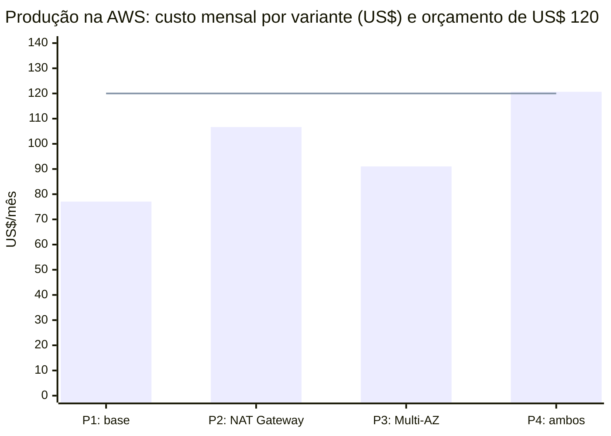
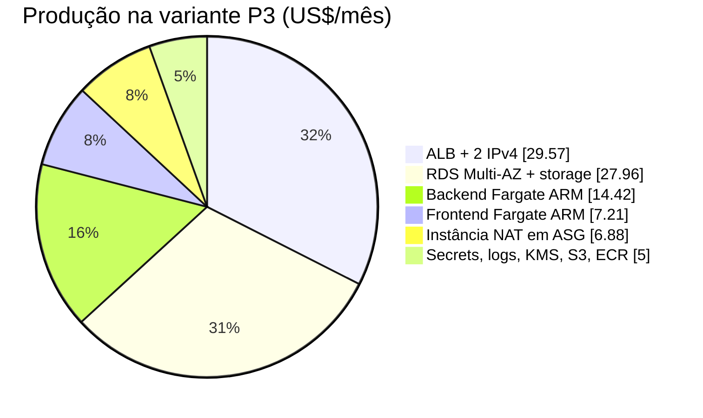
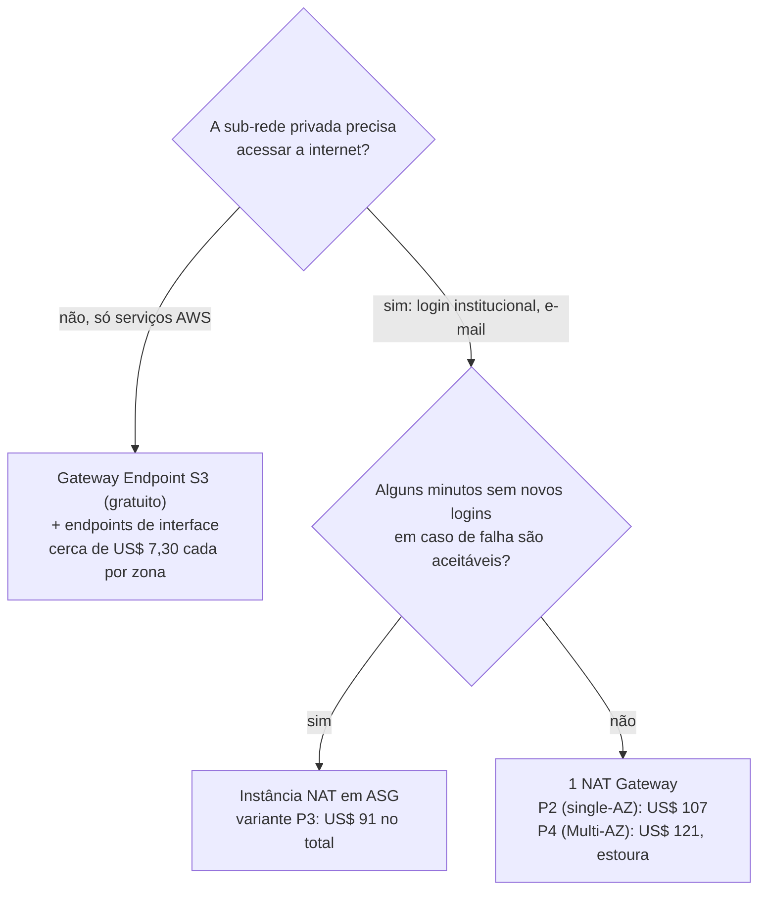

# Custos na AWS e FinOps

**Objetivo.** Explicar como a AWS cobra pelos recursos usados na Plataforma Digital, mostrar como estimar o custo mensal de uma arquitetura e detalhar o cenário adotado pelo projeto, em que **apenas o ambiente de produção existe na AWS**, comparado ao orçamento de US$ 120 por mês definido na POL-INFRA-004. O documento também reúne o custo dos reforços de segurança, as alavancas de redução, os pontos de decisão que ainda afetam o gasto e os controles de FinOps (gestão financeira de recursos de nuvem) recomendados.

**Pré-requisitos de leitura:** [02-conceitos-fundamentais-de-nuvem.md](02-conceitos-fundamentais-de-nuvem.md) e [01-visao-geral-da-plataforma.md](01-visao-geral-da-plataforma.md).

> Os valores deste documento são estimativas para fins de estudo e planejamento. A política de orçamento vigente é a POL-INFRA-004 (`_KB/operations/finops.md`), e as decisões de arquitetura válidas são as registradas nos ADRs da `_KB`. A decisão de manter somente produção na AWS é uma decisão do projeto de 2026-10-07; a decisão está registrada no ADR-012. Em caso de divergência, prevalecem os documentos normativos.

## Sumário

1. [Como a AWS cobra](#1-como-a-aws-cobra)
2. [Premissas desta estimativa](#2-premissas-desta-estimativa)
3. [Preço unitário de cada componente](#3-preço-unitário-de-cada-componente)
4. [Como calcular um item, passo a passo](#4-como-calcular-um-item-passo-a-passo)
5. [Como se chegou à decisão: estimativa inicial](#5-como-se-chegou-à-decisão-estimativa-inicial)
6. [Cenário adotado: somente produção](#6-cenário-adotado-somente-produção)
7. [Custo dos reforços de segurança](#7-custo-dos-reforços-de-segurança)
8. [Alavancas de redução e trade-offs](#8-alavancas-de-redução-e-trade-offs)
9. [Pontos de decisão de arquitetura](#9-pontos-de-decisão-de-arquitetura)
10. [Impacto nas issues de infraestrutura](#10-impacto-nas-issues-de-infraestrutura)
11. [Riscos e controles de FinOps](#11-riscos-e-controles-de-finops)
12. [Como refazer a estimativa](#12-como-refazer-a-estimativa)
13. [Referências e fontes](#13-referências-e-fontes)

---

## 1. Como a AWS cobra

A AWS adota o modelo de pagamento por uso (*pay as you go*): não há mensalidade fixa pela conta, mas cada recurso é cobrado conforme uma ou mais unidades de medida. Entender essas unidades é o primeiro passo para estimar e controlar custos.

| Unidade de cobrança | Como funciona | Exemplos na plataforma |
| --- | --- | --- |
| **Tempo de existência** (hora ou segundo) | O recurso é cobrado enquanto existir, mesmo sem tráfego algum. | NAT Gateway, Application Load Balancer, instância RDS, IPv4 público, VPC Endpoint de interface |
| **Capacidade reservada por tempo** | Cobra-se a quantidade de CPU e memória alocadas, por segundo. | Tasks do ECS Fargate (vCPU-hora e GB-hora) |
| **Volume armazenado** (GB por mês) | Cobra-se o espaço ocupado, proporcional ao tempo. | Storage do RDS, objetos no S3, imagens no ECR, snapshots |
| **Volume processado ou transferido** (por GB) | Cobra-se cada GB que passa pelo serviço ou sai da AWS. | Dados processados pelo NAT Gateway, ingestão de logs no CloudWatch, transferência para a internet |
| **Requisições ou unidades** | Cobra-se por chamada ou por unidade de capacidade consumida. | LCU do ALB, requisições ao S3, chamadas ao Secrets Manager, requisições inspecionadas pelo WAF |
| **Item fixo por mês** | Valor fixo por unidade existente. | Segredo no Secrets Manager, chave KMS, zona do Route 53, web ACL e regras do WAF |

Consequências práticas desse modelo:

- **Recursos parados também custam.** Um NAT Gateway sem nenhum tráfego custa cerca de US$ 33 por mês só por existir. Esse foi o principal motivo para não manter ambientes de desenvolvimento e homologação na AWS.
- **Endereços IPv4 públicos são cobrados desde fevereiro de 2024**, inclusive quando não estão associados a nada. Cada endereço custa US$ 0,005 por hora (cerca de US$ 3,65 por mês). Um ALB distribuído em duas zonas de disponibilidade usa dois endereços.
- **Transferência de dados** para a internet tem uma franquia gratuita mensal (100 GB). A transferência entre zonas de disponibilidade e o processamento em NAT são cobrados à parte e costumam ser esquecidos nas estimativas.
- **Free tier e créditos promocionais não devem entrar no planejamento.** Contas novas recebem créditos por tempo limitado (no momento da consulta, US$ 100 mais até US$ 100 adicionais, válidos por seis meses), e o plano gratuito cobre apenas alguns serviços. O orçamento precisa fechar sem esses benefícios, porque eles expiram antes do fim do projeto ou não se aplicam a todos os serviços.

## 2. Premissas desta estimativa

| Premissa | Valor adotado | Por quê |
| --- | --- | --- |
| Ambientes na AWS | Somente `production`, em uma única conta | Decisão do projeto de 2026-10-07 (ADR-012). `development` e a validação efêmera executam fora da AWS. |
| Região | us-east-1 (Norte da Virgínia) | É a região mais barata e a referência das páginas de preço. A região de São Paulo (sa-east-1) custa cerca de 50% a mais; se houver exigência de dados no Brasil, os números deste documento não se aplicam. |
| Modelo de preço | On-demand | Sem Savings Plans ou instâncias reservadas. Num projeto semestral, compromissos de um ano não compensam. |
| Horas por mês | 730 | Média de horas de um mês (8.760 horas por ano divididas por 12). |
| Tráfego | Baixo, típico de projeto acadêmico | Até 100 GB por mês de saída para a internet são gratuitos. |
| Data dos preços | Consultados em 2026-10-05 | Preços mudam; refaça a estimativa periodicamente (seção 12). |
| Fora do cálculo | Domínio próprio (cerca de US$ 12 por ano) e suporte pago | Itens não decididos ou fora do escopo do orçamento mensal. |

## 3. Preço unitário de cada componente

Valores on-demand em us-east-1. A coluna **US$/mês** considera 730 horas.

| Componente | Preço unitário | US$/mês | Observação |
| --- | --- | ---: | --- |
| NAT Gateway | US$ 0,045/h + US$ 0,045/GB processado | 32,85 + dados | Exige 1 IPv4 público (3,65). No desenho de alta disponibilidade há um por zona de disponibilidade. |
| IPv4 público | US$ 0,005/h por endereço | 3,65 | Cobrado mesmo quando o endereço está parado. |
| Application Load Balancer (ALB) | US$ 0,0225/h + US$ 0,008 por LCU-hora | 16,43 + cerca de 5,84 (1 LCU) | Com 2 IPv4: cerca de 29,57. É o maior item fixo do cenário adotado. |
| VPC Endpoint de interface | US$ 0,01/h por zona + US$ 0,01/GB | 7,30 por endpoint por zona | ECR (2 endpoints), Logs e Secrets Manager em 2 zonas: 8 × 7,30 = 58,40. |
| VPC Endpoint de gateway (S3) | Gratuito | 0,00 | Recomendado sempre. |
| RDS PostgreSQL `db.t4g.micro` single-AZ | US$ 0,016/h | 11,68 | 2 vCPU, 1 GiB. Com 20 GB gp3 (US$ 0,115/GB): 13,98. |
| RDS `db.t4g.micro` Multi-AZ | US$ 0,032/h | 23,36 | Com 20 GB gp3 Multi-AZ (US$ 0,23/GB): 27,96. |
| Fargate x86 | US$ 0,04048 por vCPU-h e US$ 0,004446 por GB-h | 18,02 por task (backend 0,5 vCPU / 1 GB) | Frontend 0,25 vCPU / 0,5 GB: 9,01. |
| Fargate ARM (Graviton) | US$ 0,03238 por vCPU-h e US$ 0,00356 por GB-h | 14,42 por task (backend) | Frontend: 7,21. Cerca de 20% mais barato que x86. |
| Instância NAT (`fck-nat` em EC2 `t4g.nano`) | US$ 0,0042/h + EBS + IPv4 | cerca de 6,88 | Instância única. Em Auto Scaling Group, é substituída automaticamente em caso de falha, sem custo adicional pelo grupo. |
| Secrets Manager | US$ 0,40 por segredo por mês | cerca de 1,20 | Aproximadamente 3 segredos. |
| CloudWatch Logs | US$ 0,50 por GB ingerido | cerca de 1,00 | Logs JSON enxutos, com retenção conforme POL-INFRA-002. |
| KMS (chave gerenciada pelo cliente) | US$ 1,00 por chave por mês | 1,00 por chave | Para state e segredos de produção. |
| S3, ECR, Route 53 | Centavos | cerca de 1,50 | ECR: US$ 0,10/GB. Zona Route 53: US$ 0,50. |
| CloudFront | Faixa gratuita permanente de 1 TB e 10 milhões de requisições por mês | 0,00 | Suficiente para o tráfego previsto. |
| AWS Budgets e Cost Anomaly Detection | Gratuitos | 0,00 | Os dois primeiros budgets da conta são gratuitos. |
| CloudTrail (eventos de gerenciamento) | Primeira cópia gratuita; paga-se o S3 onde os logs ficam | cerca de 0,20 | Cópias adicionais e eventos de dados são cobrados. |
| IAM Access Analyzer (acesso externo) | Gratuito | 0,00 | A análise de acesso não utilizado é paga e não é necessária aqui. |
| GuardDuty | Por volume de eventos analisados; 30 dias de teste gratuito | estimativa de 2 a 4 | Em conta pequena, tende a poucos dólares por mês. Confirme o valor real ao fim do período de teste. |
| AWS WAF | US$ 5 por web ACL + US$ 1 por regra + US$ 0,60 por milhão de requisições | cerca de 8 a 10 | Com uma web ACL e algumas regras gerenciadas básicas. |

> **VPC Endpoints não substituem a saída para a internet.** O login institucional (OIDC) e o envio de e-mail exigem acesso a serviços externos à AWS. Com endpoints de interface, paga-se cerca de US$ 58 por mês e ainda é necessário um NAT.

Os termos NAT, ALB, LCU, zona de disponibilidade, Multi-AZ e Graviton estão definidos em [02-conceitos-fundamentais-de-nuvem.md](02-conceitos-fundamentais-de-nuvem.md) e em [11-glossario.md](11-glossario.md).

## 4. Como calcular um item, passo a passo

A fórmula geral para recursos cobrados por tempo é:

```text
custo mensal = preço por hora × quantidade alocada × horas no mês
```

### Exemplo 1: task Fargate ARM do backend (0,5 vCPU e 1 GB)

O Fargate cobra separadamente CPU e memória.

```text
CPU:      0,03238 US$/vCPU-h × 0,5 vCPU × 730 h = 11,82 US$
Memória:  0,00356 US$/GB-h   × 1,0 GB   × 730 h =  2,60 US$
Total por task                                  = 14,42 US$/mês
```

Para a mesma task em x86, o resultado seria 18,02 US$/mês. A diferença de cerca de 20% é o motivo da alavanca "Fargate ARM" (seção 8). Se a aplicação precisar de 2 GB de memória, o acréscimo é de 0,00356 × 1 × 730 = 2,60 US$/mês por task.

### Exemplo 2: NAT Gateway com 20 GB processados no mês

O NAT Gateway combina três parcelas: tempo de existência, dados processados e o IPv4 público que ele exige.

```text
Tempo:    0,045 US$/h  × 730 h  = 32,85 US$
IPv4:     0,005 US$/h  × 730 h  =  3,65 US$
Dados:    0,045 US$/GB × 20 GB  =  0,90 US$
Total                           = 37,40 US$/mês
```

Note que a parcela de dados é pequena; quase todo o custo vem do simples fato de o recurso existir. Dois NAT Gateways (um por zona de disponibilidade) dobram o valor fixo.

### Exemplo 3: ALB com duas zonas de disponibilidade

```text
Tempo:     0,0225 US$/h        × 730 h = 16,43 US$
1 LCU:     0,008  US$/LCU-h    × 730 h =  5,84 US$
2 IPv4:    2 × 0,005 US$/h     × 730 h =  7,30 US$
Total                                  = 29,57 US$/mês
```

### Exemplo 4: recurso temporário (ensaio de restore)

Recursos que existem só por algumas horas custam proporcionalmente. No ensaio de restore (INF-016), um snapshot é restaurado em uma instância temporária dentro da conta de produção, validado e destruído. Supondo uma instância single-AZ `db.t4g.micro` existindo por 4 horas:

```text
Instância:  0,016 US$/h × 4 h            = 0,064 US$
Storage:    20 GB × 0,115 US$/GB-mês × (4 / 730) ≈ 0,013 US$
Total                                    ≈ 0,08 US$ por ensaio
```

O custo do ensaio é desprezível. O risco está em **esquecer** a instância criada: ligada o mês inteiro, ela custaria 13,98 US$. Por isso o procedimento de restore termina com a remoção explícita da instância e uma verificação no console ou na CLI.

## 5. Como se chegou à decisão: estimativa inicial

Antes da decisão de 2026-10-07, foram estimados três desenhos que mantinham um ambiente de homologação (staging) na AWS. Eles ficam aqui como contexto histórico, porque explicam por que o projeto optou por manter somente produção na nuvem.

| Cenário | Descrição | Produção | Staging | Total/mês | Em relação a US$ 120 |
| --- | --- | ---: | ---: | ---: | ---: |
| A | Alta disponibilidade completa (2 NAT Gateways, RDS Multi-AZ, 2 tasks x86 por serviço) e staging sempre ligado | 189,59 | 147,58 | 337,17 | +181% |
| B | Otimizado, mantendo os ADRs literalmente (1 NAT Gateway, RDS Multi-AZ, Fargate ARM) e staging sempre ligado com instância NAT | 120,66 | 76,06 | 196,72 | +64% |
| C | Ajustado ao orçamento, com staging efêmero (cerca de 25% do mês), instância NAT e RDS single-AZ | 77,06 | 20,02 | 97,08 | −19% |

Conclusões que levaram à decisão:

- Mesmo no cenário B, **somente a produção já consumia todo o orçamento**; qualquer ambiente adicional na AWS exigia cortar redundância da produção.
- No cenário C, o staging efêmero cabia no orçamento, mas exigia operar workflows de criação e remoção, restaurar snapshots e agendar janelas de teste, e ainda assim consumia folga que poderia financiar alta disponibilidade e segurança em produção.
- O papel de homologação pode ser cumprido por um **ambiente de validação efêmero dentro do próprio job do GitHub Actions** (Docker Compose com a imagem construída, PostgreSQL 16 e MiniStack), com custo AWS zero. Os limites desse modelo estão descritos em [05-laboratorio-local-ministack.md](05-laboratorio-local-ministack.md) e em [08-cicd-no-plano-free-do-github.md](08-cicd-no-plano-free-do-github.md).

## 6. Cenário adotado: somente produção

Com apenas a produção na AWS, todo o orçamento de US$ 120 fica disponível para um único ambiente. A base de cálculo é a produção do antigo cenário C: um ALB compartilhado entre frontend e API, Fargate ARM com uma task por serviço (autoscaling até duas), RDS `db.t4g.micro` e saída para a internet por instância NAT.

### Variantes

| Variante | Mudança em relação à base | Total/mês | % do orçamento | Folga |
| --- | --- | ---: | ---: | ---: |
| P1 | Base: instância NAT (`fck-nat`), RDS single-AZ | 77,06 | 64% | 42,94 |
| P2 | NAT Gateway no lugar da instância NAT | 106,68 | 89% | 13,32 |
| **P3 (recomendada)** | RDS Multi-AZ no lugar do single-AZ; instância NAT em Auto Scaling Group com recuperação automática | **91,04** | **76%** | **28,96** |
| P4 | NAT Gateway e RDS Multi-AZ | 120,66 | 101% | −0,66 (estoura) |



### Composição de cada variante

| Item | P1 | P2 | P3 | P4 |
| --- | ---: | ---: | ---: | ---: |
| Saída para a internet | Instância NAT 6,88 | NAT Gateway + IPv4 36,50 | Instância NAT em ASG 6,88 | NAT Gateway + IPv4 36,50 |
| ALB (com 2 IPv4) | 29,57 | 29,57 | 29,57 | 29,57 |
| RDS `db.t4g.micro` + 20 GB gp3 | single-AZ 13,98 | single-AZ 13,98 | Multi-AZ 27,96 | Multi-AZ 27,96 |
| Backend Fargate ARM (1 task, até 2) | 14,42 | 14,42 | 14,42 | 14,42 |
| Frontend Fargate ARM (1 task, até 2) | 7,21 | 7,21 | 7,21 | 7,21 |
| Secrets, logs, KMS, S3, ECR | 5,00 | 5,00 | 5,00 | 5,00 |
| **Total** | **77,06** | **106,68** | **91,04** | **120,66** |

### Por que a variante P3 é a recomendada

1. **Atende ao texto do ADR-002.** As consequências do ADR-002 descrevem "uma única instância RDS Multi-AZ". Com somente produção na AWS, o orçamento comporta o Multi-AZ, sem necessidade de aceite de risco por divergência do ADR.
2. **Protege o ativo mais difícil de recuperar.** O banco guarda os dados dos usuários. Com Multi-AZ, a falha de uma zona de disponibilidade provoca um failover automático de um a dois minutos, em vez de uma restauração de snapshot que pode levar de dezenas de minutos a horas e perder os dados gravados desde o último backup.
3. **A falha da instância NAT tem impacto limitado e recuperação automática.** A instância NAT só é usada para tráfego de **saída** das sub-redes privadas. Se ela falhar, as requisições dos usuários continuam chegando ao ALB e à aplicação, mas as chamadas que a API faz a serviços externos à AWS deixam de funcionar: a troca de código e a validação de token com o provedor de login institucional (o que impede **novos logins** enquanto durar a falha) e o envio de e-mails. Usuários já autenticados continuam navegando. Com a instância em um Auto Scaling Group de tamanho fixo igual a 1, uma instância defeituosa é substituída automaticamente em poucos minutos, sem custo adicional pelo grupo.
4. **Mantém folga de cerca de 24%.** Os US$ 28,96 restantes absorvem os reforços de segurança essenciais (seção 7), transferência de dados, volume extra de logs e o custo dos testes de carga.

A variante P2 troca essa proteção do banco por uma saída para a internet gerenciada e redundante dentro da zona; é uma escolha válida se a disponibilidade do login for considerada mais crítica do que a do banco. A variante P4 não cabe no orçamento.

**Composição da produção na variante P3 (US$ 91,04 por mês):**



## 7. Custo dos reforços de segurança

O documento [13-seguranca-da-infraestrutura.md](13-seguranca-da-infraestrutura.md) descreve os controles de segurança recomendados. A tabela abaixo estima o custo mensal dos que têm cobrança direta. Os valores de GuardDuty e WAF dependem do volume real e **não foram reconferidos**; confirme na calculadora e, no caso do GuardDuty, ao fim do período de teste de 30 dias.

| Controle | Prioridade | US$/mês (estimativa) |
| --- | --- | ---: |
| CloudTrail: trilha multi-região de eventos de gerenciamento, logs em bucket S3 dedicado | Essencial | 0,20 |
| IAM Access Analyzer (acesso externo) | Essencial | 0,00 |
| GuardDuty | Essencial | 3,00 |
| Chave KMS adicional (separar state/segredos dos dados do RDS) | Recomendado | 1,00 |
| **Subtotal dos essenciais e recomendados** | | **4,20** |
| AWS WAF na frente do CloudFront ou do ALB (1 web ACL, 4 regras, cerca de 1 milhão de requisições) | Opcional | 9,60 |

| Composição | Total/mês | % do orçamento | Folga |
| --- | ---: | ---: | ---: |
| P3 | 91,04 | 76% | 28,96 |
| P3 + reforços essenciais e recomendados | cerca de 95,24 | 79% | cerca de 24,76 |
| P3 + reforços + WAF | cerca de 104,84 | 87% | cerca de 15,16 |

Outros controles da lista de segurança, como VPC Flow Logs apenas de tráfego rejeitado com retenção curta e alarmes no CloudWatch (US$ 0,10 por alarme por mês), custam centavos e cabem na folga. A folga restante deve cobrir transferência de dados acima da franquia, crescimento de logs, créditos de CPU do RDS durante testes de carga e imprevistos.

## 8. Alavancas de redução e trade-offs

Cada alavanca reduz o custo em troca de alguma perda. As duas primeiras linhas já estão adotadas pela decisão de 2026-10-07.

| Alavanca | Economia/mês | O que se perde | Situação |
| --- | ---: | --- | --- |
| Ambiente development fora da AWS | US$ 75 a 150 (um ambiente inteiro) | Pouco: o desenvolvimento usa Docker Compose e emulador local | Adotada |
| Homologação em validação efêmera no CI em vez de staging na AWS | US$ 20 (efêmero) a US$ 76 (sempre ligado) | Testes de comportamento específico da AWS (IAM real, rede real, autoscaling) só acontecem em produção; ver seção 11 | Adotada |
| Instância NAT em vez de NAT Gateway | cerca de US$ 30 | Instância operada pela própria equipe; se falhar, a aplicação perde a saída para a internet por alguns minutos (o tráfego de entrada continua) | Recomendada (P3) |
| RDS single-AZ em vez de Multi-AZ | cerca de US$ 14 | Falha de uma zona de disponibilidade causa indisponibilidade de minutos a horas, até a restauração | Não recomendada com somente produção (P3 mantém Multi-AZ) |
| Fargate ARM (Graviton) | cerca de 20% do custo de computação | Imagens precisam ser `arm64` ou multiarquitetura (Temurin e Node.js já oferecem) | Recomendada |
| Uma task com autoscaling em vez de duas fixas | cerca de US$ 22 | Alguns segundos de indisponibilidade durante deploy ou falha de task | Recomendada; o *circuit breaker* cobre o rollback |
| ALB compartilhado entre frontend e API | cerca de US$ 30 | Nada relevante: o roteamento é feito por caminho ou host | Recomendada |
| API Gateway HTTP com VPC Link no lugar do ALB | até cerca de US$ 29 | Limite de 30 segundos por requisição, configuração e health check mais complexos | Não recomendada no momento |
| VPC Endpoints de interface | **Aumenta** cerca de US$ 58 | Não se aplica | Desfavorável; usar apenas o Gateway Endpoint do S3, que é gratuito |
| Dispensar o WAF | cerca de US$ 9,60 | Proteção contra padrões comuns de ataque web e limitação de taxa na borda | Decisão em aberto (seção 9) |

## 9. Pontos de decisão de arquitetura

### Decisões já tomadas

| Decisão | Resultado | Registro |
| --- | --- | --- |
| Ambientes na AWS | Somente produção, em uma conta dedicada | Decisão do projeto de 2026-10-07; ADR-012 |
| Abrangência do orçamento de US$ 120 | Cobre a conta de produção | Atualização proposta da POL-INFRA-004 |
| Ambiente development | Local (Docker Compose e MiniStack) | ADR-012 |
| Homologação | Validação efêmera dentro do job de CI | ADR-012; INF-009 |

### Decisões em aberto

Estas decisões afetam o custo e devem ser tomadas antes da implementação dos itens de rede, banco e runtime (INF-002, INF-005, INF-007). Alterar NAT, Multi-AZ ou dimensionamento depois gera retrabalho e, no caso do banco, pode exigir janela de indisponibilidade. Cada decisão deve ser registrada em ADR ou na issue correspondente.

| # | Decisão | Opções | Prós e contras | Onde registrar |
| --- | --- | --- | --- | --- |
| 1 | Saída para a internet das sub-redes privadas | NAT Gateway; instância NAT em ASG; somente endpoints | NAT Gateway é gerenciado e redundante dentro da zona, mas custa cerca de US$ 30 a mais. Instância NAT é barata e se recupera sozinha em ASG, com alguns minutos de interrupção. Endpoints não atendem serviços externos. | INF-002 |
| 2 | RDS Multi-AZ em produção | Multi-AZ; single-AZ com restauração testada | Multi-AZ tolera falha de uma zona, ao dobro do preço da instância, e atende ao texto do ADR-002. Single-AZ depende do tempo de restauração medido no INF-016. | INF-005 e ADR-002 |
| 3 | AWS WAF | Usar regras gerenciadas na borda; não usar | Protege contra ataques web comuns e permite limitar taxa por IP, por cerca de US$ 10 por mês. Sem ele, a proteção fica restrita à aplicação e ao Security Group. | Issue proposta de segurança (ver [13](13-seguranca-da-infraestrutura.md)) |
| 4 | GuardDuty | Ativar; não ativar | Detecção gerenciada de comportamento suspeito na conta (credenciais usadas de locais incomuns, mineração de criptomoeda, acesso anômalo ao S3) por poucos dólares por mês. | Issue proposta de segurança |
| 5 | Arquitetura de CPU dos containers | x86; ARM | ARM é cerca de 20% mais barato e exige imagens compatíveis no backend e no frontend. | INF-006 e INF-007 |

O fluxo abaixo resume a decisão 1.



## 10. Impacto nas issues de infraestrutura

Com a variante P3 adotada, as issues são afetadas da seguinte forma (ver [06-backlog-de-infraestrutura.md](06-backlog-de-infraestrutura.md)):

| Issue | O que muda |
| --- | --- |
| INF-001 (state) | Um único bucket de state, o de produção, com KMS. Não há state de non-production na AWS. |
| INF-002 (rede) | Somente a VPC de produção (10.30.0.0/16). Instância NAT em Auto Scaling Group; Gateway Endpoint do S3; sem endpoints de interface. |
| INF-005 (RDS) | `db.t4g.micro` Multi-AZ, 20 GB gp3 com crescimento automático até 50 GB. |
| INF-006, INF-007, INF-011 | Imagens `arm64`, `runtime_platform { cpu_architecture = "ARM64" }` e ALB único com regras por caminho. |
| INF-009 | Deixa de criar staging na AWS: passa a ser a validação efêmera no CI e o deploy contínuo em produção no período anterior ao go-live. Sem custo AWS; consome minutos do GitHub Actions. |
| INF-014 (budget) | Budget de US$ 120 na conta de produção, com alertas de 50/80/100%, alerta de previsão em 100%, Cost Anomaly Detection e tags de custo ativadas. |
| INF-015 e INF-016 | O armazenamento de backups automáticos até o tamanho do banco não é cobrado. O restore é ensaiado em instância temporária dentro da conta de produção, removida ao final (exemplo 4 da seção 4). |
| INF-017 (autoscaling) | `max_capacity = 2` por serviço, funcionando como teto explícito de custo. O teste de carga acontece em produção antes do go-live. |
| QA-024 e QA-026 (k6, ZAP) | Versões reduzidas rodam na validação efêmera; o teste de carga completo a 200 requisições por segundo roda em produção antes do go-live, consumindo LCU do ALB e créditos de CPU. |
| Backend e Frontend | Builds `linux/arm64` no pipeline, com o estágio de compilação em `FROM --platform=$BUILDPLATFORM` para não compilar sob emulação. |

## 11. Riscos e controles de FinOps

### Riscos

- **Minutos do GitHub Actions.** No plano Free com repositórios privados, a **organização inteira** tem 2.000 minutos por mês de runners Linux hospedados. A validação efêmera torna o CI mais pesado. Estimativa por execução de um repositório de aplicação: build da imagem (5 a 8 min), subida do Docker Compose e migrations (2 min), smoke e E2E (5 min), DAST de referência com ZAP (3 min) e k6 reduzido (2 min), totalizando cerca de **15 minutos**. Um mês com 60 execuções em PR, 30 em `main` e 40 planos de infraestrutura de cerca de 5 minutos consome aproximadamente 900 + 450 + 200 = **1.550 minutos**, perto do limite. Quando os minutos acabam e o limite de gastos da organização é zero, os workflows de repositórios privados deixam de executar até o mês seguinte. Mitigações:
  - filtros de `paths` para não executar o pipeline em mudanças que não afetam o código;
  - `concurrency` com `cancel-in-progress: true` em PRs, para cancelar execuções obsoletas;
  - cache de dependências (Maven, npm) e de camadas Docker;
  - validação completa apenas em PR marcado como pronto para revisão e na `main`; em rascunhos, só build e testes unitários;
  - acompanhamento semanal do consumo em Settings → Billing da organização.
- **Teste de carga em produção.** Antes do go-live, o teste de carga do INF-017 e do QA-024 roda na conta de produção. A 200 requisições por segundo, o ALB consome mais LCU e as tasks escalam até duas por serviço; o RDS `db.t4g.micro`, que é uma instância *burstable* (com créditos de CPU), pode gerar cobrança extra de US$ 0,075 por vCPU-hora no modo *unlimited* se ficar muito tempo acima da linha de base. Defina duração curta para o teste, acompanhe a métrica `CPUCreditBalance` e registre o custo do teste. Depois do go-live, testes de carga só em janela controlada e comunicada.
- **Capacidade do `db.t4g.micro` (1 GiB de RAM).** Comporta cerca de 100 conexões. O pool de conexões por task multiplicado pelo número máximo de tasks precisa caber nesse limite (DB-019).
- **Memória do backend.** Uma aplicação Spring Boot com 1 GB pode ficar no limite. Passar para 2 GB custa cerca de US$ 2,60 a mais por task por mês (ARM).
- **Dados processados pelo NAT.** Baixar imagens do ECR pelo NAT gera tráfego processado. O Gateway Endpoint do S3 reduz esse custo, porque as camadas das imagens do ECR são armazenadas no S3; imagens menores também ajudam.
- **Recursos temporários esquecidos.** Instâncias de restore, tasks de teste ou recursos criados manualmente e não removidos. Mitigação: procedimentos que terminam com remoção explícita, tags padrão obrigatórias (`default_tags`) e relatório periódico de recursos sem a tag `ManagedBy=terraform`.

### Controles recomendados

| Controle | O que faz | Custo |
| --- | --- | --- |
| Cost allocation tags | Ativar as tags `Project`, `Environment` e `Squad` no Billing da conta de produção. Sem isso, o Cost Explorer não separa o gasto por componente ou finalidade. | Gratuito |
| AWS Budgets | Orçamento mensal de US$ 120 na conta de produção, com alertas de 50%, 80% e 100% do gasto real e 100% do previsto, enviados ao canal da equipe (INF-014). | Gratuito (dois primeiros) |
| Cost Anomaly Detection | Detecta automaticamente gastos fora do padrão histórico. | Gratuito |
| Estimativa no pull request | Ferramentas como `infracost` calculam a diferença de custo de cada alteração Terraform e a publicam no PR. | Gratuito na versão de linha de comando |
| Revisão periódica | Revisão rápida no Cost Explorer e do consumo de minutos do GitHub Actions a cada revisão de sprint. | Sem custo |

A POL-INFRA-004 estabelece que os alertas de orçamento **não disparam desligamento destrutivo automático**: desvios são investigados pela equipe, que propõe a redução adequada.

## 12. Como refazer a estimativa

Preços e necessidades mudam. Para refazer ou validar estes números:

1. Acesse a [AWS Pricing Calculator](https://calculator.aws/) e crie uma estimativa na região us-east-1.
2. Crie um grupo para a produção e, se quiser comparar variantes, um grupo por variante (P1 a P4).
3. Inclua cada componente da seção 3 com a mesma configuração (tipo de instância, vCPU, memória, horas por mês).
4. Não esqueça os itens cobrados por existência: IPv4 públicos, NAT e endpoints de interface; e os reforços de segurança da seção 7.
5. Salve a estimativa, gere o link público e anexe-o às issues afetadas (INF-002, INF-005, INF-007, INF-014).
6. Após o primeiro mês de uso real e após os testes de carga, compare a estimativa com o Cost Explorer e ajuste as premissas. Faça o mesmo com o consumo de minutos do GitHub Actions.

## 13. Referências e fontes

**Documentos da governança**

- POL-INFRA-004, FinOps: `_KB/operations/finops.md`
- POL-INFRA-002, Observabilidade (retenção de logs): `_KB/engineering/observability.md`
- POL-INFRA-003, Infraestrutura (backup): `_KB/operations/infrastructure.md`
- ADR-002 `_KB/architecture/adrs/ADR-002-postgresql-schema-isolation.md`
- ADR-004 `_KB/architecture/adrs/ADR-004-aws-ecs-fargate-platform.md`
- ADR-011 `_KB/architecture/adrs/ADR-011-environment-isolation.md`
- ADR-012, somente produção na AWS: `_KB/architecture/adrs/ADR-012-production-only-aws.md`

**Fontes de preço (consultadas em 2026-10-05)**

- [AWS Fargate pricing](https://aws.amazon.com/fargate/pricing/): preço por segundo; a conversão para hora foi feita neste documento.
- [Amazon VPC pricing](https://aws.amazon.com/vpc/pricing/): NAT Gateway e IPv4 público.
- [AWS PrivateLink pricing](https://aws.amazon.com/privatelink/pricing/): endpoints de interface.
- [Elastic Load Balancing pricing](https://aws.amazon.com/elasticloadbalancing/pricing/): ALB e LCU.
- [Amazon RDS for PostgreSQL pricing](https://aws.amazon.com/rds/postgresql/pricing/): storage gp3 e créditos de CPU.
- [db.t4g.micro (Vantage)](https://instances.vantage.sh/aws/rds/db.t4g.micro): preço por hora da instância. A leitura automática da página da AWS apresentou inconsistência; confirme na calculadora.
- [AWS Free Tier](https://aws.amazon.com/free/): créditos de conta nova.
- [Amazon GuardDuty pricing](https://aws.amazon.com/guardduty/pricing/): cobrança por volume de eventos e período de teste.
- [AWS WAF pricing](https://aws.amazon.com/waf/pricing/): web ACL, regras e requisições.
- [AWS CloudTrail pricing](https://aws.amazon.com/cloudtrail/pricing/): primeira cópia gratuita dos eventos de gerenciamento.
- [About billing for GitHub Actions](https://docs.github.com/en/billing/managing-billing-for-your-products/managing-billing-for-github-actions/about-billing-for-github-actions): minutos incluídos por plano e limite de gastos.
- Itens de centavos (Secrets Manager, KMS, CloudWatch Logs, Route 53, ECR, `t4g.nano`, faixa gratuita do CloudFront) e as estimativas de GuardDuty e WAF: **não reconferidos** nesta rodada. Valide na calculadora.

**Documentos relacionados deste material:** [06-backlog-de-infraestrutura.md](06-backlog-de-infraestrutura.md), [10-diagramas.md](10-diagramas.md), [11-glossario.md](11-glossario.md), [13-seguranca-da-infraestrutura.md](13-seguranca-da-infraestrutura.md).
