# Diagramas

**Objetivo.** Reunir em um único documento os diagramas da infraestrutura da Plataforma Digital, para consulta visual rápida. Cada diagrama tem uma breve explicação e indica o documento em que o assunto é aprofundado.

**Pré-requisitos de leitura:** [01 Visão geral da plataforma](01-visao-geral-da-plataforma.md). Os termos usados estão no [11 Glossário](11-glossario.md).

Os diagramas usam Mermaid e são renderizados pelo GitHub, pelo VS Code (pré-visualização de Markdown) e pelo Obsidian. Para exportar um diagrama como imagem, copie o bloco para [mermaid.live](https://mermaid.live).

Todos os diagramas refletem a decisão do projeto de 2026-10-07: **apenas o ambiente de produção existe na AWS**. A decisão está registrada no ADR-012.

## Sumário

1. [Repositórios e suas relações](#1-repositórios-e-suas-relações)
2. [Arquitetura na AWS](#2-arquitetura-na-aws)
3. [Rede: sub-redes e security groups](#3-rede-sub-redes-e-security-groups)
4. [Ambientes](#4-ambientes)
5. [Ambiente de validação efêmera](#5-ambiente-de-validação-efêmera)
6. [Pipeline de entrega](#6-pipeline-de-entrega)
7. [OIDC: autenticação do pipeline na AWS](#7-oidc-autenticação-do-pipeline-na-aws)
8. [Ciclo de trabalho do Terraform](#8-ciclo-de-trabalho-do-terraform)
9. [State remoto, lock e bootstrap](#9-state-remoto-lock-e-bootstrap)
10. [Estrutura do repositório de infraestrutura](#10-estrutura-do-repositório-de-infraestrutura)
11. [Estados de uma issue](#11-estados-de-uma-issue)
12. [Fluxo de um PR de infraestrutura](#12-fluxo-de-um-pr-de-infraestrutura)
13. [Dependências entre as issues de infraestrutura](#13-dependências-entre-as-issues-de-infraestrutura)
14. [Sequência das sprints](#14-sequência-das-sprints)
15. [Integração com as outras equipes](#15-integração-com-as-outras-equipes)
16. [Custos](#16-custos)
17. [Laboratório local](#17-laboratório-local)

---

## 1. Repositórios e suas relações

O repositório de governança define as regras. Os demais as seguem, fixando a versão por tag e SHA (ADR-006, ADR-008). A infraestrutura recebe as imagens e as migrations dos outros repositórios e fornece à equipe de qualidade o ambiente de validação efêmera e, até o go-live, a conta de produção para os testes que exigem a AWS real. O repositório `plataforma-release`, ainda não criado, concentra o deploy em produção.

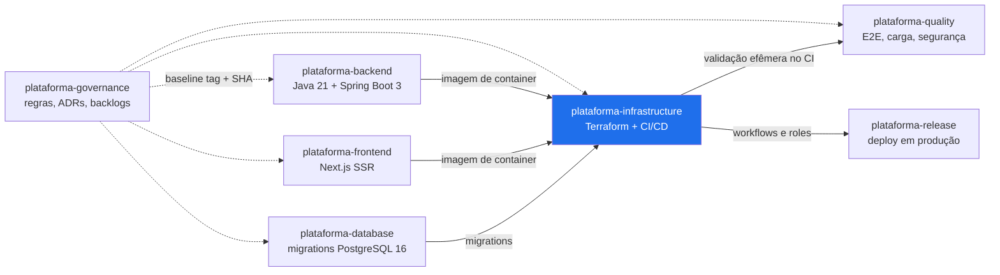

Aprofundamento: [01 Visão geral](01-visao-geral-da-plataforma.md#2-os-repositórios).

## 2. Arquitetura na AWS

A arquitetura alvo, conforme ADR-002, ADR-004, ADR-010 e a arquitetura de segurança. Ela existe em uma única conta AWS, dedicada à produção.

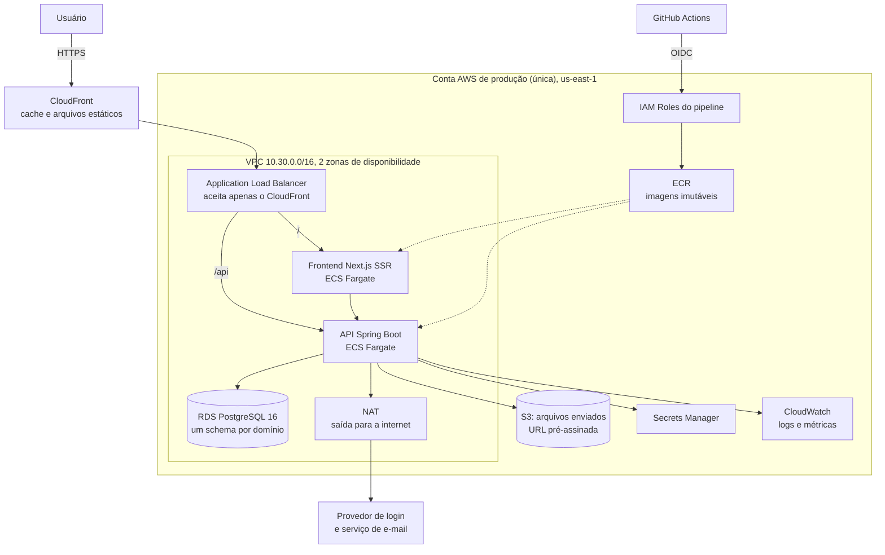

O serviço que executa o SSR do frontend ainda está em detalhamento (INF-011, ADR-010). O diagrama mostra a alternativa ECS Fargate, que segue o mesmo padrão da API. A restrição do ALB ao CloudFront é um dos reforços descritos em [13 Segurança da infraestrutura](13-seguranca-da-infraestrutura.md).

Aprofundamento: [01 Visão geral](01-visao-geral-da-plataforma.md#4-arquitetura-alvo-na-aws) e [02 Conceitos fundamentais](02-conceitos-fundamentais-de-nuvem.md).

## 3. Rede: sub-redes e security groups

Cada camada só aceita tráfego da camada imediatamente anterior (INF-002). O módulo `modules/network` do laboratório implementa este desenho.

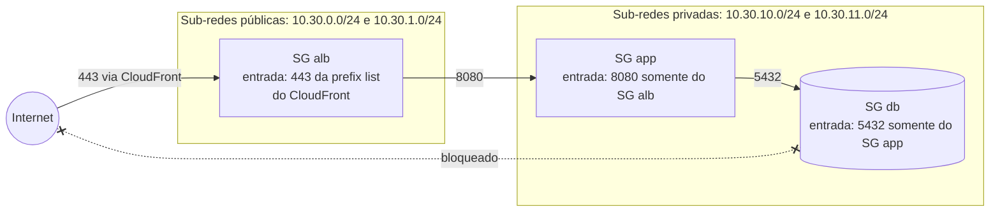

Os endereços mostrados são os de produção. No laboratório, o mesmo módulo usa `10.10.x.x` (development). A faixa `10.20.0.0/16` fica reservada para um eventual staging na AWS.

Aprofundamento: [02 Conceitos fundamentais](02-conceitos-fundamentais-de-nuvem.md) e [13 Segurança da infraestrutura](13-seguranca-da-infraestrutura.md).

## 4. Ambientes

Apenas produção existe na AWS. O desenvolvimento acontece na máquina de cada pessoa, e a validação que caberia a um staging acontece em um ambiente efêmero dentro do CI.

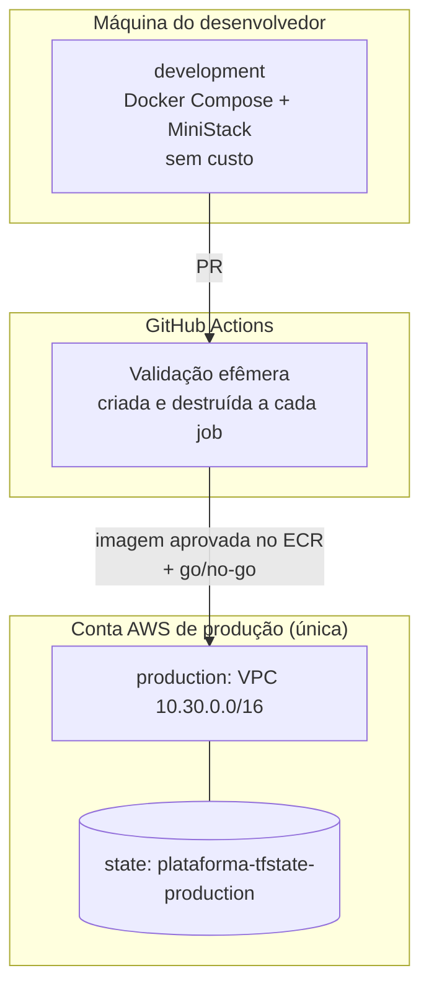

**Período pré-go-live.** Até o go-live (INF-019), a conta de produção ainda não tem usuários nem dados reais e recebe os testes que exigem a AWS real: carga a 200 RPS (INF-017), ensaio de rollback (INF-018) e primeiro ensaio de restore (INF-016). Depois do go-live, esses testes só acontecem em janela controlada, e o restore é feito em instância temporária dentro da própria conta.

Aprofundamento: [01 Visão geral](01-visao-geral-da-plataforma.md#7-ambientes).

## 5. Ambiente de validação efêmera

O ambiente é montado com Docker Compose dentro do runner do GitHub Actions e descartado ao final do job. Não usa dados reais nem credenciais da AWS.

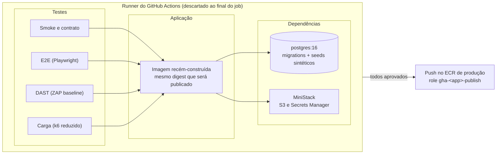

Nos PRs de infraestrutura, o mesmo runner também executa um `terraform apply` completo contra o MiniStack antes do `plan` contra produção.

Aprofundamento: [05 Laboratório local](05-laboratorio-local-ministack.md#15-o-laboratório-no-modelo-somente-produção-na-aws).

## 6. Pipeline de entrega

A mesma imagem, identificada pelo mesmo digest, vai da validação efêmera até produção (POL-INFRA-001). O deploy em produção é disparado no repositório `plataforma-release`.

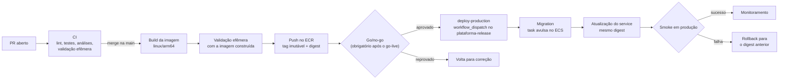

Aprofundamento: [08 CI/CD no plano Free](08-cicd-no-plano-free-do-github.md).

## 7. OIDC: autenticação do pipeline na AWS

Nenhuma chave de acesso fica guardada no GitHub. Cada credencial é temporária e vale apenas para a role autorizada (INF-004). Todas as roles ficam na conta de produção: `gha-infra-plan`, `gha-infra-apply`, `gha-backend-publish`, `gha-frontend-publish` e `gha-release-deploy`.

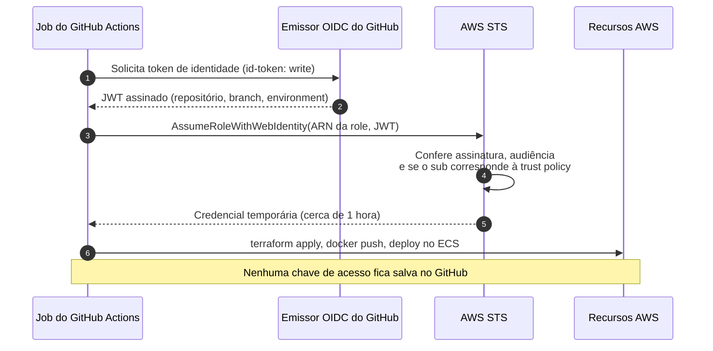

Aprofundamento: [07 OIDC](07-oidc-github-actions-aws.md).

## 8. Ciclo de trabalho do Terraform

O código descreve o estado desejado. O `plan` compara esse estado com o state e com a infraestrutura real, e uma pessoa revisa a diferença antes do `apply`.

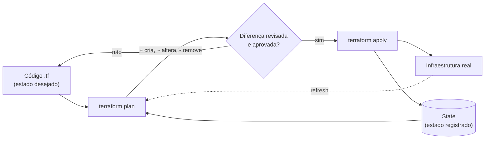

Sequência de comandos: `init`, `fmt`, `validate`, `plan`, `apply` e, no laboratório, `destroy`.

Aprofundamento: [03 Terraform: fundamentos](03-terraform-fundamentos.md).

## 9. State remoto, lock e bootstrap

Duas execuções não conseguem alterar o mesmo state ao mesmo tempo (INF-001). O comportamento foi testado no laboratório.

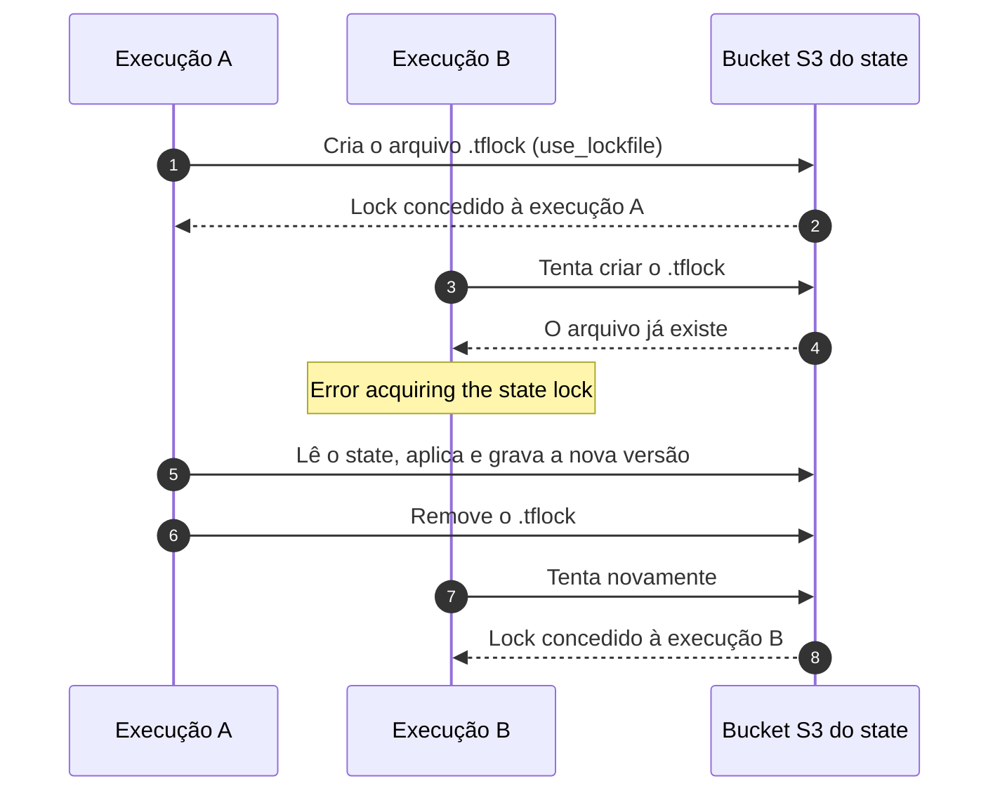

O bucket que guarda o state não pode guardar o próprio state. Por isso ele é criado uma única vez por um diretório separado, o `bootstrap/`, que usa state local. Na AWS existe um único bucket de state, o de produção; no laboratório, o bucket equivalente é `plataforma-tfstate-development`.

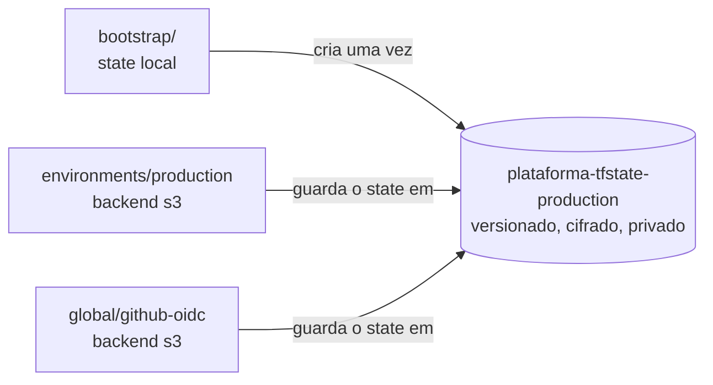

## 10. Estrutura do repositório de infraestrutura

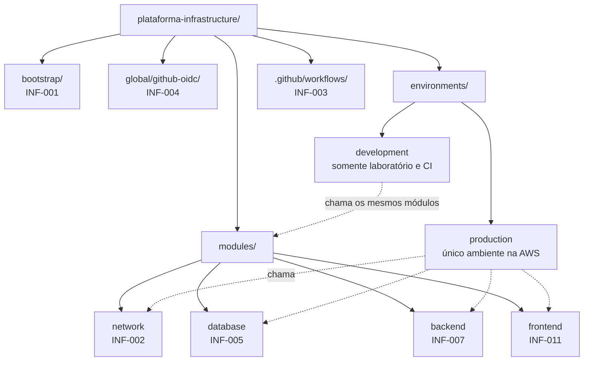

Os módulos funcionam como funções reutilizáveis; cada diretório em `environments/` é um ponto de entrada (root module) que chama os módulos com os valores daquele ambiente. Não existe `environments/staging/`.

Aprofundamento: [03 Terraform: fundamentos](03-terraform-fundamentos.md) e [04 Padrões e fluxo de trabalho](04-padroes-e-fluxo-de-trabalho.md).

## 11. Estados de uma issue

Os estados do GitHub Project (POL-GOV-007).

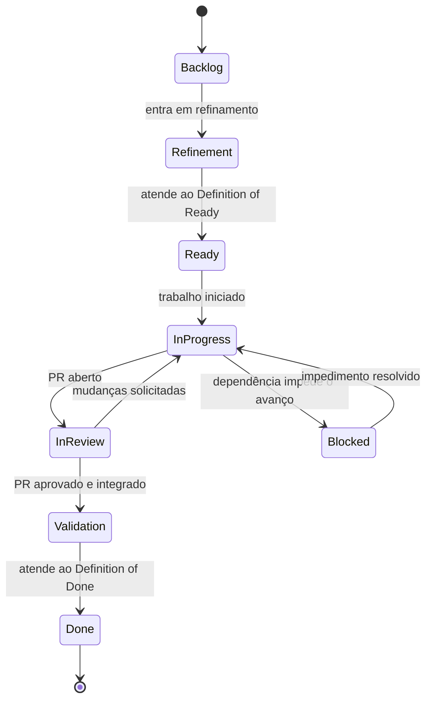

Aprofundamento: [04 Padrões e fluxo de trabalho](04-padroes-e-fluxo-de-trabalho.md).

## 12. Fluxo de um PR de infraestrutura

No PR, o código é aplicado no emulador e comparado com produção. O `apply` em produção só acontece depois do merge.

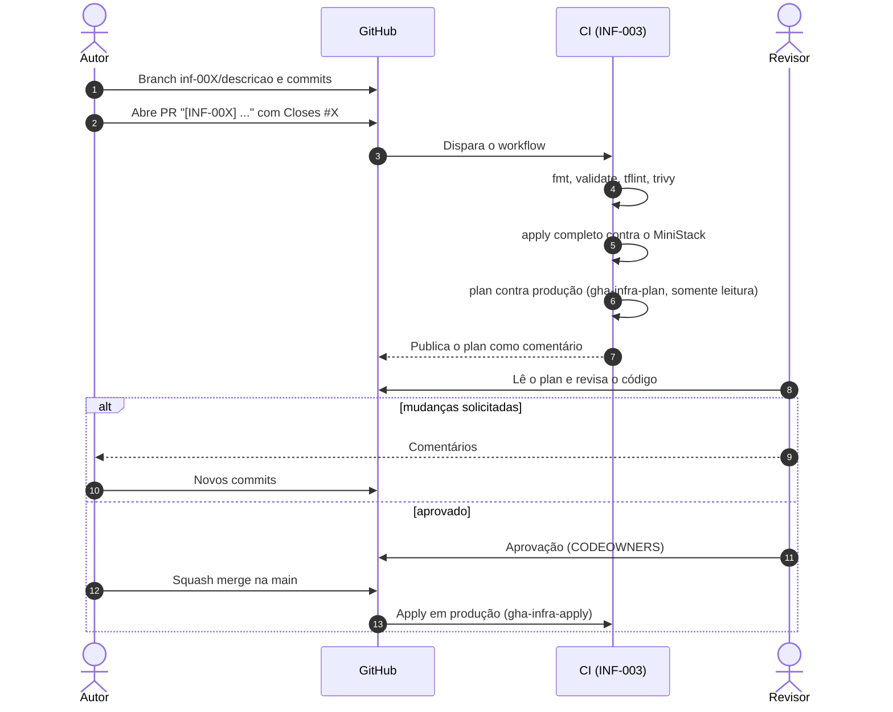

Depois do go-live, recomenda-se que o apply em produção seja disparado manualmente (`workflow_dispatch` na `main`) logo após o merge, para que alguém acompanhe a execução.

## 13. Dependências entre as issues de infraestrutura

Cada seta indica que a issue de destino depende da issue de origem. O caminho crítico vai da conta AWS de produção até o INF-009 (validação efêmera e publicação de imagens), destacado em azul.

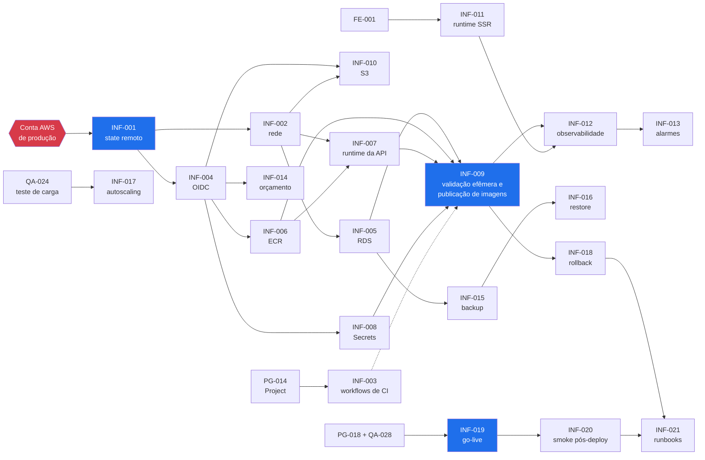

Aprofundamento: [06 Backlog de infraestrutura](06-backlog-de-infraestrutura.md).

## 14. Sequência das sprints

As sprints têm cadência quinzenal. O diagrama mostra apenas a ordem; as datas oficiais ficam no GitHub Project. A sprint S4 não contém issues de infraestrutura. Todas as sprints anteriores à S6 pertencem ao período pré-go-live.

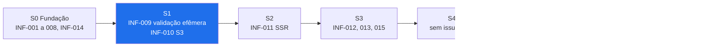

## 15. Integração com as outras equipes

À esquerda, o que a infraestrutura recebe de cada equipe; à direita, o que entrega.

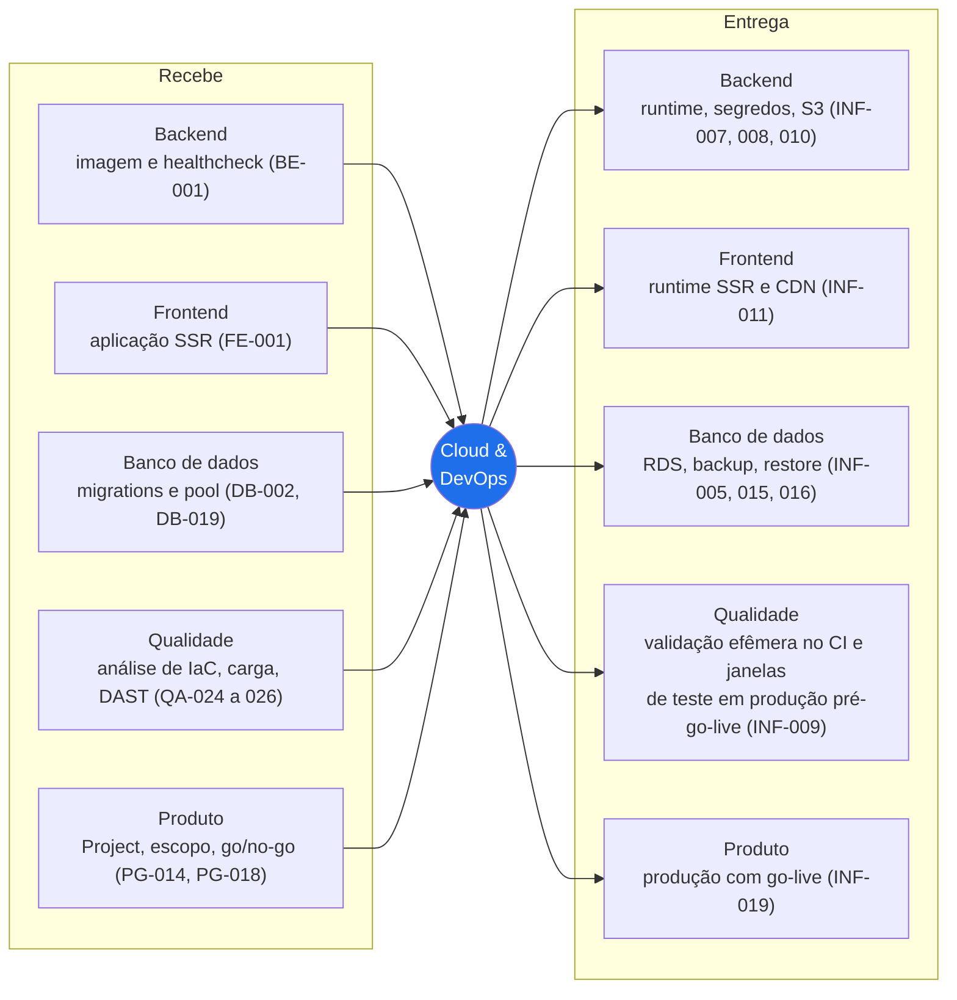

## 16. Custos

Valores mensais estimados em us-east-1, preços on-demand consultados em 2026-10-05. Como apenas produção existe na AWS, todo o orçamento de US$ 120 cobre esse ambiente. As variantes estão descritas em [09 Custos e FinOps](09-custos-e-finops.md).

**Custo mensal de produção por variante comparado ao orçamento de US$ 120:**

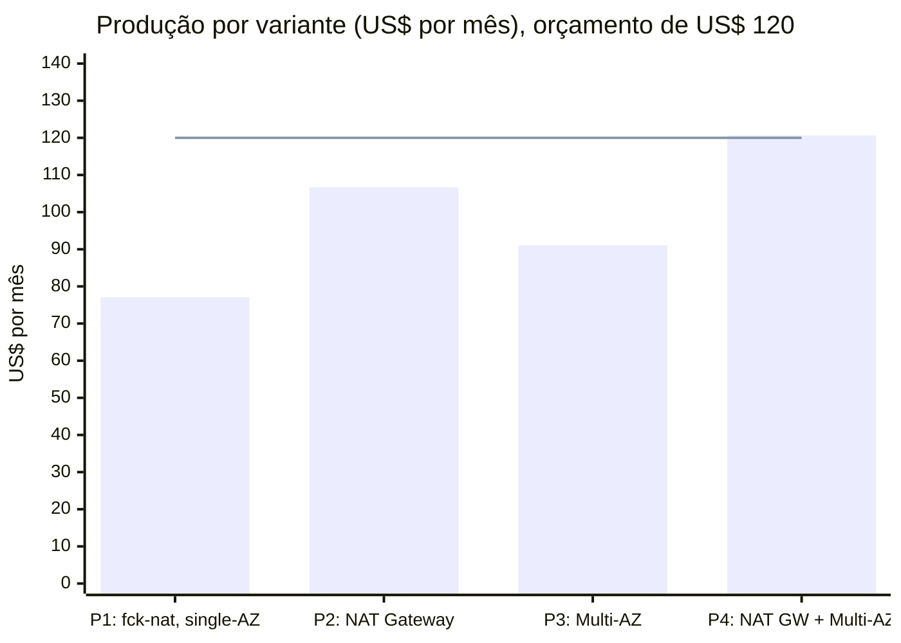

**Composição do custo da variante P3 (recomendada, US$ 91,04 por mês):**

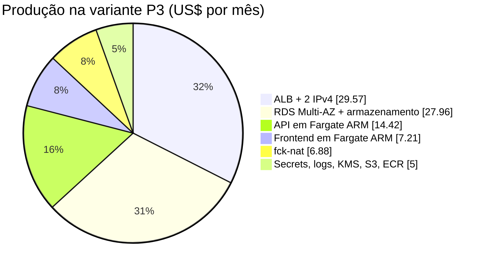

Somando os reforços de segurança essenciais, a estimativa da P3 fica em cerca de US$ 95 por mês, ou cerca de US$ 105 com AWS WAF ([13 Segurança da infraestrutura](13-seguranca-da-infraestrutura.md)).

**Escolha da saída para a internet das sub-redes privadas de produção:**

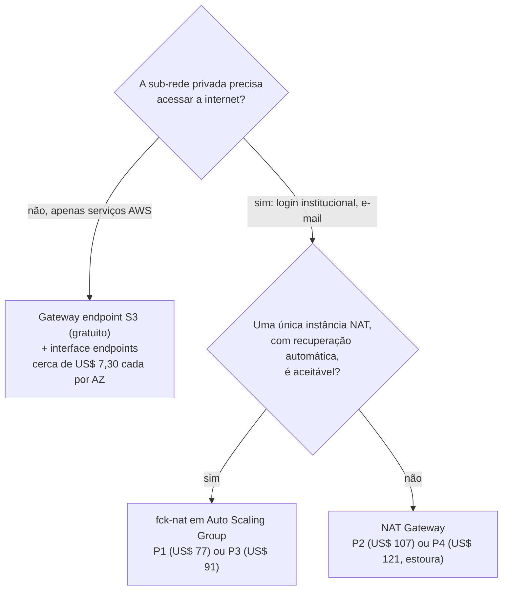

## 17. Laboratório local

O laboratório substitui a AWS por um emulador que executa em container no computador do desenvolvedor. A mesma base é usada no ambiente de validação efêmera do CI.

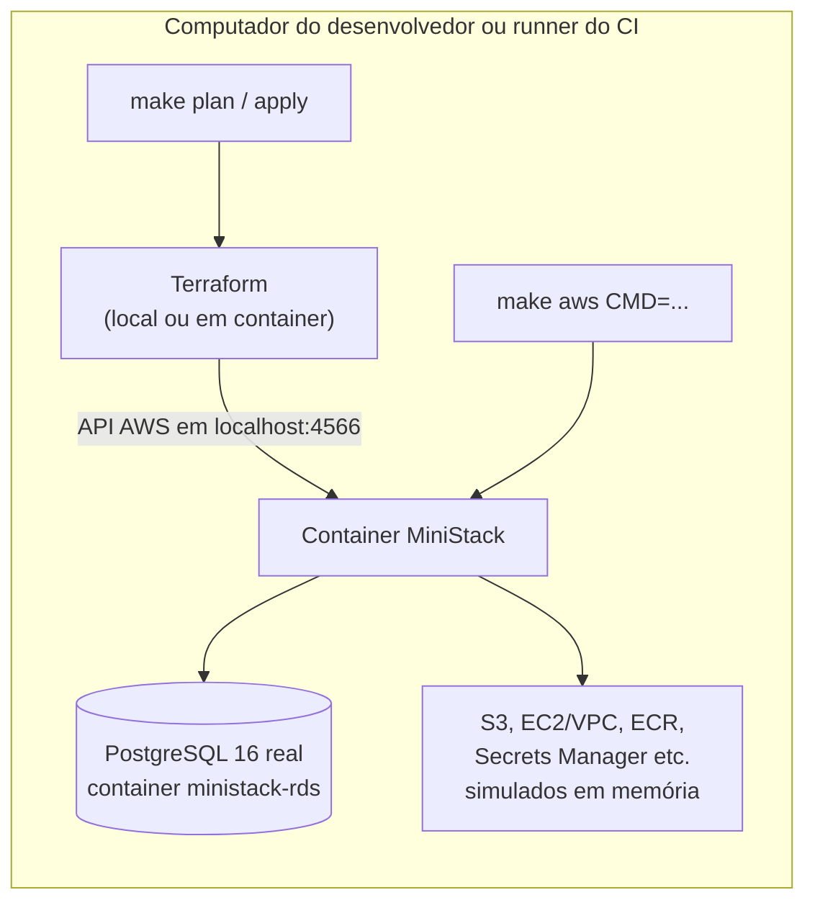

Limites do emulador: as permissões IAM só são avaliadas com `AUTH=true` e, mesmo assim, sem verificar a chave secreta nem a assinatura de tokens; alguns atributos não são guardados; não há custo real. O emulador valida a estrutura do código; o comportamento real só é comprovado na conta de produção, preferencialmente no período pré-go-live.

Aprofundamento: [05 Laboratório local com MiniStack](05-laboratorio-local-ministack.md).
