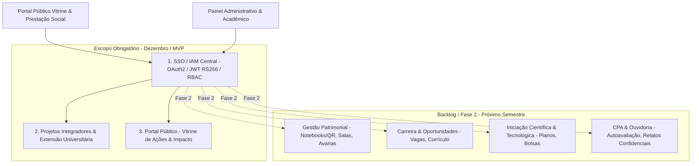

---
title: "Escopo Geral e Fronteiras do Sistema"
domain: "product"
status: "accepted"
owner: "Fellipe Raszejas / Luciano Jr"
last_updated: "2026-08-27"
---

# 📦 Escopo Geral & Fronteiras do Sistema

## 1. Visão Geral das Fronteiras do Sistema

A plataforma delimita de forma transparente o que pertence ao **Escopo Obrigatório com entrega em Dezembro (MVP)** e o que compõe o **Backlog / Fase 2 (Próximo Semestre)**.

---

## 2. Delimitação Estrita do Escopo

### 🎯 Escopo Obrigatório — Dezembro (Semestre Atual / MVP):
1. **Autenticação & Autorização Central (SSO/IAM):**
   * Central unificada de autenticação para todos os módulos.
   * Gestão de usuários, perfis e níveis de acesso (Aluno, Docente, Coordenação, CPA, Administrador).
   * Sessões seguras e Single Sign-On via JWT (RS256) e OAuth2.
2. **Projetos Integradores & Extensão Universitária:**
   * **Captação de Projetos:** Submissão e validação de propostas de projetos integradores e de extensão (incluindo modelos híbridos).
   * **Gestão de Equipes/Alunos:** Alocação de estudantes em projetos com acompanhamento de status.
   * **Avaliação Docente:** Módulo para avaliação de desempenho e entregas por professores avaliadores com rubricas.
   * **Cálculo de Horas:** Apuração e controle automatizado de horas de extensão para cumprimento curricular (Resolução CNE).
   * **Cálculo de Notas:** Consolidação e lançamento automatizado de notas e médias para Projetos Integradores.
   * **Certificação Digital:** Emissão de certificados em PDF com hash SHA-256 e validação pública.
3. **Portal Público (Vitrine de Ações):**
   * Website público responsivo contendo o catálogo de projetos de extensão e integradores desenvolvidos.
   * Divulgação do impacto das ações na comunidade e módulo de prestação de contas social.
   * Busca facetada por curso/ODS e página pública individual dos projetos.

---

### ⏳ Backlog / Fase 2 (Postergado para o Próximo Semestre):
* **Gestão Patrimonial:** Inventário de notebooks com QR Code, check-in/check-out de empréstimos, agendamento de salas fora do horário e registro de avarias/ocorrências.
* **Carreira & Oportunidades:** Banco de currículos de alunos, mural de vagas de estágio/trainee e candidaturas simplificadas.
* **Iniciação Científica & Tecnológica (IC & IT):** Editais de bolsas, submissão de planos de trabalho e relatórios de pesquisa.
* **CPA & Ouvidoria Institucional:** Questionários periódicos de autoavaliação, avaliação da cantina e canal confidencial de relatos a docentes/coordenação.

---

## 3. Documentos Relacionados
* [Delimitação do MVP](mvp-baseline.md)
* [Módulos do Sistema](modules.md)
* [Roadmap do Projeto](../archive/legacy-2026-09-09/02-planning/roadmap.md)
* [Backlog Geral](../../BACKLOG_BY_TEAM.md)
